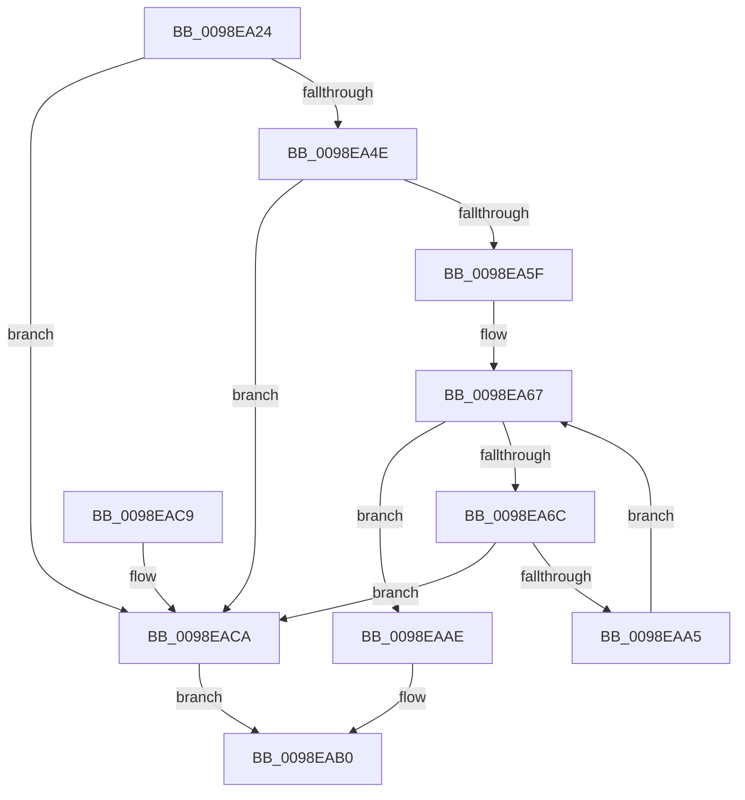

# RtlpInternEntryMatch

- RVA: `0x0098EA24`–`0x0098EACE` (길이 `170` bytes)
- VA: `0x000000014098EA24`
- 실행 섹션: `PAGE`
- PDB 이름 있음: `예`; PDB Function 태그: `아니요`
- unwind 정보 RVA: `0x00098958`
- 디코드: `54`개 명령, `170/170` bytes 표시
- 미해석 바이트: `0` (있으면 어셈블리에 `.byte`로 보존)

> 이 문서는 커널 이미지의 기계어와 PDB 기호를 분석해 생성했습니다. 4번과 5번은 함수 원형과 자료형을 바이너리 사용 방식에서 추정한 C 해석이며 원본 소스 복구 결과는 아닙니다.

## 1. Dependencies

- 직접 호출 지점: **1**; 고유 호출 대상: **1**
- 직접 호출자로 확인된 함수: **1**
- RIP 상대 이미지 참조: **0**

### Outgoing calls
- `0x0098EA9C` → [memcmp](../../text/6C/memcmp_function_006C6B10.md) (function, `0x006C6B10`)

### Direct callers
- [RtlpInternEntryFind](RtlpInternEntryFind_function_0098F28C.md) at `0x0098F377`

### Static image references
- 디코드된 RIP-relative 메모리 참조가 없습니다.

## 2. Other-region calls and transfers

- 다른 실행 섹션으로 향하는 call: **1**
  - `0x0098EA9C` → [memcmp](../../text/6C/memcmp_function_006C6B10.md) (`PAGE` → `.text`)
- 별도 외부 분기/꼬리 이동을 확인하지 못했습니다.

## 3. Assembly (complete function range)

```asm
0098EA24  48 89 5C 24 08                  mov qword ptr [rsp + 8], rbx
0098EA29  48 89 6C 24 10                  mov qword ptr [rsp + 0x10], rbp
0098EA2E  48 89 74 24 18                  mov qword ptr [rsp + 0x18], rsi
0098EA33  57                              push rdi
0098EA34  41 56                           push r14
0098EA36  41 57                           push r15
0098EA38  48 83 EC 20                     sub rsp, 0x20
0098EA3C  48 8B 41 18                     mov rax, qword ptr [rcx + 0x18]
0098EA40  48 8B EA                        mov rbp, rdx
0098EA43  0F B7 D8                        movzx ebx, ax
0098EA46  4C 8B F1                        mov r14, rcx
0098EA49  48 39 1A                        cmp qword ptr [rdx], rbx
0098EA4C  75 7C                           jne 0x14098eaca
0098EA4E  48 C1 E8 10                     shr rax, 0x10
0098EA52  25 FF FF FF 3F                  and eax, 0x3fffffff
0098EA57  48 03 C3                        add rax, rbx
0098EA5A  4C 3B C0                        cmp r8, rax
0098EA5D  75 6B                           jne 0x14098eaca
0098EA5F  4C 8B 7A 10                     mov r15, qword ptr [rdx + 0x10]
0098EA63  33 FF                           xor edi, edi
0098EA65  33 F6                           xor esi, esi
0098EA67  49 3B FF                        cmp rdi, r15
0098EA6A  73 42                           jae 0x14098eaae
0098EA6C  4C 8B 4D 08                     mov r9, qword ptr [rbp + 8]
0098EA70  4A 8B 54 0E 18                  mov rdx, qword ptr [rsi + r9 + 0x18]
0098EA75  4E 8B 44 0E 10                  mov r8, qword ptr [rsi + r9 + 0x10]
0098EA7A  48 8D 4A FF                     lea rcx, [rdx - 1]
0098EA7E  48 03 CB                        add rcx, rbx
0098EA81  48 8D 42 FF                     lea rax, [rdx - 1]
0098EA85  48 23 C8                        and rcx, rax
0098EA88  48 2B D1                        sub rdx, rcx
0098EA8B  48 FF CA                        dec rdx
0098EA8E  48 03 DA                        add rbx, rdx
0098EA91  4A 8B 14 0E                     mov rdx, qword ptr [rsi + r9]
0098EA95  4A 8D 0C 33                     lea rcx, [rbx + r14]
0098EA99  49 03 D8                        add rbx, r8
0098EA9C  E8 6F 80 D3 FF                  call 0x1406c6b10
0098EAA1  85 C0                           test eax, eax
0098EAA3  75 25                           jne 0x14098eaca
0098EAA5  48 FF C7                        inc rdi
0098EAA8  48 83 C6 20                     add rsi, 0x20
0098EAAC  EB B9                           jmp 0x14098ea67
0098EAAE  B0 01                           mov al, 1
0098EAB0  48 8B 5C 24 40                  mov rbx, qword ptr [rsp + 0x40]
0098EAB5  48 8B 6C 24 48                  mov rbp, qword ptr [rsp + 0x48]
0098EABA  48 8B 74 24 50                  mov rsi, qword ptr [rsp + 0x50]
0098EABF  48 83 C4 20                     add rsp, 0x20
0098EAC3  41 5F                           pop r15
0098EAC5  41 5E                           pop r14
0098EAC7  5F                              pop rdi
0098EAC8  C3                              ret
0098EAC9  CC                              int3
0098EACA  32 C0                           xor al, al
0098EACC  EB E2                           jmp 0x14098eab0
```

## 4. C-style interpretation (structured pseudocode)

```c
__int64 __fastcall RtlpInternEntryMatch(__int64 a1, __int64 a2, __int64 a3)
{
    __int64 result;
    __int64 v_rbx;
    __int64 v_rdi;
    __int64 v_rsi;
    __int64 v_rsp;
    unsigned __int64 v_stack_p10;
    unsigned __int64 v_stack_p18;
    unsigned __int64 v_stack_p8;

    v_stack_p8 = v_rbx;
    v_stack_p10 = v_rbp;
    v_stack_p18 = v_rsi;
    v_rsp = (v_rsp) - (32);
    if ((*(unsigned __int64 *)(a2)) != ((unsigned __int16)(*(unsigned __int64 *)(a1 + 24)))) goto loc_0098EACA;
    result = (*(unsigned __int64 *)(a1 + 24)) >> (16);
    result = (unsigned int)((result) & (0x3FFFFFFFULL));
    result = (result) + ((unsigned __int16)(*(unsigned __int64 *)(a1 + 24)));
    if (a3 != result) goto loc_0098EACA;
    v_rdi = 0;
    v_rsi = 0;
loc_0098EA67:
    if (0 >= (*(unsigned __int64 *)(a2 + 16))) goto loc_0098EAAE;
    a1 = (*(unsigned __int64 *)(v_rsi + *(unsigned __int64 *)(a2 + 8) * 1 + 24) - 1) + ((unsigned __int16)(*(unsigned __int64 *)(a1 + 24)));
    a1 = (a1) & (*(unsigned __int64 *)(v_rsi + *(unsigned __int64 *)(a2 + 8) * 1 + 24) - 1);
    a2 = (*(unsigned __int64 *)(v_rsi + *(unsigned __int64 *)(a2 + 8) * 1 + 24)) - (a1);
    a2 = (a2) - 1;
    v_rbx = ((unsigned __int16)(*(unsigned __int64 *)(a1 + 24))) + (a2);
    v_rbx = (v_rbx) + (*(unsigned __int64 *)(v_rsi + *(unsigned __int64 *)(a2 + 8) * 1 + 16));
    result = memcmp(v_rbx + a1 * 1, *(unsigned __int64 *)(v_rsi + *(unsigned __int64 *)(a2 + 8) * 1), *(unsigned __int64 *)(v_rsi + *(unsigned __int64 *)(a2 + 8) * 1 + 16), *(unsigned __int64 *)(a2 + 8));
    if ((unsigned int)(result) != 0) goto loc_0098EACA;
    v_rdi = (v_rdi) + 1;
    v_rsi = (v_rsi) + (32);
    goto loc_0098EA67;
loc_0098EAAE:
loc_0098EAB0:
    v_rsp = (v_rsp) + (32);
    return 1;
loc_0098EACA:
    result = 0;
    goto loc_0098EAB0;
}
```

## 5. (Beta) C Style

```c
int64_t RtlpInternEntryMatch(void *Arg1, void *Arg2, int64_t Arg3)
{
    uint8_t *arg1 = (uint8_t *)Arg1;
    uint8_t *arg2 = (uint8_t *)Arg2;

    int64_t result;
    int64_t local_rbx;
    int64_t local_rdi;
    int64_t local_rsi;
    int64_t local_rsp;
    uint64_t v_stack_p10;
    uint64_t v_stack_p18;
    uint64_t v_stack_p8;

    v_stack_p8 = local_rbx;
    v_stack_p10 = local_rbp;
    v_stack_p18 = local_rsi;
    local_rsp = (local_rsp) - (32);
    if ((*(uint64_t *)(arg2)) != ((uint16_t)(*(uint64_t *)(arg1 + 0x18)))) goto loc_0098EACA;
    result = (*(uint64_t *)(arg1 + 0x18)) >> (16);
    result = (uint32_t)((result) & (0x3FFFFFFFULL));
    result = (result) + ((uint16_t)(*(uint64_t *)(arg1 + 0x18)));
    if (Arg3 != result) goto loc_0098EACA;
    local_rdi = 0;
    local_rsi = 0;
loc_0098EA67:
    if (0 >= (*(uint64_t *)(arg2 + 0x10))) goto loc_0098EAAE;
    Arg1 = (*(uint64_t *)(local_rsi + *(uint64_t *)(arg2 + 0x8) * 1 + 0x18) - 1) + ((uint16_t)(*(uint64_t *)(arg1 + 0x18)));
    Arg1 = (Arg1) & (*(uint64_t *)(local_rsi + *(uint64_t *)(arg2 + 0x8) * 1 + 0x18) - 1);
    Arg2 = (*(uint64_t *)(local_rsi + *(uint64_t *)(arg2 + 0x8) * 1 + 0x18)) - (Arg1);
    Arg2 = (Arg2) - 1;
    local_rbx = ((uint16_t)(*(uint64_t *)(arg1 + 0x18))) + (Arg2);
    local_rbx = (local_rbx) + (*(uint64_t *)(local_rsi + *(uint64_t *)(arg2 + 0x8) * 1 + 0x10));
    result = memcmp(local_rbx + Arg1 * 1, *(uint64_t *)(local_rsi + *(uint64_t *)(arg2 + 0x8) * 1), *(uint64_t *)(local_rsi + *(uint64_t *)(arg2 + 0x8) * 1 + 0x10), *(uint64_t *)(arg2 + 0x8));
    if ((uint32_t)(result) != 0) goto loc_0098EACA;
    local_rdi = (local_rdi) + 1;
    local_rsi = (local_rsi) + (32);
    goto loc_0098EA67;
loc_0098EAAE:
loc_0098EAB0:
    local_rsp = (local_rsp) + (32);
    return 1;
loc_0098EACA:
    result = 0;
    goto loc_0098EAB0;
}
```

### 관측된 메모리 오프셋

구조체 형식이 확인되지 않은 접근은 인자 기준의 오프셋으로만 기록했습니다.

| 기준 인자 | 오프셋 표현 | 폭 (bit) | 접근 |
|---|---:|---:|---|
| `Arg1` | `+ 0x18` | `64` | `R` |
| `Arg2` | `+ 0x0` | `64` | `R` |
| `Arg2` | `+ 0x8` | `64` | `R` |
| `Arg2` | `+ 0x10` | `64` | `R` |

## 6. Execution-region graph

[열기: 2D/3D 그래프와 함수 탐색 컨트롤 패널](../../../control-panel.html?section=page&rva=0x0098EA24&view=graph)

- 2D 그래프는 위에서 아래로 흐르고, 3D 그래프는 빈 공간을 드래그해 회전합니다. Shift+드래그는 이동, 휠은 확대·축소, 함수 노드 선택은 대상 보고서 이동입니다.

### Static fallback


