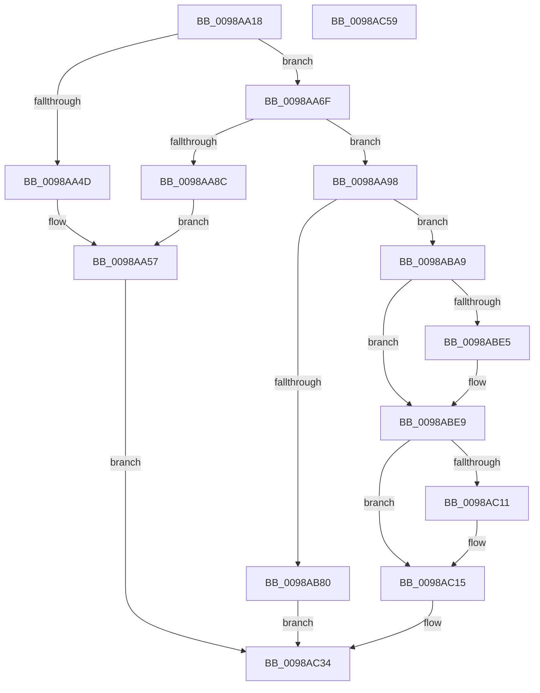

# TtmInitCurrentSession

- RVA: `0x0098AA18`–`0x0098AC5A` (길이 `578` bytes)
- VA: `0x000000014098AA18`
- 실행 섹션: `PAGE`
- PDB 이름 있음: `예`; PDB Function 태그: `아니요`
- unwind 정보 RVA: `0x0008A658`
- 디코드: `129`개 명령, `578/578` bytes 표시
- 미해석 바이트: `0` (있으면 어셈블리에 `.byte`로 보존)

> 이 문서는 커널 이미지의 기계어와 PDB 기호를 분석해 생성했습니다. 4번과 5번은 함수 원형과 자료형을 바이너리 사용 방식에서 추정한 C 해석이며 원본 소스 복구 결과는 아닙니다.

## 1. Dependencies

- 직접 호출 지점: **15**; 고유 호출 대상: **13**
- 직접 호출자로 확인된 함수: **1**
- RIP 상대 이미지 참조: **8**

### Outgoing calls
- `0x0098AA22` → [TtmiLogInitCurrentSessionStart](TtmiLogInitCurrentSessionStart_function_0098AC60.md) (function, `0x0098AC60`)
- `0x0098AA37` → [PsGetProcessSessionIdEx](../../text/22/PsGetProcessSessionIdEx_function_0022F8F0.md) (function, `0x0022F8F0`)
- `0x0098AA3E` → [TtmpAcquireSessionLock](../70/TtmpAcquireSessionLock_function_00700408.md) (function, `0x00700408`)
- `0x0098AA65` → [TtmiLogError](TtmiLogError_function_0098B39C.md) (function, `0x0098B39C`)
- `0x0098AA7F` → [ExAllocatePool2](../../poolcode/B8/ExAllocatePool2_function_00B820F0.md) (function, `0x00B820F0`)
- `0x0098AB1F` → [TtmiLogSessionDeviceAssignmentPolicySet](../77/TtmiLogSessionDeviceAssignmentPolicySet_function_0077AF9C.md) (function, `0x0077AF9C`)
- `0x0098AB75` → [TtmiCreateTerminal](../77/TtmiCreateTerminal_function_0077C748.md) (function, `0x0077C748`)
- `0x0098AB92` → [TtmiLogError](TtmiLogError_function_0098B39C.md) (function, `0x0098B39C`)
- `0x0098AB9F` → [ExFreePoolWithTag](../../poolcode/B8/ExFreePoolWithTag_function_00B82870.md) (function, `0x00B82870`)
- `0x0098ABB1` → [TtmiUpdateActiveTerminalCount](../77/TtmiUpdateActiveTerminalCount_function_007774C4.md) (function, `0x007774C4`)
- `0x0098ABDC` → [PoRegisterPowerSettingCallback](../A8/PoRegisterPowerSettingCallback_function_00A82150.md) (function, `0x00A82150`)
- `0x0098AC08` → [PoRegisterPowerSettingCallback](../A8/PoRegisterPowerSettingCallback_function_00A82150.md) (function, `0x00A82150`)
- `0x0098AC3B` → [ExReleaseResourceLite](../../text/25/ExReleaseResourceLite_function_0025FA10.md) (function, `0x0025FA10`)
- `0x0098AC40` → [KeLeaveCriticalRegion](../../text/25/KeLeaveCriticalRegion_function_0025D8B0.md) (function, `0x0025D8B0`)
- `0x0098AC47` → [TtmiLogInitCurrentSessionStop](TtmiLogInitCurrentSessionStop_function_0098B598.md) (function, `0x0098B598`)

### Direct callers
- [NtPowerInformation](../95/NtPowerInformation_function_00955D80.md) at `0x00956EB3`

### Static image references
- `0x0098AA43` → RVA `0x00FD9B90` (`PAGEDATA`; read)
- `0x0098AA5B` → RVA `0x00B041A0` (` ?? ::NNGAKEGL::`string'`; read)
- `0x0098AB2B` → RVA `0x00777F60` (`TtmpSessionWorker`; read)
- `0x0098ABCC` → RVA `0x00778250` (`TtmpTerminal0PowerSettingCallback`; read)
- `0x0098ABD5` → RVA `0x0001C368` (`.rdata`; read)
- `0x0098ABFF` → RVA `0x00011AB8` (`.rdata`; read)
- `0x0098AC2D` → RVA `0x00FD9B90` (`PAGEDATA`; write)
- `0x0098AC34` → RVA `0x00F06940` (`.data`; read)

## 2. Other-region calls and transfers

- 다른 실행 섹션으로 향하는 call: **5**
  - `0x0098AA37` → [PsGetProcessSessionIdEx](../../text/22/PsGetProcessSessionIdEx_function_0022F8F0.md) (`PAGE` → `.text`)
  - `0x0098AA7F` → [ExAllocatePool2](../../poolcode/B8/ExAllocatePool2_function_00B820F0.md) (`PAGE` → `POOLCODE`)
  - `0x0098AB9F` → [ExFreePoolWithTag](../../poolcode/B8/ExFreePoolWithTag_function_00B82870.md) (`PAGE` → `POOLCODE`)
  - `0x0098AC3B` → [ExReleaseResourceLite](../../text/25/ExReleaseResourceLite_function_0025FA10.md) (`PAGE` → `.text`)
  - `0x0098AC40` → [KeLeaveCriticalRegion](../../text/25/KeLeaveCriticalRegion_function_0025D8B0.md) (`PAGE` → `.text`)
- 별도 외부 분기/꼬리 이동을 확인하지 못했습니다.

## 3. Assembly (complete function range)

```asm
0098AA18  48 89 5C 24 10                  mov qword ptr [rsp + 0x10], rbx
0098AA1D  57                              push rdi
0098AA1E  48 83 EC 30                     sub rsp, 0x30
0098AA22  E8 39 02 00 00                  call 0x14098ac60
0098AA27  65 48 8B 0C 25 88 01 00 00      mov rcx, qword ptr gs:[0x188]
0098AA30  48 8B 89 B8 00 00 00            mov rcx, qword ptr [rcx + 0xb8]
0098AA37  E8 B4 4E 8A FF                  call 0x14022f8f0
0098AA3C  8B F8                           mov edi, eax
0098AA3E  E8 C5 59 D7 FF                  call 0x140700408
0098AA43  48 83 3D 45 F1 64 00 00         cmp qword ptr [rip + 0x64f145], 0
0098AA4B  74 22                           je 0x14098aa6f
0098AA4D  BF BB 00 00 C0                  mov edi, 0xc00000bb
0098AA52  BA B9 04 00 00                  mov edx, 0x4b9
0098AA57  41 83 C8 FF                     or r8d, 0xffffffff
0098AA5B  48 8D 0D 3E 97 17 00            lea rcx, [rip + 0x17973e]
0098AA62  44 8B CF                        mov r9d, edi
0098AA65  E8 32 09 00 00                  call 0x14098b39c
0098AA6A  E9 C5 01 00 00                  jmp 0x14098ac34
0098AA6F  BA 20 01 00 00                  mov edx, 0x120
0098AA74  B9 40 00 00 00                  mov ecx, 0x40
0098AA79  41 B8 54 74 6D 53               mov r8d, 0x536d7454
0098AA7F  E8 6C 76 1F 00                  call 0x140b820f0
0098AA84  48 8B D8                        mov rbx, rax
0098AA87  48 85 C0                        test rax, rax
0098AA8A  75 0C                           jne 0x14098aa98
0098AA8C  BF 9A 00 00 C0                  mov edi, 0xc000009a
0098AA91  BA C2 04 00 00                  mov edx, 0x4c2
0098AA96  EB BF                           jmp 0x14098aa57
0098AA98  C7 40 08 01 00 00 00            mov dword ptr [rax + 8], 1
0098AA9F  B1 01                           mov cl, 1
0098AAA1  89 38                           mov dword ptr [rax], edi
0098AAA3  48 83 C0 28                     add rax, 0x28
0098AAA7  48 89 40 08                     mov qword ptr [rax + 8], rax
0098AAAB  48 89 00                        mov qword ptr [rax], rax
0098AAAE  48 8D 43 50                     lea rax, [rbx + 0x50]
0098AAB2  48 89 40 08                     mov qword ptr [rax + 8], rax
0098AAB6  48 89 00                        mov qword ptr [rax], rax
0098AAB9  48 8D 43 48                     lea rax, [rbx + 0x48]
0098AABD  48 89 43 40                     mov qword ptr [rbx + 0x40], rax
0098AAC1  48 8D 43 60                     lea rax, [rbx + 0x60]
0098AAC5  C7 43 38 20 00 00 00            mov dword ptr [rbx + 0x38], 0x20
0098AACC  83 63 70 00                     and dword ptr [rbx + 0x70], 0
0098AAD0  83 63 74 00                     and dword ptr [rbx + 0x74], 0
0098AAD4  48 89 40 08                     mov qword ptr [rax + 8], rax
0098AAD8  48 89 00                        mov qword ptr [rax], rax
0098AADB  48 8D 83 80 00 00 00            lea rax, [rbx + 0x80]
0098AAE2  C7 43 78 01 00 00 00            mov dword ptr [rbx + 0x78], 1
0098AAE9  48 89 40 08                     mov qword ptr [rax + 8], rax
0098AAED  48 89 00                        mov qword ptr [rax], rax
0098AAF0  48 8D 83 90 00 00 00            lea rax, [rbx + 0x90]
0098AAF7  48 89 40 08                     mov qword ptr [rax + 8], rax
0098AAFB  48 89 00                        mov qword ptr [rax], rax
0098AAFE  48 8D 83 A0 00 00 00            lea rax, [rbx + 0xa0]
0098AB05  48 89 40 08                     mov qword ptr [rax + 8], rax
0098AB09  48 89 00                        mov qword ptr [rax], rax
0098AB0C  48 8D 83 B0 00 00 00            lea rax, [rbx + 0xb0]
0098AB13  48 89 40 08                     mov qword ptr [rax + 8], rax
0098AB17  48 89 00                        mov qword ptr [rax], rax
0098AB1A  0F BA 6B 04 0B                  bts dword ptr [rbx + 4], 0xb
0098AB1F  E8 78 04 DF FF                  call 0x14077af9c
0098AB24  83 A3 E0 00 00 00 00            and dword ptr [rbx + 0xe0], 0
0098AB2B  48 8D 05 2E D4 DE FF            lea rax, [rip - 0x212bd2]
0098AB32  48 83 A3 C0 00 00 00 00         and qword ptr [rbx + 0xc0], 0
0098AB3A  4C 8D 4B 18                     lea r9, [rbx + 0x18]
0098AB3E  48 89 83 D0 00 00 00            mov qword ptr [rbx + 0xd0], rax
0098AB45  45 33 C0                        xor r8d, r8d
0098AB48  48 89 9B D8 00 00 00            mov qword ptr [rbx + 0xd8], rbx
0098AB4F  48 8D 43 20                     lea rax, [rbx + 0x20]
0098AB53  83 4B 04 08                     or dword ptr [rbx + 4], 8
0098AB57  BA 03 00 1F 00                  mov edx, 0x1f0003
0098AB5C  48 89 44 24 28                  mov qword ptr [rsp + 0x28], rax
0098AB61  48 8B CB                        mov rcx, rbx
0098AB64  48 8D 44 24 40                  lea rax, [rsp + 0x40]
0098AB69  C7 43 4C 01 00 00 00            mov dword ptr [rbx + 0x4c], 1
0098AB70  48 89 44 24 20                  mov qword ptr [rsp + 0x20], rax
0098AB75  E8 CE 1B DF FF                  call 0x14077c748
0098AB7A  8B F8                           mov edi, eax
0098AB7C  85 C0                           test eax, eax
0098AB7E  79 29                           jns 0x14098aba9
0098AB80  44 8B C8                        mov r9d, eax
0098AB83  48 8D 0D 16 96 17 00            lea rcx, [rip + 0x179616]
0098AB8A  44 8B C0                        mov r8d, eax
0098AB8D  BA 0B 05 00 00                  mov edx, 0x50b
0098AB92  E8 05 08 00 00                  call 0x14098b39c
0098AB97  BA 54 74 6D 53                  mov edx, 0x536d7454
0098AB9C  48 8B CB                        mov rcx, rbx
0098AB9F  E8 CC 7C 1F 00                  call 0x140b82870
0098ABA4  E9 8B 00 00 00                  jmp 0x14098ac34
0098ABA9  45 33 C0                        xor r8d, r8d
0098ABAC  33 D2                           xor edx, edx
0098ABAE  48 8B CB                        mov rcx, rbx
0098ABB1  E8 0E C9 DE FF                  call 0x1407774c4
0098ABB6  48 8D 83 F8 00 00 00            lea rax, [rbx + 0xf8]
0098ABBD  C6 83 F0 00 00 00 01            mov byte ptr [rbx + 0xf0], 1
0098ABC4  4C 8B CB                        mov r9, rbx
0098ABC7  48 89 44 24 20                  mov qword ptr [rsp + 0x20], rax
0098ABCC  4C 8D 05 7D D6 DE FF            lea r8, [rip - 0x212983]
0098ABD3  33 C9                           xor ecx, ecx
0098ABD5  48 8D 15 8C 17 69 FF            lea rdx, [rip - 0x96e874]
0098ABDC  E8 6F 75 0F 00                  call 0x140a82150
0098ABE1  85 C0                           test eax, eax
0098ABE3  78 04                           js 0x14098abe9
0098ABE5  F0 FF 43 08                     lock inc dword ptr [rbx + 8]
0098ABE9  48 8D 83 00 01 00 00            lea rax, [rbx + 0x100]
0098ABF0  4C 8B CB                        mov r9, rbx
0098ABF3  4C 8D 05 56 D6 DE FF            lea r8, [rip - 0x2129aa]
0098ABFA  48 89 44 24 20                  mov qword ptr [rsp + 0x20], rax
0098ABFF  48 8D 15 B2 6E 68 FF            lea rdx, [rip - 0x97914e]
0098AC06  33 C9                           xor ecx, ecx
0098AC08  E8 43 75 0F 00                  call 0x140a82150
0098AC0D  85 C0                           test eax, eax
0098AC0F  78 04                           js 0x14098ac15
0098AC11  F0 FF 43 08                     lock inc dword ptr [rbx + 8]
0098AC15  83 A3 10 01 00 00 00            and dword ptr [rbx + 0x110], 0
0098AC1C  48 83 A3 18 01 00 00 00         and qword ptr [rbx + 0x118], 0
0098AC24  83 A3 14 01 00 00 00            and dword ptr [rbx + 0x114], 0
0098AC2B  33 FF                           xor edi, edi
0098AC2D  48 89 1D 5C EF 64 00            mov qword ptr [rip + 0x64ef5c], rbx
0098AC34  48 8D 0D 05 BD 57 00            lea rcx, [rip + 0x57bd05]
0098AC3B  E8 D0 4D 8D FF                  call 0x14025fa10
0098AC40  E8 6B 2C 8D FF                  call 0x14025d8b0
0098AC45  8B CF                           mov ecx, edi
0098AC47  E8 4C 09 00 00                  call 0x14098b598
0098AC4C  48 8B 5C 24 48                  mov rbx, qword ptr [rsp + 0x48]
0098AC51  8B C7                           mov eax, edi
0098AC53  48 83 C4 30                     add rsp, 0x30
0098AC57  5F                              pop rdi
0098AC58  C3                              ret
0098AC59  CC                              int3
```

## 4. C-style interpretation (structured pseudocode)

```c
__int64 __fastcall TtmInitCurrentSession(__int64 a1, __int64 a2, int a3)
{
    __int64 result;
    __int64 v_rdi;
    __int64 v_rsp;
    unsigned __int64 v_stack_m10;
    unsigned __int64 v_stack_m18;
    unsigned __int64 v_stack_p10;
    unsigned __int64 v_stack_p8;

    v_stack_p10 = v_rbx;
    v_rsp = (v_rsp) - (48);
    result = TtmiLogInitCurrentSessionStart(a1, a2, a3, a4);
    result = PsGetProcessSessionIdEx(*(unsigned __int64 *)(*(unsigned __int64 *)(gs_base + (0 + 392)) + 184), a2, a3, a4);
    result = TtmpAcquireSessionLock(*(unsigned __int64 *)(*(unsigned __int64 *)(gs_base + (0 + 392)) + 184), a2, a3, a4);
    if ((*(unsigned __int64 *)(v_rip + 6615365)) == 0) goto loc_0098AA6F;
loc_0098AA57:
    a3 = (unsigned int)((a3) | (0xFFFFFFFFULL));
    result = TtmiLogError(v_rip + 1546046, (unsigned int)(0x4B9ULL), a3, (unsigned int)((unsigned int)((unsigned int)(0xC00000BBULL))));
    goto loc_0098AC34;
loc_0098AA6F:
    result = ExAllocatePool2(64, 288, (unsigned int)(0x536D7454ULL), (unsigned int)((unsigned int)((unsigned int)(0xC00000BBULL))));
    if (result != 0) goto loc_0098AA98;
    goto loc_0098AA57;
loc_0098AA98:
    *(unsigned int *)(result + 8) = 1;
    *(unsigned int *)(result) = (unsigned int)((unsigned int)(0xC000009AULL));
    result = (result) + (40);
    *(unsigned __int64 *)(result + 8) = result;
    *(unsigned __int64 *)(result) = result;
    *(unsigned __int64 *)(result + 80 + 8) = result + 80;
    *(unsigned __int64 *)(result + 80) = result + 80;
    *(unsigned __int64 *)(result + 64) = result + 72;
    *(unsigned int *)(result + 56) = 32;
    *(unsigned __int64 *)(result + 96 + 8) = result + 96;
    *(unsigned __int64 *)(result + 96) = result + 96;
    *(unsigned int *)(result + 120) = 1;
    *(unsigned __int64 *)(result + 128 + 8) = result + 128;
    *(unsigned __int64 *)(result + 128) = result + 128;
    *(unsigned __int64 *)(result + 144 + 8) = result + 144;
    *(unsigned __int64 *)(result + 144) = result + 144;
    *(unsigned __int64 *)(result + 160 + 8) = result + 160;
    *(unsigned __int64 *)(result + 160) = result + 160;
    *(unsigned __int64 *)(result + 176 + 8) = result + 176;
    *(unsigned __int64 *)(result + 176) = result + 176;
    result = TtmiLogSessionDeviceAssignmentPolicySet(1, (unsigned int)(0x4C2ULL), (unsigned int)(0x536D7454ULL), (unsigned int)((unsigned int)((unsigned int)(0xC00000BBULL))));
    *(unsigned __int64 *)(result + 208) = v_rip - 2173906;
    a3 = 0;
    *(unsigned __int64 *)(result + 216) = result;
    v_stack_m10 = result + 32;
    *(unsigned int *)(result + 76) = 1;
    v_stack_m18 = v_stack_p8;
    result = TtmiCreateTerminal(result, (unsigned int)(0x1F0003ULL), a3, result + 24);
    if (!sign_flag) goto loc_0098ABA9;
    result = TtmiLogError(v_rip + 1545750, (unsigned int)(0x50BULL), (unsigned int)((unsigned int)(result)), (unsigned int)((unsigned int)(result)));
    result = ExFreePoolWithTag(result, (unsigned int)(0x536D7454ULL), (unsigned int)((unsigned int)(result)), (unsigned int)((unsigned int)(result)));
    goto loc_0098AC34;
loc_0098ABA9:
    a3 = 0;
    a2 = 0;
    result = TtmiUpdateActiveTerminalCount(result, a2, a3, (unsigned int)((unsigned int)(result)));
    *(unsigned __int8 *)(result + 240) = 1;
    v_stack_m18 = result + 248;
    a1 = 0;
    result = PoRegisterPowerSettingCallback(a1, v_rip - 9889908, v_rip - 2173315, result);
    if (!(sign_flag)) {
    }
    v_stack_m18 = result + 256;
    a1 = 0;
    result = PoRegisterPowerSettingCallback(a1, v_rip - 9933134, v_rip - 2173354, result);
    if (!(sign_flag)) {
    }
    v_rdi = 0;
    *(unsigned __int64 *)(v_rip + 6614876) = result;
loc_0098AC34:
    result = ExReleaseResourceLite(v_rip + 5750021, v_rip - 9933134, v_rip - 2173354, result);
    result = KeLeaveCriticalRegion(v_rip + 5750021, v_rip - 9933134, v_rip - 2173354, result);
    result = TtmiLogInitCurrentSessionStop(0, v_rip - 9933134, v_rip - 2173354, result);
    v_rsp = (v_rsp) + (48);
    return 0;
}
```

## 5. (Beta) C Style

```c
int64_t TtmInitCurrentSession(int64_t Arg1, int64_t Arg2, int32_t Arg3)
{
    int64_t result;
    int64_t local_rdi;
    int64_t local_rsp;
    uint64_t v_stack_m10;
    uint64_t v_stack_m18;
    uint64_t v_stack_p10;
    uint64_t v_stack_p8;

    v_stack_p10 = local_rbx;
    local_rsp = (local_rsp) - (48);
    result = TtmiLogInitCurrentSessionStart(Arg1, Arg2, Arg3, a4);
    result = PsGetProcessSessionIdEx(*(uint64_t *)(*(uint64_t *)(gs_base + (0 + 0x188)) + 0xB8), Arg2, Arg3, a4);
    result = TtmpAcquireSessionLock(*(uint64_t *)(*(uint64_t *)(gs_base + (0 + 0x188)) + 0xB8), Arg2, Arg3, a4);
    if ((*(uint64_t *)(v_rip + 0x64F145)) == 0) goto loc_0098AA6F;
loc_0098AA57:
    Arg3 = (uint32_t)((Arg3) | (0xFFFFFFFFULL));
    result = TtmiLogError(v_rip + 1546046, (uint32_t)(0x4B9ULL), Arg3, (uint32_t)((uint32_t)((uint32_t)(0xC00000BBULL))));
    goto loc_0098AC34;
loc_0098AA6F:
    result = ExAllocatePool2(64, 288, (uint32_t)(0x536D7454ULL), (uint32_t)((uint32_t)((uint32_t)(0xC00000BBULL))));
    if (result != 0) goto loc_0098AA98;
    goto loc_0098AA57;
loc_0098AA98:
    *(uint32_t *)(result + 0x8) = 1;
    *(uint32_t *)(result) = (uint32_t)((uint32_t)(0xC000009AULL));
    result = (result) + (40);
    *(uint64_t *)(result + 0x8) = result;
    *(uint64_t *)(result) = result;
    *(uint64_t *)(result + 0x50 + 0x8) = result + 80;
    *(uint64_t *)(result + 0x50) = result + 80;
    *(uint64_t *)(result + 0x40) = result + 72;
    *(uint32_t *)(result + 0x38) = 32;
    *(uint64_t *)(result + 0x60 + 0x8) = result + 96;
    *(uint64_t *)(result + 0x60) = result + 96;
    *(uint32_t *)(result + 0x78) = 1;
    *(uint64_t *)(result + 0x80 + 0x8) = result + 128;
    *(uint64_t *)(result + 0x80) = result + 128;
    *(uint64_t *)(result + 0x90 + 0x8) = result + 144;
    *(uint64_t *)(result + 0x90) = result + 144;
    *(uint64_t *)(result + 0xA0 + 0x8) = result + 160;
    *(uint64_t *)(result + 0xA0) = result + 160;
    *(uint64_t *)(result + 0xB0 + 0x8) = result + 176;
    *(uint64_t *)(result + 0xB0) = result + 176;
    result = TtmiLogSessionDeviceAssignmentPolicySet(1, (uint32_t)(0x4C2ULL), (uint32_t)(0x536D7454ULL), (uint32_t)((uint32_t)((uint32_t)(0xC00000BBULL))));
    *(uint64_t *)(result + 0xD0) = v_rip - 2173906;
    Arg3 = 0;
    *(uint64_t *)(result + 0xD8) = result;
    v_stack_m10 = result + 32;
    *(uint32_t *)(result + 0x4C) = 1;
    v_stack_m18 = v_stack_p8;
    result = TtmiCreateTerminal(result, (uint32_t)(0x1F0003ULL), Arg3, result + 24);
    if (!sign_flag) goto loc_0098ABA9;
    result = TtmiLogError(v_rip + 1545750, (uint32_t)(0x50BULL), (uint32_t)((uint32_t)(result)), (uint32_t)((uint32_t)(result)));
    result = ExFreePoolWithTag(result, (uint32_t)(0x536D7454ULL), (uint32_t)((uint32_t)(result)), (uint32_t)((uint32_t)(result)));
    goto loc_0098AC34;
loc_0098ABA9:
    Arg3 = 0;
    Arg2 = 0;
    result = TtmiUpdateActiveTerminalCount(result, Arg2, Arg3, (uint32_t)((uint32_t)(result)));
    *(uint8_t *)(result + 0xF0) = 1;
    v_stack_m18 = result + 248;
    Arg1 = 0;
    result = PoRegisterPowerSettingCallback(Arg1, v_rip - 9889908, v_rip - 2173315, result);
    if (!(sign_flag)) {
    }
    v_stack_m18 = result + 256;
    Arg1 = 0;
    result = PoRegisterPowerSettingCallback(Arg1, v_rip - 9933134, v_rip - 2173354, result);
    if (!(sign_flag)) {
    }
    local_rdi = 0;
    *(uint64_t *)(v_rip + 0x64EF5C) = result;
loc_0098AC34:
    result = ExReleaseResourceLite(v_rip + 5750021, v_rip - 9933134, v_rip - 2173354, result);
    result = KeLeaveCriticalRegion(v_rip + 5750021, v_rip - 9933134, v_rip - 2173354, result);
    result = TtmiLogInitCurrentSessionStop(0, v_rip - 9933134, v_rip - 2173354, result);
    local_rsp = (local_rsp) + (48);
    return 0;
}
```

## 6. Execution-region graph

[열기: 2D/3D 그래프와 함수 탐색 컨트롤 패널](../../../control-panel.html?section=page&rva=0x0098AA18&view=graph)

- 2D 그래프는 위에서 아래로 흐르고, 3D 그래프는 빈 공간을 드래그해 회전합니다. Shift+드래그는 이동, 휠은 확대·축소, 함수 노드 선택은 대상 보고서 이동입니다.

### Static fallback


