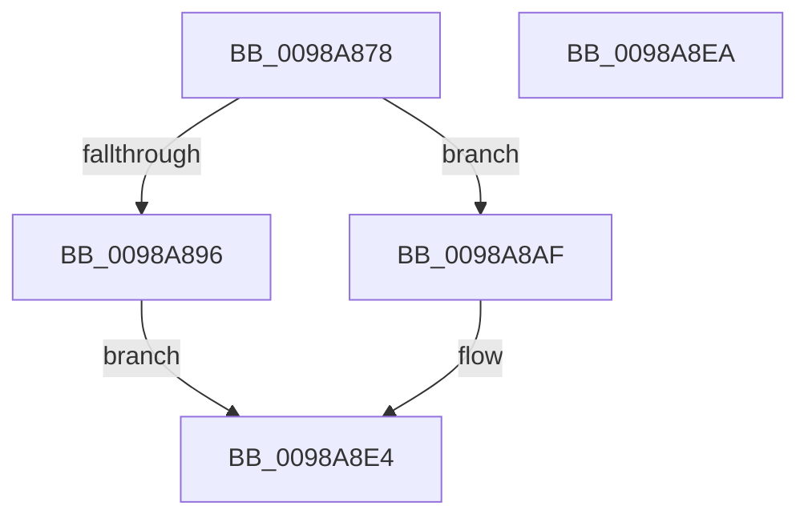

# TtmNotifyLowPowerStateExited

- RVA: `0x0098A878`–`0x0098A8EB` (길이 `115` bytes)
- VA: `0x000000014098A878`
- 실행 섹션: `PAGE`
- PDB 이름 있음: `예`; PDB Function 태그: `아니요`
- unwind 정보 RVA: `0x0005CF00`
- 디코드: `31`개 명령, `115/115` bytes 표시
- 미해석 바이트: `0` (있으면 어셈블리에 `.byte`로 보존)

> 이 문서는 커널 이미지의 기계어와 PDB 기호를 분석해 생성했습니다. 4번과 5번은 함수 원형과 자료형을 바이너리 사용 방식에서 추정한 C 해석이며 원본 소스 복구 결과는 아닙니다.

## 1. Dependencies

- 직접 호출 지점: **6**; 고유 호출 대상: **6**
- 직접 호출자로 확인된 함수: **2**
- RIP 상대 이미지 참조: **2**

### Outgoing calls
- `0x0098A88D` → [TtmpAcquireSessionById](TtmpAcquireSessionById_function_0098B4F4.md) (function, `0x0098B4F4`)
- `0x0098A8A8` → [TtmiLogError](TtmiLogError_function_0098B39C.md) (function, `0x0098B39C`)
- `0x0098A8B1` → [TtmiLogSessionCsExitComplete](../77/TtmiLogSessionCsExitComplete_function_0077AE60.md) (function, `0x0077AE60`)
- `0x0098A8CE` → [TtmiScheduleSessionWorker](../77/TtmiScheduleSessionWorker_function_00777184.md) (function, `0x00777184`)
- `0x0098A8DA` → [ExReleaseResourceLite](../../text/25/ExReleaseResourceLite_function_0025FA10.md) (function, `0x0025FA10`)
- `0x0098A8DF` → [KeLeaveCriticalRegion](../../text/25/KeLeaveCriticalRegion_function_0025D8B0.md) (function, `0x0025D8B0`)

### Direct callers
- [PopPowerAggregatorNotifyCsStateExited](PopPowerAggregatorNotifyCsStateExited_function_0098A434.md) at `0x0098A4BE`
- [PopIssueActionRequest](../A9/PopIssueActionRequest_function_00A9CE54.md) at `0x00A9D226`

### Static image references
- `0x0098A899` → RVA `0x00B041E0` (` ?? ::NNGAKEGL::`string'`; read)
- `0x0098A8D3` → RVA `0x00F06940` (`.data`; read)

## 2. Other-region calls and transfers

- 다른 실행 섹션으로 향하는 call: **2**
  - `0x0098A8DA` → [ExReleaseResourceLite](../../text/25/ExReleaseResourceLite_function_0025FA10.md) (`PAGE` → `.text`)
  - `0x0098A8DF` → [KeLeaveCriticalRegion](../../text/25/KeLeaveCriticalRegion_function_0025D8B0.md) (`PAGE` → `.text`)
- 별도 외부 분기/꼬리 이동을 확인하지 못했습니다.

## 3. Assembly (complete function range)

```asm
0098A878  40 53                           push rbx
0098A87A  48 83 EC 20                     sub rsp, 0x20
0098A87E  48 83 64 24 38 00               and qword ptr [rsp + 0x38], 0
0098A884  8B D9                           mov ebx, ecx
0098A886  8B D1                           mov edx, ecx
0098A888  48 8D 4C 24 38                  lea rcx, [rsp + 0x38]
0098A88D  E8 62 0C 00 00                  call 0x14098b4f4
0098A892  85 C0                           test eax, eax
0098A894  79 19                           jns 0x14098a8af
0098A896  44 8B C8                        mov r9d, eax
0098A899  48 8D 0D 40 99 17 00            lea rcx, [rip + 0x179940]
0098A8A0  44 8B C0                        mov r8d, eax
0098A8A3  BA 32 0C 00 00                  mov edx, 0xc32
0098A8A8  E8 EF 0A 00 00                  call 0x14098b39c
0098A8AD  EB 35                           jmp 0x14098a8e4
0098A8AF  8B CB                           mov ecx, ebx
0098A8B1  E8 AA 05 DF FF                  call 0x14077ae60
0098A8B6  48 8B 4C 24 38                  mov rcx, qword ptr [rsp + 0x38]
0098A8BB  BA 04 00 00 00                  mov edx, 4
0098A8C0  8B 41 04                        mov eax, dword ptr [rcx + 4]
0098A8C3  0F BA F0 08                     btr eax, 8
0098A8C7  0F BA F0 09                     btr eax, 9
0098A8CB  89 41 04                        mov dword ptr [rcx + 4], eax
0098A8CE  E8 B1 C8 DE FF                  call 0x140777184
0098A8D3  48 8D 0D 66 C0 57 00            lea rcx, [rip + 0x57c066]
0098A8DA  E8 31 51 8D FF                  call 0x14025fa10
0098A8DF  E8 CC 2F 8D FF                  call 0x14025d8b0
0098A8E4  48 83 C4 20                     add rsp, 0x20
0098A8E8  5B                              pop rbx
0098A8E9  C3                              ret
0098A8EA  CC                              int3
```

## 4. C-style interpretation (structured pseudocode)

```c
__int64 __fastcall TtmNotifyLowPowerStateExited(int a1)
{
    __int64 result;
    __int64 v_rsp;
    unsigned __int64 v_stack_p10;

    v_rsp = (v_rsp) - (32);
    result = TtmpAcquireSessionById(v_stack_p10, (unsigned int)(a1), a3, a4);
    if (!sign_flag) goto loc_0098A8AF;
    result = TtmiLogError(v_rip + 1546560, (unsigned int)(0xC32ULL), (unsigned int)((unsigned int)(result)), (unsigned int)((unsigned int)(result)));
    goto loc_0098A8E4;
loc_0098A8AF:
    result = TtmiLogSessionCsExitComplete((unsigned int)((unsigned int)((unsigned int)(a1))), (unsigned int)(0xC32ULL), (unsigned int)((unsigned int)(result)), (unsigned int)((unsigned int)(result)));
    *(unsigned int *)(v_stack_p10 + 4) = (unsigned int)((unsigned int)(*(unsigned int *)(v_stack_p10 + 4)));
    result = TtmiScheduleSessionWorker(v_stack_p10, 4, (unsigned int)((unsigned int)(result)), (unsigned int)((unsigned int)(result)));
    result = ExReleaseResourceLite(v_rip + 5750886, 4, (unsigned int)((unsigned int)(result)), (unsigned int)((unsigned int)(result)));
    result = KeLeaveCriticalRegion(v_rip + 5750886, 4, (unsigned int)((unsigned int)(result)), (unsigned int)((unsigned int)(result)));
loc_0098A8E4:
    v_rsp = (v_rsp) + (32);
    return result;
}
```

## 5. (Beta) C Style

```c
int64_t TtmNotifyLowPowerStateExited(int32_t Arg1)
{
    int64_t result;
    int64_t local_rsp;
    uint64_t v_stack_p10;

    local_rsp = (local_rsp) - (32);
    result = TtmpAcquireSessionById(v_stack_p10, (uint32_t)(Arg1), a3, a4);
    if (!sign_flag) goto loc_0098A8AF;
    result = TtmiLogError(v_rip + 1546560, (uint32_t)(0xC32ULL), (uint32_t)((uint32_t)(result)), (uint32_t)((uint32_t)(result)));
    goto loc_0098A8E4;
loc_0098A8AF:
    result = TtmiLogSessionCsExitComplete((uint32_t)((uint32_t)((uint32_t)(Arg1))), (uint32_t)(0xC32ULL), (uint32_t)((uint32_t)(result)), (uint32_t)((uint32_t)(result)));
    *(uint32_t *)(v_stack_p10 + 0x4) = (uint32_t)((uint32_t)(*(uint32_t *)(v_stack_p10 + 0x4)));
    result = TtmiScheduleSessionWorker(v_stack_p10, 4, (uint32_t)((uint32_t)(result)), (uint32_t)((uint32_t)(result)));
    result = ExReleaseResourceLite(v_rip + 5750886, 4, (uint32_t)((uint32_t)(result)), (uint32_t)((uint32_t)(result)));
    result = KeLeaveCriticalRegion(v_rip + 5750886, 4, (uint32_t)((uint32_t)(result)), (uint32_t)((uint32_t)(result)));
loc_0098A8E4:
    local_rsp = (local_rsp) + (32);
    return result;
}
```

## 6. Execution-region graph

[열기: 2D/3D 그래프와 함수 탐색 컨트롤 패널](../../../control-panel.html?section=page&rva=0x0098A878&view=graph)

- 2D 그래프는 위에서 아래로 흐르고, 3D 그래프는 빈 공간을 드래그해 회전합니다. Shift+드래그는 이동, 휠은 확대·축소, 함수 노드 선택은 대상 보고서 이동입니다.

### Static fallback


