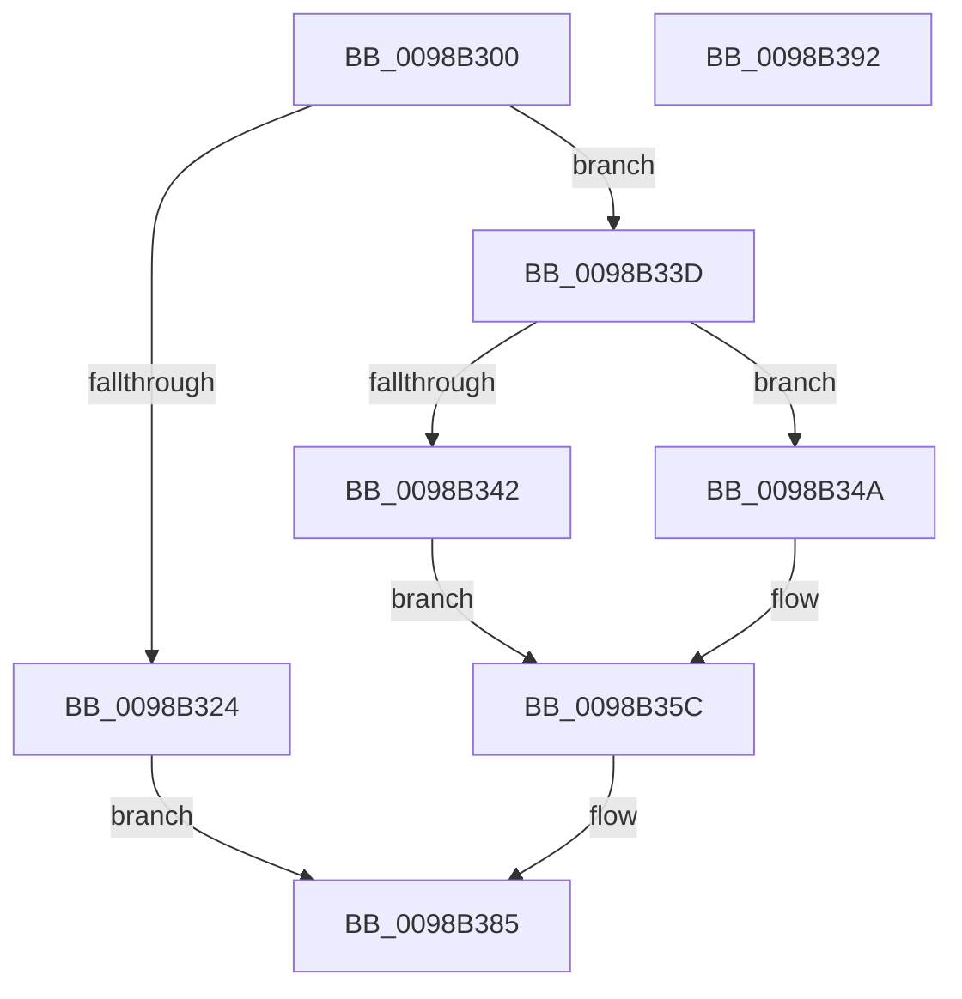

# TtmNotifySessionDisplayBurst

- RVA: `0x0098B300`–`0x0098B393` (길이 `147` bytes)
- VA: `0x000000014098B300`
- 실행 섹션: `PAGE`
- PDB 이름 있음: `예`; PDB Function 태그: `아니요`
- unwind 정보 RVA: `0x0006E5F8`
- 디코드: `40`개 명령, `147/147` bytes 표시
- 미해석 바이트: `0` (있으면 어셈블리에 `.byte`로 보존)

> 이 문서는 커널 이미지의 기계어와 PDB 기호를 분석해 생성했습니다. 4번과 5번은 함수 원형과 자료형을 바이너리 사용 방식에서 추정한 C 해석이며 원본 소스 복구 결과는 아닙니다.

## 1. Dependencies

- 직접 호출 지점: **5**; 고유 호출 대상: **5**
- 직접 호출자로 확인된 함수: **2**
- RIP 상대 이미지 참조: **2**

### Outgoing calls
- `0x0098B319` → [TtmpAcquireSessionById](TtmpAcquireSessionById_function_0098B4F4.md) (function, `0x0098B4F4`)
- `0x0098B336` → [TtmiLogError](TtmiLogError_function_0098B39C.md) (function, `0x0098B39C`)
- `0x0098B36D` → [TtmiResetTerminalTimeouts](../77/TtmiResetTerminalTimeouts_function_0077CD90.md) (function, `0x0077CD90`)
- `0x0098B379` → [ExReleaseResourceLite](../../text/25/ExReleaseResourceLite_function_0025FA10.md) (function, `0x0025FA10`)
- `0x0098B37E` → [KeLeaveCriticalRegion](../../text/25/KeLeaveCriticalRegion_function_0025D8B0.md) (function, `0x0025D8B0`)

### Direct callers
- [PopPowerSourceChangeCallback](../../text/4C/PopPowerSourceChangeCallback_function_004C3A60.md) at `0x004C3C34`
- [NtPowerInformation](../95/NtPowerInformation_function_00955D80.md) at `0x009578E3`

### Static image references
- `0x0098B327` → RVA `0x00B043C0` (` ?? ::NNGAKEGL::`string'`; read)
- `0x0098B372` → RVA `0x00F06940` (`.data`; read)

## 2. Other-region calls and transfers

- 다른 실행 섹션으로 향하는 call: **2**
  - `0x0098B379` → [ExReleaseResourceLite](../../text/25/ExReleaseResourceLite_function_0025FA10.md) (`PAGE` → `.text`)
  - `0x0098B37E` → [KeLeaveCriticalRegion](../../text/25/KeLeaveCriticalRegion_function_0025D8B0.md) (`PAGE` → `.text`)
- 별도 외부 분기/꼬리 이동을 확인하지 못했습니다.

## 3. Assembly (complete function range)

```asm
0098B300  48 89 5C 24 08                  mov qword ptr [rsp + 8], rbx
0098B305  57                              push rdi
0098B306  48 83 EC 30                     sub rsp, 0x30
0098B30A  48 83 64 24 50 00               and qword ptr [rsp + 0x50], 0
0098B310  8B FA                           mov edi, edx
0098B312  8B D1                           mov edx, ecx
0098B314  48 8D 4C 24 50                  lea rcx, [rsp + 0x50]
0098B319  E8 D6 01 00 00                  call 0x14098b4f4
0098B31E  8B D8                           mov ebx, eax
0098B320  85 C0                           test eax, eax
0098B322  79 19                           jns 0x14098b33d
0098B324  44 8B C8                        mov r9d, eax
0098B327  48 8D 0D 92 90 17 00            lea rcx, [rip + 0x179092]
0098B32E  44 8B C0                        mov r8d, eax
0098B331  BA AB 0C 00 00                  mov edx, 0xcab
0098B336  E8 61 00 00 00                  call 0x14098b39c
0098B33B  EB 48                           jmp 0x14098b385
0098B33D  83 FF 05                        cmp edi, 5
0098B340  75 08                           jne 0x14098b34a
0098B342  41 B9 41 43 44 42               mov r9d, 0x42444341
0098B348  EB 12                           jmp 0x14098b35c
0098B34A  83 FF 10                        cmp edi, 0x10
0098B34D  B8 42 43 44 42                  mov eax, 0x42444342
0098B352  41 B9 53 65 44 42               mov r9d, 0x42446553
0098B358  44 0F 44 C8                     cmove r9d, eax
0098B35C  48 8B 4C 24 50                  mov rcx, qword ptr [rsp + 0x50]
0098B361  44 8B C7                        mov r8d, edi
0098B364  C6 44 24 20 01                  mov byte ptr [rsp + 0x20], 1
0098B369  48 8B 51 20                     mov rdx, qword ptr [rcx + 0x20]
0098B36D  E8 1E 1A DF FF                  call 0x14077cd90
0098B372  48 8D 0D C7 B5 57 00            lea rcx, [rip + 0x57b5c7]
0098B379  E8 92 46 8D FF                  call 0x14025fa10
0098B37E  E8 2D 25 8D FF                  call 0x14025d8b0
0098B383  33 DB                           xor ebx, ebx
0098B385  8B C3                           mov eax, ebx
0098B387  48 8B 5C 24 40                  mov rbx, qword ptr [rsp + 0x40]
0098B38C  48 83 C4 30                     add rsp, 0x30
0098B390  5F                              pop rdi
0098B391  C3                              ret
0098B392  CC                              int3
```

## 4. C-style interpretation (structured pseudocode)

```c
__int64 __fastcall TtmNotifySessionDisplayBurst(int a1, int a2)
{
    __int64 result;
    __int64 v_rbx;
    __int64 v_rsp;
    unsigned __int8 v_stack_m18;
    unsigned __int64 v_stack_p18;
    unsigned __int64 v_stack_p8;

    v_stack_p8 = v_rbx;
    v_rsp = (v_rsp) - (48);
    result = TtmpAcquireSessionById(v_stack_p18, (unsigned int)(a1), a3, a4);
    if (!sign_flag) goto loc_0098B33D;
    result = TtmiLogError(v_rip + 1544338, (unsigned int)(0xCABULL), (unsigned int)((unsigned int)(result)), (unsigned int)((unsigned int)(result)));
    goto loc_0098B385;
loc_0098B33D:
    if (((unsigned int)((unsigned int)(a2))) != 5) goto loc_0098B34A;
    goto loc_0098B35C;
loc_0098B34A:
    a4 = (unsigned int)(0x42446553ULL);
    if (((unsigned int)((unsigned int)(a2))) == 16) { a4 = (unsigned int)((unsigned int)(0x42444342ULL)); }
loc_0098B35C:
    v_stack_m18 = 1;
    result = TtmiResetTerminalTimeouts(v_stack_p18, *(unsigned __int64 *)(v_stack_p18 + 32), (unsigned int)((unsigned int)((unsigned int)(a2))), a4);
    result = ExReleaseResourceLite(v_rip + 5748167, *(unsigned __int64 *)(v_stack_p18 + 32), (unsigned int)((unsigned int)((unsigned int)(a2))), a4);
    result = KeLeaveCriticalRegion(v_rip + 5748167, *(unsigned __int64 *)(v_stack_p18 + 32), (unsigned int)((unsigned int)((unsigned int)(a2))), a4);
    v_rbx = 0;
loc_0098B385:
    v_rsp = (v_rsp) + (48);
    return 0;
}
```

## 5. (Beta) C Style

```c
int64_t TtmNotifySessionDisplayBurst(int32_t Arg1, int32_t Arg2)
{
    int64_t result;
    int64_t local_rbx;
    int64_t local_rsp;
    uint8_t v_stack_m18;
    uint64_t v_stack_p18;
    uint64_t v_stack_p8;

    v_stack_p8 = local_rbx;
    local_rsp = (local_rsp) - (48);
    result = TtmpAcquireSessionById(v_stack_p18, (uint32_t)(Arg1), a3, a4);
    if (!sign_flag) goto loc_0098B33D;
    result = TtmiLogError(v_rip + 1544338, (uint32_t)(0xCABULL), (uint32_t)((uint32_t)(result)), (uint32_t)((uint32_t)(result)));
    goto loc_0098B385;
loc_0098B33D:
    if (((uint32_t)((uint32_t)(Arg2))) != 5) goto loc_0098B34A;
    goto loc_0098B35C;
loc_0098B34A:
    a4 = (uint32_t)(0x42446553ULL);
    if (((uint32_t)((uint32_t)(Arg2))) == 16) { a4 = (uint32_t)((uint32_t)(0x42444342ULL)); }
loc_0098B35C:
    v_stack_m18 = 1;
    result = TtmiResetTerminalTimeouts(v_stack_p18, *(uint64_t *)(v_stack_p18 + 0x20), (uint32_t)((uint32_t)((uint32_t)(Arg2))), a4);
    result = ExReleaseResourceLite(v_rip + 5748167, *(uint64_t *)(v_stack_p18 + 0x20), (uint32_t)((uint32_t)((uint32_t)(Arg2))), a4);
    result = KeLeaveCriticalRegion(v_rip + 5748167, *(uint64_t *)(v_stack_p18 + 0x20), (uint32_t)((uint32_t)((uint32_t)(Arg2))), a4);
    local_rbx = 0;
loc_0098B385:
    local_rsp = (local_rsp) + (48);
    return 0;
}
```

## 6. Execution-region graph

[열기: 2D/3D 그래프와 함수 탐색 컨트롤 패널](../../../control-panel.html?section=page&rva=0x0098B300&view=graph)

- 2D 그래프는 위에서 아래로 흐르고, 3D 그래프는 빈 공간을 드래그해 회전합니다. Shift+드래그는 이동, 휠은 확대·축소, 함수 노드 선택은 대상 보고서 이동입니다.

### Static fallback


