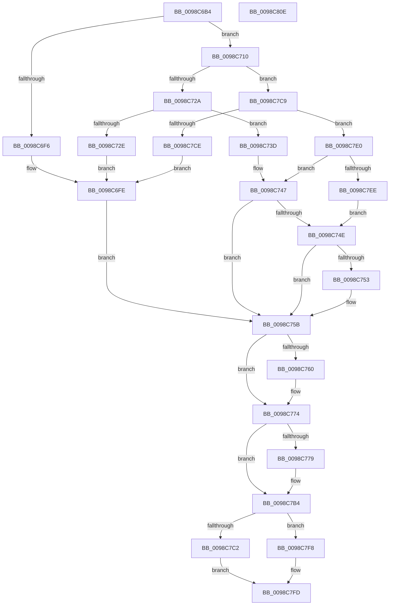

# TtmNotifySessionDisplayRequiredChange

- RVA: `0x0098C6B4`–`0x0098C80F` (길이 `347` bytes)
- VA: `0x000000014098C6B4`
- 실행 섹션: `PAGE`
- PDB 이름 있음: `예`; PDB Function 태그: `아니요`
- unwind 정보 RVA: `0x000987A4`
- 디코드: `99`개 명령, `347/347` bytes 표시
- 미해석 바이트: `0` (있으면 어셈블리에 `.byte`로 보존)

> 이 문서는 커널 이미지의 기계어와 PDB 기호를 분석해 생성했습니다. 4번과 5번은 함수 원형과 자료형을 바이너리 사용 방식에서 추정한 C 해석이며 원본 소스 복구 결과는 아닙니다.

## 1. Dependencies

- 직접 호출 지점: **9**; 고유 호출 대상: **9**
- 직접 호출자로 확인된 함수: **1**
- RIP 상대 이미지 참조: **3**

### Outgoing calls
- `0x0098C6E3` → [TtmpAcquireSessionById](TtmpAcquireSessionById_function_0098B4F4.md) (function, `0x0098B4F4`)
- `0x0098C709` → [TtmiLogError](TtmiLogError_function_0098B39C.md) (function, `0x0098B39C`)
- `0x0098C719` → [TtmpUpdateDisplayRequiredPowerRequest](../77/TtmpUpdateDisplayRequiredPowerRequest_function_00778304.md) (function, `0x00778304`)
- `0x0098C76A` → [ExReleaseResourceLite](../../text/25/ExReleaseResourceLite_function_0025FA10.md) (function, `0x0025FA10`)
- `0x0098C76F` → [KeLeaveCriticalRegion](../../text/25/KeLeaveCriticalRegion_function_0025D8B0.md) (function, `0x0025D8B0`)
- `0x0098C7A3` → [ZwUpdateWnfStateData](../../text/6B/ZwUpdateWnfStateData_function_006B0D10.md) (function, `0x006B0D10`)
- `0x0098C7AF` → [PoSessionEngagementUpdate](../../text/5D/PoSessionEngagementUpdate_function_005DC4B8.md) (function, `0x005DC4B8`)
- `0x0098C7C2` → [TtmiLogSessionDisplayRequiredDereference](../AD/TtmiLogSessionDisplayRequiredDereference_function_00ADAED8.md) (function, `0x00ADAED8`)
- `0x0098C7F8` → [TtmiLogSessionDisplayRequiredReference](../AD/TtmiLogSessionDisplayRequiredReference_function_00ADB060.md) (function, `0x00ADB060`)

### Direct callers
- [PopPowerRequestCallbackDisplayRequired](PopPowerRequestCallbackDisplayRequired_function_0098C820.md) at `0x0098C86C`

### Static image references
- `0x0098C702` → RVA `0x00B043E0` (` ?? ::NNGAKEGL::`string'`; read)
- `0x0098C763` → RVA `0x00F06940` (`.data`; read)
- `0x0098C798` → RVA `0x00020978` (`.rdata`; read)

## 2. Other-region calls and transfers

- 다른 실행 섹션으로 향하는 call: **4**
  - `0x0098C76A` → [ExReleaseResourceLite](../../text/25/ExReleaseResourceLite_function_0025FA10.md) (`PAGE` → `.text`)
  - `0x0098C76F` → [KeLeaveCriticalRegion](../../text/25/KeLeaveCriticalRegion_function_0025D8B0.md) (`PAGE` → `.text`)
  - `0x0098C7A3` → [ZwUpdateWnfStateData](../../text/6B/ZwUpdateWnfStateData_function_006B0D10.md) (`PAGE` → `.text`)
  - `0x0098C7AF` → [PoSessionEngagementUpdate](../../text/5D/PoSessionEngagementUpdate_function_005DC4B8.md) (`PAGE` → `.text`)
- 별도 외부 분기/꼬리 이동을 확인하지 못했습니다.

## 3. Assembly (complete function range)

```asm
0098C6B4  48 8B C4                        mov rax, rsp
0098C6B7  48 89 58 10                     mov qword ptr [rax + 0x10], rbx
0098C6BB  89 48 08                        mov dword ptr [rax + 8], ecx
0098C6BE  55                              push rbp
0098C6BF  56                              push rsi
0098C6C0  57                              push rdi
0098C6C1  41 56                           push r14
0098C6C3  41 57                           push r15
0098C6C5  48 83 EC 40                     sub rsp, 0x40
0098C6C9  48 83 60 20 00                  and qword ptr [rax + 0x20], 0
0098C6CE  44 8B FA                        mov r15d, edx
0098C6D1  8B D1                           mov edx, ecx
0098C6D3  33 ED                           xor ebp, ebp
0098C6D5  48 8D 48 20                     lea rcx, [rax + 0x20]
0098C6D9  40 88 68 18                     mov byte ptr [rax + 0x18], bpl
0098C6DD  45 8A F0                        mov r14b, r8b
0098C6E0  40 32 F6                        xor sil, sil
0098C6E3  E8 0C EE FF FF                  call 0x14098b4f4
0098C6E8  48 8B 9C 24 88 00 00 00         mov rbx, qword ptr [rsp + 0x88]
0098C6F0  8B F8                           mov edi, eax
0098C6F2  85 C0                           test eax, eax
0098C6F4  79 1A                           jns 0x14098c710
0098C6F6  44 8B C0                        mov r8d, eax
0098C6F9  BA E4 0E 00 00                  mov edx, 0xee4
0098C6FE  41 83 C9 FF                     or r9d, 0xffffffff
0098C702  48 8D 0D D7 7C 17 00            lea rcx, [rip + 0x177cd7]
0098C709  E8 8E EC FF FF                  call 0x14098b39c
0098C70E  EB 4B                           jmp 0x14098c75b
0098C710  45 8A C6                        mov r8b, r14b
0098C713  41 8B D7                        mov edx, r15d
0098C716  48 8B CB                        mov rcx, rbx
0098C719  E8 E6 BB DE FF                  call 0x140778304
0098C71E  8B 43 14                        mov eax, dword ptr [rbx + 0x14]
0098C721  45 84 F6                        test r14b, r14b
0098C724  0F 85 9F 00 00 00               jne 0x14098c7c9
0098C72A  85 C0                           test eax, eax
0098C72C  75 0F                           jne 0x14098c73d
0098C72E  BF 0D 00 00 C0                  mov edi, 0xc000000d
0098C733  BA 04 0F 00 00                  mov edx, 0xf04
0098C738  44 8B C7                        mov r8d, edi
0098C73B  EB C1                           jmp 0x14098c6fe
0098C73D  83 E8 01                        sub eax, 1
0098C740  89 43 14                        mov dword ptr [rbx + 0x14], eax
0098C743  40 0F 94 C6                     sete sil
0098C747  33 FF                           xor edi, edi
0098C749  40 84 F6                        test sil, sil
0098C74C  74 0D                           je 0x14098c75b
0098C74E  39 6B 14                        cmp dword ptr [rbx + 0x14], ebp
0098C751  76 08                           jbe 0x14098c75b
0098C753  C6 84 24 80 00 00 00 01         mov byte ptr [rsp + 0x80], 1
0098C75B  48 85 DB                        test rbx, rbx
0098C75E  74 14                           je 0x14098c774
0098C760  8B 6B 14                        mov ebp, dword ptr [rbx + 0x14]
0098C763  48 8D 0D D6 A1 57 00            lea rcx, [rip + 0x57a1d6]
0098C76A  E8 A1 32 8D FF                  call 0x14025fa10
0098C76F  E8 3C 11 8D FF                  call 0x14025d8b0
0098C774  40 84 F6                        test sil, sil
0098C777  74 3B                           je 0x14098c7b4
0098C779  83 64 24 30 00                  and dword ptr [rsp + 0x30], 0
0098C77E  48 8D 44 24 70                  lea rax, [rsp + 0x70]
0098C783  83 64 24 28 00                  and dword ptr [rsp + 0x28], 0
0098C788  48 8D 94 24 80 00 00 00         lea rdx, [rsp + 0x80]
0098C790  45 33 C9                        xor r9d, r9d
0098C793  48 89 44 24 20                  mov qword ptr [rsp + 0x20], rax
0098C798  48 8D 0D D9 41 69 FF            lea rcx, [rip - 0x96be27]
0098C79F  45 8D 41 01                     lea r8d, [r9 + 1]
0098C7A3  E8 68 45 D2 FF                  call 0x1406b0d10
0098C7A8  8A 8C 24 80 00 00 00            mov cl, byte ptr [rsp + 0x80]
0098C7AF  E8 04 FD C4 FF                  call 0x1405dc4b8
0098C7B4  8B 4C 24 70                     mov ecx, dword ptr [rsp + 0x70]
0098C7B8  44 8B C7                        mov r8d, edi
0098C7BB  8B D5                           mov edx, ebp
0098C7BD  45 84 F6                        test r14b, r14b
0098C7C0  75 36                           jne 0x14098c7f8
0098C7C2  E8 11 E7 14 00                  call 0x140adaed8
0098C7C7  EB 34                           jmp 0x14098c7fd
0098C7C9  83 F8 FF                        cmp eax, -1
0098C7CC  75 12                           jne 0x14098c7e0
0098C7CE  BF 95 00 00 C0                  mov edi, 0xc0000095
0098C7D3  BA 18 0F 00 00                  mov edx, 0xf18
0098C7D8  44 8B C7                        mov r8d, edi
0098C7DB  E9 1E FF FF FF                  jmp 0x14098c6fe
0098C7E0  FF C0                           inc eax
0098C7E2  89 43 14                        mov dword ptr [rbx + 0x14], eax
0098C7E5  83 F8 01                        cmp eax, 1
0098C7E8  0F 85 59 FF FF FF               jne 0x14098c747
0098C7EE  40 8A F0                        mov sil, al
0098C7F1  33 FF                           xor edi, edi
0098C7F3  E9 56 FF FF FF                  jmp 0x14098c74e
0098C7F8  E8 63 E8 14 00                  call 0x140adb060
0098C7FD  48 8B 5C 24 78                  mov rbx, qword ptr [rsp + 0x78]
0098C802  48 83 C4 40                     add rsp, 0x40
0098C806  41 5F                           pop r15
0098C808  41 5E                           pop r14
0098C80A  5F                              pop rdi
0098C80B  5E                              pop rsi
0098C80C  5D                              pop rbp
0098C80D  C3                              ret
0098C80E  CC                              int3
```

## 4. C-style interpretation (structured pseudocode)

```c
__int64 __fastcall TtmNotifySessionDisplayRequiredChange(int a1, int a2, unsigned __int8 a3, int a4)
{
    __int64 result;
    __int64 v_rbp;
    __int64 v_rdi;
    __int64 v_rsi;
    __int64 v_rsp;
    unsigned int v_stack_m38;
    unsigned int v_stack_m40;
    unsigned __int64 v_stack_m48;
    unsigned __int64 v_stack_p10;
    unsigned __int8 v_stack_p18;
    unsigned __int64 v_stack_p20;
    unsigned __int64 v_stack_p8;

    *(unsigned __int64 *)(v_rsp + 16) = v_rbx;
    *(unsigned int *)(v_rsp + 8) = a1;
    v_rsp = (v_rsp) - (64);
    v_rbp = 0;
    *(unsigned __int8 *)(v_rsp + 24) = 0;
    v_rsi = 0;
    result = TtmpAcquireSessionById(v_rsp + 32, (unsigned int)(a1), a3, a4);
    if (!sign_flag) goto loc_0098C710;
loc_0098C6FE:
    a4 = (unsigned int)((a4) | (0xFFFFFFFFULL));
    result = TtmiLogError(v_rip + 1539287, (unsigned int)(0xEE4ULL), (unsigned int)((unsigned int)(result)), a4);
    goto loc_0098C75B;
loc_0098C710:
    result = TtmpUpdateDisplayRequiredPowerRequest(v_stack_p20, (unsigned int)((unsigned int)((unsigned int)(a2))), a3, a4);
    if (a3 != 0) goto loc_0098C7C9;
    if ((unsigned int)((unsigned int)(*(unsigned int *)(v_stack_p20 + 20))) != 0) goto loc_0098C73D;
    goto loc_0098C6FE;
loc_0098C73D:
    result = (unsigned int)(((unsigned int)(*(unsigned int *)(v_stack_p20 + 20))) - (1));
    *(unsigned int *)(v_stack_p20 + 20) = (unsigned int)(result);
    v_rsi = (condition_is_equal) ? 1 : 0;
loc_0098C747:
    v_rdi = 0;
    if ((unsigned __int8)(v_rsi) == 0) goto loc_0098C75B;
loc_0098C74E:
    if ((*(unsigned int *)(v_stack_p20 + 20)) >= = 0) {
        v_stack_p18 = 1;
    }
    if (v_stack_p20 != 0) {
        v_rbp = *(unsigned int *)(v_stack_p20 + 20);
        a1 = v_rip + 5743062;
        result = ExReleaseResourceLite(a1, (unsigned int)(0xF04ULL), (unsigned int)((unsigned int)((unsigned int)(0xC000000DULL))), a4);
        result = KeLeaveCriticalRegion(a1, (unsigned int)(0xF04ULL), (unsigned int)((unsigned int)((unsigned int)(0xC000000DULL))), a4);
    }
    if ((unsigned __int8)(v_rsi) != 0) {
        result = v_stack_p8;
        a2 = v_stack_p18;
        a4 = 0;
        v_stack_m48 = result;
        a1 = v_rip - 9879079;
        a3 = a4 + 1;
        result = ZwUpdateWnfStateData(a1, a2, a3, a4);
        a1 = v_stack_p18;
        result = PoSessionEngagementUpdate(a1, a2, a3, a4);
    }
    if (a3 != 0) goto loc_0098C7F8;
    result = TtmiLogSessionDisplayRequiredDereference((unsigned int)(v_stack_p8), (unsigned int)((unsigned int)(v_rbp)), 0, a4);
    goto loc_0098C7FD;
loc_0098C7C9:
    if (((unsigned int)(result)) != -1) goto loc_0098C7E0;
    goto loc_0098C6FE;
loc_0098C7E0:
    result = (unsigned int)((result) + 1);
    *(unsigned int *)(v_stack_p20 + 20) = (unsigned int)(result);
    if (((unsigned int)(result)) != 1) goto loc_0098C747;
    v_rdi = 0;
    goto loc_0098C74E;
loc_0098C7F8:
    result = TtmiLogSessionDisplayRequiredReference((unsigned int)(v_stack_p8), (unsigned int)(0xF18ULL), (unsigned int)((unsigned int)((unsigned int)(0xC0000095ULL))), a4);
loc_0098C7FD:
    v_rsp = (v_rsp) + (64);
    return result;
}
```

## 5. (Beta) C Style

```c
int64_t TtmNotifySessionDisplayRequiredChange(int32_t Arg1, int32_t Arg2, uint8_t Arg3, int32_t Arg4)
{
    int64_t result;
    int64_t local_rbp;
    int64_t local_rdi;
    int64_t local_rsi;
    int64_t local_rsp;
    uint32_t v_stack_m38;
    uint32_t v_stack_m40;
    uint64_t v_stack_m48;
    uint64_t v_stack_p10;
    uint8_t v_stack_p18;
    uint64_t v_stack_p20;
    uint64_t v_stack_p8;

    *(uint64_t *)(local_rsp + 0x10) = local_rbx;
    *(uint32_t *)(local_rsp + 0x8) = Arg1;
    local_rsp = (local_rsp) - (64);
    local_rbp = 0;
    *(uint8_t *)(local_rsp + 0x18) = 0;
    local_rsi = 0;
    result = TtmpAcquireSessionById(local_rsp + 32, (uint32_t)(Arg1), Arg3, Arg4);
    if (!sign_flag) goto loc_0098C710;
loc_0098C6FE:
    Arg4 = (uint32_t)((Arg4) | (0xFFFFFFFFULL));
    result = TtmiLogError(v_rip + 1539287, (uint32_t)(0xEE4ULL), (uint32_t)((uint32_t)(result)), Arg4);
    goto loc_0098C75B;
loc_0098C710:
    result = TtmpUpdateDisplayRequiredPowerRequest(v_stack_p20, (uint32_t)((uint32_t)((uint32_t)(Arg2))), Arg3, Arg4);
    if (Arg3 != 0) goto loc_0098C7C9;
    if ((uint32_t)((uint32_t)(*(uint32_t *)(v_stack_p20 + 0x14))) != 0) goto loc_0098C73D;
    goto loc_0098C6FE;
loc_0098C73D:
    result = (uint32_t)(((uint32_t)(*(uint32_t *)(v_stack_p20 + 0x14))) - (1));
    *(uint32_t *)(v_stack_p20 + 0x14) = (uint32_t)(result);
    local_rsi = (condition_is_equal) ? 1 : 0;
loc_0098C747:
    local_rdi = 0;
    if ((uint8_t)(local_rsi) == 0) goto loc_0098C75B;
loc_0098C74E:
    if ((*(uint32_t *)(v_stack_p20 + 0x14)) >= = 0) {
        v_stack_p18 = 1;
    }
    if (v_stack_p20 != 0) {
        local_rbp = *(uint32_t *)(v_stack_p20 + 0x14);
        Arg1 = v_rip + 5743062;
        result = ExReleaseResourceLite(Arg1, (uint32_t)(0xF04ULL), (uint32_t)((uint32_t)((uint32_t)(0xC000000DULL))), Arg4);
        result = KeLeaveCriticalRegion(Arg1, (uint32_t)(0xF04ULL), (uint32_t)((uint32_t)((uint32_t)(0xC000000DULL))), Arg4);
    }
    if ((uint8_t)(local_rsi) != 0) {
        result = v_stack_p8;
        Arg2 = v_stack_p18;
        Arg4 = 0;
        v_stack_m48 = result;
        Arg1 = v_rip - 9879079;
        Arg3 = Arg4 + 1;
        result = ZwUpdateWnfStateData(Arg1, Arg2, Arg3, Arg4);
        Arg1 = v_stack_p18;
        result = PoSessionEngagementUpdate(Arg1, Arg2, Arg3, Arg4);
    }
    if (Arg3 != 0) goto loc_0098C7F8;
    result = TtmiLogSessionDisplayRequiredDereference((uint32_t)(v_stack_p8), (uint32_t)((uint32_t)(local_rbp)), 0, Arg4);
    goto loc_0098C7FD;
loc_0098C7C9:
    if (((uint32_t)(result)) != -1) goto loc_0098C7E0;
    goto loc_0098C6FE;
loc_0098C7E0:
    result = (uint32_t)((result) + 1);
    *(uint32_t *)(v_stack_p20 + 0x14) = (uint32_t)(result);
    if (((uint32_t)(result)) != 1) goto loc_0098C747;
    local_rdi = 0;
    goto loc_0098C74E;
loc_0098C7F8:
    result = TtmiLogSessionDisplayRequiredReference((uint32_t)(v_stack_p8), (uint32_t)(0xF18ULL), (uint32_t)((uint32_t)((uint32_t)(0xC0000095ULL))), Arg4);
loc_0098C7FD:
    local_rsp = (local_rsp) + (64);
    return result;
}
```

## 6. Execution-region graph

[열기: 2D/3D 그래프와 함수 탐색 컨트롤 패널](../../../control-panel.html?section=page&rva=0x0098C6B4&view=graph)

- 2D 그래프는 위에서 아래로 흐르고, 3D 그래프는 빈 공간을 드래그해 회전합니다. Shift+드래그는 이동, 휠은 확대·축소, 함수 노드 선택은 대상 보고서 이동입니다.

### Static fallback


