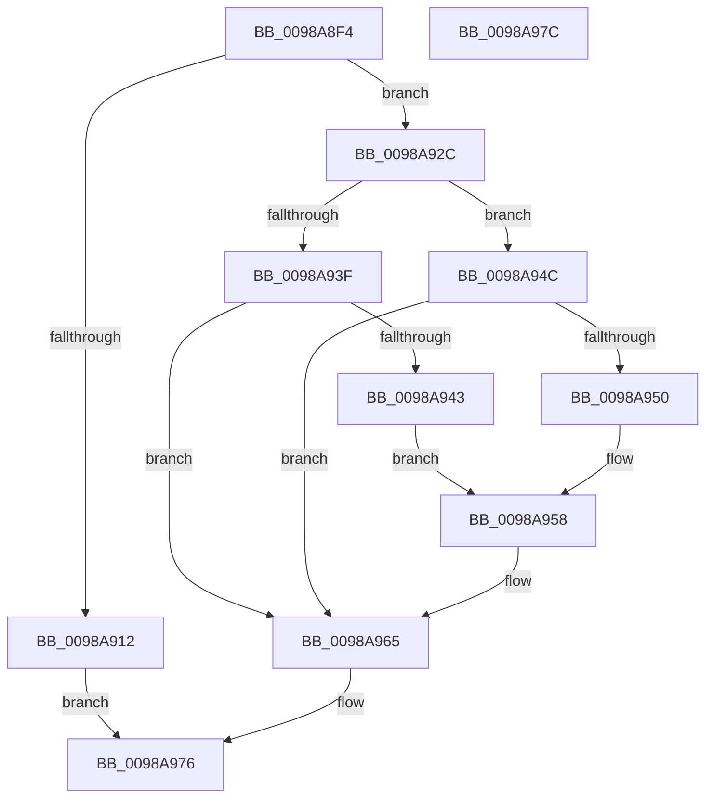

# TtmNotifySessionPowerStateChange

- RVA: `0x0098A8F4`–`0x0098A97D` (길이 `137` bytes)
- VA: `0x000000014098A8F4`
- 실행 섹션: `PAGE`
- PDB 이름 있음: `예`; PDB Function 태그: `아니요`
- unwind 정보 RVA: `0x0005CF00`
- 디코드: `40`개 명령, `137/137` bytes 표시
- 미해석 바이트: `0` (있으면 어셈블리에 `.byte`로 보존)

> 이 문서는 커널 이미지의 기계어와 PDB 기호를 분석해 생성했습니다. 4번과 5번은 함수 원형과 자료형을 바이너리 사용 방식에서 추정한 C 해석이며 원본 소스 복구 결과는 아닙니다.

## 1. Dependencies

- 직접 호출 지점: **6**; 고유 호출 대상: **6**
- 직접 호출자로 확인된 함수: **1**
- RIP 상대 이미지 참조: **2**

### Outgoing calls
- `0x0098A909` → [TtmpAcquireSessionById](TtmpAcquireSessionById_function_0098B4F4.md) (function, `0x0098B4F4`)
- `0x0098A925` → [TtmiLogError](TtmiLogError_function_0098B39C.md) (function, `0x0098B39C`)
- `0x0098A92E` → [TtmiLogSessionPowerStateChange](../77/TtmiLogSessionPowerStateChange_function_0077B59C.md) (function, `0x0077B59C`)
- `0x0098A960` → [TtmiScheduleSessionWorker](../77/TtmiScheduleSessionWorker_function_00777184.md) (function, `0x00777184`)
- `0x0098A96C` → [ExReleaseResourceLite](../../text/25/ExReleaseResourceLite_function_0025FA10.md) (function, `0x0025FA10`)
- `0x0098A971` → [KeLeaveCriticalRegion](../../text/25/KeLeaveCriticalRegion_function_0025D8B0.md) (function, `0x0025D8B0`)

### Direct callers
- [PopPowerInformationInternal](../A8/PopPowerInformationInternal_function_00A8B7C0.md) at `0x00A8BCC4`

### Static image references
- `0x0098A916` → RVA `0x00B04390` (` ?? ::NNGAKEGL::`string'`; read)
- `0x0098A965` → RVA `0x00F06940` (`.data`; read)

## 2. Other-region calls and transfers

- 다른 실행 섹션으로 향하는 call: **2**
  - `0x0098A96C` → [ExReleaseResourceLite](../../text/25/ExReleaseResourceLite_function_0025FA10.md) (`PAGE` → `.text`)
  - `0x0098A971` → [KeLeaveCriticalRegion](../../text/25/KeLeaveCriticalRegion_function_0025D8B0.md) (`PAGE` → `.text`)
- 별도 외부 분기/꼬리 이동을 확인하지 못했습니다.

## 3. Assembly (complete function range)

```asm
0098A8F4  40 53                           push rbx
0098A8F6  48 83 EC 20                     sub rsp, 0x20
0098A8FA  48 83 64 24 40 00               and qword ptr [rsp + 0x40], 0
0098A900  8A DA                           mov bl, dl
0098A902  8B D1                           mov edx, ecx
0098A904  48 8D 4C 24 40                  lea rcx, [rsp + 0x40]
0098A909  E8 E6 0B 00 00                  call 0x14098b4f4
0098A90E  85 C0                           test eax, eax
0098A910  79 1A                           jns 0x14098a92c
0098A912  41 83 C9 FF                     or r9d, 0xffffffff
0098A916  48 8D 0D 73 9A 17 00            lea rcx, [rip + 0x179a73]
0098A91D  44 8B C0                        mov r8d, eax
0098A920  BA 66 0C 00 00                  mov edx, 0xc66
0098A925  E8 72 0A 00 00                  call 0x14098b39c
0098A92A  EB 4A                           jmp 0x14098a976
0098A92C  8A CB                           mov cl, bl
0098A92E  E8 69 0C DF FF                  call 0x14077b59c
0098A933  48 8B 4C 24 40                  mov rcx, qword ptr [rsp + 0x40]
0098A938  8B 41 04                        mov eax, dword ptr [rcx + 4]
0098A93B  84 DB                           test bl, bl
0098A93D  75 0D                           jne 0x14098a94c
0098A93F  A8 40                           test al, 0x40
0098A941  74 22                           je 0x14098a965
0098A943  83 E0 BF                        and eax, 0xffffffbf
0098A946  0F BA E8 0A                     bts eax, 0xa
0098A94A  EB 0C                           jmp 0x14098a958
0098A94C  84 C0                           test al, al
0098A94E  79 15                           jns 0x14098a965
0098A950  0F BA F0 07                     btr eax, 7
0098A954  0F BA F0 0A                     btr eax, 0xa
0098A958  BA 04 00 00 00                  mov edx, 4
0098A95D  89 41 04                        mov dword ptr [rcx + 4], eax
0098A960  E8 1F C8 DE FF                  call 0x140777184
0098A965  48 8D 0D D4 BF 57 00            lea rcx, [rip + 0x57bfd4]
0098A96C  E8 9F 50 8D FF                  call 0x14025fa10
0098A971  E8 3A 2F 8D FF                  call 0x14025d8b0
0098A976  48 83 C4 20                     add rsp, 0x20
0098A97A  5B                              pop rbx
0098A97B  C3                              ret
0098A97C  CC                              int3
```

## 4. C-style interpretation (structured pseudocode)

```c
__int64 __fastcall TtmNotifySessionPowerStateChange(int a1, unsigned __int8 a2, __int64 a3, int a4)
{
    __int64 result;
    __int64 v_rsp;
    unsigned __int64 v_stack_p18;

    v_rsp = (v_rsp) - (32);
    result = TtmpAcquireSessionById(v_stack_p18, (unsigned int)(a1), a3, a4);
    if (!sign_flag) goto loc_0098A92C;
    a4 = (unsigned int)((a4) | (0xFFFFFFFFULL));
    result = TtmiLogError(v_rip + 1546867, (unsigned int)(0xC66ULL), (unsigned int)((unsigned int)(result)), a4);
    goto loc_0098A976;
loc_0098A92C:
    result = TtmiLogSessionPowerStateChange(a2, (unsigned int)(0xC66ULL), (unsigned int)((unsigned int)(result)), a4);
    if (a2 != 0) goto loc_0098A94C;
    if ((((unsigned __int8)((unsigned int)(*(unsigned int *)(v_stack_p18 + 4)))) & (64)) == 0) goto loc_0098A965;
    result = (unsigned int)(((unsigned int)(*(unsigned int *)(v_stack_p18 + 4))) & (0xFFFFFFBFULL));
    goto loc_0098A958;
loc_0098A94C:
    if (!sign_flag) goto loc_0098A965;
loc_0098A958:
    *(unsigned int *)(v_stack_p18 + 4) = (unsigned int)(result);
    result = TtmiScheduleSessionWorker(v_stack_p18, 4, (unsigned int)((unsigned int)(result)), a4);
loc_0098A965:
    result = ExReleaseResourceLite(v_rip + 5750740, 4, (unsigned int)((unsigned int)(result)), a4);
    result = KeLeaveCriticalRegion(v_rip + 5750740, 4, (unsigned int)((unsigned int)(result)), a4);
loc_0098A976:
    v_rsp = (v_rsp) + (32);
    return result;
}
```

## 5. (Beta) C Style

```c
int64_t TtmNotifySessionPowerStateChange(int32_t Arg1, uint8_t Arg2, int64_t Arg3, int32_t Arg4)
{
    int64_t result;
    int64_t local_rsp;
    uint64_t v_stack_p18;

    local_rsp = (local_rsp) - (32);
    result = TtmpAcquireSessionById(v_stack_p18, (uint32_t)(Arg1), Arg3, Arg4);
    if (!sign_flag) goto loc_0098A92C;
    Arg4 = (uint32_t)((Arg4) | (0xFFFFFFFFULL));
    result = TtmiLogError(v_rip + 1546867, (uint32_t)(0xC66ULL), (uint32_t)((uint32_t)(result)), Arg4);
    goto loc_0098A976;
loc_0098A92C:
    result = TtmiLogSessionPowerStateChange(Arg2, (uint32_t)(0xC66ULL), (uint32_t)((uint32_t)(result)), Arg4);
    if (Arg2 != 0) goto loc_0098A94C;
    if ((((uint8_t)((uint32_t)(*(uint32_t *)(v_stack_p18 + 0x4)))) & (64)) == 0) goto loc_0098A965;
    result = (uint32_t)(((uint32_t)(*(uint32_t *)(v_stack_p18 + 0x4))) & (0xFFFFFFBFULL));
    goto loc_0098A958;
loc_0098A94C:
    if (!sign_flag) goto loc_0098A965;
loc_0098A958:
    *(uint32_t *)(v_stack_p18 + 0x4) = (uint32_t)(result);
    result = TtmiScheduleSessionWorker(v_stack_p18, 4, (uint32_t)((uint32_t)(result)), Arg4);
loc_0098A965:
    result = ExReleaseResourceLite(v_rip + 5750740, 4, (uint32_t)((uint32_t)(result)), Arg4);
    result = KeLeaveCriticalRegion(v_rip + 5750740, 4, (uint32_t)((uint32_t)(result)), Arg4);
loc_0098A976:
    local_rsp = (local_rsp) + (32);
    return result;
}
```

## 6. Execution-region graph

[열기: 2D/3D 그래프와 함수 탐색 컨트롤 패널](../../../control-panel.html?section=page&rva=0x0098A8F4&view=graph)

- 2D 그래프는 위에서 아래로 흐르고, 3D 그래프는 빈 공간을 드래그해 회전합니다. Shift+드래그는 이동, 휠은 확대·축소, 함수 노드 선택은 대상 보고서 이동입니다.

### Static fallback


