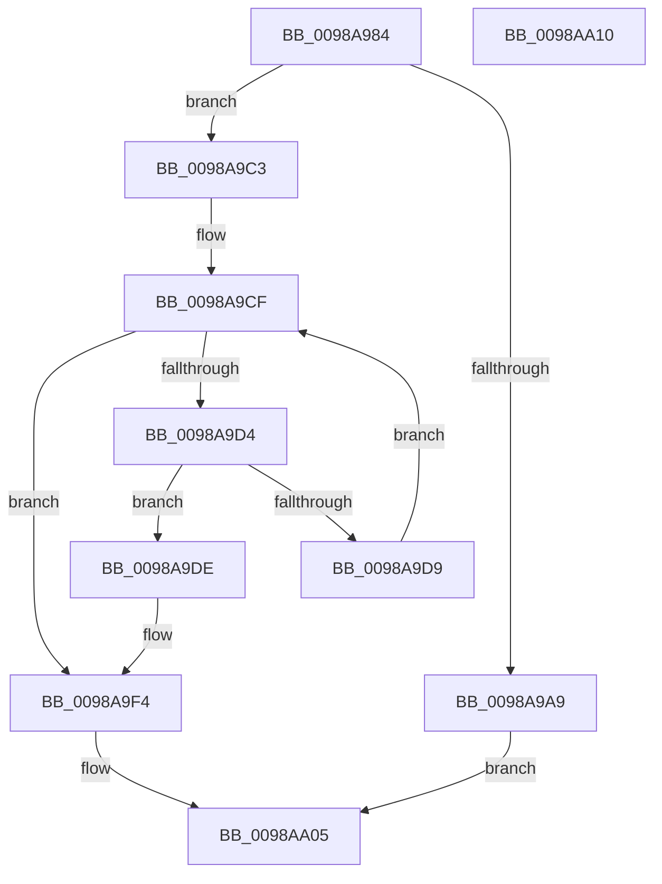

# TtmNotifySessionTerminalInput

- RVA: `0x0098A984`–`0x0098AA11` (길이 `141` bytes)
- VA: `0x000000014098A984`
- 실행 섹션: `PAGE`
- PDB 이름 있음: `예`; PDB Function 태그: `아니요`
- unwind 정보 RVA: `0x0006E5F8`
- 디코드: `38`개 명령, `141/141` bytes 표시
- 미해석 바이트: `0` (있으면 어셈블리에 `.byte`로 보존)

> 이 문서는 커널 이미지의 기계어와 PDB 기호를 분석해 생성했습니다. 4번과 5번은 함수 원형과 자료형을 바이너리 사용 방식에서 추정한 C 해석이며 원본 소스 복구 결과는 아닙니다.

## 1. Dependencies

- 직접 호출 지점: **5**; 고유 호출 대상: **5**
- 직접 호출자로 확인된 함수: **1**
- RIP 상대 이미지 참조: **2**

### Outgoing calls
- `0x0098A9A0` → [TtmpAcquireSessionById](TtmpAcquireSessionById_function_0098B4F4.md) (function, `0x0098B4F4`)
- `0x0098A9BC` → [TtmiLogError](TtmiLogError_function_0098B39C.md) (function, `0x0098B39C`)
- `0x0098A9EF` → [TtmiResetTerminalTimeouts](../77/TtmiResetTerminalTimeouts_function_0077CD90.md) (function, `0x0077CD90`)
- `0x0098A9FB` → [ExReleaseResourceLite](../../text/25/ExReleaseResourceLite_function_0025FA10.md) (function, `0x0025FA10`)
- `0x0098AA00` → [KeLeaveCriticalRegion](../../text/25/KeLeaveCriticalRegion_function_0025D8B0.md) (function, `0x0025D8B0`)

### Direct callers
- [PopPowerInformationInternal](../A8/PopPowerInformationInternal_function_00A8B7C0.md) at `0x00A8BE34`

### Static image references
- `0x0098A9AD` → RVA `0x00B04330` (` ?? ::NNGAKEGL::`string'`; read)
- `0x0098A9F4` → RVA `0x00F06940` (`.data`; read)

## 2. Other-region calls and transfers

- 다른 실행 섹션으로 향하는 call: **2**
  - `0x0098A9FB` → [ExReleaseResourceLite](../../text/25/ExReleaseResourceLite_function_0025FA10.md) (`PAGE` → `.text`)
  - `0x0098AA00` → [KeLeaveCriticalRegion](../../text/25/KeLeaveCriticalRegion_function_0025D8B0.md) (`PAGE` → `.text`)
- 별도 외부 분기/꼬리 이동을 확인하지 못했습니다.

## 3. Assembly (complete function range)

```asm
0098A984  48 89 5C 24 08                  mov qword ptr [rsp + 8], rbx
0098A989  57                              push rdi
0098A98A  48 83 EC 30                     sub rsp, 0x30
0098A98E  48 83 64 24 58 00               and qword ptr [rsp + 0x58], 0
0098A994  8B DA                           mov ebx, edx
0098A996  8B D1                           mov edx, ecx
0098A998  41 8A F8                        mov dil, r8b
0098A99B  48 8D 4C 24 58                  lea rcx, [rsp + 0x58]
0098A9A0  E8 4F 0B 00 00                  call 0x14098b4f4
0098A9A5  85 C0                           test eax, eax
0098A9A7  79 1A                           jns 0x14098a9c3
0098A9A9  41 83 C9 FF                     or r9d, 0xffffffff
0098A9AD  48 8D 0D 7C 99 17 00            lea rcx, [rip + 0x17997c]
0098A9B4  44 8B C0                        mov r8d, eax
0098A9B7  BA 50 10 00 00                  mov edx, 0x1050
0098A9BC  E8 DB 09 00 00                  call 0x14098b39c
0098A9C1  EB 42                           jmp 0x14098aa05
0098A9C3  48 8B 4C 24 58                  mov rcx, qword ptr [rsp + 0x58]
0098A9C8  48 8D 41 28                     lea rax, [rcx + 0x28]
0098A9CC  48 8B 10                        mov rdx, qword ptr [rax]
0098A9CF  48 3B D0                        cmp rdx, rax
0098A9D2  74 20                           je 0x14098a9f4
0098A9D4  39 5A 1C                        cmp dword ptr [rdx + 0x1c], ebx
0098A9D7  74 05                           je 0x14098a9de
0098A9D9  48 8B 12                        mov rdx, qword ptr [rdx]
0098A9DC  EB F1                           jmp 0x14098a9cf
0098A9DE  41 B9 53 54 49 74               mov r9d, 0x74495453
0098A9E4  40 88 7C 24 20                  mov byte ptr [rsp + 0x20], dil
0098A9E9  41 B8 04 00 00 00               mov r8d, 4
0098A9EF  E8 9C 23 DF FF                  call 0x14077cd90
0098A9F4  48 8D 0D 45 BF 57 00            lea rcx, [rip + 0x57bf45]
0098A9FB  E8 10 50 8D FF                  call 0x14025fa10
0098AA00  E8 AB 2E 8D FF                  call 0x14025d8b0
0098AA05  48 8B 5C 24 40                  mov rbx, qword ptr [rsp + 0x40]
0098AA0A  48 83 C4 30                     add rsp, 0x30
0098AA0E  5F                              pop rdi
0098AA0F  C3                              ret
0098AA10  CC                              int3
```

## 4. C-style interpretation (structured pseudocode)

```c
__int64 __fastcall TtmNotifySessionTerminalInput(int a1, int a2, unsigned __int8 a3, int a4)
{
    __int64 result;
    __int64 v_rsp;
    unsigned __int8 v_stack_m18;
    unsigned __int64 v_stack_p20;
    unsigned __int64 v_stack_p8;

    v_stack_p8 = v_rbx;
    v_rsp = (v_rsp) - (48);
    result = TtmpAcquireSessionById(v_stack_p20, (unsigned int)(a1), a3, a4);
    if (!sign_flag) goto loc_0098A9C3;
    a4 = (unsigned int)((a4) | (0xFFFFFFFFULL));
    result = TtmiLogError(v_rip + 1546620, (unsigned int)(0x1050ULL), (unsigned int)((unsigned int)(result)), a4);
    goto loc_0098AA05;
loc_0098A9C3:
loc_0098A9CF:
    if ((*(unsigned __int64 *)(v_stack_p20 + 40)) == (v_stack_p20 + 40)) goto loc_0098A9F4;
    if ((*(unsigned int *)(*(unsigned __int64 *)(v_stack_p20 + 40) + 28)) == ((unsigned int)((unsigned int)(a2)))) goto loc_0098A9DE;
    goto loc_0098A9CF;
loc_0098A9DE:
    v_stack_m18 = a3;
    result = TtmiResetTerminalTimeouts(v_stack_p20, *(unsigned __int64 *)(*(unsigned __int64 *)(v_stack_p20 + 40)), 4, (unsigned int)(0x74495453ULL));
loc_0098A9F4:
    result = ExReleaseResourceLite(v_rip + 5750597, *(unsigned __int64 *)(*(unsigned __int64 *)(v_stack_p20 + 40)), 4, (unsigned int)(0x74495453ULL));
    result = KeLeaveCriticalRegion(v_rip + 5750597, *(unsigned __int64 *)(*(unsigned __int64 *)(v_stack_p20 + 40)), 4, (unsigned int)(0x74495453ULL));
loc_0098AA05:
    v_rsp = (v_rsp) + (48);
    return result;
}
```

## 5. (Beta) C Style

```c
int64_t TtmNotifySessionTerminalInput(int32_t Arg1, int32_t Arg2, uint8_t Arg3, int32_t Arg4)
{
    int64_t result;
    int64_t local_rsp;
    uint8_t v_stack_m18;
    uint64_t v_stack_p20;
    uint64_t v_stack_p8;

    v_stack_p8 = local_rbx;
    local_rsp = (local_rsp) - (48);
    result = TtmpAcquireSessionById(v_stack_p20, (uint32_t)(Arg1), Arg3, Arg4);
    if (!sign_flag) goto loc_0098A9C3;
    Arg4 = (uint32_t)((Arg4) | (0xFFFFFFFFULL));
    result = TtmiLogError(v_rip + 1546620, (uint32_t)(0x1050ULL), (uint32_t)((uint32_t)(result)), Arg4);
    goto loc_0098AA05;
loc_0098A9C3:
loc_0098A9CF:
    if ((*(uint64_t *)(v_stack_p20 + 0x28)) == (v_stack_p20 + 40)) goto loc_0098A9F4;
    if ((*(uint32_t *)(*(uint64_t *)(v_stack_p20 + 0x28) + 0x1C)) == ((uint32_t)((uint32_t)(Arg2)))) goto loc_0098A9DE;
    goto loc_0098A9CF;
loc_0098A9DE:
    v_stack_m18 = Arg3;
    result = TtmiResetTerminalTimeouts(v_stack_p20, *(uint64_t *)(*(uint64_t *)(v_stack_p20 + 0x28)), 4, (uint32_t)(0x74495453ULL));
loc_0098A9F4:
    result = ExReleaseResourceLite(v_rip + 5750597, *(uint64_t *)(*(uint64_t *)(v_stack_p20 + 0x28)), 4, (uint32_t)(0x74495453ULL));
    result = KeLeaveCriticalRegion(v_rip + 5750597, *(uint64_t *)(*(uint64_t *)(v_stack_p20 + 0x28)), 4, (uint32_t)(0x74495453ULL));
loc_0098AA05:
    local_rsp = (local_rsp) + (48);
    return result;
}
```

## 6. Execution-region graph

[열기: 2D/3D 그래프와 함수 탐색 컨트롤 패널](../../../control-panel.html?section=page&rva=0x0098A984&view=graph)

- 2D 그래프는 위에서 아래로 흐르고, 3D 그래프는 빈 공간을 드래그해 회전합니다. Shift+드래그는 이동, 휠은 확대·축소, 함수 노드 선택은 대상 보고서 이동입니다.

### Static fallback


