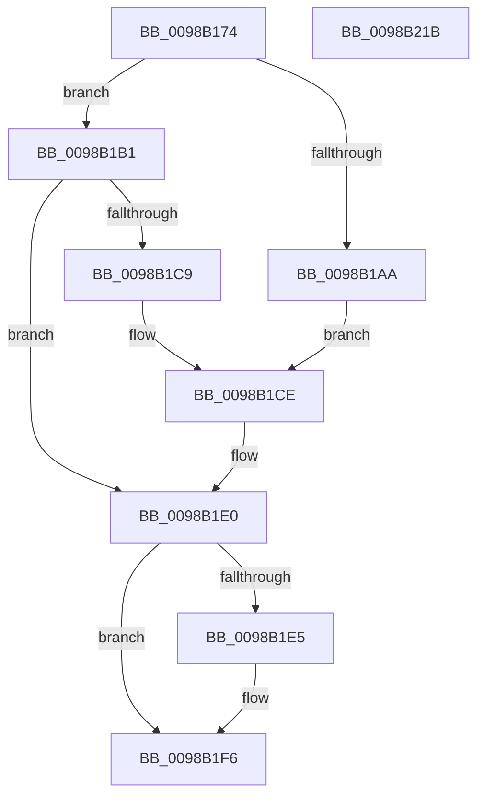

# TtmSessionMonitorControl

- RVA: `0x0098B174`–`0x0098B21C` (길이 `168` bytes)
- VA: `0x000000014098B174`
- 실행 섹션: `PAGE`
- PDB 이름 있음: `예`; PDB Function 태그: `아니요`
- unwind 정보 RVA: `0x00098710`
- 디코드: `52`개 명령, `168/168` bytes 표시
- 미해석 바이트: `0` (있으면 어셈블리에 `.byte`로 보존)

> 이 문서는 커널 이미지의 기계어와 PDB 기호를 분석해 생성했습니다. 4번과 5번은 함수 원형과 자료형을 바이너리 사용 방식에서 추정한 C 해석이며 원본 소스 복구 결과는 아닙니다.

## 1. Dependencies

- 직접 호출 지점: **6**; 고유 호출 대상: **6**
- 직접 호출자로 확인된 함수: **1**
- RIP 상대 이미지 참조: **2**

### Outgoing calls
- `0x0098B19A` → [TtmpAcquireSessionById](TtmpAcquireSessionById_function_0098B4F4.md) (function, `0x0098B4F4`)
- `0x0098B1BE` → [TtmiTerminalMonitorControl](../77/TtmiTerminalMonitorControl_function_0077D128.md) (function, `0x0077D128`)
- `0x0098B1DB` → [TtmiLogError](TtmiLogError_function_0098B39C.md) (function, `0x0098B39C`)
- `0x0098B1EC` → [ExReleaseResourceLite](../../text/25/ExReleaseResourceLite_function_0025FA10.md) (function, `0x0025FA10`)
- `0x0098B1F1` → [KeLeaveCriticalRegion](../../text/25/KeLeaveCriticalRegion_function_0025D8B0.md) (function, `0x0025D8B0`)
- `0x0098B201` → [TtmiLogSessionMonitorControl](TtmiLogSessionMonitorControl_function_0098B224.md) (function, `0x0098B224`)

### Direct callers
- [PopControlMonitor](PopControlMonitor_function_0098A7F0.md) at `0x0098A81D`

### Static image references
- `0x0098B1D1` → RVA `0x00B04310` (` ?? ::NNGAKEGL::`string'`; read)
- `0x0098B1E5` → RVA `0x00F06940` (`.data`; read)

## 2. Other-region calls and transfers

- 다른 실행 섹션으로 향하는 call: **2**
  - `0x0098B1EC` → [ExReleaseResourceLite](../../text/25/ExReleaseResourceLite_function_0025FA10.md) (`PAGE` → `.text`)
  - `0x0098B1F1` → [KeLeaveCriticalRegion](../../text/25/KeLeaveCriticalRegion_function_0025D8B0.md) (`PAGE` → `.text`)
- 별도 외부 분기/꼬리 이동을 확인하지 못했습니다.

## 3. Assembly (complete function range)

```asm
0098B174  48 8B C4                        mov rax, rsp
0098B177  48 89 58 08                     mov qword ptr [rax + 8], rbx
0098B17B  48 89 68 10                     mov qword ptr [rax + 0x10], rbp
0098B17F  56                              push rsi
0098B180  57                              push rdi
0098B181  41 56                           push r14
0098B183  48 83 EC 20                     sub rsp, 0x20
0098B187  48 83 60 20 00                  and qword ptr [rax + 0x20], 0
0098B18C  8B EA                           mov ebp, edx
0098B18E  8B D1                           mov edx, ecx
0098B190  44 8B F1                        mov r14d, ecx
0098B193  48 8D 48 20                     lea rcx, [rax + 0x20]
0098B197  41 8B F0                        mov esi, r8d
0098B19A  E8 55 03 00 00                  call 0x14098b4f4
0098B19F  48 8B 7C 24 58                  mov rdi, qword ptr [rsp + 0x58]
0098B1A4  8B D8                           mov ebx, eax
0098B1A6  85 C0                           test eax, eax
0098B1A8  79 07                           jns 0x14098b1b1
0098B1AA  BA BA 0F 00 00                  mov edx, 0xfba
0098B1AF  EB 1D                           jmp 0x14098b1ce
0098B1B1  48 8B 57 20                     mov rdx, qword ptr [rdi + 0x20]
0098B1B5  44 8B CE                        mov r9d, esi
0098B1B8  44 8B C5                        mov r8d, ebp
0098B1BB  48 8B CF                        mov rcx, rdi
0098B1BE  E8 65 1F DF FF                  call 0x14077d128
0098B1C3  8B D8                           mov ebx, eax
0098B1C5  85 C0                           test eax, eax
0098B1C7  79 17                           jns 0x14098b1e0
0098B1C9  BA C6 0F 00 00                  mov edx, 0xfc6
0098B1CE  44 8B C8                        mov r9d, eax
0098B1D1  48 8D 0D 38 91 17 00            lea rcx, [rip + 0x179138]
0098B1D8  44 8B C0                        mov r8d, eax
0098B1DB  E8 BC 01 00 00                  call 0x14098b39c
0098B1E0  48 85 FF                        test rdi, rdi
0098B1E3  74 11                           je 0x14098b1f6
0098B1E5  48 8D 0D 54 B7 57 00            lea rcx, [rip + 0x57b754]
0098B1EC  E8 1F 48 8D FF                  call 0x14025fa10
0098B1F1  E8 BA 26 8D FF                  call 0x14025d8b0
0098B1F6  44 8B CB                        mov r9d, ebx
0098B1F9  44 8B C6                        mov r8d, esi
0098B1FC  8B D5                           mov edx, ebp
0098B1FE  41 8B CE                        mov ecx, r14d
0098B201  E8 1E 00 00 00                  call 0x14098b224
0098B206  48 8B 6C 24 48                  mov rbp, qword ptr [rsp + 0x48]
0098B20B  8B C3                           mov eax, ebx
0098B20D  48 8B 5C 24 40                  mov rbx, qword ptr [rsp + 0x40]
0098B212  48 83 C4 20                     add rsp, 0x20
0098B216  41 5E                           pop r14
0098B218  5F                              pop rdi
0098B219  5E                              pop rsi
0098B21A  C3                              ret
0098B21B  CC                              int3
```

## 4. C-style interpretation (structured pseudocode)

```c
__int64 __fastcall TtmSessionMonitorControl(int a1, int a2, int a3)
{
    __int64 result;
    __int64 v_rsp;
    unsigned __int64 v_stack_p10;
    unsigned __int64 v_stack_p20;
    unsigned __int64 v_stack_p8;

    *(unsigned __int64 *)(v_rsp + 8) = v_rbx;
    *(unsigned __int64 *)(v_rsp + 16) = v_rbp;
    v_rsp = (v_rsp) - (32);
    result = TtmpAcquireSessionById(v_rsp + 32, (unsigned int)(a1), a3, a4);
    if (!sign_flag) goto loc_0098B1B1;
    goto loc_0098B1CE;
loc_0098B1B1:
    result = TtmiTerminalMonitorControl(v_stack_p20, *(unsigned __int64 *)(v_stack_p20 + 32), (unsigned int)((unsigned int)((unsigned int)(a2))), (unsigned int)((unsigned int)((unsigned int)(a3))));
    if (!sign_flag) goto loc_0098B1E0;
loc_0098B1CE:
    result = TtmiLogError(v_rip + 1544504, (unsigned int)(0xFC6ULL), (unsigned int)((unsigned int)(result)), (unsigned int)((unsigned int)(result)));
loc_0098B1E0:
    if (v_stack_p20 != 0) {
        a1 = v_rip + 5748564;
        result = ExReleaseResourceLite(a1, (unsigned int)(0xFC6ULL), (unsigned int)((unsigned int)(result)), (unsigned int)((unsigned int)(result)));
        result = KeLeaveCriticalRegion(a1, (unsigned int)(0xFC6ULL), (unsigned int)((unsigned int)(result)), (unsigned int)((unsigned int)(result)));
    }
    result = TtmiLogSessionMonitorControl((unsigned int)((unsigned int)((unsigned int)(a1))), (unsigned int)((unsigned int)((unsigned int)(a2))), (unsigned int)((unsigned int)((unsigned int)(a3))), (unsigned int)((unsigned int)((unsigned int)((unsigned int)(result)))));
    v_rsp = (v_rsp) + (32);
    return (unsigned int)((unsigned int)((unsigned int)((unsigned int)(result))));
}
```

## 5. (Beta) C Style

```c
int64_t TtmSessionMonitorControl(int32_t Arg1, int32_t Arg2, int32_t Arg3)
{
    int64_t result;
    int64_t local_rsp;
    uint64_t v_stack_p10;
    uint64_t v_stack_p20;
    uint64_t v_stack_p8;

    *(uint64_t *)(local_rsp + 0x8) = local_rbx;
    *(uint64_t *)(local_rsp + 0x10) = local_rbp;
    local_rsp = (local_rsp) - (32);
    result = TtmpAcquireSessionById(local_rsp + 32, (uint32_t)(Arg1), Arg3, a4);
    if (!sign_flag) goto loc_0098B1B1;
    goto loc_0098B1CE;
loc_0098B1B1:
    result = TtmiTerminalMonitorControl(v_stack_p20, *(uint64_t *)(v_stack_p20 + 0x20), (uint32_t)((uint32_t)((uint32_t)(Arg2))), (uint32_t)((uint32_t)((uint32_t)(Arg3))));
    if (!sign_flag) goto loc_0098B1E0;
loc_0098B1CE:
    result = TtmiLogError(v_rip + 1544504, (uint32_t)(0xFC6ULL), (uint32_t)((uint32_t)(result)), (uint32_t)((uint32_t)(result)));
loc_0098B1E0:
    if (v_stack_p20 != 0) {
        Arg1 = v_rip + 5748564;
        result = ExReleaseResourceLite(Arg1, (uint32_t)(0xFC6ULL), (uint32_t)((uint32_t)(result)), (uint32_t)((uint32_t)(result)));
        result = KeLeaveCriticalRegion(Arg1, (uint32_t)(0xFC6ULL), (uint32_t)((uint32_t)(result)), (uint32_t)((uint32_t)(result)));
    }
    result = TtmiLogSessionMonitorControl((uint32_t)((uint32_t)((uint32_t)(Arg1))), (uint32_t)((uint32_t)((uint32_t)(Arg2))), (uint32_t)((uint32_t)((uint32_t)(Arg3))), (uint32_t)((uint32_t)((uint32_t)((uint32_t)(result)))));
    local_rsp = (local_rsp) + (32);
    return (uint32_t)((uint32_t)((uint32_t)((uint32_t)(result))));
}
```

## 6. Execution-region graph

[열기: 2D/3D 그래프와 함수 탐색 컨트롤 패널](../../../control-panel.html?section=page&rva=0x0098B174&view=graph)

- 2D 그래프는 위에서 아래로 흐르고, 3D 그래프는 빈 공간을 드래그해 회전합니다. Shift+드래그는 이동, 휠은 확대·축소, 함수 노드 선택은 대상 보고서 이동입니다.

### Static fallback


