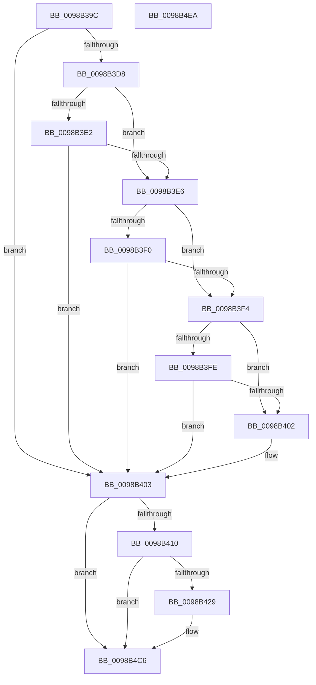

# TtmiLogError

- RVA: `0x0098B39C`–`0x0098B4EB` (길이 `335` bytes)
- VA: `0x000000014098B39C`
- 실행 섹션: `PAGE`
- PDB 이름 있음: `예`; PDB Function 태그: `아니요`
- unwind 정보 RVA: `0x00098728`
- 디코드: `86`개 명령, `335/335` bytes 표시
- 미해석 바이트: `0` (있으면 어셈블리에 `.byte`로 보존)

> 이 문서는 커널 이미지의 기계어와 PDB 기호를 분석해 생성했습니다. 4번과 5번은 함수 원형과 자료형을 바이너리 사용 방식에서 추정한 C 해석이며 원본 소스 복구 결과는 아닙니다.

## 1. Dependencies

- 직접 호출 지점: **5**; 고유 호출 대상: **5**
- 직접 호출자로 확인된 함수: **52**
- RIP 상대 이미지 참조: **7**

### Outgoing calls
- `0x0098B41C` → [tlgKeywordOn](../../text/42/tlgKeywordOn_function_0042EAA0.md) (function, `0x0042EAA0`)
- `0x0098B439` → [PsGetProcessSessionIdEx](../../text/22/PsGetProcessSessionIdEx_function_0022F8F0.md) (function, `0x0022F8F0`)
- `0x0098B45E` → [tlgCreate1Sz_char](../../text/42/tlgCreate1Sz_char_function_00427304.md) (function, `0x00427304`)
- `0x0098B4C1` → [tlgWriteTransfer_EtwWriteTransfer](../../text/42/tlgWriteTransfer_EtwWriteTransfer_function_004260E0.md) (function, `0x004260E0`)
- `0x0098B4CD` → [_security_check_cookie](../../text/6A/_security_check_cookie_function_006AC640.md) (function, `0x006AC640`)

### Direct callers
- [TtmNotifyDeviceArrival](../77/TtmNotifyDeviceArrival_function_007754F0.md) at `0x00775554`
- [TtmNotifyDeviceArrival](../77/TtmNotifyDeviceArrival_function_007754F0.md) at `0x007755C9`
- [TtmNotifyDeviceArrival](../77/TtmNotifyDeviceArrival_function_007754F0.md) at `0x0077564C`
- [TtmNotifyDeviceArrival](../77/TtmNotifyDeviceArrival_function_007754F0.md) at `0x007756CC`
- [TtmNotifyDeviceArrival](../77/TtmNotifyDeviceArrival_function_007754F0.md) at `0x00775779`
- [TtmNotifyDeviceDeparture](../77/TtmNotifyDeviceDeparture_function_007757F0.md) at `0x00775830`
- [TtmNotifyDeviceInput](../77/TtmNotifyDeviceInput_function_007758B0.md) at `0x0077590F`
- [TtmNotifyDeviceInput](../77/TtmNotifyDeviceInput_function_007758B0.md) at `0x00775989`
- [TtmiAssignDevice](../77/TtmiAssignDevice_function_00775A3C.md) at `0x00775A86`
- [TtmiPublishDeviceEnumerationEvents](../77/TtmiPublishDeviceEnumerationEvents_function_00775C0C.md) at `0x00775C71`
- [TtmiSetInputWakeCapability](../77/TtmiSetInputWakeCapability_function_00775E84.md) at `0x00775ED2`
- [TtmpCallAssignedToTerminal](../77/TtmpCallAssignedToTerminal_function_00775F70.md) at `0x00775FF4`
- [TtmpCallSetDisplayState](../77/TtmpCallSetDisplayState_function_0077608C.md) at `0x00776118`
- [TtmpCallSetInputMode](../77/TtmpCallSetInputMode_function_0077613C.md) at `0x007761BD`
- [TtmpCommitTerminalDisplayStateUpdateWorker](../77/TtmpCommitTerminalDisplayStateUpdateWorker_function_00776390.md) at `0x00776433`
- [TtmpPushTerminalState](../77/TtmpPushTerminalState_function_007768F0.md) at `0x00776943`
- [TtmpQueueTerminalDisplayStateOntoDevice](../77/TtmpQueueTerminalDisplayStateOntoDevice_function_007769C0.md) at `0x00776A28`
- [TtmNotifySessionPowerRequestDeleted](../77/TtmNotifySessionPowerRequestDeleted_function_00776E10.md) at `0x00776E55`
- [TtmiAcquireCurrentSession](../77/TtmiAcquireCurrentSession_function_00777010.md) at `0x0077704B`
- [TtmiSessionsRundown](../77/TtmiSessionsRundown_function_007771BC.md) at `0x007771F2`
- [TtmiSetDisplayPowerRequest](../77/TtmiSetDisplayPowerRequest_function_0077727C.md) at `0x00777486`
- [TtmiWriteEnumerationEventsToQueue](../77/TtmiWriteEnumerationEventsToQueue_function_00777510.md) at `0x00777545`
- [TtmiWriteEventToAllQueues](../77/TtmiWriteEventToAllQueues_function_007775AC.md) at `0x007775FC`
- [TtmpFindPowerRequestEntryById](../77/TtmpFindPowerRequestEntryById_function_007778C4.md) at `0x007779DE`
- [TtmpInsertPowerRequestToSession](../77/TtmpInsertPowerRequestToSession_function_00777A98.md) at `0x00777AEE`
- [TtmpInsertPowerRequestToSession](../77/TtmpInsertPowerRequestToSession_function_00777A98.md) at `0x00777DA7`
- [TtmpSetDisplayRequestEnded](../77/TtmpSetDisplayRequestEnded_function_00778124.md) at `0x007781CA`
- [TtmpSetDisplayRequestEnded](../77/TtmpSetDisplayRequestEnded_function_00778124.md) at `0x007781FD`
- [TtmpUpdateDisplayRequiredPowerRequest](../77/TtmpUpdateDisplayRequiredPowerRequest_function_00778304.md) at `0x0077835C`
- [TtmpUpdatePowerRequestAttribute](../77/TtmpUpdatePowerRequestAttribute_function_007783D4.md) at `0x00778420`
- [TtmpWriteDisplayRequiredPowerRequestUpdatedEvent](../77/TtmpWriteDisplayRequiredPowerRequestUpdatedEvent_function_00778498.md) at `0x00778516`
- [TtmpAcquireSessionFromTerminalHandle](../77/TtmpAcquireSessionFromTerminalHandle_function_00778544.md) at `0x007785C2`
- [TtmpAcquireSessionFromTerminalHandle](../77/TtmpAcquireSessionFromTerminalHandle_function_00778544.md) at `0x007785D9`
- [TtmpDispatchAssignDevice](../77/TtmpDispatchAssignDevice_function_00778670.md) at `0x007786BC`
- [TtmpDispatchCreateEventQueue](../77/TtmpDispatchCreateEventQueue_function_00778718.md) at `0x00778773`
- [TtmpDispatchCreateEventQueue](../77/TtmpDispatchCreateEventQueue_function_00778718.md) at `0x007787A2`
- [TtmpDispatchCreateTerminal](../77/TtmpDispatchCreateTerminal_function_00778858.md) at `0x007788AA`
- [TtmpDispatchCreateTerminal](../77/TtmpDispatchCreateTerminal_function_00778858.md) at `0x00778900`
- [TtmpDispatchEvacuateDevices](../77/TtmpDispatchEvacuateDevices_function_00778948.md) at `0x0077898C`
- [TtmpDispatchGetTerminalEvent](../77/TtmpDispatchGetTerminalEvent_function_007789F4.md) at `0x00778A52`
- [TtmpDispatchGetTerminalEvent](../77/TtmpDispatchGetTerminalEvent_function_007789F4.md) at `0x00778A69`
- [TtmpDispatchOpenTerminal](../77/TtmpDispatchOpenTerminal_function_00778AB8.md) at `0x00778AF4`
- [TtmpDispatchSetDefaultDeviceAssignment](../77/TtmpDispatchSetDefaultDeviceAssignment_function_00778B54.md) at `0x00778BA8`
- [TtmpDispatchSetDisplayPowerRequest](../77/TtmpDispatchSetDisplayPowerRequest_function_00778C10.md) at `0x00778C5C`
- [TtmpDispatchSetDisplayState](../77/TtmpDispatchSetDisplayState_function_00778CBC.md) at `0x00778D08`
- [TtmpDispatchSetDisplayTimeouts](../77/TtmpDispatchSetDisplayTimeouts_function_00778D70.md) at `0x00778DC8`
- [TtmpDispatchSetInputWakeCapability](../77/TtmpDispatchSetInputWakeCapability_function_00778E2C.md) at `0x00778E78`
- [TtmiCreateTerminal](../77/TtmiCreateTerminal_function_0077C748.md) at `0x0077C7BA`
- [TtmiCreateTerminal](../77/TtmiCreateTerminal_function_0077C748.md) at `0x0077C7D1`
- [TtmiCreateTerminal](../77/TtmiCreateTerminal_function_0077C748.md) at `0x0077C9A6`
- [TtmiOpenDefaultTerminal](../77/TtmiOpenDefaultTerminal_function_0077CC20.md) at `0x0077CCCB`
- [TtmiTerminalMonitorControl](../77/TtmiTerminalMonitorControl_function_0077D128.md) at `0x0077D16F`
- [TtmiCreateEventQueue](../77/TtmiCreateEventQueue_function_0077DA14.md) at `0x0077DABF`
- [TtmiRetrieveEventFromQueue](../77/TtmiRetrieveEventFromQueue_function_0077DCB8.md) at `0x0077DCFF`
- [TtmiWriteEventToSingleQueue](../77/TtmiWriteEventToSingleQueue_function_0077DE04.md) at `0x0077DE45`
- [TtmNotifyConsoleUserPresent](../91/TtmNotifyConsoleUserPresent_function_0091327C.md) at `0x009132B9`
- [TtmNotifyLowPowerStateExited](TtmNotifyLowPowerStateExited_function_0098A878.md) at `0x0098A8A8`
- [TtmNotifySessionPowerStateChange](TtmNotifySessionPowerStateChange_function_0098A8F4.md) at `0x0098A925`
- [TtmNotifySessionTerminalInput](TtmNotifySessionTerminalInput_function_0098A984.md) at `0x0098A9BC`
- [TtmInitCurrentSession](TtmInitCurrentSession_function_0098AA18.md) at `0x0098AA65`
- [TtmInitCurrentSession](TtmInitCurrentSession_function_0098AA18.md) at `0x0098AB92`
- [TtmDispatchApi](TtmDispatchApi_function_0098AD08.md) at `0x0098AF03`
- [TtmDispatchApi](TtmDispatchApi_function_0098AD08.md) at `0x0098AF7F`
- [TtmSessionMonitorControl](TtmSessionMonitorControl_function_0098B174.md) at `0x0098B1DB`
- [TtmNotifySessionDisplayBurst](TtmNotifySessionDisplayBurst_function_0098B300.md) at `0x0098B336`
- [TtmpAcquireSessionById](TtmpAcquireSessionById_function_0098B4F4.md) at `0x0098B52E`
- [TtmpAcquireSessionById](TtmpAcquireSessionById_function_0098B4F4.md) at `0x0098B567`
- [TtmNotifySessionDisplayRequiredChange](TtmNotifySessionDisplayRequiredChange_function_0098C6B4.md) at `0x0098C709`

### Static image references
- `0x0098B3B6` → RVA `0x00E0A740` (`.data`; read)
- `0x0098B3C4` → RVA `0x00FD81E0` (`PAGEDATA`; read)
- `0x0098B3D8` → RVA `0x00FD81E4` (`PAGEDATA`; read)
- `0x0098B3E6` → RVA `0x00FD81E8` (`PAGEDATA`; read)
- `0x0098B3F4` → RVA `0x00FD81EC` (`PAGEDATA`; read)
- `0x0098B403` → RVA `0x00FD88C8` (`PAGEDATA`; read)
- `0x0098B46F` → RVA `0x00051499` (`.rdata`; read)

## 2. Other-region calls and transfers

- 다른 실행 섹션으로 향하는 call: **5**
  - `0x0098B41C` → [tlgKeywordOn](../../text/42/tlgKeywordOn_function_0042EAA0.md) (`PAGE` → `.text`)
  - `0x0098B439` → [PsGetProcessSessionIdEx](../../text/22/PsGetProcessSessionIdEx_function_0022F8F0.md) (`PAGE` → `.text`)
  - `0x0098B45E` → [tlgCreate1Sz_char](../../text/42/tlgCreate1Sz_char_function_00427304.md) (`PAGE` → `.text`)
  - `0x0098B4C1` → [tlgWriteTransfer_EtwWriteTransfer](../../text/42/tlgWriteTransfer_EtwWriteTransfer_function_004260E0.md) (`PAGE` → `.text`)
  - `0x0098B4CD` → [_security_check_cookie](../../text/6A/_security_check_cookie_function_006AC640.md) (`PAGE` → `.text`)
- 별도 외부 분기/꼬리 이동을 확인하지 못했습니다.

## 3. Assembly (complete function range)

```asm
0098B39C  48 89 5C 24 10                  mov qword ptr [rsp + 0x10], rbx
0098B3A1  48 89 74 24 18                  mov qword ptr [rsp + 0x18], rsi
0098B3A6  55                              push rbp
0098B3A7  57                              push rdi
0098B3A8  41 56                           push r14
0098B3AA  48 8D 6C 24 B9                  lea rbp, [rsp - 0x47]
0098B3AF  48 81 EC C0 00 00 00            sub rsp, 0xc0
0098B3B6  48 8B 05 83 F3 47 00            mov rax, qword ptr [rip + 0x47f383]
0098B3BD  48 33 C4                        xor rax, rsp
0098B3C0  48 89 45 37                     mov qword ptr [rbp + 0x37], rax
0098B3C4  80 3D 15 CE 64 00 00            cmp byte ptr [rip + 0x64ce15], 0
0098B3CB  41 8B D9                        mov ebx, r9d
0098B3CE  41 8B F8                        mov edi, r8d
0098B3D1  8B F2                           mov esi, edx
0098B3D3  4C 8B F1                        mov r14, rcx
0098B3D6  74 2B                           je 0x14098b403
0098B3D8  8B 05 06 CE 64 00               mov eax, dword ptr [rip + 0x64ce06]
0098B3DE  85 C0                           test eax, eax
0098B3E0  74 04                           je 0x14098b3e6
0098B3E2  3B C2                           cmp eax, edx
0098B3E4  75 1D                           jne 0x14098b403
0098B3E6  8B 05 FC CD 64 00               mov eax, dword ptr [rip + 0x64cdfc]
0098B3EC  85 C0                           test eax, eax
0098B3EE  74 04                           je 0x14098b3f4
0098B3F0  3B C7                           cmp eax, edi
0098B3F2  75 0F                           jne 0x14098b403
0098B3F4  8B 05 F2 CD 64 00               mov eax, dword ptr [rip + 0x64cdf2]
0098B3FA  85 C0                           test eax, eax
0098B3FC  74 04                           je 0x14098b402
0098B3FE  3B C3                           cmp eax, ebx
0098B400  75 01                           jne 0x14098b403
0098B402  CC                              int3
0098B403  83 3D BE D4 64 00 05            cmp dword ptr [rip + 0x64d4be], 5
0098B40A  0F 86 B6 00 00 00               jbe 0x14098b4c6
0098B410  BA 02 00 00 00                  mov edx, 2
0098B415  48 8D 0D AC D4 64 00            lea rcx, [rip + 0x64d4ac]
0098B41C  E8 7F 36 AA FF                  call 0x14042eaa0
0098B421  84 C0                           test al, al
0098B423  0F 84 9D 00 00 00               je 0x14098b4c6
0098B429  65 48 8B 0C 25 88 01 00 00      mov rcx, qword ptr gs:[0x188]
0098B432  48 8B 89 B8 00 00 00            mov rcx, qword ptr [rcx + 0xb8]
0098B439  E8 B2 44 8A FF                  call 0x14022f8f0
0098B43E  83 65 F3 00                     and dword ptr [rbp - 0xd], 0
0098B442  48 8D 4D F7                     lea rcx, [rbp - 9]
0098B446  89 45 B7                        mov dword ptr [rbp - 0x49], eax
0098B449  41 B8 04 00 00 00               mov r8d, 4
0098B44F  48 8D 45 B7                     lea rax, [rbp - 0x49]
0098B453  44 89 45 EF                     mov dword ptr [rbp - 0x11], r8d
0098B457  49 8B D6                        mov rdx, r14
0098B45A  48 89 45 E7                     mov qword ptr [rbp - 0x19], rax
0098B45E  E8 A1 BE A9 FF                  call 0x140427304
0098B463  83 65 13 00                     and dword ptr [rbp + 0x13], 0
0098B467  48 8D 45 BB                     lea rax, [rbp - 0x45]
0098B46B  83 65 23 00                     and dword ptr [rbp + 0x23], 0
0098B46F  48 8D 15 23 60 6C FF            lea rdx, [rip - 0x939fdd]
0098B476  83 65 33 00                     and dword ptr [rbp + 0x33], 0
0098B47A  48 8D 0D 47 D4 64 00            lea rcx, [rip + 0x64d447]
0098B481  48 89 45 07                     mov qword ptr [rbp + 7], rax
0098B485  45 33 C9                        xor r9d, r9d
0098B488  48 8D 45 BF                     lea rax, [rbp - 0x41]
0098B48C  44 89 45 0F                     mov dword ptr [rbp + 0xf], r8d
0098B490  48 89 45 17                     mov qword ptr [rbp + 0x17], rax
0098B494  48 8D 45 C3                     lea rax, [rbp - 0x3d]
0098B498  48 89 45 27                     mov qword ptr [rbp + 0x27], rax
0098B49C  48 8D 45 C7                     lea rax, [rbp - 0x39]
0098B4A0  44 89 45 1F                     mov dword ptr [rbp + 0x1f], r8d
0098B4A4  44 89 45 2F                     mov dword ptr [rbp + 0x2f], r8d
0098B4A8  45 33 C0                        xor r8d, r8d
0098B4AB  48 89 44 24 28                  mov qword ptr [rsp + 0x28], rax
0098B4B0  C7 44 24 20 07 00 00 00         mov dword ptr [rsp + 0x20], 7
0098B4B8  89 75 BB                        mov dword ptr [rbp - 0x45], esi
0098B4BB  89 7D BF                        mov dword ptr [rbp - 0x41], edi
0098B4BE  89 5D C3                        mov dword ptr [rbp - 0x3d], ebx
0098B4C1  E8 1A AC A9 FF                  call 0x1404260e0
0098B4C6  48 8B 4D 37                     mov rcx, qword ptr [rbp + 0x37]
0098B4CA  48 33 CC                        xor rcx, rsp
0098B4CD  E8 6E 11 D2 FF                  call 0x1406ac640
0098B4D2  4C 8D 9C 24 C0 00 00 00         lea r11, [rsp + 0xc0]
0098B4DA  49 8B 5B 28                     mov rbx, qword ptr [r11 + 0x28]
0098B4DE  49 8B 73 30                     mov rsi, qword ptr [r11 + 0x30]
0098B4E2  49 8B E3                        mov rsp, r11
0098B4E5  41 5E                           pop r14
0098B4E7  5F                              pop rdi
0098B4E8  5D                              pop rbp
0098B4E9  C3                              ret
0098B4EA  CC                              int3
```

## 4. C-style interpretation (structured pseudocode)

```c
__int64 __fastcall TtmiLogError(__int64 a1, int a2, int a3, int a4)
{
    __int64 result;
    __int64 v_rsp;
    unsigned __int64 v_stack_m18;
    unsigned __int64 v_stack_m28;
    unsigned int v_stack_m2C;
    unsigned int v_stack_m30;
    unsigned __int64 v_stack_m38;
    unsigned int v_stack_m3C;
    unsigned int v_stack_m40;
    unsigned __int64 v_stack_m48;
    unsigned int v_stack_m4C;
    unsigned int v_stack_m50;
    unsigned __int64 v_stack_m58;
    unsigned __int64 v_stack_m5F;
    unsigned __int64 v_stack_m68;
    unsigned int v_stack_m6C;
    unsigned int v_stack_m70;
    unsigned __int64 v_stack_m78;
    unsigned __int64 v_stack_m98;
    unsigned __int64 v_stack_m9C;
    unsigned __int64 v_stack_mA0;
    unsigned __int64 v_stack_mA4;
    unsigned int v_stack_mA8;
    unsigned __int64 v_stack_mB0;
    unsigned int v_stack_mB8;
    unsigned __int64 v_stack_p10;
    unsigned __int64 v_stack_p18;

    v_stack_p10 = v_rbx;
    v_stack_p18 = v_rsi;
    v_rsp = (v_rsp) - (192);
    result = (*(unsigned __int64 *)(v_rip + 4715395)) ^ (v_rsp);
    v_stack_m28 = result;
    if ((*(unsigned __int8 *)(v_rip + 6606357)) == 0) goto loc_0098B403;
    if ((unsigned int)((unsigned int)(*(unsigned int *)(v_rip + 6606342))) == 0) goto loc_0098B3E6;
    if (((unsigned int)((unsigned int)(*(unsigned int *)(v_rip + 6606342)))) != a2) goto loc_0098B403;
loc_0098B3E6:
    if ((unsigned int)((unsigned int)(*(unsigned int *)(v_rip + 6606332))) == 0) goto loc_0098B3F4;
    if (((unsigned int)((unsigned int)(*(unsigned int *)(v_rip + 6606332)))) != ((unsigned int)((unsigned int)(a3)))) goto loc_0098B403;
loc_0098B3F4:
    if ((unsigned int)((unsigned int)(*(unsigned int *)(v_rip + 6606322))) == 0) goto loc_0098B402;
    if (((unsigned int)((unsigned int)(*(unsigned int *)(v_rip + 6606322)))) == ((unsigned int)((unsigned int)(a4)))) {
    }
    if ((*(unsigned int *)(v_rip + 6608062)) <= 5) goto loc_0098B4C6;
    result = tlgKeywordOn(v_rip + 6608044, 2, a3, a4);
    if ((unsigned __int8)(result) != 0) {
        a1 = *(unsigned __int64 *)(gs_base + (0 + 392));
        a1 = *(unsigned __int64 *)(a1 + 184);
        result = PsGetProcessSessionIdEx(a1, 2, a3, a4);
        a1 = v_stack_m68;
        v_stack_mA8 = (unsigned int)(result);
        a3 = 4;
        result = v_stack_mA8;
        v_stack_m70 = a3;
        a2 = a1;
        v_stack_m78 = result;
        result = tlgCreate1Sz_char(a1, a2, a3, a4);
        result = v_stack_mA4;
        a2 = v_rip - 9674717;
        a1 = v_rip + 6607943;
        v_stack_m58 = result;
        a4 = 0;
        result = v_stack_mA0;
        v_stack_m50 = a3;
        v_stack_m48 = result;
        result = v_stack_m9C;
        v_stack_m38 = result;
        result = v_stack_m98;
        v_stack_m40 = a3;
        v_stack_m30 = a3;
        a3 = 0;
        v_stack_mB0 = result;
        v_stack_mB8 = 7;
        v_stack_mA4 = (unsigned int)((unsigned int)(a2));
        v_stack_mA0 = (unsigned int)((unsigned int)(a3));
        v_stack_m9C = (unsigned int)((unsigned int)(a4));
        result = tlgWriteTransfer_EtwWriteTransfer(a1, a2, a3, a4);
    }
    a1 = (v_stack_m28) ^ (v_rsp);
    result = _security_check_cookie(a1, a2, a3, a4);
    return result;
}
```

## 5. (Beta) C Style

```c
int64_t TtmiLogError(int64_t Arg1, int32_t Arg2, int32_t Arg3, int32_t Arg4)
{
    int64_t result;
    int64_t local_rsp;
    uint64_t v_stack_m18;
    uint64_t v_stack_m28;
    uint32_t v_stack_m2C;
    uint32_t v_stack_m30;
    uint64_t v_stack_m38;
    uint32_t v_stack_m3C;
    uint32_t v_stack_m40;
    uint64_t v_stack_m48;
    uint32_t v_stack_m4C;
    uint32_t v_stack_m50;
    uint64_t v_stack_m58;
    uint64_t v_stack_m5F;
    uint64_t v_stack_m68;
    uint32_t v_stack_m6C;
    uint32_t v_stack_m70;
    uint64_t v_stack_m78;
    uint64_t v_stack_m98;
    uint64_t v_stack_m9C;
    uint64_t v_stack_mA0;
    uint64_t v_stack_mA4;
    uint32_t v_stack_mA8;
    uint64_t v_stack_mB0;
    uint32_t v_stack_mB8;
    uint64_t v_stack_p10;
    uint64_t v_stack_p18;

    v_stack_p10 = local_rbx;
    v_stack_p18 = local_rsi;
    local_rsp = (local_rsp) - (192);
    result = (*(uint64_t *)(v_rip + 0x47F383)) ^ (local_rsp);
    v_stack_m28 = result;
    if ((*(uint8_t *)(v_rip + 0x64CE15)) == 0) goto loc_0098B403;
    if ((uint32_t)((uint32_t)(*(uint32_t *)(v_rip + 0x64CE06))) == 0) goto loc_0098B3E6;
    if (((uint32_t)((uint32_t)(*(uint32_t *)(v_rip + 0x64CE06)))) != Arg2) goto loc_0098B403;
loc_0098B3E6:
    if ((uint32_t)((uint32_t)(*(uint32_t *)(v_rip + 0x64CDFC))) == 0) goto loc_0098B3F4;
    if (((uint32_t)((uint32_t)(*(uint32_t *)(v_rip + 0x64CDFC)))) != ((uint32_t)((uint32_t)(Arg3)))) goto loc_0098B403;
loc_0098B3F4:
    if ((uint32_t)((uint32_t)(*(uint32_t *)(v_rip + 0x64CDF2))) == 0) goto loc_0098B402;
    if (((uint32_t)((uint32_t)(*(uint32_t *)(v_rip + 0x64CDF2)))) == ((uint32_t)((uint32_t)(Arg4)))) {
    }
    if ((*(uint32_t *)(v_rip + 0x64D4BE)) <= 5) goto loc_0098B4C6;
    result = tlgKeywordOn(v_rip + 6608044, 2, Arg3, Arg4);
    if ((uint8_t)(result) != 0) {
        Arg1 = *(uint64_t *)(gs_base + (0 + 0x188));
        Arg1 = *(uint64_t *)(Arg1 + 0xB8);
        result = PsGetProcessSessionIdEx(Arg1, 2, Arg3, Arg4);
        Arg1 = v_stack_m68;
        v_stack_mA8 = (uint32_t)(result);
        Arg3 = 4;
        result = v_stack_mA8;
        v_stack_m70 = Arg3;
        Arg2 = Arg1;
        v_stack_m78 = result;
        result = tlgCreate1Sz_char(Arg1, Arg2, Arg3, Arg4);
        result = v_stack_mA4;
        Arg2 = v_rip - 9674717;
        Arg1 = v_rip + 6607943;
        v_stack_m58 = result;
        Arg4 = 0;
        result = v_stack_mA0;
        v_stack_m50 = Arg3;
        v_stack_m48 = result;
        result = v_stack_m9C;
        v_stack_m38 = result;
        result = v_stack_m98;
        v_stack_m40 = Arg3;
        v_stack_m30 = Arg3;
        Arg3 = 0;
        v_stack_mB0 = result;
        v_stack_mB8 = 7;
        v_stack_mA4 = (uint32_t)((uint32_t)(Arg2));
        v_stack_mA0 = (uint32_t)((uint32_t)(Arg3));
        v_stack_m9C = (uint32_t)((uint32_t)(Arg4));
        result = tlgWriteTransfer_EtwWriteTransfer(Arg1, Arg2, Arg3, Arg4);
    }
    Arg1 = (v_stack_m28) ^ (local_rsp);
    result = _security_check_cookie(Arg1, Arg2, Arg3, Arg4);
    return result;
}
```

## 6. Execution-region graph

[열기: 2D/3D 그래프와 함수 탐색 컨트롤 패널](../../../control-panel.html?section=page&rva=0x0098B39C&view=graph)

- 2D 그래프는 위에서 아래로 흐르고, 3D 그래프는 빈 공간을 드래그해 회전합니다. Shift+드래그는 이동, 휠은 확대·축소, 함수 노드 선택은 대상 보고서 이동입니다.

### Static fallback


