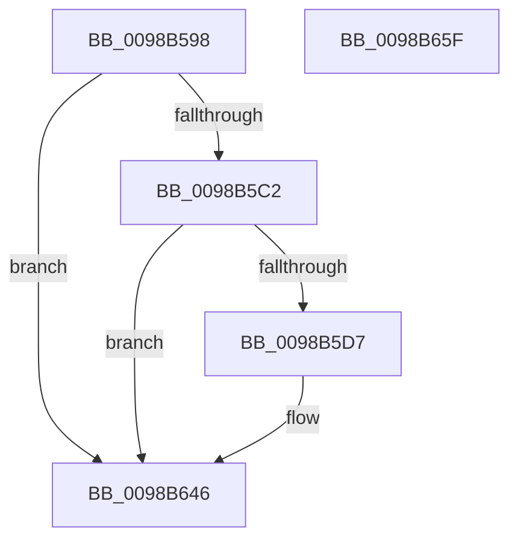

# TtmiLogInitCurrentSessionStop

- RVA: `0x0098B598`–`0x0098B660` (길이 `200` bytes)
- VA: `0x000000014098B598`
- 실행 섹션: `PAGE`
- PDB 이름 있음: `예`; PDB Function 태그: `아니요`
- unwind 정보 RVA: `0x000986F8`
- 디코드: `42`개 명령, `200/200` bytes 표시
- 미해석 바이트: `0` (있으면 어셈블리에 `.byte`로 보존)

> 이 문서는 커널 이미지의 기계어와 PDB 기호를 분석해 생성했습니다. 4번과 5번은 함수 원형과 자료형을 바이너리 사용 방식에서 추정한 C 해석이며 원본 소스 복구 결과는 아닙니다.

## 1. Dependencies

- 직접 호출 지점: **4**; 고유 호출 대상: **4**
- 직접 호출자로 확인된 함수: **1**
- RIP 상대 이미지 참조: **3**

### Outgoing calls
- `0x0098B5CE` → [tlgKeywordOn](../../text/42/tlgKeywordOn_function_0042EAA0.md) (function, `0x0042EAA0`)
- `0x0098B5E7` → [PsGetProcessSessionIdEx](../../text/22/PsGetProcessSessionIdEx_function_0022F8F0.md) (function, `0x0022F8F0`)
- `0x0098B641` → [tlgWriteTransfer_EtwWriteTransfer](../../text/42/tlgWriteTransfer_EtwWriteTransfer_function_004260E0.md) (function, `0x004260E0`)
- `0x0098B651` → [_security_check_cookie](../../text/6A/_security_check_cookie_function_006AC640.md) (function, `0x006AC640`)

### Direct callers
- [TtmInitCurrentSession](TtmInitCurrentSession_function_0098AA18.md) at `0x0098AC47`

### Static image references
- `0x0098B5A1` → RVA `0x00E0A740` (`.data`; read)
- `0x0098B5B3` → RVA `0x00FD88C8` (`PAGEDATA`; read)
- `0x0098B636` → RVA `0x000521B5` (`.rdata`; read)

## 2. Other-region calls and transfers

- 다른 실행 섹션으로 향하는 call: **4**
  - `0x0098B5CE` → [tlgKeywordOn](../../text/42/tlgKeywordOn_function_0042EAA0.md) (`PAGE` → `.text`)
  - `0x0098B5E7` → [PsGetProcessSessionIdEx](../../text/22/PsGetProcessSessionIdEx_function_0022F8F0.md) (`PAGE` → `.text`)
  - `0x0098B641` → [tlgWriteTransfer_EtwWriteTransfer](../../text/42/tlgWriteTransfer_EtwWriteTransfer_function_004260E0.md) (`PAGE` → `.text`)
  - `0x0098B651` → [_security_check_cookie](../../text/6A/_security_check_cookie_function_006AC640.md) (`PAGE` → `.text`)
- 별도 외부 분기/꼬리 이동을 확인하지 못했습니다.

## 3. Assembly (complete function range)

```asm
0098B598  40 53                           push rbx
0098B59A  48 81 EC 90 00 00 00            sub rsp, 0x90
0098B5A1  48 8B 05 98 F1 47 00            mov rax, qword ptr [rip + 0x47f198]
0098B5A8  48 33 C4                        xor rax, rsp
0098B5AB  48 89 84 24 80 00 00 00         mov qword ptr [rsp + 0x80], rax
0098B5B3  83 3D 0E D3 64 00 05            cmp dword ptr [rip + 0x64d30e], 5
0098B5BA  8B D9                           mov ebx, ecx
0098B5BC  0F 86 84 00 00 00               jbe 0x14098b646
0098B5C2  BA 01 00 00 00                  mov edx, 1
0098B5C7  48 8D 0D FA D2 64 00            lea rcx, [rip + 0x64d2fa]
0098B5CE  E8 CD 34 AA FF                  call 0x14042eaa0
0098B5D3  84 C0                           test al, al
0098B5D5  74 6F                           je 0x14098b646
0098B5D7  65 48 8B 0C 25 88 01 00 00      mov rcx, qword ptr gs:[0x188]
0098B5E0  48 8B 89 B8 00 00 00            mov rcx, qword ptr [rcx + 0xb8]
0098B5E7  E8 04 43 8A FF                  call 0x14022f8f0
0098B5EC  83 64 24 6C 00                  and dword ptr [rsp + 0x6c], 0
0098B5F1  48 8D 0D D0 D2 64 00            lea rcx, [rip + 0x64d2d0]
0098B5F8  83 64 24 7C 00                  and dword ptr [rsp + 0x7c], 0
0098B5FD  BA 04 00 00 00                  mov edx, 4
0098B602  89 44 24 30                     mov dword ptr [rsp + 0x30], eax
0098B606  45 33 C9                        xor r9d, r9d
0098B609  48 8D 44 24 30                  lea rax, [rsp + 0x30]
0098B60E  89 54 24 68                     mov dword ptr [rsp + 0x68], edx
0098B612  48 89 44 24 60                  mov qword ptr [rsp + 0x60], rax
0098B617  45 33 C0                        xor r8d, r8d
0098B61A  48 8D 44 24 34                  lea rax, [rsp + 0x34]
0098B61F  89 54 24 78                     mov dword ptr [rsp + 0x78], edx
0098B623  48 89 44 24 70                  mov qword ptr [rsp + 0x70], rax
0098B628  48 8D 44 24 40                  lea rax, [rsp + 0x40]
0098B62D  48 89 44 24 28                  mov qword ptr [rsp + 0x28], rax
0098B632  89 54 24 20                     mov dword ptr [rsp + 0x20], edx
0098B636  48 8D 15 78 6B 6C FF            lea rdx, [rip - 0x939488]
0098B63D  89 5C 24 34                     mov dword ptr [rsp + 0x34], ebx
0098B641  E8 9A AA A9 FF                  call 0x1404260e0
0098B646  48 8B 8C 24 80 00 00 00         mov rcx, qword ptr [rsp + 0x80]
0098B64E  48 33 CC                        xor rcx, rsp
0098B651  E8 EA 0F D2 FF                  call 0x1406ac640
0098B656  48 81 C4 90 00 00 00            add rsp, 0x90
0098B65D  5B                              pop rbx
0098B65E  C3                              ret
0098B65F  CC                              int3
```

## 4. C-style interpretation (structured pseudocode)

```c
__int64 __fastcall TtmiLogInitCurrentSessionStop(int a1, __int64 a2, int a3, int a4)
{
    __int64 result;
    __int64 v_rsp;
    unsigned __int64 v_stack_m18;
    unsigned int v_stack_m1C;
    unsigned int v_stack_m20;
    unsigned __int64 v_stack_m28;
    unsigned int v_stack_m2C;
    unsigned int v_stack_m30;
    unsigned __int64 v_stack_m38;
    unsigned __int64 v_stack_m58;
    unsigned __int64 v_stack_m64;
    unsigned int v_stack_m68;
    unsigned __int64 v_stack_m70;
    unsigned int v_stack_m78;

    v_rsp = (v_rsp) - (144);
    result = (*(unsigned __int64 *)(v_rip + 4714904)) ^ (v_rsp);
    v_stack_m18 = result;
    if ((*(unsigned int *)(v_rip + 6607630)) <= 5) goto loc_0098B646;
    result = tlgKeywordOn(v_rip + 6607610, 1, a3, a4);
    if ((unsigned __int8)(result) != 0) {
        a1 = *(unsigned __int64 *)(gs_base + (0 + 392));
        a1 = *(unsigned __int64 *)(a1 + 184);
        result = PsGetProcessSessionIdEx(a1, 1, a3, a4);
        a1 = v_rip + 6607568;
        a2 = 4;
        v_stack_m68 = (unsigned int)(result);
        a4 = 0;
        result = v_stack_m68;
        v_stack_m30 = (unsigned int)(a2);
        v_stack_m38 = result;
        a3 = 0;
        result = v_stack_m64;
        v_stack_m20 = (unsigned int)(a2);
        v_stack_m28 = result;
        result = v_stack_m58;
        v_stack_m70 = result;
        v_stack_m78 = (unsigned int)(a2);
        a2 = v_rip - 9671816;
        v_stack_m64 = (unsigned int)((unsigned int)(a1));
        result = tlgWriteTransfer_EtwWriteTransfer(a1, a2, a3, a4);
    }
    a1 = (v_stack_m18) ^ (v_rsp);
    result = _security_check_cookie(a1, a2, a3, a4);
    v_rsp = (v_rsp) + (144);
    return result;
}
```

## 5. (Beta) C Style

```c
int64_t TtmiLogInitCurrentSessionStop(int32_t Arg1, int64_t Arg2, int32_t Arg3, int32_t Arg4)
{
    int64_t result;
    int64_t local_rsp;
    uint64_t v_stack_m18;
    uint32_t v_stack_m1C;
    uint32_t v_stack_m20;
    uint64_t v_stack_m28;
    uint32_t v_stack_m2C;
    uint32_t v_stack_m30;
    uint64_t v_stack_m38;
    uint64_t v_stack_m58;
    uint64_t v_stack_m64;
    uint32_t v_stack_m68;
    uint64_t v_stack_m70;
    uint32_t v_stack_m78;

    local_rsp = (local_rsp) - (144);
    result = (*(uint64_t *)(v_rip + 0x47F198)) ^ (local_rsp);
    v_stack_m18 = result;
    if ((*(uint32_t *)(v_rip + 0x64D30E)) <= 5) goto loc_0098B646;
    result = tlgKeywordOn(v_rip + 6607610, 1, Arg3, Arg4);
    if ((uint8_t)(result) != 0) {
        Arg1 = *(uint64_t *)(gs_base + (0 + 0x188));
        Arg1 = *(uint64_t *)(Arg1 + 0xB8);
        result = PsGetProcessSessionIdEx(Arg1, 1, Arg3, Arg4);
        Arg1 = v_rip + 6607568;
        Arg2 = 4;
        v_stack_m68 = (uint32_t)(result);
        Arg4 = 0;
        result = v_stack_m68;
        v_stack_m30 = (uint32_t)(Arg2);
        v_stack_m38 = result;
        Arg3 = 0;
        result = v_stack_m64;
        v_stack_m20 = (uint32_t)(Arg2);
        v_stack_m28 = result;
        result = v_stack_m58;
        v_stack_m70 = result;
        v_stack_m78 = (uint32_t)(Arg2);
        Arg2 = v_rip - 9671816;
        v_stack_m64 = (uint32_t)((uint32_t)(Arg1));
        result = tlgWriteTransfer_EtwWriteTransfer(Arg1, Arg2, Arg3, Arg4);
    }
    Arg1 = (v_stack_m18) ^ (local_rsp);
    result = _security_check_cookie(Arg1, Arg2, Arg3, Arg4);
    local_rsp = (local_rsp) + (144);
    return result;
}
```

## 6. Execution-region graph

[열기: 2D/3D 그래프와 함수 탐색 컨트롤 패널](../../../control-panel.html?section=page&rva=0x0098B598&view=graph)

- 2D 그래프는 위에서 아래로 흐르고, 3D 그래프는 빈 공간을 드래그해 회전합니다. Shift+드래그는 이동, 휠은 확대·축소, 함수 노드 선택은 대상 보고서 이동입니다.

### Static fallback


