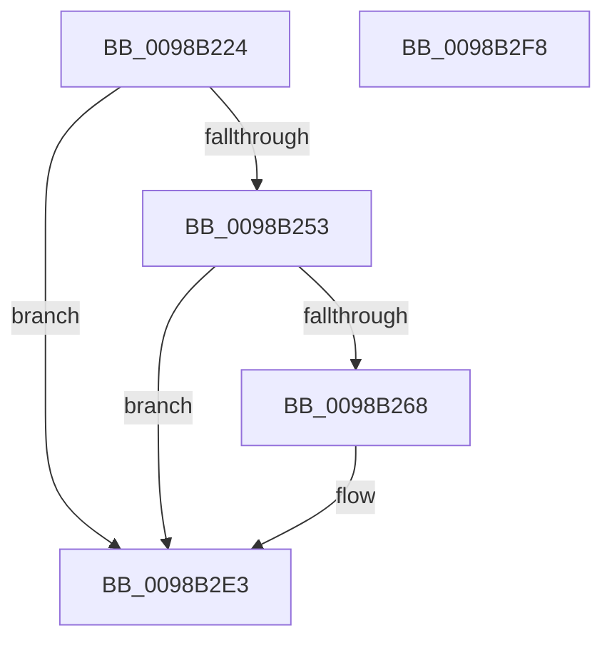

# TtmiLogSessionMonitorControl

- RVA: `0x0098B224`–`0x0098B2F9` (길이 `213` bytes)
- VA: `0x000000014098B224`
- 실행 섹션: `PAGE`
- PDB 이름 있음: `예`; PDB Function 태그: `아니요`
- unwind 정보 RVA: `0x00079278`
- 디코드: `51`개 명령, `213/213` bytes 표시
- 미해석 바이트: `0` (있으면 어셈블리에 `.byte`로 보존)

> 이 문서는 커널 이미지의 기계어와 PDB 기호를 분석해 생성했습니다. 4번과 5번은 함수 원형과 자료형을 바이너리 사용 방식에서 추정한 C 해석이며 원본 소스 복구 결과는 아닙니다.

## 1. Dependencies

- 직접 호출 지점: **3**; 고유 호출 대상: **3**
- 직접 호출자로 확인된 함수: **1**
- RIP 상대 이미지 참조: **3**

### Outgoing calls
- `0x0098B25F` → [tlgKeywordOn](../../text/42/tlgKeywordOn_function_0042EAA0.md) (function, `0x0042EAA0`)
- `0x0098B2DE` → [tlgWriteTransfer_EtwWriteTransfer](../../text/42/tlgWriteTransfer_EtwWriteTransfer_function_004260E0.md) (function, `0x004260E0`)
- `0x0098B2EA` → [_security_check_cookie](../../text/6A/_security_check_cookie_function_006AC640.md) (function, `0x006AC640`)

### Direct callers
- [TtmSessionMonitorControl](TtmSessionMonitorControl_function_0098B174.md) at `0x0098B201`

### Static image references
- `0x0098B232` → RVA `0x00E0A740` (`.data`; read)
- `0x0098B240` → RVA `0x00FD88C8` (`PAGEDATA`; read)
- `0x0098B2C2` → RVA `0x000512B8` (`.rdata`; read)

## 2. Other-region calls and transfers

- 다른 실행 섹션으로 향하는 call: **3**
  - `0x0098B25F` → [tlgKeywordOn](../../text/42/tlgKeywordOn_function_0042EAA0.md) (`PAGE` → `.text`)
  - `0x0098B2DE` → [tlgWriteTransfer_EtwWriteTransfer](../../text/42/tlgWriteTransfer_EtwWriteTransfer_function_004260E0.md) (`PAGE` → `.text`)
  - `0x0098B2EA` → [_security_check_cookie](../../text/6A/_security_check_cookie_function_006AC640.md) (`PAGE` → `.text`)
- 별도 외부 분기/꼬리 이동을 확인하지 못했습니다.

## 3. Assembly (complete function range)

```asm
0098B224  40 55                           push rbp
0098B226  48 8D 6C 24 A9                  lea rbp, [rsp - 0x57]
0098B22B  48 81 EC B0 00 00 00            sub rsp, 0xb0
0098B232  48 8B 05 07 F5 47 00            mov rax, qword ptr [rip + 0x47f507]
0098B239  48 33 C4                        xor rax, rsp
0098B23C  48 89 45 47                     mov qword ptr [rbp + 0x47], rax
0098B240  83 3D 81 D6 64 00 05            cmp dword ptr [rip + 0x64d681], 5
0098B247  44 8B D2                        mov r10d, edx
0098B24A  44 8B D9                        mov r11d, ecx
0098B24D  0F 86 90 00 00 00               jbe 0x14098b2e3
0098B253  BA 01 00 00 00                  mov edx, 1
0098B258  48 8D 0D 69 D6 64 00            lea rcx, [rip + 0x64d669]
0098B25F  E8 3C 38 AA FF                  call 0x14042eaa0
0098B264  84 C0                           test al, al
0098B266  74 7B                           je 0x14098b2e3
0098B268  83 65 13 00                     and dword ptr [rbp + 0x13], 0
0098B26C  48 8D 45 D7                     lea rax, [rbp - 0x29]
0098B270  83 65 23 00                     and dword ptr [rbp + 0x23], 0
0098B274  48 8D 0D 4D D6 64 00            lea rcx, [rip + 0x64d64d]
0098B27B  83 65 33 00                     and dword ptr [rbp + 0x33], 0
0098B27F  BA 04 00 00 00                  mov edx, 4
0098B284  83 65 43 00                     and dword ptr [rbp + 0x43], 0
0098B288  48 89 45 07                     mov qword ptr [rbp + 7], rax
0098B28C  48 8D 45 DB                     lea rax, [rbp - 0x25]
0098B290  48 89 45 17                     mov qword ptr [rbp + 0x17], rax
0098B294  48 8D 45 DF                     lea rax, [rbp - 0x21]
0098B298  48 89 45 27                     mov qword ptr [rbp + 0x27], rax
0098B29C  48 8D 45 E3                     lea rax, [rbp - 0x1d]
0098B2A0  48 89 45 37                     mov qword ptr [rbp + 0x37], rax
0098B2A4  48 8D 45 E7                     lea rax, [rbp - 0x19]
0098B2A8  89 55 0F                        mov dword ptr [rbp + 0xf], edx
0098B2AB  89 55 1F                        mov dword ptr [rbp + 0x1f], edx
0098B2AE  44 89 45 DF                     mov dword ptr [rbp - 0x21], r8d
0098B2B2  45 33 C0                        xor r8d, r8d
0098B2B5  89 55 2F                        mov dword ptr [rbp + 0x2f], edx
0098B2B8  44 89 4D E3                     mov dword ptr [rbp - 0x1d], r9d
0098B2BC  45 33 C9                        xor r9d, r9d
0098B2BF  89 55 3F                        mov dword ptr [rbp + 0x3f], edx
0098B2C2  48 8D 15 EF 5F 6C FF            lea rdx, [rip - 0x93a011]
0098B2C9  48 89 44 24 28                  mov qword ptr [rsp + 0x28], rax
0098B2CE  C7 44 24 20 06 00 00 00         mov dword ptr [rsp + 0x20], 6
0098B2D6  44 89 5D D7                     mov dword ptr [rbp - 0x29], r11d
0098B2DA  44 89 55 DB                     mov dword ptr [rbp - 0x25], r10d
0098B2DE  E8 FD AD A9 FF                  call 0x1404260e0
0098B2E3  48 8B 4D 47                     mov rcx, qword ptr [rbp + 0x47]
0098B2E7  48 33 CC                        xor rcx, rsp
0098B2EA  E8 51 13 D2 FF                  call 0x1406ac640
0098B2EF  48 81 C4 B0 00 00 00            add rsp, 0xb0
0098B2F6  5D                              pop rbp
0098B2F7  C3                              ret
0098B2F8  CC                              int3
```

## 4. C-style interpretation (structured pseudocode)

```c
__int64 __fastcall TtmiLogSessionMonitorControl(int a1, int a2, int a3, int a4)
{
    __int64 result;
    __int64 v_rsp;
    unsigned __int64 v_stack_m18;
    unsigned int v_stack_m1C;
    unsigned int v_stack_m20;
    unsigned __int64 v_stack_m28;
    unsigned int v_stack_m2C;
    unsigned int v_stack_m30;
    unsigned __int64 v_stack_m38;
    unsigned int v_stack_m3C;
    unsigned int v_stack_m40;
    unsigned __int64 v_stack_m48;
    unsigned int v_stack_m4C;
    unsigned int v_stack_m50;
    unsigned __int64 v_stack_m58;
    unsigned __int64 v_stack_m5F;
    unsigned __int64 v_stack_m78;
    unsigned __int64 v_stack_m7C;
    unsigned __int64 v_stack_m80;
    unsigned __int64 v_stack_m84;
    unsigned __int64 v_stack_m88;
    unsigned __int64 v_stack_m90;
    unsigned int v_stack_m98;

    v_rsp = (v_rsp) - (176);
    result = (*(unsigned __int64 *)(v_rip + 4715783)) ^ (v_rsp);
    v_stack_m18 = result;
    if ((*(unsigned int *)(v_rip + 6608513)) <= 5) goto loc_0098B2E3;
    result = tlgKeywordOn(v_rip + 6608489, 1, a3, a4);
    if ((unsigned __int8)(result) != 0) {
        result = v_stack_m88;
        a1 = v_rip + 6608461;
        a2 = 4;
        v_stack_m58 = result;
        result = v_stack_m84;
        v_stack_m48 = result;
        result = v_stack_m80;
        v_stack_m38 = result;
        result = v_stack_m7C;
        v_stack_m28 = result;
        result = v_stack_m78;
        v_stack_m50 = a2;
        v_stack_m40 = a2;
        v_stack_m80 = a3;
        a3 = 0;
        v_stack_m30 = a2;
        v_stack_m7C = a4;
        a4 = 0;
        v_stack_m20 = a2;
        a2 = v_rip - 9674769;
        v_stack_m90 = result;
        v_stack_m98 = 6;
        v_stack_m88 = (unsigned int)((unsigned int)(a1));
        v_stack_m84 = (unsigned int)((unsigned int)(a2));
        result = tlgWriteTransfer_EtwWriteTransfer(a1, a2, a3, a4);
    }
    a1 = (v_stack_m18) ^ (v_rsp);
    result = _security_check_cookie(a1, a2, a3, a4);
    v_rsp = (v_rsp) + (176);
    return result;
}
```

## 5. (Beta) C Style

```c
int64_t TtmiLogSessionMonitorControl(int32_t Arg1, int32_t Arg2, int32_t Arg3, int32_t Arg4)
{
    int64_t result;
    int64_t local_rsp;
    uint64_t v_stack_m18;
    uint32_t v_stack_m1C;
    uint32_t v_stack_m20;
    uint64_t v_stack_m28;
    uint32_t v_stack_m2C;
    uint32_t v_stack_m30;
    uint64_t v_stack_m38;
    uint32_t v_stack_m3C;
    uint32_t v_stack_m40;
    uint64_t v_stack_m48;
    uint32_t v_stack_m4C;
    uint32_t v_stack_m50;
    uint64_t v_stack_m58;
    uint64_t v_stack_m5F;
    uint64_t v_stack_m78;
    uint64_t v_stack_m7C;
    uint64_t v_stack_m80;
    uint64_t v_stack_m84;
    uint64_t v_stack_m88;
    uint64_t v_stack_m90;
    uint32_t v_stack_m98;

    local_rsp = (local_rsp) - (176);
    result = (*(uint64_t *)(v_rip + 0x47F507)) ^ (local_rsp);
    v_stack_m18 = result;
    if ((*(uint32_t *)(v_rip + 0x64D681)) <= 5) goto loc_0098B2E3;
    result = tlgKeywordOn(v_rip + 6608489, 1, Arg3, Arg4);
    if ((uint8_t)(result) != 0) {
        result = v_stack_m88;
        Arg1 = v_rip + 6608461;
        Arg2 = 4;
        v_stack_m58 = result;
        result = v_stack_m84;
        v_stack_m48 = result;
        result = v_stack_m80;
        v_stack_m38 = result;
        result = v_stack_m7C;
        v_stack_m28 = result;
        result = v_stack_m78;
        v_stack_m50 = Arg2;
        v_stack_m40 = Arg2;
        v_stack_m80 = Arg3;
        Arg3 = 0;
        v_stack_m30 = Arg2;
        v_stack_m7C = Arg4;
        Arg4 = 0;
        v_stack_m20 = Arg2;
        Arg2 = v_rip - 9674769;
        v_stack_m90 = result;
        v_stack_m98 = 6;
        v_stack_m88 = (uint32_t)((uint32_t)(Arg1));
        v_stack_m84 = (uint32_t)((uint32_t)(Arg2));
        result = tlgWriteTransfer_EtwWriteTransfer(Arg1, Arg2, Arg3, Arg4);
    }
    Arg1 = (v_stack_m18) ^ (local_rsp);
    result = _security_check_cookie(Arg1, Arg2, Arg3, Arg4);
    local_rsp = (local_rsp) + (176);
    return result;
}
```

## 6. Execution-region graph

[열기: 2D/3D 그래프와 함수 탐색 컨트롤 패널](../../../control-panel.html?section=page&rva=0x0098B224&view=graph)

- 2D 그래프는 위에서 아래로 흐르고, 3D 그래프는 빈 공간을 드래그해 회전합니다. Shift+드래그는 이동, 휠은 확대·축소, 함수 노드 선택은 대상 보고서 이동입니다.

### Static fallback


