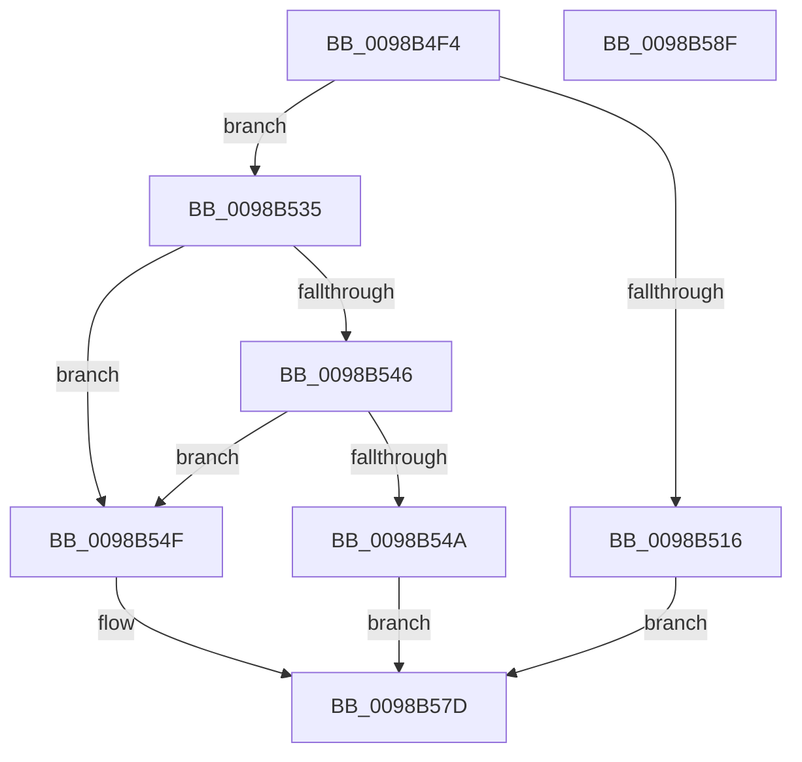

# TtmpAcquireSessionById

- RVA: `0x0098B4F4`–`0x0098B590` (길이 `156` bytes)
- VA: `0x000000014098B4F4`
- 실행 섹션: `PAGE`
- PDB 이름 있음: `예`; PDB Function 태그: `아니요`
- unwind 정보 RVA: `0x00060BC4`
- 디코드: `42`개 명령, `156/156` bytes 표시
- 미해석 바이트: `0` (있으면 어셈블리에 `.byte`로 보존)

> 이 문서는 커널 이미지의 기계어와 PDB 기호를 분석해 생성했습니다. 4번과 5번은 함수 원형과 자료형을 바이너리 사용 방식에서 추정한 C 해석이며 원본 소스 복구 결과는 아닙니다.

## 1. Dependencies

- 직접 호출 지점: **6**; 고유 호출 대상: **5**
- 직접 호출자로 확인된 함수: **11**
- RIP 상대 이미지 참조: **3**

### Outgoing calls
- `0x0098B50D` → [TtmIsEnabled](../91/TtmIsEnabled_function_009143D8.md) (function, `0x009143D8`)
- `0x0098B52E` → [TtmiLogError](TtmiLogError_function_0098B39C.md) (function, `0x0098B39C`)
- `0x0098B535` → [TtmpAcquireSessionLock](../70/TtmpAcquireSessionLock_function_00700408.md) (function, `0x00700408`)
- `0x0098B567` → [TtmiLogError](TtmiLogError_function_0098B39C.md) (function, `0x0098B39C`)
- `0x0098B573` → [ExReleaseResourceLite](../../text/25/ExReleaseResourceLite_function_0025FA10.md) (function, `0x0025FA10`)
- `0x0098B578` → [KeLeaveCriticalRegion](../../text/25/KeLeaveCriticalRegion_function_0025D8B0.md) (function, `0x0025D8B0`)

### Direct callers
- [TtmNotifySessionPowerRequestDeleted](../77/TtmNotifySessionPowerRequestDeleted_function_00776E10.md) at `0x00776E34`
- [TtmiAcquireCurrentSession](../77/TtmiAcquireCurrentSession_function_00777010.md) at `0x00777057`
- [TtmpInsertPowerRequestToSession](../77/TtmpInsertPowerRequestToSession_function_00777A98.md) at `0x00777ACD`
- [TtmpUpdatePowerRequestAttribute](../77/TtmpUpdatePowerRequestAttribute_function_007783D4.md) at `0x00778404`
- [TtmNotifyConsoleUserPresent](../91/TtmNotifyConsoleUserPresent_function_0091327C.md) at `0x0091329B`
- [TtmNotifyLowPowerStateExited](TtmNotifyLowPowerStateExited_function_0098A878.md) at `0x0098A88D`
- [TtmNotifySessionPowerStateChange](TtmNotifySessionPowerStateChange_function_0098A8F4.md) at `0x0098A909`
- [TtmNotifySessionTerminalInput](TtmNotifySessionTerminalInput_function_0098A984.md) at `0x0098A9A0`
- [TtmSessionMonitorControl](TtmSessionMonitorControl_function_0098B174.md) at `0x0098B19A`
- [TtmNotifySessionDisplayBurst](TtmNotifySessionDisplayBurst_function_0098B300.md) at `0x0098B319`
- [TtmNotifySessionDisplayRequiredChange](TtmNotifySessionDisplayRequiredChange_function_0098C6B4.md) at `0x0098C6E3`

### Static image references
- `0x0098B51B` → RVA `0x00B04150` (` ?? ::NNGAKEGL::`string'`; read)
- `0x0098B53A` → RVA `0x00FD9B90` (`PAGEDATA`; read)
- `0x0098B56C` → RVA `0x00F06940` (`.data`; read)

## 2. Other-region calls and transfers

- 다른 실행 섹션으로 향하는 call: **2**
  - `0x0098B573` → [ExReleaseResourceLite](../../text/25/ExReleaseResourceLite_function_0025FA10.md) (`PAGE` → `.text`)
  - `0x0098B578` → [KeLeaveCriticalRegion](../../text/25/KeLeaveCriticalRegion_function_0025D8B0.md) (`PAGE` → `.text`)
- 별도 외부 분기/꼬리 이동을 확인하지 못했습니다.

## 3. Assembly (complete function range)

```asm
0098B4F4  48 89 5C 24 08                  mov qword ptr [rsp + 8], rbx
0098B4F9  48 89 74 24 10                  mov qword ptr [rsp + 0x10], rsi
0098B4FE  57                              push rdi
0098B4FF  48 83 EC 20                     sub rsp, 0x20
0098B503  33 DB                           xor ebx, ebx
0098B505  8B F2                           mov esi, edx
0098B507  48 89 19                        mov qword ptr [rcx], rbx
0098B50A  48 8B F9                        mov rdi, rcx
0098B50D  E8 C6 8E F8 FF                  call 0x1409143d8
0098B512  84 C0                           test al, al
0098B514  75 1F                           jne 0x14098b535
0098B516  BB BB 00 00 C0                  mov ebx, 0xc00000bb
0098B51B  48 8D 0D 2E 8C 17 00            lea rcx, [rip + 0x178c2e]
0098B522  44 8B CB                        mov r9d, ebx
0098B525  41 83 C8 FF                     or r8d, 0xffffffff
0098B529  BA 96 06 00 00                  mov edx, 0x696
0098B52E  E8 69 FE FF FF                  call 0x14098b39c
0098B533  EB 48                           jmp 0x14098b57d
0098B535  E8 CE 4E D7 FF                  call 0x140700408
0098B53A  48 8B 05 4F E6 64 00            mov rax, qword ptr [rip + 0x64e64f]
0098B541  48 85 C0                        test rax, rax
0098B544  74 09                           je 0x14098b54f
0098B546  39 30                           cmp dword ptr [rax], esi
0098B548  75 05                           jne 0x14098b54f
0098B54A  48 89 07                        mov qword ptr [rdi], rax
0098B54D  EB 2E                           jmp 0x14098b57d
0098B54F  BB 55 04 00 C0                  mov ebx, 0xc0000455
0098B554  48 8D 0D F5 8B 17 00            lea rcx, [rip + 0x178bf5]
0098B55B  44 8B CB                        mov r9d, ebx
0098B55E  41 83 C8 FF                     or r8d, 0xffffffff
0098B562  BA A1 06 00 00                  mov edx, 0x6a1
0098B567  E8 30 FE FF FF                  call 0x14098b39c
0098B56C  48 8D 0D CD B3 57 00            lea rcx, [rip + 0x57b3cd]
0098B573  E8 98 44 8D FF                  call 0x14025fa10
0098B578  E8 33 23 8D FF                  call 0x14025d8b0
0098B57D  48 8B 74 24 38                  mov rsi, qword ptr [rsp + 0x38]
0098B582  8B C3                           mov eax, ebx
0098B584  48 8B 5C 24 30                  mov rbx, qword ptr [rsp + 0x30]
0098B589  48 83 C4 20                     add rsp, 0x20
0098B58D  5F                              pop rdi
0098B58E  C3                              ret
0098B58F  CC                              int3
```

## 4. C-style interpretation (structured pseudocode)

```c
__int64 __fastcall TtmpAcquireSessionById(__int64 a1, int a2, int a3)
{
    __int64 result;
    __int64 v_rbx;
    __int64 v_rsp;
    unsigned __int64 v_stack_p10;
    unsigned __int64 v_stack_p8;

    v_stack_p8 = v_rbx;
    v_stack_p10 = v_rsi;
    v_rsp = (v_rsp) - (32);
    v_rbx = 0;
    *(unsigned __int64 *)(a1) = 0;
    result = TtmIsEnabled(a1, a2, a3, a4);
    if ((unsigned __int8)(result) != 0) goto loc_0098B535;
    a3 = (unsigned int)((a3) | (0xFFFFFFFFULL));
    result = TtmiLogError(v_rip + 1543214, (unsigned int)(0x696ULL), a3, (unsigned int)((unsigned int)((unsigned int)(0xC00000BBULL))));
    goto loc_0098B57D;
loc_0098B535:
    result = TtmpAcquireSessionLock(v_rip + 1543214, (unsigned int)(0x696ULL), a3, (unsigned int)((unsigned int)((unsigned int)(0xC00000BBULL))));
    if (*(unsigned __int64 *)(v_rip + 6612559) == 0) goto loc_0098B54F;
    if ((*(unsigned int *)(*(unsigned __int64 *)(v_rip + 6612559))) != ((unsigned int)((unsigned int)(a2)))) goto loc_0098B54F;
    *(unsigned __int64 *)(a1) = *(unsigned __int64 *)(v_rip + 6612559);
    goto loc_0098B57D;
loc_0098B54F:
    a3 = (unsigned int)((a3) | (0xFFFFFFFFULL));
    result = TtmiLogError(v_rip + 1543157, (unsigned int)(0x6A1ULL), a3, (unsigned int)((unsigned int)((unsigned int)(0xC0000455ULL))));
    result = ExReleaseResourceLite(v_rip + 5747661, (unsigned int)(0x6A1ULL), a3, (unsigned int)((unsigned int)((unsigned int)(0xC0000455ULL))));
    result = KeLeaveCriticalRegion(v_rip + 5747661, (unsigned int)(0x6A1ULL), a3, (unsigned int)((unsigned int)((unsigned int)(0xC0000455ULL))));
loc_0098B57D:
    v_rsp = (v_rsp) + (32);
    return (unsigned int)((unsigned int)((unsigned int)(0xC0000455ULL)));
}
```

## 5. (Beta) C Style

```c
int64_t TtmpAcquireSessionById(void *Arg1, int32_t Arg2, int32_t Arg3)
{
    uint8_t *arg1 = (uint8_t *)Arg1;

    int64_t result;
    int64_t local_rbx;
    int64_t local_rsp;
    uint64_t v_stack_p10;
    uint64_t v_stack_p8;

    v_stack_p8 = local_rbx;
    v_stack_p10 = local_rsi;
    local_rsp = (local_rsp) - (32);
    local_rbx = 0;
    *(uint64_t *)(arg1) = 0;
    result = TtmIsEnabled(Arg1, Arg2, Arg3, a4);
    if ((uint8_t)(result) != 0) goto loc_0098B535;
    Arg3 = (uint32_t)((Arg3) | (0xFFFFFFFFULL));
    result = TtmiLogError(v_rip + 1543214, (uint32_t)(0x696ULL), Arg3, (uint32_t)((uint32_t)((uint32_t)(0xC00000BBULL))));
    goto loc_0098B57D;
loc_0098B535:
    result = TtmpAcquireSessionLock(v_rip + 1543214, (uint32_t)(0x696ULL), Arg3, (uint32_t)((uint32_t)((uint32_t)(0xC00000BBULL))));
    if (*(uint64_t *)(v_rip + 0x64E64F) == 0) goto loc_0098B54F;
    if ((*(uint32_t *)(*(uint64_t *)(v_rip + 0x64E64F))) != ((uint32_t)((uint32_t)(Arg2)))) goto loc_0098B54F;
    *(uint64_t *)(arg1) = *(uint64_t *)(v_rip + 0x64E64F);
    goto loc_0098B57D;
loc_0098B54F:
    Arg3 = (uint32_t)((Arg3) | (0xFFFFFFFFULL));
    result = TtmiLogError(v_rip + 1543157, (uint32_t)(0x6A1ULL), Arg3, (uint32_t)((uint32_t)((uint32_t)(0xC0000455ULL))));
    result = ExReleaseResourceLite(v_rip + 5747661, (uint32_t)(0x6A1ULL), Arg3, (uint32_t)((uint32_t)((uint32_t)(0xC0000455ULL))));
    result = KeLeaveCriticalRegion(v_rip + 5747661, (uint32_t)(0x6A1ULL), Arg3, (uint32_t)((uint32_t)((uint32_t)(0xC0000455ULL))));
loc_0098B57D:
    local_rsp = (local_rsp) + (32);
    return (uint32_t)((uint32_t)((uint32_t)(0xC0000455ULL)));
}
```

### 관측된 메모리 오프셋

구조체 형식이 확인되지 않은 접근은 인자 기준의 오프셋으로만 기록했습니다.

| 기준 인자 | 오프셋 표현 | 폭 (bit) | 접근 |
|---|---:|---:|---|
| `Arg1` | `+ 0x0` | `64` | `W` |

## 6. Execution-region graph

[열기: 2D/3D 그래프와 함수 탐색 컨트롤 패널](../../../control-panel.html?section=page&rva=0x0098B4F4&view=graph)

- 2D 그래프는 위에서 아래로 흐르고, 3D 그래프는 빈 공간을 드래그해 회전합니다. Shift+드래그는 이동, 휠은 확대·축소, 함수 노드 선택은 대상 보고서 이동입니다.

### Static fallback


