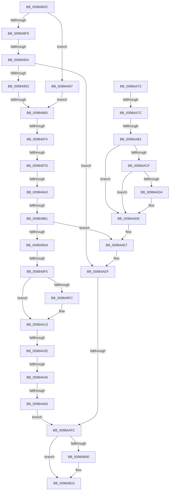

# sub_009848DC

- RVA: `0x009848DC`–`0x00984B33` (길이 `599` bytes)
- VA: `0x00000001409848DC`
- 실행 섹션: `PAGE`
- PDB 이름 있음: `아니요`; PDB Function 태그: `아니요`
- unwind 정보 RVA: `0x00097B54`
- 디코드: `146`개 명령, `599/599` bytes 표시
- 미해석 바이트: `0` (있으면 어셈블리에 `.byte`로 보존)

> 이 문서는 커널 이미지의 기계어와 PDB 기호를 분석해 생성했습니다. 4번과 5번은 함수 원형과 자료형을 바이너리 사용 방식에서 추정한 C 해석이며 원본 소스 복구 결과는 아닙니다.

## 1. Dependencies

- 직접 호출 지점: **14**; 고유 호출 대상: **13**
- 직접 호출자로 확인된 함수: **0**
- RIP 상대 이미지 참조: **2**

### Outgoing calls
- `0x0098493F` → [ObpReferenceObjectByHandleWithTag](../86/ObpReferenceObjectByHandleWithTag_function_00869650.md) (function, `0x00869650`)
- `0x00984963` → [IoGetFileMemoryPartitionInformation](../../text/46/IoGetFileMemoryPartitionInformation_function_004664F8.md) (function, `0x004664F8`)
- `0x00984985` → [ObfReferenceObjectWithTag](../../text/21/ObfReferenceObjectWithTag_function_00210710.md) (function, `0x00210710`)
- `0x009849CA` → [MiCallCreateSectionFilters](MiCallCreateSectionFilters_function_00984EB8.md) (function, `0x00984EB8`)
- `0x009849FC` → [IoGetTopLevelIrp](../../text/41/IoGetTopLevelIrp_function_0041D910.md) (function, `0x0041D910`)
- `0x00984A0B` → [IoSetTopLevelIrp](../../text/42/IoSetTopLevelIrp_function_0042A7D0.md) (function, `0x0042A7D0`)
- `0x00984A1E` → [MiReferenceControlArea](../../text/2B/MiReferenceControlArea_function_002BC198.md) (function, `0x002BC198`)
- `0x00984A48` → [KeLeaveCriticalRegionThread](../../text/25/KeLeaveCriticalRegionThread_function_0025EFF0.md) (function, `0x0025EFF0`)
- `0x00984A50` → [MiShareExistingControlArea](MiShareExistingControlArea_function_00984FAC.md) (function, `0x00984FAC`)
- `0x00984A95` → [MiZeroSectionObjectPointer](../../text/4A/MiZeroSectionObjectPointer_function_004A9B90.md) (function, `0x004A9B90`)
- `0x00984AB9` → [ObfDereferenceObjectWithTag](../../text/2F/ObfDereferenceObjectWithTag_function_002F78E0.md) (function, `0x002F78E0`)
- `0x00984AE2` → [MiReleaseControlAreaWaiters](../../text/28/MiReleaseControlAreaWaiters_function_002865F0.md) (function, `0x002865F0`)
- `0x00984AEA` → [KeLeaveCriticalRegionThread](../../text/25/KeLeaveCriticalRegionThread_function_0025EFF0.md) (function, `0x0025EFF0`)
- `0x00984B0B` → [ObDereferenceObjectExWithTag](../../text/43/ObDereferenceObjectExWithTag_function_0043CBC0.md) (function, `0x0043CBC0`)

### Direct callers
- 이 함수 시작 RVA로 연결되는 직접 call은 확인되지 않았습니다. 간접 호출은 완전히 역산할 수 없습니다.

### Static image references
- `0x00984907` → RVA `0x00013060` (`.rdata`; read)
- `0x00984916` → RVA `0x00FC6AE0` (`ALMOSTRO`; read)

## 2. Other-region calls and transfers

- 다른 실행 섹션으로 향하는 call: **11**
  - `0x00984963` → [IoGetFileMemoryPartitionInformation](../../text/46/IoGetFileMemoryPartitionInformation_function_004664F8.md) (`PAGE` → `.text`)
  - `0x00984985` → [ObfReferenceObjectWithTag](../../text/21/ObfReferenceObjectWithTag_function_00210710.md) (`PAGE` → `.text`)
  - `0x009849FC` → [IoGetTopLevelIrp](../../text/41/IoGetTopLevelIrp_function_0041D910.md) (`PAGE` → `.text`)
  - `0x00984A0B` → [IoSetTopLevelIrp](../../text/42/IoSetTopLevelIrp_function_0042A7D0.md) (`PAGE` → `.text`)
  - `0x00984A1E` → [MiReferenceControlArea](../../text/2B/MiReferenceControlArea_function_002BC198.md) (`PAGE` → `.text`)
  - `0x00984A48` → [KeLeaveCriticalRegionThread](../../text/25/KeLeaveCriticalRegionThread_function_0025EFF0.md) (`PAGE` → `.text`)
  - `0x00984A95` → [MiZeroSectionObjectPointer](../../text/4A/MiZeroSectionObjectPointer_function_004A9B90.md) (`PAGE` → `.text`)
  - `0x00984AB9` → [ObfDereferenceObjectWithTag](../../text/2F/ObfDereferenceObjectWithTag_function_002F78E0.md) (`PAGE` → `.text`)
  - `0x00984AE2` → [MiReleaseControlAreaWaiters](../../text/28/MiReleaseControlAreaWaiters_function_002865F0.md) (`PAGE` → `.text`)
  - `0x00984AEA` → [KeLeaveCriticalRegionThread](../../text/25/KeLeaveCriticalRegionThread_function_0025EFF0.md) (`PAGE` → `.text`)
  - `0x00984B0B` → [ObDereferenceObjectExWithTag](../../text/43/ObDereferenceObjectExWithTag_function_0043CBC0.md) (`PAGE` → `.text`)
- call이 아닌 외부 분기/꼬리 이동: **13**
  - `0x009848FE` → [sub_00984D37 + 0x12F](Unknown_function_00984D37.md) (`tail-transfer`)
  - `0x0098495A` → [sub_00984B34 + 0x1CD](Unknown_function_00984B34.md) (`tail-transfer`)
  - `0x0098496E` → [sub_00984B34 + 0x125](Unknown_function_00984B34.md) (`tail-transfer`)
  - `0x00984977` → [sub_00984B34](Unknown_function_00984B34.md) (`tail-transfer`)
  - `0x0098499A` → [sub_00984D37 + 0x139](Unknown_function_00984D37.md) (`tail-transfer`)
  - `0x009849AB` → [sub_00984B34 + 0x9C](Unknown_function_00984B34.md) (`tail-transfer`)
  - `0x009849EF` → [sub_00984D37 + 0x108](Unknown_function_00984D37.md) (`tail-transfer`)
  - `0x00984A28` → [sub_00984D37 + 0x21](Unknown_function_00984D37.md) (`tail-transfer`)
  - `0x00984A3F` → [sub_00984B34 + 0xC5](Unknown_function_00984B34.md) (`tail-transfer`)
  - `0x00984A5A` → [sub_00984D37 + 0x67](Unknown_function_00984D37.md) (`tail-transfer`)
  - `0x00984A76` → [sub_00984D37 + 0x166](Unknown_function_00984D37.md) (`tail-transfer`)
  - `0x00984AAB` → [sub_00984D37 + 0xB0](Unknown_function_00984D37.md) (`tail-transfer`)
  - `0x00984AF6` → [sub_00984B34 + 0x18A](Unknown_function_00984B34.md) (`tail-transfer`)

## 3. Assembly (complete function range)

```asm
009848DC  4C 89 AC 24 E0 00 00 00         mov qword ptr [rsp + 0xe0], r13
009848E4  4C 8B 6F 30                     mov r13, qword ptr [rdi + 0x30]
009848E8  4C 89 BC 24 D8 00 00 00         mov qword ptr [rsp + 0xd8], r15
009848F0  4D 85 ED                        test r13, r13
009848F3  0F 85 6E 01 00 00               jne 0x140984a67
009848F9  A9 00 00 02 80                  test eax, 0x80020000
009848FE  0F 85 62 05 00 00               jne 0x140984e66
00984904  8B 47 20                        mov eax, dword ptr [rdi + 0x20]
00984907  48 8D 15 52 E7 68 FF            lea rdx, [rip - 0x9718ae]
0098490E  44 0F B6 4F 48                  movzx r9d, byte ptr [rdi + 0x48]
00984913  83 E0 07                        and eax, 7
00984916  4C 8B 05 C3 21 64 00            mov r8, qword ptr [rip + 0x6421c3]
0098491D  48 8B 4F 28                     mov rcx, qword ptr [rdi + 0x28]
00984921  48 89 5C 24 38                  mov qword ptr [rsp + 0x38], rbx
00984926  8B 14 82                        mov edx, dword ptr [rdx + rax*4]
00984929  48 8D 45 6F                     lea rax, [rbp + 0x6f]
0098492D  48 89 5C 24 30                  mov qword ptr [rsp + 0x30], rbx
00984932  48 89 44 24 28                  mov qword ptr [rsp + 0x28], rax
00984937  C7 44 24 20 4D 6D 53 43         mov dword ptr [rsp + 0x20], 0x43536d4d
0098493F  E8 0C 4D EE FF                  call 0x140869650
00984944  4C 8B 7D 6F                     mov r15, qword ptr [rbp + 0x6f]
00984948  44 8B F0                        mov r14d, eax
0098494B  85 C0                           test eax, eax
0098494D  0F 88 9C 01 00 00               js 0x140984aef
00984953  41 8B F4                        mov esi, r12d
00984956  49 39 5F 28                     cmp qword ptr [r15 + 0x28], rbx
0098495A  0F 84 A1 03 00 00               je 0x140984d01
00984960  49 8B CF                        mov rcx, r15
00984963  E8 90 1B AE FF                  call 0x1404664f8
00984968  48 8B C8                        mov rcx, rax
0098496B  48 85 C0                        test rax, rax
0098496E  0F 85 E5 02 00 00               jne 0x140984c59
00984974  4D 85 ED                        test r13, r13
00984977  0F 85 B7 01 00 00               jne 0x140984b34
0098497D  BA 4D 6D 53 43                  mov edx, 0x43536d4d
00984982  49 8B CF                        mov rcx, r15
00984985  E8 86 BD 88 FF                  call 0x140210710
0098498A  FF C6                           inc esi
0098498C  4C 89 7F 38                     mov qword ptr [rdi + 0x38], r15
00984990  C7 45 CF 02 00 00 00            mov dword ptr [rbp - 0x31], 2
00984997  4D 85 FF                        test r15, r15
0098499A  0F 84 D0 04 00 00               je 0x140984e70
009849A0  4C 89 7D D7                     mov qword ptr [rbp - 0x29], r15
009849A4  F7 47 10 00 00 00 01            test dword ptr [rdi + 0x10], 0x1000000
009849AB  0F 85 1F 02 00 00               jne 0x140984bd0
009849B1  65 4C 8B 2C 25 88 01 00 00      mov r13, qword ptr gs:[0x188]
009849BA  4C 8B 7D 6F                     mov r15, qword ptr [rbp + 0x6f]
009849BE  66 41 FF 8D E4 01 00 00         dec word ptr [r13 + 0x1e4]
009849C6  90                              nop
009849C7  48 8B CF                        mov rcx, rdi
009849CA  E8 E9 04 00 00                  call 0x140984eb8
009849CF  44 8B F0                        mov r14d, eax
009849D2  85 C0                           test eax, eax
009849D4  0F 88 0D 01 00 00               js 0x140984ae7
009849DA  8B 17                           mov edx, dword ptr [rdi]
009849DC  0F BA E2 0E                     bt edx, 0xe
009849E0  0F 92 C1                        setb cl
009849E3  F7 47 10 00 00 00 01            test dword ptr [rdi + 0x10], 0x1000000
009849EA  0F 95 C0                        setne al
009849ED  84 C8                           test al, cl
009849EF  0F 85 4A 04 00 00               jne 0x140984e3f
009849F5  8B 07                           mov eax, dword ptr [rdi]
009849F7  41 84 C4                        test r12b, al
009849FA  75 17                           jne 0x140984a13
009849FC  E8 0F 8F A9 FF                  call 0x14041d910
00984A01  49 8B CC                        mov rcx, r12
00984A04  48 89 87 B8 00 00 00            mov qword ptr [rdi + 0xb8], rax
00984A0B  E8 C0 5D AA FF                  call 0x14042a7d0
00984A10  83 0F 02                        or dword ptr [rdi], 2
00984A13  4C 8D 45 77                     lea r8, [rbp + 0x77]
00984A17  48 8B CF                        mov rcx, rdi
00984A1A  48 8D 55 97                     lea rdx, [rbp - 0x69]
00984A1E  E8 75 77 93 FF                  call 0x1402bc198
00984A23  44 8B F0                        mov r14d, eax
00984A26  85 C0                           test eax, eax
00984A28  0F 88 2A 03 00 00               js 0x140984d58
00984A2E  48 8B 45 77                     mov rax, qword ptr [rbp + 0x77]
00984A32  48 89 45 7F                     mov qword ptr [rbp + 0x7f], rax
00984A36  48 89 47 40                     mov qword ptr [rdi + 0x40], rax
00984A3A  8B 40 38                        mov eax, dword ptr [rax + 0x38]
00984A3D  A8 02                           test al, 2
00984A3F  0F 85 B4 01 00 00               jne 0x140984bf9
00984A45  49 8B CD                        mov rcx, r13
00984A48  E8 A3 A5 8D FF                  call 0x14025eff0
00984A4D  48 8B CF                        mov rcx, rdi
00984A50  E8 57 05 00 00                  call 0x140984fac
00984A55  44 8B F0                        mov r14d, eax
00984A58  85 C0                           test eax, eax
00984A5A  0F 88 3E 03 00 00               js 0x140984d9e
00984A60  FF CE                           dec esi
00984A62  E9 95 00 00 00                  jmp 0x140984afc
00984A67  4D 8B FD                        mov r15, r13
00984A6A  4C 89 6D 6F                     mov qword ptr [rbp + 0x6f], r13
00984A6E  E9 ED FE FF FF                  jmp 0x140984960
00984A73  48 85 C0                        test rax, rax
00984A76  0F 84 21 04 00 00               je 0x140984e9d
00984A7C  48 8B 00                        mov rax, qword ptr [rax]
00984A7F  48 89 45 7F                     mov qword ptr [rbp + 0x7f], rax
00984A83  48 89 45 77                     mov qword ptr [rbp + 0x77], rax
00984A87  48 89 47 40                     mov qword ptr [rdi + 0x40], rax
00984A8B  44 8B 47 10                     mov r8d, dword ptr [rdi + 0x10]
00984A8F  48 8B D0                        mov rdx, rax
00984A92  49 8B CF                        mov rcx, r15
00984A95  E8 F6 50 B2 FF                  call 0x1404a9b90
00984A9A  48 8B 4D 7F                     mov rcx, qword ptr [rbp + 0x7f]
00984A9E  FF CE                           dec esi
00984AA0  48 89 45 8F                     mov qword ptr [rbp - 0x71], rax
00984AA4  48 8D 45 97                     lea rax, [rbp - 0x69]
00984AA8  48 3B C8                        cmp rcx, rax
00984AAB  0F 85 36 03 00 00               jne 0x140984de7
00984AB1  BA 4D 6D 53 43                  mov edx, 0x43536d4d
00984AB6  49 8B CF                        mov rcx, r15
00984AB9  E8 22 2E 97 FF                  call 0x1402f78e0
00984ABE  48 8B 45 7F                     mov rax, qword ptr [rbp + 0x7f]
00984AC2  48 87 58 40                     xchg qword ptr [rax + 0x40], rbx
00984AC6  4C 8B FB                        mov r15, rbx
00984AC9  49 83 E7 F0                     and r15, 0xfffffffffffffff0
00984ACD  74 0F                           je 0x140984ade
00984ACF  83 E3 0F                        and ebx, 0xf
00984AD2  76 0A                           jbe 0x140984ade
00984AD4  F7 DB                           neg ebx
00984AD6  48 63 C3                        movsxd rax, ebx
00984AD9  F0 49 01 47 D0                  lock add qword ptr [r15 - 0x30], rax
00984ADE  48 8B 4D 8F                     mov rcx, qword ptr [rbp - 0x71]
00984AE2  E8 09 1B 90 FF                  call 0x1402865f0
00984AE7  49 8B CD                        mov rcx, r13
00984AEA  E8 01 A5 8D FF                  call 0x14025eff0
00984AEF  41 81 FE 76 04 00 C0            cmp r14d, 0xc0000476
00984AF6  0F 84 C2 01 00 00               je 0x140984cbe
00984AFC  85 F6                           test esi, esi
00984AFE  74 10                           je 0x140984b10
00984B00  41 B8 4D 6D 53 43               mov r8d, 0x43536d4d
00984B06  8B D6                           mov edx, esi
00984B08  49 8B CF                        mov rcx, r15
00984B0B  E8 B0 80 AB FF                  call 0x14043cbc0
00984B10  41 8B C6                        mov eax, r14d
00984B13  4C 8B AC 24 E0 00 00 00         mov r13, qword ptr [rsp + 0xe0]
00984B1B  4C 8B BC 24 D8 00 00 00         mov r15, qword ptr [rsp + 0xd8]
00984B23  48 81 C4 E8 00 00 00            add rsp, 0xe8
00984B2A  41 5E                           pop r14
00984B2C  41 5C                           pop r12
00984B2E  5F                              pop rdi
00984B2F  5E                              pop rsi
00984B30  5B                              pop rbx
00984B31  5D                              pop rbp
00984B32  C3                              ret
```

## 4. C-style interpretation (structured pseudocode)

```c
__int64 __fastcall sub_009848DC(__int64 a1, __int64 a2, __int64 a3, __int64 a4, __int64 a5, __int64 a6, __int64 a7, __int64 a8, __int64 a9, __int64 a10, __int64 a11, __int64 a12, __int64 a13, __int64 a14, __int64 a15, __int64 a16, __int64 a17, __int64 a18, __int64 a19, __int64 a20, __int64 a21, __int64 a22, __int64 a23, __int64 a24, __int64 a25, __int64 a26, __int64 a27, __int64 a28)
{
    __int64 result;
    __int64 v_rsi;
    __int64 v_rsp;
    unsigned int v_stack_p20;
    unsigned __int64 v_stack_p28;
    unsigned __int64 v_stack_p30;
    unsigned __int64 v_stack_p38;
    unsigned __int64 v_stack_pD8;
    unsigned __int64 v_stack_pE0;

    v_stack_pE0 = v_r13;
    v_stack_pD8 = v_r15;
    if (*(unsigned __int64 *)(v_rdi + 48) != 0) goto loc_00984A67;
    result = (unsigned int)(((unsigned int)(*(unsigned int *)(v_rdi + 32))) & (7));
    v_stack_p38 = v_rbx;
    v_stack_p30 = v_rbx;
    v_stack_p28 = v_rbp + 111;
    v_stack_p20 = 0x43536D4DULL;
    result = ObpReferenceObjectByHandleWithTag(*(unsigned __int64 *)(v_rdi + 40), (unsigned int)(*(unsigned int *)(v_rip - 9902254 + result * 4)), *(unsigned __int64 *)(v_rip + 6562243), *(unsigned __int8 *)(v_rdi + 72));
    if (sign_flag) goto loc_00984AEF;
loc_00984960:
    result = IoGetFileMemoryPartitionInformation(*(unsigned __int64 *)(v_rbp + 111), (unsigned int)(*(unsigned int *)(v_rip - 9902254 + result * 4)), *(unsigned __int64 *)(v_rip + 6562243), *(unsigned __int8 *)(v_rdi + 72));
    result = ObfReferenceObjectWithTag(*(unsigned __int64 *)(v_rbp + 111), (unsigned int)(0x43536D4DULL), *(unsigned __int64 *)(v_rip + 6562243), *(unsigned __int8 *)(v_rdi + 72));
    v_rsi = (unsigned int)(((unsigned int)((unsigned int)(v_r12))) + 1);
    *(unsigned __int64 *)(v_rdi + 56) = *(unsigned __int64 *)(v_rbp + 111);
    *(unsigned int *)(v_rbp - 49) = 2;
    *(unsigned __int64 *)(v_rbp - 41) = *(unsigned __int64 *)(v_rbp + 111);
    result = MiCallCreateSectionFilters(v_rdi, (unsigned int)(0x43536D4DULL), *(unsigned __int64 *)(v_rip + 6562243), *(unsigned __int8 *)(v_rdi + 72));
    if (sign_flag) goto loc_00984AE7;
    a1 = (condition_is_below) ? 1 : 0;
    result = (((*(unsigned int *)(v_rdi + 16)) & (0x1000000ULL)) != 0) ? 1 : 0;
    result = (unsigned int)(*(unsigned int *)(v_rdi));
    if ((((unsigned __int8)(v_r12)) & ((unsigned __int8)((unsigned int)(*(unsigned int *)(v_rdi))))) == 0) {
        result = IoGetTopLevelIrp(a1, (unsigned int)(*(unsigned int *)(v_rdi)), *(unsigned __int64 *)(v_rip + 6562243), *(unsigned __int8 *)(v_rdi + 72));
        a1 = v_r12;
        *(unsigned __int64 *)(v_rdi + 184) = result;
        result = IoSetTopLevelIrp(a1, (unsigned int)(*(unsigned int *)(v_rdi)), *(unsigned __int64 *)(v_rip + 6562243), *(unsigned __int8 *)(v_rdi + 72));
    }
    result = MiReferenceControlArea(v_rdi, v_rbp - 105, v_rbp + 119, *(unsigned __int8 *)(v_rdi + 72));
    *(unsigned __int64 *)(v_rbp + 127) = *(unsigned __int64 *)(v_rbp + 119);
    *(unsigned __int64 *)(v_rdi + 64) = *(unsigned __int64 *)(v_rbp + 119);
    result = KeLeaveCriticalRegionThread(*(unsigned __int64 *)(gs_base + (0 + 392)), v_rbp - 105, v_rbp + 119, *(unsigned __int8 *)(v_rdi + 72));
    result = MiShareExistingControlArea(v_rdi, v_rbp - 105, v_rbp + 119, *(unsigned __int8 *)(v_rdi + 72));
    v_rsi = (unsigned int)((v_rsi) - 1);
    goto loc_00984AFC;
loc_00984A67:
    *(unsigned __int64 *)(v_rbp + 111) = *(unsigned __int64 *)(gs_base + (0 + 392));
    goto loc_00984960;
loc_00984AE7:
    result = KeLeaveCriticalRegionThread(*(unsigned __int64 *)(gs_base + (0 + 392)), v_rbp - 105, v_rbp + 119, *(unsigned __int8 *)(v_rdi + 72));
loc_00984AEF:
loc_00984AFC:
    if ((unsigned int)(v_rsi) != 0) {
        a3 = 0x43536D4DULL;
        a2 = (unsigned int)(v_rsi);
        a1 = *(unsigned __int64 *)(gs_base + (0 + 392));
        result = ObDereferenceObjectExWithTag(a1, a2, a3, *(unsigned __int8 *)(v_rdi + 72));
    }
    v_rsp = (v_rsp) + (232);
    return (unsigned int)((unsigned int)((unsigned int)((unsigned int)(result))));
}
```

## 5. (Beta) C Style

```c
int64_t sub_009848DC(int64_t Arg1, int64_t Arg2, int64_t Arg3, int64_t Arg4, uint64_t Arg5, uint64_t Arg6, uint64_t Arg7, uint64_t Arg8, uint64_t Arg9, uint64_t Arg10, uint64_t Arg11, uint64_t Arg12, uint64_t Arg13, uint64_t Arg14, uint64_t Arg15, uint64_t Arg16, uint64_t Arg17, uint64_t Arg18, uint64_t Arg19, uint64_t Arg20, uint64_t Arg21, uint64_t Arg22, uint64_t Arg23, uint64_t Arg24, uint64_t Arg25, uint64_t Arg26, int64_t Arg27, int64_t Arg28)
{
    int64_t result;
    int64_t local_rsi;
    int64_t local_rsp;
    uint32_t v_stack_p20;
    uint64_t v_stack_p28;
    uint64_t v_stack_p30;
    uint64_t v_stack_p38;
    uint64_t v_stack_pD8;
    uint64_t v_stack_pE0;

    v_stack_pE0 = local_r13;
    v_stack_pD8 = local_r15;
    if (*(uint64_t *)(local_rdi + 0x30) != 0) goto loc_00984A67;
    result = (uint32_t)(((uint32_t)(*(uint32_t *)(local_rdi + 0x20))) & (7));
    v_stack_p38 = local_rbx;
    v_stack_p30 = local_rbx;
    v_stack_p28 = local_rbp + 111;
    v_stack_p20 = 0x43536D4DULL;
    result = ObpReferenceObjectByHandleWithTag(*(uint64_t *)(local_rdi + 0x28), (uint32_t)(*(uint32_t *)(v_rip - 0x9718AE + result * 4)), *(uint64_t *)(v_rip + 0x6421C3), *(uint8_t *)(local_rdi + 0x48));
    if (sign_flag) goto loc_00984AEF;
loc_00984960:
    result = IoGetFileMemoryPartitionInformation(*(uint64_t *)(local_rbp + 0x6F), (uint32_t)(*(uint32_t *)(v_rip - 0x9718AE + result * 4)), *(uint64_t *)(v_rip + 0x6421C3), *(uint8_t *)(local_rdi + 0x48));
    result = ObfReferenceObjectWithTag(*(uint64_t *)(local_rbp + 0x6F), (uint32_t)(0x43536D4DULL), *(uint64_t *)(v_rip + 0x6421C3), *(uint8_t *)(local_rdi + 0x48));
    local_rsi = (uint32_t)(((uint32_t)((uint32_t)(local_r12))) + 1);
    *(uint64_t *)(local_rdi + 0x38) = *(uint64_t *)(local_rbp + 0x6F);
    *(uint32_t *)(local_rbp - 0x31) = 2;
    *(uint64_t *)(local_rbp - 0x29) = *(uint64_t *)(local_rbp + 0x6F);
    result = MiCallCreateSectionFilters(local_rdi, (uint32_t)(0x43536D4DULL), *(uint64_t *)(v_rip + 0x6421C3), *(uint8_t *)(local_rdi + 0x48));
    if (sign_flag) goto loc_00984AE7;
    Arg1 = (condition_is_below) ? 1 : 0;
    result = (((*(uint32_t *)(local_rdi + 0x10)) & (0x1000000ULL)) != 0) ? 1 : 0;
    result = (uint32_t)(*(uint32_t *)(local_rdi));
    if ((((uint8_t)(local_r12)) & ((uint8_t)((uint32_t)(*(uint32_t *)(local_rdi))))) == 0) {
        result = IoGetTopLevelIrp(Arg1, (uint32_t)(*(uint32_t *)(local_rdi)), *(uint64_t *)(v_rip + 0x6421C3), *(uint8_t *)(local_rdi + 0x48));
        Arg1 = local_r12;
        *(uint64_t *)(local_rdi + 0xB8) = result;
        result = IoSetTopLevelIrp(Arg1, (uint32_t)(*(uint32_t *)(local_rdi)), *(uint64_t *)(v_rip + 0x6421C3), *(uint8_t *)(local_rdi + 0x48));
    }
    result = MiReferenceControlArea(local_rdi, local_rbp - 105, local_rbp + 119, *(uint8_t *)(local_rdi + 0x48));
    *(uint64_t *)(local_rbp + 0x7F) = *(uint64_t *)(local_rbp + 0x77);
    *(uint64_t *)(local_rdi + 0x40) = *(uint64_t *)(local_rbp + 0x77);
    result = KeLeaveCriticalRegionThread(*(uint64_t *)(gs_base + (0 + 0x188)), local_rbp - 105, local_rbp + 119, *(uint8_t *)(local_rdi + 0x48));
    result = MiShareExistingControlArea(local_rdi, local_rbp - 105, local_rbp + 119, *(uint8_t *)(local_rdi + 0x48));
    local_rsi = (uint32_t)((local_rsi) - 1);
    goto loc_00984AFC;
loc_00984A67:
    *(uint64_t *)(local_rbp + 0x6F) = *(uint64_t *)(gs_base + (0 + 0x188));
    goto loc_00984960;
loc_00984AE7:
    result = KeLeaveCriticalRegionThread(*(uint64_t *)(gs_base + (0 + 0x188)), local_rbp - 105, local_rbp + 119, *(uint8_t *)(local_rdi + 0x48));
loc_00984AEF:
loc_00984AFC:
    if ((uint32_t)(local_rsi) != 0) {
        Arg3 = 0x43536D4DULL;
        Arg2 = (uint32_t)(local_rsi);
        Arg1 = *(uint64_t *)(gs_base + (0 + 0x188));
        result = ObDereferenceObjectExWithTag(Arg1, Arg2, Arg3, *(uint8_t *)(local_rdi + 0x48));
    }
    local_rsp = (local_rsp) + (232);
    return (uint32_t)((uint32_t)((uint32_t)((uint32_t)(result))));
}
```

## 6. Execution-region graph

[열기: 2D/3D 그래프와 함수 탐색 컨트롤 패널](../../../control-panel.html?section=page&rva=0x009848DC&view=graph)

- 2D 그래프는 위에서 아래로 흐르고, 3D 그래프는 빈 공간을 드래그해 회전합니다. Shift+드래그는 이동, 휠은 확대·축소, 함수 노드 선택은 대상 보고서 이동입니다.

### Static fallback


