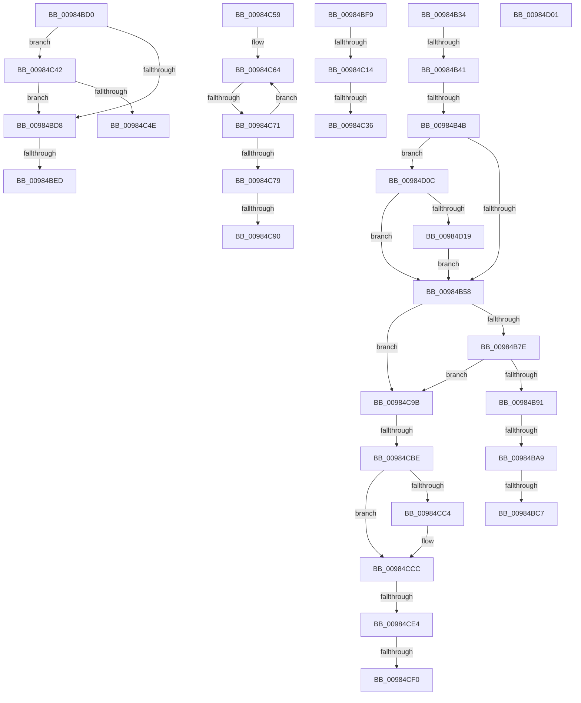

# sub_00984B34

- RVA: `0x00984B34`–`0x00984D21` (길이 `493` bytes)
- VA: `0x0000000140984B34`
- 실행 섹션: `PAGE`
- PDB 이름 있음: `아니요`; PDB Function 태그: `아니요`
- unwind 정보 RVA: `0x00097B80`
- 디코드: `112`개 명령, `493/493` bytes 표시
- 미해석 바이트: `0` (있으면 어셈블리에 `.byte`로 보존)

> 이 문서는 커널 이미지의 기계어와 PDB 기호를 분석해 생성했습니다. 4번과 5번은 함수 원형과 자료형을 바이너리 사용 방식에서 추정한 C 해석이며 원본 소스 복구 결과는 아닙니다.

## 1. Dependencies

- 직접 호출 지점: **8**; 고유 호출 대상: **7**
- 직접 호출자로 확인된 함수: **0**
- RIP 상대 이미지 참조: **1**

### Outgoing calls
- `0x00984B81` → [MiReferenceExistingControlArea](../../text/2B/MiReferenceExistingControlArea_function_002BDE64.md) (function, `0x002BDE64`)
- `0x00984BDB` → [CcWaitForUninitializeCacheMap](../../text/46/CcWaitForUninitializeCacheMap_function_004633F0.md) (function, `0x004633F0`)
- `0x00984C00` → [MiCreateNewSection](MiCreateNewSection_function_00985DB0.md) (function, `0x00985DB0`)
- `0x00984C1B` → [MiGetControlAreaPartition](../../text/43/MiGetControlAreaPartition_function_0043E560.md) (function, `0x0043E560`)
- `0x00984C45` → [IoAllowExecution](../../text/27/IoAllowExecution_function_00272498.md) (function, `0x00272498`)
- `0x00984CA9` → [ObReferenceObjectExWithTag](../../text/41/ObReferenceObjectExWithTag_function_0041FDB0.md) (function, `0x0041FDB0`)
- `0x00984CC7` → [CcWaitForUninitializeCacheMap](../../text/46/CcWaitForUninitializeCacheMap_function_004633F0.md) (function, `0x004633F0`)
- `0x00984CD6` → [MiForceSectionClosed](../../text/2A/MiForceSectionClosed_function_002ACFD4.md) (function, `0x002ACFD4`)

### Direct callers
- 이 함수 시작 RVA로 연결되는 직접 call은 확인되지 않았습니다. 간접 호출은 완전히 역산할 수 없습니다.

### Static image references
- `0x00984CF0` → RVA `0x00E30090` (`.data`; read/write)

## 2. Other-region calls and transfers

- 다른 실행 섹션으로 향하는 call: **7**
  - `0x00984B81` → [MiReferenceExistingControlArea](../../text/2B/MiReferenceExistingControlArea_function_002BDE64.md) (`PAGE` → `.text`)
  - `0x00984BDB` → [CcWaitForUninitializeCacheMap](../../text/46/CcWaitForUninitializeCacheMap_function_004633F0.md) (`PAGE` → `.text`)
  - `0x00984C1B` → [MiGetControlAreaPartition](../../text/43/MiGetControlAreaPartition_function_0043E560.md) (`PAGE` → `.text`)
  - `0x00984C45` → [IoAllowExecution](../../text/27/IoAllowExecution_function_00272498.md) (`PAGE` → `.text`)
  - `0x00984CA9` → [ObReferenceObjectExWithTag](../../text/41/ObReferenceObjectExWithTag_function_0041FDB0.md) (`PAGE` → `.text`)
  - `0x00984CC7` → [CcWaitForUninitializeCacheMap](../../text/46/CcWaitForUninitializeCacheMap_function_004633F0.md) (`PAGE` → `.text`)
  - `0x00984CD6` → [MiForceSectionClosed](../../text/2A/MiForceSectionClosed_function_002ACFD4.md) (`PAGE` → `.text`)
- call이 아닌 외부 분기/꼬리 이동: **19**
  - `0x00984B3B` → [sub_00984D37 + 0xB](Unknown_function_00984D37.md) (`tail-transfer`)
  - `0x00984B45` → [sub_00984D37](Unknown_function_00984D37.md) (`tail-transfer`)
  - `0x00984BA3` → [sub_00984D37 + 0x74](Unknown_function_00984D37.md) (`tail-transfer`)
  - `0x00984BC1` → [sub_00984D37 + 0xFA](Unknown_function_00984D37.md) (`tail-transfer`)
  - `0x00984BCB` → [sub_009848DC + 0x220](Unknown_function_009848DC.md) (`tail-transfer`)
  - `0x00984BE7` → [sub_00984D37 + 0x40](Unknown_function_00984D37.md) (`tail-transfer`)
  - `0x00984BF4` → [sub_009848DC + 0xD5](Unknown_function_009848DC.md) (`tail-transfer`)
  - `0x00984C0E` → [sub_009848DC + 0x197](Unknown_function_009848DC.md) (`tail-transfer`)
  - `0x00984C30` → [sub_00984D37 + 0x142](Unknown_function_00984D37.md) (`tail-transfer`)
  - `0x00984C3D` → [sub_009848DC + 0x20B](Unknown_function_009848DC.md) (`tail-transfer`)
  - `0x00984C54` → [sub_009848DC + 0x220](Unknown_function_009848DC.md) (`tail-transfer`)
  - `0x00984C6B` → [sub_00984D37 + 0x14E](Unknown_function_00984D37.md) (`tail-transfer`)
  - `0x00984C8A` → [sub_009848DC + 0x98](Unknown_function_009848DC.md) (`tail-transfer`)
  - `0x00984C96` → [sub_009848DC + 0x98](Unknown_function_009848DC.md) (`tail-transfer`)
  - `0x00984CB8` → [sub_009848DC + 0xB0](Unknown_function_009848DC.md) (`tail-transfer`)
  - `0x00984CDE` → [sub_009848DC + 0x220](Unknown_function_009848DC.md) (`tail-transfer`)
  - `0x00984CEA` → [sub_009848DC + 0x220](Unknown_function_009848DC.md) (`tail-transfer`)
  - `0x00984CFC` → [sub_009848DC + 0x220](Unknown_function_009848DC.md) (`tail-transfer`)
  - `0x00984D07` → [sub_009848DC + 0x224](Unknown_function_009848DC.md) (`tail-transfer`)

## 3. Assembly (complete function range)

```asm
00984B34  8B 57 10                        mov edx, dword ptr [rdi + 0x10]
00984B37  0F BA E2 18                     bt edx, 0x18
00984B3B  0F 82 01 02 00 00               jb 0x140984d42
00984B41  49 39 5D 28                     cmp qword ptr [r13 + 0x28], rbx
00984B45  0F 84 EC 01 00 00               je 0x140984d37
00984B4B  48 8B 47 08                     mov rax, qword ptr [rdi + 8]
00984B4F  48 85 C0                        test rax, rax
00984B52  0F 85 B4 01 00 00               jne 0x140984d0c
00984B58  49 8B 4D 28                     mov rcx, qword ptr [r13 + 0x28]
00984B5C  0F BA E2 18                     bt edx, 0x18
00984B60  41 BE 01 00 00 C0               mov r14d, 0xc0000001
00984B66  48 8D 41 10                     lea rax, [rcx + 0x10]
00984B6A  48 0F 43 C1                     cmovae rax, rcx
00984B6E  48 8B 08                        mov rcx, qword ptr [rax]
00984B71  48 89 4D 77                     mov qword ptr [rbp + 0x77], rcx
00984B75  48 85 C9                        test rcx, rcx
00984B78  0F 84 1D 01 00 00               je 0x140984c9b
00984B7E  48 8B CF                        mov rcx, rdi
00984B81  E8 DE 92 93 FF                  call 0x1402bde64
00984B86  44 8B F0                        mov r14d, eax
00984B89  85 C0                           test eax, eax
00984B8B  0F 88 0A 01 00 00               js 0x140984c9b
00984B91  8B 0F                           mov ecx, dword ptr [rdi]
00984B93  83 C9 04                        or ecx, 4
00984B96  F7 47 10 00 00 00 01            test dword ptr [rdi + 0x10], 0x1000000
00984B9D  89 0F                           mov dword ptr [rdi], ecx
00984B9F  49 8B 55 28                     mov rdx, qword ptr [r13 + 0x28]
00984BA3  0F 85 02 02 00 00               jne 0x140984dab
00984BA9  48 8B 02                        mov rax, qword ptr [rdx]
00984BAC  48 8B 97 98 00 00 00            mov rdx, qword ptr [rdi + 0x98]
00984BB3  48 89 97 80 00 00 00            mov qword ptr [rdi + 0x80], rdx
00984BBA  48 89 45 77                     mov qword ptr [rbp + 0x77], rax
00984BBE  41 84 CC                        test r12b, cl
00984BC1  0F 84 6A 02 00 00               je 0x140984e31
00984BC7  48 89 47 40                     mov qword ptr [rdi + 0x40], rax
00984BCB  E9 2C FF FF FF                  jmp 0x140984afc
00984BD0  F7 07 00 02 00 00               test dword ptr [rdi], 0x200
00984BD6  75 6A                           jne 0x140984c42
00984BD8  49 8B CF                        mov rcx, r15
00984BDB  E8 10 E8 AD FF                  call 0x1404633f0
00984BE0  0F B6 4F 18                     movzx ecx, byte ptr [rdi + 0x18]
00984BE4  F6 C1 10                        test cl, 0x10
00984BE7  0F 85 8A 01 00 00               jne 0x140984d77
00984BED  C7 45 67 02 00 00 00            mov dword ptr [rbp + 0x67], 2
00984BF4  E9 B8 FD FF FF                  jmp 0x1409849b1
00984BF9  48 8D 55 87                     lea rdx, [rbp - 0x79]
00984BFD  48 8B CF                        mov rcx, rdi
00984C00  E8 AB 11 00 00                  call 0x140985db0
00984C05  44 8B F0                        mov r14d, eax
00984C08  85 C0                           test eax, eax
00984C0A  48 8B 45 87                     mov rax, qword ptr [rbp - 0x79]
00984C0E  0F 88 5F FE FF FF               js 0x140984a73
00984C14  48 8B 08                        mov rcx, qword ptr [rax]
00984C17  48 89 4F 40                     mov qword ptr [rdi + 0x40], rcx
00984C1B  E8 40 99 AB FF                  call 0x14043e560
00984C20  F0 4C 0F C1 A0 C8 06 00 00      lock xadd qword ptr [rax + 0x6c8], r12
00984C29  49 FF C4                        inc r12
00984C2C  49 83 FC 01                     cmp r12, 1
00984C30  0F 8E 43 02 00 00               jle 0x140984e79
00984C36  4C 8B 7D 6F                     mov r15, qword ptr [rbp + 0x6f]
00984C3A  83 C6 FE                        add esi, -2
00984C3D  E9 A5 FE FF FF                  jmp 0x140984ae7
00984C42  49 8B CF                        mov rcx, r15
00984C45  E8 4E D8 8E FF                  call 0x140272498
00984C4A  84 C0                           test al, al
00984C4C  75 8A                           jne 0x140984bd8
00984C4E  41 BE 22 00 00 C0               mov r14d, 0xc0000022
00984C54  E9 A3 FE FF FF                  jmp 0x140984afc
00984C59  48 8B 10                        mov rdx, qword ptr [rax]
00984C5C  0F 0D 4A 28                     prefetchw byte ptr [rdx + 0x28]
00984C60  48 8B 42 28                     mov rax, qword ptr [rdx + 0x28]
00984C64  4C 8D 40 01                     lea r8, [rax + 1]
00984C68  4D 3B C4                        cmp r8, r12
00984C6B  0F 86 14 02 00 00               jbe 0x140984e85
00984C71  F0 4C 0F B1 42 28               lock cmpxchg qword ptr [rdx + 0x28], r8
00984C77  75 EB                           jne 0x140984c64
00984C79  4C 8B 7D 6F                     mov r15, qword ptr [rbp + 0x6f]
00984C7D  48 89 97 B0 00 00 00            mov qword ptr [rdi + 0xb0], rdx
00984C84  8B 41 08                        mov eax, dword ptr [rcx + 8]
00984C87  41 84 C4                        test r12b, al
00984C8A  0F 84 E4 FC FF FF               je 0x140984974
00984C90  81 0F 00 00 40 00               or dword ptr [rdi], 0x400000
00984C96  E9 D9 FC FF FF                  jmp 0x140984974
00984C9B  BA 02 00 00 00                  mov edx, 2
00984CA0  41 B8 4D 6D 53 43               mov r8d, 0x43536d4d
00984CA6  49 8B CF                        mov rcx, r15
00984CA9  E8 02 B1 A9 FF                  call 0x14041fdb0
00984CAE  83 C6 02                        add esi, 2
00984CB1  41 81 FE 76 04 00 C0            cmp r14d, 0xc0000476
00984CB8  0F 85 CE FC FF FF               jne 0x14098498c
00984CBE  8B 07                           mov eax, dword ptr [rdi]
00984CC0  A8 01                           test al, 1
00984CC2  75 08                           jne 0x140984ccc
00984CC4  49 8B CF                        mov rcx, r15
00984CC7  E8 24 E7 AD FF                  call 0x1404633f0
00984CCC  8B 55 67                        mov edx, dword ptr [rbp + 0x67]
00984CCF  45 33 C0                        xor r8d, r8d
00984CD2  49 8B 4F 28                     mov rcx, qword ptr [r15 + 0x28]
00984CD6  E8 F9 82 92 FF                  call 0x1402acfd4
00984CDB  83 F8 01                        cmp eax, 1
00984CDE  0F 86 18 FE FF FF               jbe 0x140984afc
00984CE4  F7 07 00 00 80 00               test dword ptr [rdi], 0x800000
00984CEA  0F 84 0C FE FF FF               je 0x140984afc
00984CF0  FF 05 9A B3 4A 00               inc dword ptr [rip + 0x4ab39a]
00984CF6  41 BE 0B 06 00 C0               mov r14d, 0xc000060b
00984CFC  E9 FB FD FF FF                  jmp 0x140984afc
00984D01  41 BE 20 00 00 C0               mov r14d, 0xc0000020
00984D07  E9 F4 FD FF FF                  jmp 0x140984b00
00984D0C  F7 40 18 00 02 00 00            test dword ptr [rax + 0x18], 0x200
00984D13  0F 84 3F FE FF FF               je 0x140984b58
00984D19  88 5F 48                        mov byte ptr [rdi + 0x48], bl
00984D1C  E9 37 FE FF FF                  jmp 0x140984b58
```

## 4. C-style interpretation (structured pseudocode)

```c
__int64 __fastcall sub_00984B34(void)
{
    __int64 result;
    __int64 v_rsi;

    if (*(unsigned __int64 *)(v_rdi + 8) != 0) goto loc_00984D0C;
loc_00984B58:
    result = *(unsigned __int64 *)(v_r13 + 40) + 16;
    if (condition_is_above_or_equal) { result = *(unsigned __int64 *)(v_r13 + 40); }
    *(unsigned __int64 *)(v_rbp + 119) = *(unsigned __int64 *)(result);
    if (*(unsigned __int64 *)(result) == 0) goto loc_00984C9B;
    result = MiReferenceExistingControlArea(v_rdi, (unsigned int)(*(unsigned int *)(v_rdi + 16)), a3, a4);
    if (sign_flag) goto loc_00984C9B;
    a1 = (unsigned int)(((unsigned int)(*(unsigned int *)(v_rdi))) | (4));
    *(unsigned int *)(v_rdi) = (unsigned int)(a1);
    *(unsigned __int64 *)(v_rdi + 128) = *(unsigned __int64 *)(v_rdi + 152);
    *(unsigned __int64 *)(v_rbp + 119) = *(unsigned __int64 *)(*(unsigned __int64 *)(v_r13 + 40));
    *(unsigned __int64 *)(v_rdi + 64) = *(unsigned __int64 *)(*(unsigned __int64 *)(v_r13 + 40));
loc_00984C9B:
    result = ObReferenceObjectExWithTag(v_r15, 2, (unsigned int)(0x43536D4DULL), a4);
    v_rsi = (unsigned int)((v_rsi) + (2));
    result = (unsigned int)(*(unsigned int *)(v_rdi));
    if ((((unsigned __int8)((unsigned int)(*(unsigned int *)(v_rdi)))) & (1)) == 0) {
        a1 = v_r15;
        result = CcWaitForUninitializeCacheMap(a1, 2, (unsigned int)(0x43536D4DULL), a4);
    }
    a3 = 0;
    result = MiForceSectionClosed(*(unsigned __int64 *)(v_r15 + 40), (unsigned int)(*(unsigned int *)(v_rbp + 103)), a3, a4);
loc_00984D0C:
    if (((*(unsigned int *)(result + 24)) & (512)) == 0) goto loc_00984B58;
    *(unsigned __int8 *)(v_rdi + 72) = (unsigned __int8)(v_rbx);
    goto loc_00984B58;
}
```

## 5. (Beta) C Style

```c
void sub_00984B34(void)
{
    int64_t result;
    int64_t local_rsi;

    if (*(uint64_t *)(local_rdi + 0x8) != 0) goto loc_00984D0C;
loc_00984B58:
    result = *(uint64_t *)(local_r13 + 0x28) + 16;
    if (condition_is_above_or_equal) { result = *(uint64_t *)(local_r13 + 0x28); }
    *(uint64_t *)(local_rbp + 0x77) = *(uint64_t *)(result);
    if (*(uint64_t *)(result) == 0) goto loc_00984C9B;
    result = MiReferenceExistingControlArea(local_rdi, (uint32_t)(*(uint32_t *)(local_rdi + 0x10)), a3, a4);
    if (sign_flag) goto loc_00984C9B;
    a1 = (uint32_t)(((uint32_t)(*(uint32_t *)(local_rdi))) | (4));
    *(uint32_t *)(local_rdi) = (uint32_t)(a1);
    *(uint64_t *)(local_rdi + 0x80) = *(uint64_t *)(local_rdi + 0x98);
    *(uint64_t *)(local_rbp + 0x77) = *(uint64_t *)(*(uint64_t *)(local_r13 + 0x28));
    *(uint64_t *)(local_rdi + 0x40) = *(uint64_t *)(*(uint64_t *)(local_r13 + 0x28));
loc_00984C9B:
    result = ObReferenceObjectExWithTag(local_r15, 2, (uint32_t)(0x43536D4DULL), a4);
    local_rsi = (uint32_t)((local_rsi) + (2));
    result = (uint32_t)(*(uint32_t *)(local_rdi));
    if ((((uint8_t)((uint32_t)(*(uint32_t *)(local_rdi)))) & (1)) == 0) {
        a1 = local_r15;
        result = CcWaitForUninitializeCacheMap(a1, 2, (uint32_t)(0x43536D4DULL), a4);
    }
    a3 = 0;
    result = MiForceSectionClosed(*(uint64_t *)(local_r15 + 0x28), (uint32_t)(*(uint32_t *)(local_rbp + 0x67)), a3, a4);
loc_00984D0C:
    if (((*(uint32_t *)(result + 0x18)) & (512)) == 0) goto loc_00984B58;
    *(uint8_t *)(local_rdi + 0x48) = (uint8_t)(local_rbx);
    goto loc_00984B58;
}
```

## 6. Execution-region graph

[열기: 2D/3D 그래프와 함수 탐색 컨트롤 패널](../../../control-panel.html?section=page&rva=0x00984B34&view=graph)

- 2D 그래프는 위에서 아래로 흐르고, 3D 그래프는 빈 공간을 드래그해 회전합니다. Shift+드래그는 이동, 휠은 확대·축소, 함수 노드 선택은 대상 보고서 이동입니다.

### Static fallback


