# sub_00984D37

- RVA: `0x00984D37`–`0x00984EB2` (길이 `379` bytes)
- VA: `0x0000000140984D37`
- 실행 섹션: `PAGE`
- PDB 이름 있음: `아니요`; PDB Function 태그: `아니요`
- unwind 정보 RVA: `0x00097BAC`
- 디코드: `89`개 명령, `379/379` bytes 표시
- 미해석 바이트: `0` (있으면 어셈블리에 `.byte`로 보존)

> 이 문서는 커널 이미지의 기계어와 PDB 기호를 분석해 생성했습니다. 4번과 5번은 함수 원형과 자료형을 바이너리 사용 방식에서 추정한 C 해석이며 원본 소스 복구 결과는 아닙니다.

## 1. Dependencies

- 직접 호출 지점: **6**; 고유 호출 대상: **5**
- 직접 호출자로 확인된 함수: **0**
- RIP 상대 이미지 참조: **0**

### Outgoing calls
- `0x00984D6D` → [KeLeaveCriticalRegionThread](../../text/25/KeLeaveCriticalRegionThread_function_0025EFF0.md) (function, `0x0025EFF0`)
- `0x00984DA1` → [MiDereferenceFailedControlArea](../A9/MiDereferenceFailedControlArea_function_00A99228.md) (function, `0x00A99228`)
- `0x00984DDD` → [KeLeaveCriticalRegionThread](../../text/25/KeLeaveCriticalRegionThread_function_0025EFF0.md) (function, `0x0025EFF0`)
- `0x00984DE7` → [MiGetControlAreaPartition](../../text/43/MiGetControlAreaPartition_function_0043E560.md) (function, `0x0043E560`)
- `0x00984E0B` → [MiDereferenceControlAreaBySection](../../text/45/MiDereferenceControlAreaBySection_function_00458348.md) (function, `0x00458348`)
- `0x00984E5C` → [MiForceSectionClosed](../../text/2A/MiForceSectionClosed_function_002ACFD4.md) (function, `0x002ACFD4`)

### Direct callers
- 이 함수 시작 RVA로 연결되는 직접 call은 확인되지 않았습니다. 간접 호출은 완전히 역산할 수 없습니다.

### Static image references
- 디코드된 RIP-relative 메모리 참조가 없습니다.

## 2. Other-region calls and transfers

- 다른 실행 섹션으로 향하는 call: **5**
  - `0x00984D6D` → [KeLeaveCriticalRegionThread](../../text/25/KeLeaveCriticalRegionThread_function_0025EFF0.md) (`PAGE` → `.text`)
  - `0x00984DDD` → [KeLeaveCriticalRegionThread](../../text/25/KeLeaveCriticalRegionThread_function_0025EFF0.md) (`PAGE` → `.text`)
  - `0x00984DE7` → [MiGetControlAreaPartition](../../text/43/MiGetControlAreaPartition_function_0043E560.md) (`PAGE` → `.text`)
  - `0x00984E0B` → [MiDereferenceControlAreaBySection](../../text/45/MiDereferenceControlAreaBySection_function_00458348.md) (`PAGE` → `.text`)
  - `0x00984E5C` → [MiForceSectionClosed](../../text/2A/MiForceSectionClosed_function_002ACFD4.md) (`PAGE` → `.text`)
- call이 아닌 외부 분기/꼬리 이동: **20**
  - `0x00984D3D` → [sub_009848DC + 0x220](Unknown_function_009848DC.md) (`tail-transfer`)
  - `0x00984D53` → [sub_009848DC + 0x220](Unknown_function_009848DC.md) (`tail-transfer`)
  - `0x00984D64` → [sub_009848DC + 0xEB](Unknown_function_009848DC.md) (`tail-transfer`)
  - `0x00984D72` → [sub_00984B34 + 0x18A](Unknown_function_00984B34.md) (`tail-transfer`)
  - `0x00984D99` → [sub_00984B34 + 0xB9](Unknown_function_00984B34.md) (`tail-transfer`)
  - `0x00984DA6` → [sub_009848DC + 0x213](Unknown_function_009848DC.md) (`tail-transfer`)
  - `0x00984DD5` → [sub_00984B34 + 0x93](Unknown_function_00984B34.md) (`tail-transfer`)
  - `0x00984DE2` → [sub_009848DC + 0x220](Unknown_function_009848DC.md) (`tail-transfer`)
  - `0x00984E14` → [sub_009848DC + 0x202](Unknown_function_009848DC.md) (`tail-transfer`)
  - `0x00984E20` → [sub_00984B34 + 0xD](Unknown_function_00984B34.md) (`tail-transfer`)
  - `0x00984E2C` → [sub_009848DC + 0x220](Unknown_function_009848DC.md) (`tail-transfer`)
  - `0x00984E3A` → [sub_00984B34 + 0x93](Unknown_function_00984B34.md) (`tail-transfer`)
  - `0x00984E43` → [sub_009848DC + 0x119](Unknown_function_009848DC.md) (`tail-transfer`)
  - `0x00984E50` → [sub_009848DC + 0x119](Unknown_function_009848DC.md) (`tail-transfer`)
  - `0x00984E61` → [sub_009848DC + 0x119](Unknown_function_009848DC.md) (`tail-transfer`)
  - `0x00984E6B` → [sub_009848DC + 0x237](Unknown_function_009848DC.md) (`tail-transfer`)
  - `0x00984E74` → [sub_009848DC + 0xC8](Unknown_function_009848DC.md) (`tail-transfer`)
  - `0x00984E80` → [sub_00984B34 + 0x102](Unknown_function_00984B34.md) (`tail-transfer`)
  - `0x00984E98` → [sub_009848DC + 0x220](Unknown_function_009848DC.md) (`tail-transfer`)
  - `0x00984EA1` → [sub_009848DC + 0x1AF](Unknown_function_009848DC.md) (`tail-transfer`)

## 3. Assembly (complete function range)

```asm
00984D37  41 BE 20 00 00 C0               mov r14d, 0xc0000020
00984D3D  E9 BA FD FF FF                  jmp 0x140984afc
00984D42  8B 07                           mov eax, dword ptr [rdi]
00984D44  41 84 C4                        test r12b, al
00984D47  0F 84 CC 00 00 00               je 0x140984e19
00984D4D  41 BE F4 00 00 C0               mov r14d, 0xc00000f4
00984D53  E9 A4 FD FF FF                  jmp 0x140984afc
00984D58  3D 0B 06 00 C0                  cmp eax, 0xc000060b
00984D5D  74 7B                           je 0x140984dda
00984D5F  3D 76 04 00 C0                  cmp eax, 0xc0000476
00984D64  0F 85 5D FC FF FF               jne 0x1409849c7
00984D6A  49 8B CD                        mov rcx, r13
00984D6D  E8 7E A2 8D FF                  call 0x14025eff0
00984D72  E9 47 FF FF FF                  jmp 0x140984cbe
00984D77  8B 17                           mov edx, dword ptr [rdi]
00984D79  0F BA E2 09                     bt edx, 9
00984D7D  73 14                           jae 0x140984d93
00984D7F  83 CA 10                        or edx, 0x10
00984D82  0F B6 C1                        movzx eax, cl
00984D85  24 30                           and al, 0x30
00984D87  89 17                           mov dword ptr [rdi], edx
00984D89  3C 30                           cmp al, 0x30
00984D8B  75 06                           jne 0x140984d93
00984D8D  0F BA EA 0B                     bts edx, 0xb
00984D91  89 17                           mov dword ptr [rdi], edx
00984D93  80 E1 0F                        and cl, 0xf
00984D96  88 4F 18                        mov byte ptr [rdi + 0x18], cl
00984D99  E9 4F FE FF FF                  jmp 0x140984bed
00984D9E  48 8B CF                        mov rcx, rdi
00984DA1  E8 82 44 11 00                  call 0x140a99228
00984DA6  E9 44 FD FF FF                  jmp 0x140984aef
00984DAB  48 8B 42 10                     mov rax, qword ptr [rdx + 0x10]
00984DAF  48 89 45 77                     mov qword ptr [rbp + 0x77], rax
00984DB3  48 8B 08                        mov rcx, qword ptr [rax]
00984DB6  48 C7 C2 FF FF FF FF            mov rdx, 0xffffffffffffffff
00984DBD  48 8B C2                        mov rax, rdx
00984DC0  F0 48 0F B1 51 18               lock cmpxchg qword ptr [rcx + 0x18], rdx
00984DC6  4C 8B 7D 6F                     mov r15, qword ptr [rbp + 0x6f]
00984DCA  48 89 87 80 00 00 00            mov qword ptr [rdi + 0x80], rax
00984DD1  48 8B 45 77                     mov rax, qword ptr [rbp + 0x77]
00984DD5  E9 ED FD FF FF                  jmp 0x140984bc7
00984DDA  49 8B CD                        mov rcx, r13
00984DDD  E8 0E A2 8D FF                  call 0x14025eff0
00984DE2  E9 15 FD FF FF                  jmp 0x140984afc
00984DE7  E8 74 97 AB FF                  call 0x14043e560
00984DEC  49 8B CC                        mov rcx, r12
00984DEF  F0 48 0F C1 88 C8 06 00 00      lock xadd qword ptr [rax + 0x6c8], rcx
00984DF8  48 FF C1                        inc rcx
00984DFB  49 3B CC                        cmp rcx, r12
00984DFE  0F 8E A2 00 00 00               jle 0x140984ea6
00984E04  48 8B 4D 77                     mov rcx, qword ptr [rbp + 0x77]
00984E08  41 8B D4                        mov edx, r12d
00984E0B  E8 38 35 AD FF                  call 0x140458348
00984E10  4C 8B 7D 6F                     mov r15, qword ptr [rbp + 0x6f]
00984E14  E9 C5 FC FF FF                  jmp 0x140984ade
00984E19  48 39 9F 98 00 00 00            cmp qword ptr [rdi + 0x98], rbx
00984E20  0F 84 1B FD FF FF               je 0x140984b41
00984E26  41 BE F2 00 00 C0               mov r14d, 0xc00000f2
00984E2C  E9 CB FC FF FF                  jmp 0x140984afc
00984E31  48 85 D2                        test rdx, rdx
00984E34  0F 84 79 FF FF FF               je 0x140984db3
00984E3A  E9 88 FD FF FF                  jmp 0x140984bc7
00984E3F  0F BA E2 0F                     bt edx, 0xf
00984E43  0F 82 AC FB FF FF               jb 0x1409849f5
00984E49  49 8B 4F 28                     mov rcx, qword ptr [r15 + 0x28]
00984E4D  48 39 19                        cmp qword ptr [rcx], rbx
00984E50  0F 84 9F FB FF FF               je 0x1409849f5
00984E56  45 8B C4                        mov r8d, r12d
00984E59  41 8B D4                        mov edx, r12d
00984E5C  E8 73 81 92 FF                  call 0x1402acfd4
00984E61  E9 8F FB FF FF                  jmp 0x1409849f5
00984E66  B8 F4 00 00 C0                  mov eax, 0xc00000f4
00984E6B  E9 A3 FC FF FF                  jmp 0x140984b13
00984E70  48 89 5D D7                     mov qword ptr [rbp - 0x29], rbx
00984E74  E9 2B FB FF FF                  jmp 0x1409849a4
00984E79  B9 0E 00 00 00                  mov ecx, 0xe
00984E7E  CD 29                           int 0x29
00984E80  E9 B1 FD FF FF                  jmp 0x140984c36
00984E85  74 07                           je 0x140984e8e
00984E87  B9 0E 00 00 00                  mov ecx, 0xe
00984E8C  CD 29                           int 0x29
00984E8E  4C 8B 7D 6F                     mov r15, qword ptr [rbp + 0x6f]
00984E92  41 BE A0 04 00 C0               mov r14d, 0xc00004a0
00984E98  E9 5F FC FF FF                  jmp 0x140984afc
00984E9D  48 8B 45 7F                     mov rax, qword ptr [rbp + 0x7f]
00984EA1  E9 E5 FB FF FF                  jmp 0x140984a8b
00984EA6  B9 0E 00 00 00                  mov ecx, 0xe
00984EAB  CD 29                           int 0x29
00984EAD  E9 52 FF FF FF                  jmp 0x140984e04
```

## 4. C-style interpretation (structured pseudocode)

```c
__int64 __fastcall sub_00984D37(void)
{
}
```

## 5. (Beta) C Style

```c
void sub_00984D37(void)
{
}
```

## 6. Execution-region graph

[열기: 2D/3D 그래프와 함수 탐색 컨트롤 패널](../../../control-panel.html?section=page&rva=0x00984D37&view=graph)

- 2D 그래프는 위에서 아래로 흐르고, 3D 그래프는 빈 공간을 드래그해 회전합니다. Shift+드래그는 이동, 휠은 확대·축소, 함수 노드 선택은 대상 보고서 이동입니다.

### Static fallback

```mermaid
flowchart TD
  bb_00984D37[BB_00984D37]
  bb_00984D42[BB_00984D42]
  bb_00984D4D[BB_00984D4D]
  bb_00984D58[BB_00984D58]
  bb_00984D5F[BB_00984D5F]
  bb_00984D6A[BB_00984D6A]
  bb_00984D77[BB_00984D77]
  bb_00984D7F[BB_00984D7F]
  bb_00984D8D[BB_00984D8D]
  bb_00984D93[BB_00984D93]
  bb_00984D9E[BB_00984D9E]
  bb_00984DAB[BB_00984DAB]
  bb_00984DB3[BB_00984DB3]
  bb_00984DDA[BB_00984DDA]
  bb_00984DE7[BB_00984DE7]
  bb_00984E04[BB_00984E04]
  bb_00984E19[BB_00984E19]
  bb_00984E26[BB_00984E26]
  bb_00984E31[BB_00984E31]
  bb_00984E3A[BB_00984E3A]
  bb_00984E3F[BB_00984E3F]
  bb_00984E49[BB_00984E49]
  bb_00984E56[BB_00984E56]
  bb_00984E66[BB_00984E66]
  bb_00984E70[BB_00984E70]
  bb_00984E79[BB_00984E79]
  bb_00984E85[BB_00984E85]
  bb_00984E87[BB_00984E87]
  bb_00984E8E[BB_00984E8E]
  bb_00984E9D[BB_00984E9D]
  bb_00984EA6[BB_00984EA6]
  bb_00984D42 -->|branch| bb_00984E19
  bb_00984D42 -->|fallthrough| bb_00984D4D
  bb_00984D58 -->|branch| bb_00984DDA
  bb_00984D58 -->|fallthrough| bb_00984D5F
  bb_00984D5F -->|fallthrough| bb_00984D6A
  bb_00984D77 -->|branch| bb_00984D93
  bb_00984D77 -->|fallthrough| bb_00984D7F
  bb_00984D7F -->|branch| bb_00984D93
  bb_00984D7F -->|fallthrough| bb_00984D8D
  bb_00984D8D -->|flow| bb_00984D93
  bb_00984DAB -->|flow| bb_00984DB3
  bb_00984DE7 -->|branch| bb_00984EA6
  bb_00984DE7 -->|fallthrough| bb_00984E04
  bb_00984E19 -->|fallthrough| bb_00984E26
  bb_00984E31 -->|branch| bb_00984DB3
  bb_00984E31 -->|fallthrough| bb_00984E3A
  bb_00984E3F -->|fallthrough| bb_00984E49
  bb_00984E49 -->|fallthrough| bb_00984E56
  bb_00984E85 -->|branch| bb_00984E8E
  bb_00984E85 -->|fallthrough| bb_00984E87
  bb_00984E87 -->|flow| bb_00984E8E
  bb_00984EA6 -->|branch| bb_00984E04
```


