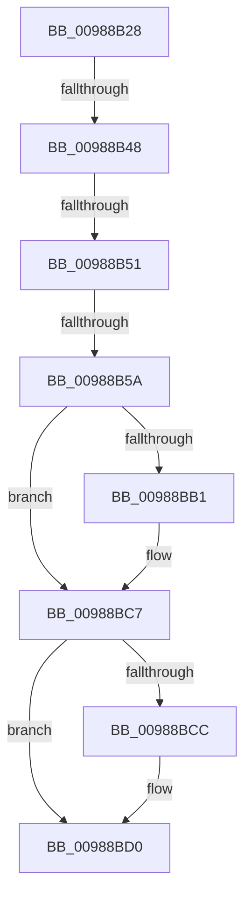

# sub_00988B28

- RVA: `0x00988B28`–`0x00988BDE` (길이 `182` bytes)
- VA: `0x0000000140988B28`
- 실행 섹션: `PAGE`
- PDB 이름 있음: `아니요`; PDB Function 태그: `아니요`
- unwind 정보 RVA: `0x00097E30`
- 디코드: `39`개 명령, `182/182` bytes 표시
- 미해석 바이트: `0` (있으면 어셈블리에 `.byte`로 보존)

> 이 문서는 커널 이미지의 기계어와 PDB 기호를 분석해 생성했습니다. 4번과 5번은 함수 원형과 자료형을 바이너리 사용 방식에서 추정한 C 해석이며 원본 소스 복구 결과는 아닙니다.

## 1. Dependencies

- 직접 호출 지점: **3**; 고유 호출 대상: **3**
- 직접 호출자로 확인된 함수: **0**
- RIP 상대 이미지 참조: **3**

### Outgoing calls
- `0x00988B7B` → [MiZeroCfgSystemWideBitmap](../../text/36/MiZeroCfgSystemWideBitmap_function_003677CC.md) (function, `0x003677CC`)
- `0x00988B9D` → [KeAbPreAcquire](../../text/21/KeAbPreAcquire_function_00210230.md) (function, `0x00210230`)
- `0x00988BC2` → [ExfAcquirePushLockExclusiveEx](../../text/20/ExfAcquirePushLockExclusiveEx_function_0020FC90.md) (function, `0x0020FC90`)

### Direct callers
- 이 함수 시작 RVA로 연결되는 직접 call은 확인되지 않았습니다. 간접 호출은 완전히 역산할 수 없습니다.

### Static image references
- `0x00988B5A` → RVA `0x00E2D730` (`.data`; read)
- `0x00988B89` → RVA `0x00E2D728` (`.data`; read)
- `0x00988BA2` → RVA `0x00E2D728` (`.data`; read/write)

## 2. Other-region calls and transfers

- 다른 실행 섹션으로 향하는 call: **3**
  - `0x00988B7B` → [MiZeroCfgSystemWideBitmap](../../text/36/MiZeroCfgSystemWideBitmap_function_003677CC.md) (`PAGE` → `.text`)
  - `0x00988B9D` → [KeAbPreAcquire](../../text/21/KeAbPreAcquire_function_00210230.md) (`PAGE` → `.text`)
  - `0x00988BC2` → [ExfAcquirePushLockExclusiveEx](../../text/20/ExfAcquirePushLockExclusiveEx_function_0020FC90.md) (`PAGE` → `.text`)
- call이 아닌 외부 분기/꼬리 이동: **4**
  - `0x00988B42` → [sub_00988C44](Unknown_function_00988C44.md) (`tail-transfer`)
  - `0x00988B4B` → [sub_00988CA8](Unknown_function_00988CA8.md) (`tail-transfer`)
  - `0x00988B54` → [sub_00988C44 + 0x11](Unknown_function_00988C44.md) (`tail-transfer`)
  - `0x00988BD8` → [sub_00988CC0](Unknown_function_00988CC0.md) (`tail-transfer`)

## 3. Assembly (complete function range)

```asm
00988B28  48 89 6C 24 40                  mov qword ptr [rsp + 0x40], rbp
00988B2D  48 89 74 24 48                  mov qword ptr [rsp + 0x48], rsi
00988B32  4C 89 74 24 50                  mov qword ptr [rsp + 0x50], r14
00988B37  4C 89 7C 24 20                  mov qword ptr [rsp + 0x20], r15
00988B3C  45 33 FF                        xor r15d, r15d
00988B3F  83 F8 01                        cmp eax, 1
00988B42  0F 84 FC 00 00 00               je 0x140988c44
00988B48  83 F8 02                        cmp eax, 2
00988B4B  0F 84 57 01 00 00               je 0x140988ca8
00988B51  83 F8 03                        cmp eax, 3
00988B54  0F 84 FB 00 00 00               je 0x140988c55
00988B5A  4C 8D 35 CF 4B 4A 00            lea r14, [rip + 0x4a4bcf]
00988B61  48 BA 00 00 FF FF FF 7F 00 00   movabs rdx, 0x7fffffff0000
00988B6B  8B 43 08                        mov eax, dword ptr [rbx + 8]
00988B6E  48 8B CB                        mov rcx, rbx
00988B71  48 03 C7                        add rax, rdi
00988B74  48 C1 E0 10                     shl rax, 0x10
00988B78  48 2B D0                        sub rdx, rax
00988B7B  E8 4C EC 9D FF                  call 0x1403677cc
00988B80  65 48 8B 34 25 88 01 00 00      mov rsi, qword ptr gs:[0x188]
00988B89  48 8D 0D 98 4B 4A 00            lea rcx, [rip + 0x4a4b98]
00988B90  45 33 C0                        xor r8d, r8d
00988B93  33 D2                           xor edx, edx
00988B95  66 FF 8E E6 01 00 00            dec word ptr [rsi + 0x1e6]
00988B9C  90                              nop
00988B9D  E8 8E 76 88 FF                  call 0x140210230
00988BA2  F0 48 0F BA 2D 7C 4B 4A 00 00   lock bts qword ptr [rip + 0x4a4b7c], 0
00988BAC  48 8B E8                        mov rbp, rax
00988BAF  73 16                           jae 0x140988bc7
00988BB1  4C 8D 05 70 4B 4A 00            lea r8, [rip + 0x4a4b70]
00988BB8  48 8B D0                        mov rdx, rax
00988BBB  48 8D 0D 66 4B 4A 00            lea rcx, [rip + 0x4a4b66]
00988BC2  E8 C9 70 88 FF                  call 0x14020fc90
00988BC7  48 85 ED                        test rbp, rbp
00988BCA  74 04                           je 0x140988bd0
00988BCC  C6 45 0A 01                     mov byte ptr [rbp + 0xa], 1
00988BD0  48 8B 6C 24 40                  mov rbp, qword ptr [rsp + 0x40]
00988BD5  4D 85 FF                        test r15, r15
00988BD8  0F 85 E2 00 00 00               jne 0x140988cc0
```

## 4. C-style interpretation (structured pseudocode)

```c
__int64 __fastcall sub_00988B28(__int64 a1, __int64 a2, int a3, __int64 a4, __int64 a5, __int64 a6, __int64 a7, __int64 a8)
{
    __int64 result;
    __int64 v_r15;
    unsigned __int64 v_stack_p20;
    unsigned __int64 v_stack_p40;
    unsigned __int64 v_stack_p48;
    unsigned __int64 v_stack_p50;

    v_stack_p40 = v_rbp;
    v_stack_p48 = v_rsi;
    v_stack_p50 = v_r14;
    v_stack_p20 = v_r15;
    v_r15 = 0;
    result = ((unsigned int)(*(unsigned int *)(v_rbx + 8))) + (v_rdi);
    result = (result) << (16);
    a2 = (a2) - (result);
    result = MiZeroCfgSystemWideBitmap(v_rbx, a2, a3, a4);
    a3 = 0;
    a2 = 0;
    result = KeAbPreAcquire(v_rip + 4869016, a2, a3, a4);
    if (!(condition_is_above_or_equal)) {
        a3 = v_rip + 4868976;
        a2 = result;
        a1 = v_rip + 4868966;
        result = ExfAcquirePushLockExclusiveEx(a1, a2, a3, a4);
    }
    if (result != 0) {
        *(unsigned __int8 *)(result + 10) = 1;
    }
}
```

## 5. (Beta) C Style

```c
int64_t sub_00988B28(int64_t Arg1, int64_t Arg2, int32_t Arg3, int64_t Arg4, uint64_t Arg5, uint64_t Arg6, uint64_t Arg7, int64_t Arg8)
{
    int64_t result;
    int64_t local_r15;
    uint64_t v_stack_p20;
    uint64_t v_stack_p40;
    uint64_t v_stack_p48;
    uint64_t v_stack_p50;

    v_stack_p40 = local_rbp;
    v_stack_p48 = local_rsi;
    v_stack_p50 = local_r14;
    v_stack_p20 = local_r15;
    local_r15 = 0;
    result = ((uint32_t)(*(uint32_t *)(local_rbx + 0x8))) + (local_rdi);
    result = (result) << (16);
    Arg2 = (Arg2) - (result);
    result = MiZeroCfgSystemWideBitmap(local_rbx, Arg2, Arg3, Arg4);
    Arg3 = 0;
    Arg2 = 0;
    result = KeAbPreAcquire(v_rip + 4869016, Arg2, Arg3, Arg4);
    if (!(condition_is_above_or_equal)) {
        Arg3 = v_rip + 4868976;
        Arg2 = result;
        Arg1 = v_rip + 4868966;
        result = ExfAcquirePushLockExclusiveEx(Arg1, Arg2, Arg3, Arg4);
    }
    if (result != 0) {
        *(uint8_t *)(result + 0xA) = 1;
    }
}
```

## 6. Execution-region graph

[열기: 2D/3D 그래프와 함수 탐색 컨트롤 패널](../../../control-panel.html?section=page&rva=0x00988B28&view=graph)

- 2D 그래프는 위에서 아래로 흐르고, 3D 그래프는 빈 공간을 드래그해 회전합니다. Shift+드래그는 이동, 휠은 확대·축소, 함수 노드 선택은 대상 보고서 이동입니다.

### Static fallback


