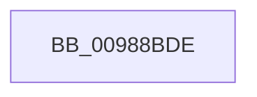

# sub_00988BDE

- RVA: `0x00988BDE`–`0x00988C11` (길이 `51` bytes)
- VA: `0x0000000140988BDE`
- 실행 섹션: `PAGE`
- PDB 이름 있음: `아니요`; PDB Function 태그: `아니요`
- unwind 정보 RVA: `0x00097E50`
- 디코드: `11`개 명령, `51/51` bytes 표시
- 미해석 바이트: `0` (있으면 어셈블리에 `.byte`로 보존)

> 이 문서는 커널 이미지의 기계어와 PDB 기호를 분석해 생성했습니다. 4번과 5번은 함수 원형과 자료형을 바이너리 사용 방식에서 추정한 C 해석이며 원본 소스 복구 결과는 아닙니다.

## 1. Dependencies

- 직접 호출 지점: **1**; 고유 호출 대상: **1**
- 직접 호출자로 확인된 함수: **0**
- RIP 상대 이미지 참조: **1**

### Outgoing calls
- `0x00988BE8` → [RtlClearBitsEx](../../text/29/RtlClearBitsEx_function_00297740.md) (function, `0x00297740`)

### Direct callers
- 이 함수 시작 RVA로 연결되는 직접 call은 확인되지 않았습니다. 간접 호출은 완전히 역산할 수 없습니다.

### Static image references
- `0x00988BF4` → RVA `0x00E2D728` (`.data`; read/write)

## 2. Other-region calls and transfers

- 다른 실행 섹션으로 향하는 call: **1**
  - `0x00988BE8` → [RtlClearBitsEx](../../text/29/RtlClearBitsEx_function_00297740.md) (`PAGE` → `.text`)
- call이 아닌 외부 분기/꼬리 이동: **1**
  - `0x00988C0B` → [sub_00988C97](Unknown_function_00988C97.md) (`tail-transfer`)

## 3. Assembly (complete function range)

```asm
00988BDE  44 8B 43 08                     mov r8d, dword ptr [rbx + 8]
00988BE2  48 8B D7                        mov rdx, rdi
00988BE5  49 8B CE                        mov rcx, r14
00988BE8  E8 53 EB 90 FF                  call 0x140297740
00988BED  48 C7 C0 FF FF FF FF            mov rax, 0xffffffffffffffff
00988BF4  F0 48 0F C1 05 2B 4B 4A 00      lock xadd qword ptr [rip + 0x4a4b2b], rax
00988BFD  4C 8B 7C 24 20                  mov r15, qword ptr [rsp + 0x20]
00988C02  24 06                           and al, 6
00988C04  4C 8B 74 24 50                  mov r14, qword ptr [rsp + 0x50]
00988C09  3C 02                           cmp al, 2
00988C0B  0F 84 86 00 00 00               je 0x140988c97
```

## 4. C-style interpretation (structured pseudocode)

```c
__int64 __fastcall sub_00988BDE(__int64 a1, __int64 a2, __int64 a3, __int64 a4, __int64 a5, __int64 a6, __int64 a7, __int64 a8, __int64 a9, __int64 a10)
{
    __int64 result;
    unsigned __int64 v_stack_p20;

    result = RtlClearBitsEx(v_r14, v_rdi, (unsigned int)(*(unsigned int *)(v_rbx + 8)), a4);
    result = (unsigned __int8)((-1) & (6));
}
```

## 5. (Beta) C Style

```c
int64_t sub_00988BDE(int64_t Arg1, int64_t Arg2, int64_t Arg3, int64_t Arg4, uint64_t Arg5, uint64_t Arg6, uint64_t Arg7, uint64_t Arg8, uint64_t Arg9, int64_t Arg10)
{
    int64_t result;
    uint64_t v_stack_p20;

    result = RtlClearBitsEx(local_r14, local_rdi, (uint32_t)(*(uint32_t *)(local_rbx + 0x8)), Arg4);
    result = (uint8_t)((-1) & (6));
}
```

## 6. Execution-region graph

[열기: 2D/3D 그래프와 함수 탐색 컨트롤 패널](../../../control-panel.html?section=page&rva=0x00988BDE&view=graph)

- 2D 그래프는 위에서 아래로 흐르고, 3D 그래프는 빈 공간을 드래그해 회전합니다. Shift+드래그는 이동, 휠은 확대·축소, 함수 노드 선택은 대상 보고서 이동입니다.

### Static fallback


