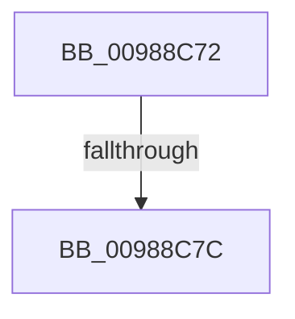

# sub_00988C72

- RVA: `0x00988C72`–`0x00988C97` (길이 `37` bytes)
- VA: `0x0000000140988C72`
- 실행 섹션: `PAGE`
- PDB 이름 있음: `아니요`; PDB Function 태그: `아니요`
- unwind 정보 RVA: `0x00097EA0`
- 디코드: `8`개 명령, `37/37` bytes 표시
- 미해석 바이트: `0` (있으면 어셈블리에 `.byte`로 보존)

> 이 문서는 커널 이미지의 기계어와 PDB 기호를 분석해 생성했습니다. 4번과 5번은 함수 원형과 자료형을 바이너리 사용 방식에서 추정한 C 해석이며 원본 소스 복구 결과는 아닙니다.

## 1. Dependencies

- 직접 호출 지점: **1**; 고유 호출 대상: **1**
- 직접 호출자로 확인된 함수: **0**
- RIP 상대 이미지 참조: **0**

### Outgoing calls
- `0x00988C8D` → [MiReturnSystemImageAddress](../A7/MiReturnSystemImageAddress_function_00A7F190.md) (function, `0x00A7F190`)

### Direct callers
- 이 함수 시작 RVA로 연결되는 직접 call은 확인되지 않았습니다. 간접 호출은 완전히 역산할 수 없습니다.

### Static image references
- 디코드된 RIP-relative 메모리 참조가 없습니다.

## 2. Other-region calls and transfers

- 다른 실행 섹션으로 향하는 call: **0**
- call이 아닌 외부 분기/꼬리 이동: **2**
  - `0x00988C76` → [MiReturnImageBase + 0x13](MiReturnImageBase_function_00988B00.md) (`tail-transfer`)
  - `0x00988C92` → [MiReturnImageBase + 0x13](MiReturnImageBase_function_00988B00.md) (`tail-transfer`)

## 3. Assembly (complete function range)

```asm
00988C72  80 79 0D 00                     cmp byte ptr [rcx + 0xd], 0
00988C76  0F 84 97 FE FF FF               je 0x140988b13
00988C7C  8B 51 08                        mov edx, dword ptr [rcx + 8]
00988C7F  48 8D 8F 00 00 00 80            lea rcx, [rdi - 0x80000000]
00988C86  48 C1 E1 10                     shl rcx, 0x10
00988C8A  C1 E2 10                        shl edx, 0x10
00988C8D  E8 FE 64 0F 00                  call 0x140a7f190
00988C92  E9 7C FE FF FF                  jmp 0x140988b13
```

## 4. C-style interpretation (structured pseudocode)

```c
__int64 __fastcall sub_00988C72(__int64 a1)
{
    __int64 result;

    a1 = (v_rdi - 2147483648) << (16);
    a2 = (unsigned int)(((unsigned int)(*(unsigned int *)(a1 + 8))) << (16));
    result = MiReturnSystemImageAddress(a1, a2, a3, a4);
}
```

## 5. (Beta) C Style

```c
int64_t sub_00988C72(void *Arg1)
{
    uint8_t *arg1 = (uint8_t *)Arg1;

    int64_t result;

    Arg1 = (local_rdi - 2147483648) << (16);
    a2 = (uint32_t)(((uint32_t)(*(uint32_t *)(arg1 + 0x8))) << (16));
    result = MiReturnSystemImageAddress(Arg1, a2, a3, a4);
}
```

### 관측된 메모리 오프셋

구조체 형식이 확인되지 않은 접근은 인자 기준의 오프셋으로만 기록했습니다.

| 기준 인자 | 오프셋 표현 | 폭 (bit) | 접근 |
|---|---:|---:|---|
| `Arg1` | `+ 0x8` | `32` | `R` |
| `Arg1` | `+ 0xD` | `8` | `R` |

## 6. Execution-region graph

[열기: 2D/3D 그래프와 함수 탐색 컨트롤 패널](../../../control-panel.html?section=page&rva=0x00988C72&view=graph)

- 2D 그래프는 위에서 아래로 흐르고, 3D 그래프는 빈 공간을 드래그해 회전합니다. Shift+드래그는 이동, 휠은 확대·축소, 함수 노드 선택은 대상 보고서 이동입니다.

### Static fallback


