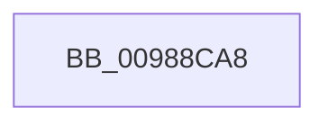

# sub_00988CA8

- RVA: `0x00988CA8`–`0x00988CC0` (길이 `24` bytes)
- VA: `0x0000000140988CA8`
- 실행 섹션: `PAGE`
- PDB 이름 있음: `아니요`; PDB Function 태그: `아니요`
- unwind 정보 RVA: `0x00097EC4`
- 디코드: `4`개 명령, `24/24` bytes 표시
- 미해석 바이트: `0` (있으면 어셈블리에 `.byte`로 보존)

> 이 문서는 커널 이미지의 기계어와 PDB 기호를 분석해 생성했습니다. 4번과 5번은 함수 원형과 자료형을 바이너리 사용 방식에서 추정한 C 해석이며 원본 소스 복구 결과는 아닙니다.

## 1. Dependencies

- 직접 호출 지점: **0**; 고유 호출 대상: **0**
- 직접 호출자로 확인된 함수: **0**
- RIP 상대 이미지 참조: **2**

### Outgoing calls
- 직접 디코드된 call 명령이 없습니다.

### Direct callers
- 이 함수 시작 RVA로 연결되는 직접 call은 확인되지 않았습니다. 간접 호출은 완전히 역산할 수 없습니다.

### Static image references
- `0x00988CA8` → RVA `0x00E2D768` (`.data`; read)
- `0x00988CB4` → RVA `0x00E2D7C0` (`.data`; read)

## 2. Other-region calls and transfers

- 다른 실행 섹션으로 향하는 call: **0**
- call이 아닌 외부 분기/꼬리 이동: **1**
  - `0x00988CBB` → [sub_00988B28 + 0x43](Unknown_function_00988B28.md) (`tail-transfer`)

## 3. Assembly (complete function range)

```asm
00988CA8  4C 8D 35 B9 4A 4A 00            lea r14, [rip + 0x4a4ab9]
00988CAF  BA 00 00 00 78                  mov edx, 0x78000000
00988CB4  4C 8D 3D 05 4B 4A 00            lea r15, [rip + 0x4a4b05]
00988CBB  E9 AB FE FF FF                  jmp 0x140988b6b
```

## 4. C-style interpretation (structured pseudocode)

```c
void __fastcall sub_00988CA8(void)
{
}
```

## 5. (Beta) C Style

```c
void sub_00988CA8(void)
{
}
```

## 6. Execution-region graph

[열기: 2D/3D 그래프와 함수 탐색 컨트롤 패널](../../../control-panel.html?section=page&rva=0x00988CA8&view=graph)

- 2D 그래프는 위에서 아래로 흐르고, 3D 그래프는 빈 공간을 드래그해 회전합니다. Shift+드래그는 이동, 휠은 확대·축소, 함수 노드 선택은 대상 보고서 이동입니다.

### Static fallback


