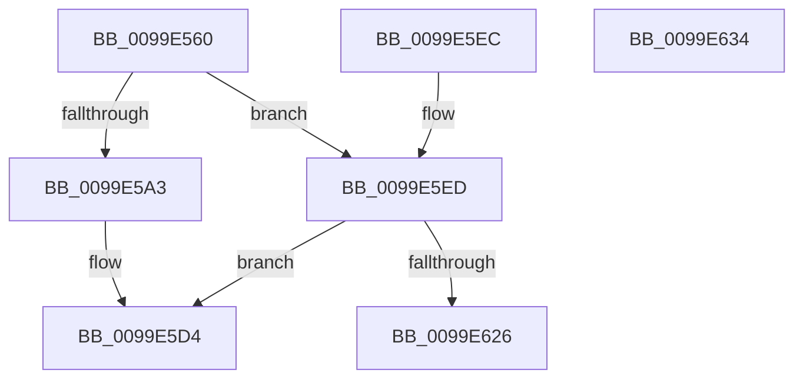

# CcMapDataCommon

- RVA: `0x0099E560`–`0x0099E635` (길이 `213` bytes)
- VA: `0x000000014099E560`
- 실행 섹션: `PAGE`
- PDB 이름 있음: `예`; PDB Function 태그: `아니요`
- unwind 정보 RVA: `0x0009AC24`
- 디코드: `52`개 명령, `213/213` bytes 표시
- 미해석 바이트: `0` (있으면 어셈블리에 `.byte`로 보존)

> 이 문서는 커널 이미지의 기계어와 PDB 기호를 분석해 생성했습니다. 4번과 5번은 함수 원형과 자료형을 바이너리 사용 방식에서 추정한 C 해석이며 원본 소스 복구 결과는 아닙니다.

## 1. Dependencies

- 직접 호출 지점: **2**; 고유 호출 대상: **2**
- 직접 호출자로 확인된 함수: **1**
- RIP 상대 이미지 참조: **0**

### Outgoing calls
- `0x0099E5C4` → [CcGetVirtualAddress](../../text/34/CcGetVirtualAddress_function_00340C9C.md) (function, `0x00340C9C`)
- `0x0099E61D` → [CcPinFileData](../../text/33/CcPinFileData_function_0033FB40.md) (function, `0x0033FB40`)

### Direct callers
- [CcMapDataForOverwrite](../../text/46/CcMapDataForOverwrite_function_00466160.md) at `0x0046621E`

### Static image references
- 디코드된 RIP-relative 메모리 참조가 없습니다.

## 2. Other-region calls and transfers

- 다른 실행 섹션으로 향하는 call: **2**
  - `0x0099E5C4` → [CcGetVirtualAddress](../../text/34/CcGetVirtualAddress_function_00340C9C.md) (`PAGE` → `.text`)
  - `0x0099E61D` → [CcPinFileData](../../text/33/CcPinFileData_function_0033FB40.md) (`PAGE` → `.text`)
- 별도 외부 분기/꼬리 이동을 확인하지 못했습니다.

## 3. Assembly (complete function range)

```asm
0099E560  40 53                           push rbx
0099E562  48 83 EC 60                     sub rsp, 0x60
0099E566  33 DB                           xor ebx, ebx
0099E568  45 8B D1                        mov r10d, r9d
0099E56B  48 89 5C 24 50                  mov qword ptr [rsp + 0x50], rbx
0099E570  41 83 E2 01                     and r10d, 1
0099E574  48 89 5C 24 70                  mov qword ptr [rsp + 0x70], rbx
0099E579  4C 8B D9                        mov r11, rcx
0099E57C  42 8D 04 95 4C 89 00 00         lea eax, [r10*4 + 0x894c]
0099E584  65 FF 00                        inc dword ptr gs:[rax]
0099E587  65 48 8B 04 25 88 01 00 00      mov rax, qword ptr gs:[0x188]
0099E590  89 98 DC 05 00 00               mov dword ptr [rax + 0x5dc], ebx
0099E596  48 8B 41 28                     mov rax, qword ptr [rcx + 0x28]
0099E59A  48 8B 48 08                     mov rcx, qword ptr [rax + 8]
0099E59E  45 85 D2                        test r10d, r10d
0099E5A1  74 4A                           je 0x14099e5ed
0099E5A3  48 8B 12                        mov rdx, qword ptr [rdx]
0099E5A6  4C 8D 44 24 70                  lea r8, [rsp + 0x70]
0099E5AB  41 C1 E9 06                     shr r9d, 6
0099E5AF  41 83 E1 01                     and r9d, 1
0099E5B3  89 5C 24 28                     mov dword ptr [rsp + 0x28], ebx
0099E5B7  44 89 4C 24 20                  mov dword ptr [rsp + 0x20], r9d
0099E5BC  4C 8D 8C 24 88 00 00 00         lea r9, [rsp + 0x88]
0099E5C4  E8 D3 26 9A FF                  call 0x140340c9c
0099E5C9  48 8B 8C 24 98 00 00 00         mov rcx, qword ptr [rsp + 0x98]
0099E5D1  48 89 01                        mov qword ptr [rcx], rax
0099E5D4  48 8B 44 24 70                  mov rax, qword ptr [rsp + 0x70]
0099E5D9  48 8B 8C 24 90 00 00 00         mov rcx, qword ptr [rsp + 0x90]
0099E5E1  48 89 01                        mov qword ptr [rcx], rax
0099E5E4  B0 01                           mov al, 1
0099E5E6  48 83 C4 60                     add rsp, 0x60
0099E5EA  5B                              pop rbx
0099E5EB  C3                              ret
0099E5EC  CC                              int3
0099E5ED  48 8D 44 24 50                  lea rax, [rsp + 0x50]
0099E5F2  49 8B CB                        mov rcx, r11
0099E5F5  48 89 44 24 40                  mov qword ptr [rsp + 0x40], rax
0099E5FA  48 8B 84 24 98 00 00 00         mov rax, qword ptr [rsp + 0x98]
0099E602  48 89 44 24 38                  mov qword ptr [rsp + 0x38], rax
0099E607  48 8D 44 24 70                  lea rax, [rsp + 0x70]
0099E60C  48 89 44 24 30                  mov qword ptr [rsp + 0x30], rax
0099E611  44 89 4C 24 28                  mov dword ptr [rsp + 0x28], r9d
0099E616  41 B1 01                        mov r9b, 1
0099E619  88 5C 24 20                     mov byte ptr [rsp + 0x20], bl
0099E61D  E8 1E 15 9A FF                  call 0x14033fb40
0099E622  84 C0                           test al, al
0099E624  75 AE                           jne 0x14099e5d4
0099E626  65 FF 04 25 8C 89 00 00         inc dword ptr gs:[0x898c]
0099E62E  48 83 C4 60                     add rsp, 0x60
0099E632  5B                              pop rbx
0099E633  C3                              ret
0099E634  CC                              int3
```

## 4. C-style interpretation (structured pseudocode)

```c
__int64 __fastcall CcMapDataCommon(__int64 a1, __int64 a2, __int64 a3, int a4, __int64 a5, __int64 a6)
{
    __int64 result;
    __int64 v_r10;
    __int64 v_rbx;
    __int64 v_rsp;
    unsigned __int64 v_stack_m18;
    unsigned int v_stack_m40;
    unsigned int v_stack_m48;
    unsigned __int64 v_stack_p20;
    unsigned int v_stack_p28;
    unsigned __int64 v_stack_p30;
    unsigned __int64 v_stack_p38;
    unsigned __int64 v_stack_p40;
    unsigned __int64 v_stack_p50;
    unsigned __int64 v_stack_p70;
    unsigned __int64 v_stack_p8;

    v_rsp = (v_rsp) - (96);
    v_rbx = 0;
    v_stack_m18 = 0;
    v_r10 = (unsigned int)(((unsigned int)(a4)) & (1));
    v_stack_p8 = 0;
    *(unsigned int *)(*(unsigned __int64 *)(gs_base + (0 + 392)) + 1500) = 0;
    if ((unsigned int)(v_r10) == 0) goto loc_0099E5ED;
    a4 = (unsigned int)((a4) >> (6));
    a4 = (unsigned int)((a4) & (1));
    v_stack_m40 = 0;
    v_stack_m48 = a4;
    result = CcGetVirtualAddress(*(unsigned __int64 *)(*(unsigned __int64 *)(a1 + 40) + 8), *(unsigned __int64 *)(a2), v_stack_p8, v_stack_p20);
    *(unsigned __int64 *)(a6) = result;
loc_0099E5D4:
    *(unsigned __int64 *)(a5) = v_stack_p8;
    v_rsp = (v_rsp) + (96);
    return 1;
loc_0099E5ED:
    v_stack_p40 = v_stack_p50;
    v_stack_p38 = a6;
    v_stack_p30 = v_stack_p70;
    v_stack_p28 = (unsigned int)(v_stack_p20);
    v_stack_p20 = 0;
    result = CcPinFileData(a1, *(unsigned __int64 *)(a2), v_stack_p8, 1);
    if ((unsigned __int8)(result) != 0) goto loc_0099E5D4;
    v_rsp = (v_rsp) + (96);
    return result;
}
```

## 5. (Beta) C Style

```c
int64_t CcMapDataCommon(void *Arg1, void *Arg2, int64_t Arg3, int32_t Arg4, void *Arg5, void *Arg6)
{
    uint8_t *arg1 = (uint8_t *)Arg1;
    uint8_t *arg2 = (uint8_t *)Arg2;
    uint8_t *arg5 = (uint8_t *)Arg5;
    uint8_t *arg6 = (uint8_t *)Arg6;

    int64_t result;
    int64_t local_r10;
    int64_t local_rbx;
    int64_t local_rsp;
    uint64_t v_stack_m18;
    uint32_t v_stack_m40;
    uint32_t v_stack_m48;
    uint64_t v_stack_p20;
    uint32_t v_stack_p28;
    uint64_t v_stack_p30;
    uint64_t v_stack_p38;
    uint64_t v_stack_p40;
    uint64_t v_stack_p50;
    uint64_t v_stack_p70;
    uint64_t v_stack_p8;

    local_rsp = (local_rsp) - (96);
    local_rbx = 0;
    v_stack_m18 = 0;
    local_r10 = (uint32_t)(((uint32_t)(Arg4)) & (1));
    v_stack_p8 = 0;
    *(uint32_t *)(*(uint64_t *)(gs_base + (0 + 0x188)) + 0x5DC) = 0;
    if ((uint32_t)(local_r10) == 0) goto loc_0099E5ED;
    Arg4 = (uint32_t)((Arg4) >> (6));
    Arg4 = (uint32_t)((Arg4) & (1));
    v_stack_m40 = 0;
    v_stack_m48 = Arg4;
    result = CcGetVirtualAddress(*(uint64_t *)(*(uint64_t *)(arg1 + 0x28) + 0x8), *(uint64_t *)(arg2), v_stack_p8, v_stack_p20);
    *(uint64_t *)(arg6) = result;
loc_0099E5D4:
    *(uint64_t *)(arg5) = v_stack_p8;
    local_rsp = (local_rsp) + (96);
    return 1;
loc_0099E5ED:
    v_stack_p40 = v_stack_p50;
    v_stack_p38 = Arg6;
    v_stack_p30 = v_stack_p70;
    v_stack_p28 = (uint32_t)(v_stack_p20);
    v_stack_p20 = 0;
    result = CcPinFileData(Arg1, *(uint64_t *)(arg2), v_stack_p8, 1);
    if ((uint8_t)(result) != 0) goto loc_0099E5D4;
    local_rsp = (local_rsp) + (96);
    return result;
}
```

### 관측된 메모리 오프셋

구조체 형식이 확인되지 않은 접근은 인자 기준의 오프셋으로만 기록했습니다.

| 기준 인자 | 오프셋 표현 | 폭 (bit) | 접근 |
|---|---:|---:|---|
| `Arg1` | `+ 0x28` | `64` | `R` |
| `Arg2` | `+ 0x0` | `64` | `R` |
| `Arg5` | `+ 0x0` | `64` | `W` |
| `Arg6` | `+ 0x0` | `64` | `W` |

## 6. Execution-region graph

[열기: 2D/3D 그래프와 함수 탐색 컨트롤 패널](../../../control-panel.html?section=page&rva=0x0099E560&view=graph)

- 2D 그래프는 위에서 아래로 흐르고, 3D 그래프는 빈 공간을 드래그해 회전합니다. Shift+드래그는 이동, 휠은 확대·축소, 함수 노드 선택은 대상 보고서 이동입니다.

### Static fallback


