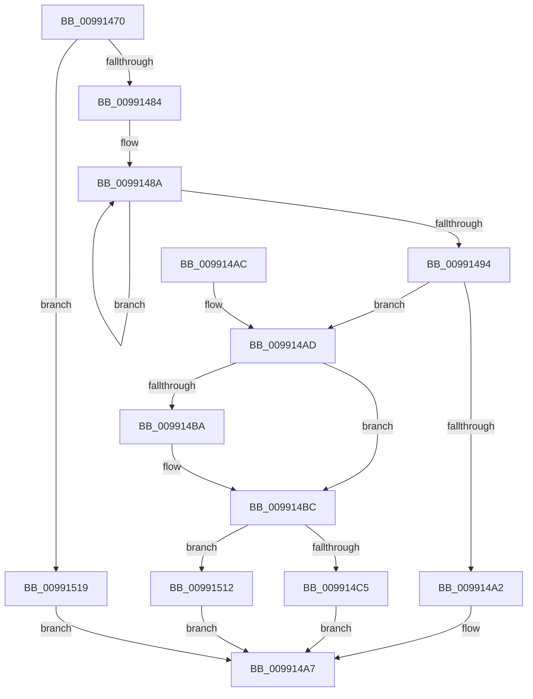

# CmGetDeviceControlKeyPath

- RVA: `0x00991470`–`0x00991520` (길이 `176` bytes)
- VA: `0x0000000140991470`
- 실행 섹션: `PAGE`
- PDB 이름 있음: `예`; PDB Function 태그: `아니요`
- unwind 정보 RVA: `0x00098CD4`
- 디코드: `41`개 명령, `176/176` bytes 표시
- 미해석 바이트: `0` (있으면 어셈블리에 `.byte`로 보존)

> 이 문서는 커널 이미지의 기계어와 PDB 기호를 분석해 생성했습니다. 4번과 5번은 함수 원형과 자료형을 바이너리 사용 방식에서 추정한 C 해석이며 원본 소스 복구 결과는 아닙니다.

## 1. Dependencies

- 직접 호출 지점: **1**; 고유 호출 대상: **1**
- 직접 호출자로 확인된 함수: **1**
- RIP 상대 이미지 참조: **3**

### Outgoing calls
- `0x0099150B` → [RtlStringCchPrintfExW](../../text/42/RtlStringCchPrintfExW_function_0042B390.md) (function, `0x0042B390`)

### Direct callers
- [CmGetDeviceRegKeyPath](CmGetDeviceRegKeyPath_function_00990CC0.md) at `0x00990ED4`

### Static image references
- `0x009914CC` → RVA `0x00B0D370` (` ?? ::NNGAKEGL::`string'`; read)
- `0x009914E3` → RVA `0x00B0D550` (` ?? ::NNGAKEGL::`string'`; read)
- `0x009914F7` → RVA `0x00AFDE50` (` ?? ::NNGAKEGL::`string'`; read)

## 2. Other-region calls and transfers

- 다른 실행 섹션으로 향하는 call: **1**
  - `0x0099150B` → [RtlStringCchPrintfExW](../../text/42/RtlStringCchPrintfExW_function_0042B390.md) (`PAGE` → `.text`)
- 별도 외부 분기/꼬리 이동을 확인하지 못했습니다.

## 3. Assembly (complete function range)

```asm
00991470  48 83 EC 58                     sub rsp, 0x58
00991474  4C 8B CA                        mov r9, rdx
00991477  41 F7 C0 EC FF FF FF            test r8d, 0xffffffec
0099147E  0F 85 95 00 00 00               jne 0x140991519
00991484  48 83 C8 FF                     or rax, 0xffffffffffffffff
00991488  33 D2                           xor edx, edx
0099148A  48 FF C0                        inc rax
0099148D  66 41 39 14 41                  cmp word ptr [r9 + rax*2], dx
00991492  75 F6                           jne 0x14099148a
00991494  48 83 C0 27                     add rax, 0x27
00991498  B9 FF FF FF FF                  mov ecx, 0xffffffff
0099149D  48 3B C1                        cmp rax, rcx
009914A0  76 0B                           jbe 0x1409914ad
009914A2  B8 95 00 00 C0                  mov eax, 0xc0000095
009914A7  48 83 C4 58                     add rsp, 0x58
009914AB  C3                              ret
009914AC  CC                              int3
009914AD  48 8B 8C 24 98 00 00 00         mov rcx, qword ptr [rsp + 0x98]
009914B5  48 85 C9                        test rcx, rcx
009914B8  74 02                           je 0x1409914bc
009914BA  89 01                           mov dword ptr [rcx], eax
009914BC  3B 84 24 90 00 00 00            cmp eax, dword ptr [rsp + 0x90]
009914C3  77 4D                           ja 0x140991512
009914C5  8B 94 24 90 00 00 00            mov edx, dword ptr [rsp + 0x90]
009914CC  48 8D 05 9D BE 17 00            lea rax, [rip + 0x17be9d]
009914D3  48 8B 8C 24 88 00 00 00         mov rcx, qword ptr [rsp + 0x88]
009914DB  45 33 C0                        xor r8d, r8d
009914DE  48 89 44 24 40                  mov qword ptr [rsp + 0x40], rax
009914E3  48 8D 05 66 C0 17 00            lea rax, [rip + 0x17c066]
009914EA  4C 89 4C 24 38                  mov qword ptr [rsp + 0x38], r9
009914EF  45 33 C9                        xor r9d, r9d
009914F2  48 89 44 24 30                  mov qword ptr [rsp + 0x30], rax
009914F7  48 8D 05 52 C9 16 00            lea rax, [rip + 0x16c952]
009914FE  48 89 44 24 28                  mov qword ptr [rsp + 0x28], rax
00991503  C7 44 24 20 00 08 00 00         mov dword ptr [rsp + 0x20], 0x800
0099150B  E8 80 9E A9 FF                  call 0x14042b390
00991510  EB 95                           jmp 0x1409914a7
00991512  B8 23 00 00 C0                  mov eax, 0xc0000023
00991517  EB 8E                           jmp 0x1409914a7
00991519  B8 0D 00 00 C0                  mov eax, 0xc000000d
0099151E  EB 87                           jmp 0x1409914a7
```

## 4. C-style interpretation (structured pseudocode)

```c
__int64 __fastcall CmGetDeviceControlKeyPath(__int64 a1, __int64 a2, int a3, __int64 a4, __int64 a5, __int64 a6, unsigned int a7, __int64 a8)
{
    __int64 result;
    __int64 v_rsp;
    unsigned int v_stack_p20;
    unsigned __int64 v_stack_p28;
    unsigned __int64 v_stack_p30;
    unsigned __int64 v_stack_p38;
    unsigned __int64 v_stack_p40;

    v_rsp = (v_rsp) - (88);
    if (((a3) & (0xFFFFFFECULL)) != 0) goto loc_00991519;
    result = (result) | (-1);
    a2 = 0;
loc_0099148A:
    result = (result) + 1;
    if ((*(unsigned __int16 *)(a2 + result * 2)) != 0) goto loc_0099148A;
    result = (result) + (39);
    if (result <= ((unsigned int)(0xFFFFFFFFULL))) goto loc_009914AD;
loc_009914A7:
    v_rsp = (v_rsp) + (88);
    return (unsigned int)(0xC0000095ULL);
loc_009914AD:
    if (a8 != 0) {
        *(unsigned int *)(a8) = (unsigned int)((unsigned int)(0xC0000095ULL));
    }
    if (((unsigned int)((unsigned int)(0xC0000095ULL))) > a7) goto loc_00991512;
    a3 = 0;
    v_stack_p40 = v_rip + 1556125;
    v_stack_p38 = 0;
    a4 = 0;
    v_stack_p30 = v_rip + 1556582;
    v_stack_p28 = v_rip + 1493330;
    v_stack_p20 = 0x800ULL;
    result = RtlStringCchPrintfExW(a6, (unsigned int)(a7), a3, a4);
    goto loc_009914A7;
loc_00991512:
    goto loc_009914A7;
loc_00991519:
    goto loc_009914A7;
}
```

## 5. (Beta) C Style

```c
int64_t CmGetDeviceControlKeyPath(int64_t Arg1, void *Arg2, int32_t Arg3, int64_t Arg4, uint64_t Arg5, int64_t Arg6, uint32_t Arg7, int64_t Arg8)
{
    uint8_t *arg2 = (uint8_t *)Arg2;

    int64_t result;
    int64_t local_rsp;
    uint32_t v_stack_p20;
    uint64_t v_stack_p28;
    uint64_t v_stack_p30;
    uint64_t v_stack_p38;
    uint64_t v_stack_p40;

    local_rsp = (local_rsp) - (88);
    if (((Arg3) & (0xFFFFFFECULL)) != 0) goto loc_00991519;
    result = (result) | (-1);
    Arg2 = 0;
loc_0099148A:
    result = (result) + 1;
    if ((*(uint16_t *)(arg2 + result * 2)) != 0) goto loc_0099148A;
    result = (result) + (39);
    if (result <= ((uint32_t)(0xFFFFFFFFULL))) goto loc_009914AD;
loc_009914A7:
    local_rsp = (local_rsp) + (88);
    return (uint32_t)(0xC0000095ULL);
loc_009914AD:
    if (Arg8 != 0) {
        *(uint32_t *)(Arg8) = (uint32_t)((uint32_t)(0xC0000095ULL));
    }
    if (((uint32_t)((uint32_t)(0xC0000095ULL))) > Arg7) goto loc_00991512;
    Arg3 = 0;
    v_stack_p40 = v_rip + 1556125;
    v_stack_p38 = 0;
    Arg4 = 0;
    v_stack_p30 = v_rip + 1556582;
    v_stack_p28 = v_rip + 1493330;
    v_stack_p20 = 0x800ULL;
    result = RtlStringCchPrintfExW(Arg6, (uint32_t)(Arg7), Arg3, Arg4);
    goto loc_009914A7;
loc_00991512:
    goto loc_009914A7;
loc_00991519:
    goto loc_009914A7;
}
```

### 관측된 메모리 오프셋

구조체 형식이 확인되지 않은 접근은 인자 기준의 오프셋으로만 기록했습니다.

| 기준 인자 | 오프셋 표현 | 폭 (bit) | 접근 |
|---|---:|---:|---|
| `Arg2` | `+ 0x0 + rax*2` | `16` | `R` |

## 6. Execution-region graph

[열기: 2D/3D 그래프와 함수 탐색 컨트롤 패널](../../../control-panel.html?section=page&rva=0x00991470&view=graph)

- 2D 그래프는 위에서 아래로 흐르고, 3D 그래프는 빈 공간을 드래그해 회전합니다. Shift+드래그는 이동, 휠은 확대·축소, 함수 노드 선택은 대상 보고서 이동입니다.

### Static fallback


