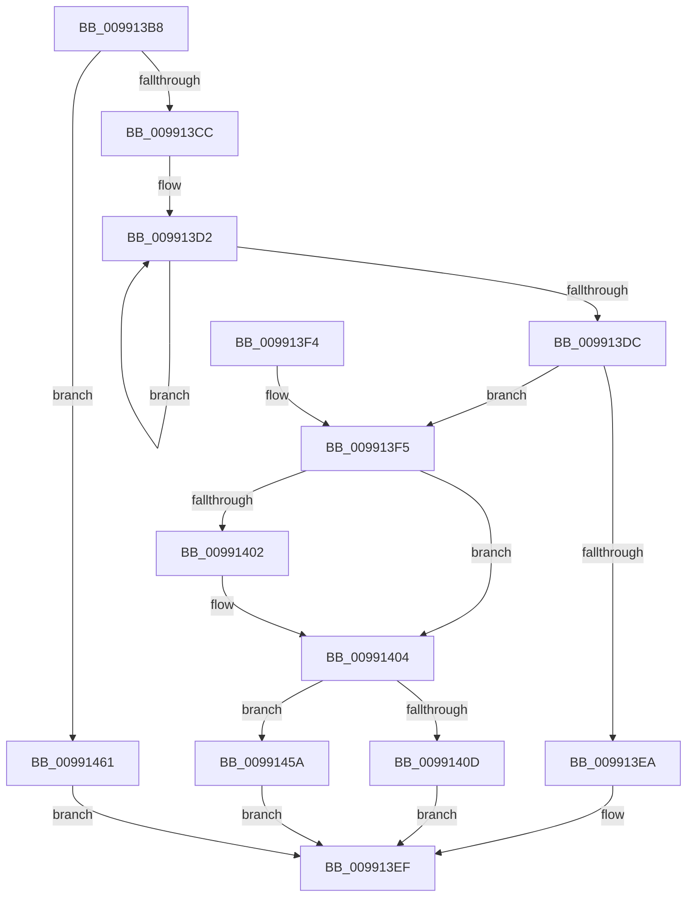

# CmGetDeviceLogConfKeyPath

- RVA: `0x009913B8`–`0x00991468` (길이 `176` bytes)
- VA: `0x00000001409913B8`
- 실행 섹션: `PAGE`
- PDB 이름 있음: `예`; PDB Function 태그: `아니요`
- unwind 정보 RVA: `0x00098CD4`
- 디코드: `41`개 명령, `176/176` bytes 표시
- 미해석 바이트: `0` (있으면 어셈블리에 `.byte`로 보존)

> 이 문서는 커널 이미지의 기계어와 PDB 기호를 분석해 생성했습니다. 4번과 5번은 함수 원형과 자료형을 바이너리 사용 방식에서 추정한 C 해석이며 원본 소스 복구 결과는 아닙니다.

## 1. Dependencies

- 직접 호출 지점: **1**; 고유 호출 대상: **1**
- 직접 호출자로 확인된 함수: **1**
- RIP 상대 이미지 참조: **3**

### Outgoing calls
- `0x00991453` → [RtlStringCchPrintfExW](../../text/42/RtlStringCchPrintfExW_function_0042B390.md) (function, `0x0042B390`)

### Direct callers
- [CmGetDeviceRegKeyPath](CmGetDeviceRegKeyPath_function_00990CC0.md) at `0x00990E9B`

### Static image references
- `0x00991414` → RVA `0x00AFD5E0` (` ?? ::NNGAKEGL::`string'`; read)
- `0x0099142B` → RVA `0x00B0D550` (` ?? ::NNGAKEGL::`string'`; read)
- `0x0099143F` → RVA `0x00AFDE50` (` ?? ::NNGAKEGL::`string'`; read)

## 2. Other-region calls and transfers

- 다른 실행 섹션으로 향하는 call: **1**
  - `0x00991453` → [RtlStringCchPrintfExW](../../text/42/RtlStringCchPrintfExW_function_0042B390.md) (`PAGE` → `.text`)
- 별도 외부 분기/꼬리 이동을 확인하지 못했습니다.

## 3. Assembly (complete function range)

```asm
009913B8  48 83 EC 58                     sub rsp, 0x58
009913BC  4C 8B CA                        mov r9, rdx
009913BF  41 F7 C0 EB FF FF FF            test r8d, 0xffffffeb
009913C6  0F 85 95 00 00 00               jne 0x140991461
009913CC  48 83 C8 FF                     or rax, 0xffffffffffffffff
009913D0  33 D2                           xor edx, edx
009913D2  48 FF C0                        inc rax
009913D5  66 41 39 14 41                  cmp word ptr [r9 + rax*2], dx
009913DA  75 F6                           jne 0x1409913d2
009913DC  48 83 C0 27                     add rax, 0x27
009913E0  B9 FF FF FF FF                  mov ecx, 0xffffffff
009913E5  48 3B C1                        cmp rax, rcx
009913E8  76 0B                           jbe 0x1409913f5
009913EA  B8 95 00 00 C0                  mov eax, 0xc0000095
009913EF  48 83 C4 58                     add rsp, 0x58
009913F3  C3                              ret
009913F4  CC                              int3
009913F5  48 8B 8C 24 98 00 00 00         mov rcx, qword ptr [rsp + 0x98]
009913FD  48 85 C9                        test rcx, rcx
00991400  74 02                           je 0x140991404
00991402  89 01                           mov dword ptr [rcx], eax
00991404  3B 84 24 90 00 00 00            cmp eax, dword ptr [rsp + 0x90]
0099140B  77 4D                           ja 0x14099145a
0099140D  8B 94 24 90 00 00 00            mov edx, dword ptr [rsp + 0x90]
00991414  48 8D 05 C5 C1 16 00            lea rax, [rip + 0x16c1c5]
0099141B  48 8B 8C 24 88 00 00 00         mov rcx, qword ptr [rsp + 0x88]
00991423  45 33 C0                        xor r8d, r8d
00991426  48 89 44 24 40                  mov qword ptr [rsp + 0x40], rax
0099142B  48 8D 05 1E C1 17 00            lea rax, [rip + 0x17c11e]
00991432  4C 89 4C 24 38                  mov qword ptr [rsp + 0x38], r9
00991437  45 33 C9                        xor r9d, r9d
0099143A  48 89 44 24 30                  mov qword ptr [rsp + 0x30], rax
0099143F  48 8D 05 0A CA 16 00            lea rax, [rip + 0x16ca0a]
00991446  48 89 44 24 28                  mov qword ptr [rsp + 0x28], rax
0099144B  C7 44 24 20 00 08 00 00         mov dword ptr [rsp + 0x20], 0x800
00991453  E8 38 9F A9 FF                  call 0x14042b390
00991458  EB 95                           jmp 0x1409913ef
0099145A  B8 23 00 00 C0                  mov eax, 0xc0000023
0099145F  EB 8E                           jmp 0x1409913ef
00991461  B8 0D 00 00 C0                  mov eax, 0xc000000d
00991466  EB 87                           jmp 0x1409913ef
```

## 4. C-style interpretation (structured pseudocode)

```c
__int64 __fastcall CmGetDeviceLogConfKeyPath(__int64 a1, __int64 a2, int a3, __int64 a4, __int64 a5, __int64 a6, unsigned int a7, __int64 a8)
{
    __int64 result;
    __int64 v_rsp;
    unsigned int v_stack_p20;
    unsigned __int64 v_stack_p28;
    unsigned __int64 v_stack_p30;
    unsigned __int64 v_stack_p38;
    unsigned __int64 v_stack_p40;

    v_rsp = (v_rsp) - (88);
    if (((a3) & (0xFFFFFFEBULL)) != 0) goto loc_00991461;
    result = (result) | (-1);
    a2 = 0;
loc_009913D2:
    result = (result) + 1;
    if ((*(unsigned __int16 *)(a2 + result * 2)) != 0) goto loc_009913D2;
    result = (result) + (39);
    if (result <= ((unsigned int)(0xFFFFFFFFULL))) goto loc_009913F5;
loc_009913EF:
    v_rsp = (v_rsp) + (88);
    return (unsigned int)(0xC0000095ULL);
loc_009913F5:
    if (a8 != 0) {
        *(unsigned int *)(a8) = (unsigned int)((unsigned int)(0xC0000095ULL));
    }
    if (((unsigned int)((unsigned int)(0xC0000095ULL))) > a7) goto loc_0099145A;
    a3 = 0;
    v_stack_p40 = v_rip + 1491397;
    v_stack_p38 = 0;
    a4 = 0;
    v_stack_p30 = v_rip + 1556766;
    v_stack_p28 = v_rip + 1493514;
    v_stack_p20 = 0x800ULL;
    result = RtlStringCchPrintfExW(a6, (unsigned int)(a7), a3, a4);
    goto loc_009913EF;
loc_0099145A:
    goto loc_009913EF;
loc_00991461:
    goto loc_009913EF;
}
```

## 5. (Beta) C Style

```c
int64_t CmGetDeviceLogConfKeyPath(int64_t Arg1, void *Arg2, int32_t Arg3, int64_t Arg4, uint64_t Arg5, int64_t Arg6, uint32_t Arg7, int64_t Arg8)
{
    uint8_t *arg2 = (uint8_t *)Arg2;

    int64_t result;
    int64_t local_rsp;
    uint32_t v_stack_p20;
    uint64_t v_stack_p28;
    uint64_t v_stack_p30;
    uint64_t v_stack_p38;
    uint64_t v_stack_p40;

    local_rsp = (local_rsp) - (88);
    if (((Arg3) & (0xFFFFFFEBULL)) != 0) goto loc_00991461;
    result = (result) | (-1);
    Arg2 = 0;
loc_009913D2:
    result = (result) + 1;
    if ((*(uint16_t *)(arg2 + result * 2)) != 0) goto loc_009913D2;
    result = (result) + (39);
    if (result <= ((uint32_t)(0xFFFFFFFFULL))) goto loc_009913F5;
loc_009913EF:
    local_rsp = (local_rsp) + (88);
    return (uint32_t)(0xC0000095ULL);
loc_009913F5:
    if (Arg8 != 0) {
        *(uint32_t *)(Arg8) = (uint32_t)((uint32_t)(0xC0000095ULL));
    }
    if (((uint32_t)((uint32_t)(0xC0000095ULL))) > Arg7) goto loc_0099145A;
    Arg3 = 0;
    v_stack_p40 = v_rip + 1491397;
    v_stack_p38 = 0;
    Arg4 = 0;
    v_stack_p30 = v_rip + 1556766;
    v_stack_p28 = v_rip + 1493514;
    v_stack_p20 = 0x800ULL;
    result = RtlStringCchPrintfExW(Arg6, (uint32_t)(Arg7), Arg3, Arg4);
    goto loc_009913EF;
loc_0099145A:
    goto loc_009913EF;
loc_00991461:
    goto loc_009913EF;
}
```

### 관측된 메모리 오프셋

구조체 형식이 확인되지 않은 접근은 인자 기준의 오프셋으로만 기록했습니다.

| 기준 인자 | 오프셋 표현 | 폭 (bit) | 접근 |
|---|---:|---:|---|
| `Arg2` | `+ 0x0 + rax*2` | `16` | `R` |

## 6. Execution-region graph

[열기: 2D/3D 그래프와 함수 탐색 컨트롤 패널](../../../control-panel.html?section=page&rva=0x009913B8&view=graph)

- 2D 그래프는 위에서 아래로 흐르고, 3D 그래프는 빈 공간을 드래그해 회전합니다. Shift+드래그는 이동, 휠은 확대·축소, 함수 노드 선택은 대상 보고서 이동입니다.

### Static fallback


