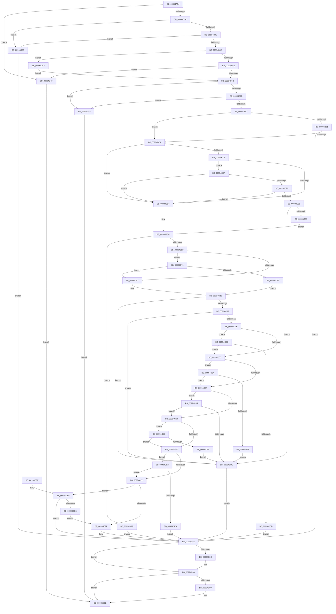

# CmGetInstallerClassRegPropWorker

- RVA: `0x00994AF4`–`0x00994DB3` (길이 `703` bytes)
- VA: `0x0000000140994AF4`
- 실행 섹션: `PAGE`
- PDB 이름 있음: `예`; PDB Function 태그: `아니요`
- unwind 정보 RVA: `0x00099094`
- 디코드: `189`개 명령, `703/703` bytes 표시
- 미해석 바이트: `0` (있으면 어셈블리에 `.byte`로 보존)

> 이 문서는 커널 이미지의 기계어와 PDB 기호를 분석해 생성했습니다. 4번과 5번은 함수 원형과 자료형을 바이너리 사용 방식에서 추정한 C 해석이며 원본 소스 복구 결과는 아닙니다.

## 1. Dependencies

- 직접 호출 지점: **8**; 고유 호출 대상: **7**
- 직접 호출자로 확인된 함수: **1**
- RIP 상대 이미지 참조: **1**

### Outgoing calls
- `0x00994B7F` → [_CmClassPropertyRead](../../text/46/_CmClassPropertyRead_function_0046286C.md) (function, `0x0046286C`)
- `0x00994BB5` → [CmOpenCommonClassRegKey](../8E/CmOpenCommonClassRegKey_function_008EFF5C.md) (function, `0x008EFF5C`)
- `0x00994BDE` → [MapCmClassPropertyToRegValue](../../text/47/MapCmClassPropertyToRegValue_function_00473B84.md) (function, `0x00473B84`)
- `0x00994C21` → [PnpRegQueryValueIndirect](../8E/PnpRegQueryValueIndirect_function_008EE210.md) (function, `0x008EE210`)
- `0x00994C8B` → [ZwClose](../../text/6A/ZwClose_function_006AD2B0.md) (function, `0x006AD2B0`)
- `0x00994C99` → [ZwClose](../../text/6A/ZwClose_function_006AD2B0.md) (function, `0x006AD2B0`)
- `0x00994D26` → [_PnpOpenPropertiesKey](_PnpOpenPropertiesKey_function_009938A0.md) (function, `0x009938A0`)
- `0x00994D9F` → [guard_dispatch_icall](../../text/6B/guard_dispatch_icall_function_006BAAD0.md) (function, `0x006BAAD0`)

### Direct callers
- [CmGetInstallerClassRegProp](CmGetInstallerClassRegProp_function_00994940.md) at `0x00994A48`

### Static image references
- `0x00994D71` → RVA `0x008EE210` (`PnpRegQueryValueIndirect`; read)

## 2. Other-region calls and transfers

- 다른 실행 섹션으로 향하는 call: **5**
  - `0x00994B7F` → [_CmClassPropertyRead](../../text/46/_CmClassPropertyRead_function_0046286C.md) (`PAGE` → `.text`)
  - `0x00994BDE` → [MapCmClassPropertyToRegValue](../../text/47/MapCmClassPropertyToRegValue_function_00473B84.md) (`PAGE` → `.text`)
  - `0x00994C8B` → [ZwClose](../../text/6A/ZwClose_function_006AD2B0.md) (`PAGE` → `.text`)
  - `0x00994C99` → [ZwClose](../../text/6A/ZwClose_function_006AD2B0.md) (`PAGE` → `.text`)
  - `0x00994D9F` → [guard_dispatch_icall](../../text/6B/guard_dispatch_icall_function_006BAAD0.md) (`PAGE` → `.text`)
- 별도 외부 분기/꼬리 이동을 확인하지 못했습니다.

## 3. Assembly (complete function range)

```asm
00994AF4  48 89 5C 24 08                  mov qword ptr [rsp + 8], rbx
00994AF9  48 89 74 24 10                  mov qword ptr [rsp + 0x10], rsi
00994AFE  48 89 7C 24 18                  mov qword ptr [rsp + 0x18], rdi
00994B03  55                              push rbp
00994B04  41 54                           push r12
00994B06  41 55                           push r13
00994B08  41 56                           push r14
00994B0A  41 57                           push r15
00994B0C  48 8B EC                        mov rbp, rsp
00994B0F  48 83 EC 60                     sub rsp, 0x60
00994B13  0F B7 45 68                     movzx eax, word ptr [rbp + 0x68]
00994B17  33 DB                           xor ebx, ebx
00994B19  48 21 5D E8                     and qword ptr [rbp - 0x18], rbx
00994B1D  41 8B F1                        mov esi, r9d
00994B20  48 21 5D F0                     and qword ptr [rbp - 0x10], rbx
00994B24  49 8B F8                        mov rdi, r8
00994B27  21 5D E4                        and dword ptr [rbp - 0x1c], ebx
00994B2A  4C 8B E9                        mov r13, rcx
00994B2D  21 5D E0                        and dword ptr [rbp - 0x20], ebx
00994B30  85 C0                           test eax, eax
00994B32  0F 85 17 02 00 00               jne 0x140994d4f
00994B38  4C 8B 75 60                     mov r14, qword ptr [rbp + 0x60]
00994B3C  4D 85 F6                        test r14, r14
00994B3F  0F 84 14 02 00 00               je 0x140994d59
00994B45  48 8B 45 50                     mov rax, qword ptr [rbp + 0x50]
00994B49  48 85 C0                        test rax, rax
00994B4C  0F 84 07 02 00 00               je 0x140994d59
00994B52  45 8B 26                        mov r12d, dword ptr [r14]
00994B55  45 85 E4                        test r12d, r12d
00994B58  0F 84 71 01 00 00               je 0x140994ccf
00994B5E  4C 8B 7D 58                     mov r15, qword ptr [rbp + 0x58]
00994B62  4D 85 FF                        test r15, r15
00994B65  0F 84 E4 01 00 00               je 0x140994d4f
00994B6B  41 21 1E                        and dword ptr [r14], ebx
00994B6E  21 18                           and dword ptr [rax], ebx
00994B70  41 8D 41 FF                     lea eax, [r9 - 1]
00994B74  83 F8 24                        cmp eax, 0x24
00994B77  0F 87 C8 01 00 00               ja 0x140994d45
00994B7D  8B CE                           mov ecx, esi
00994B7F  E8 E8 DC AC FF                  call 0x14046286c
00994B84  84 C0                           test al, al
00994B86  0F 84 B9 01 00 00               je 0x140994d45
00994B8C  48 85 FF                        test rdi, rdi
00994B8F  75 33                           jne 0x140994bc4
00994B91  48 21 5C 24 38                  and qword ptr [rsp + 0x38], rbx
00994B96  48 8D 45 E8                     lea rax, [rbp - 0x18]
00994B9A  48 89 44 24 30                  mov qword ptr [rsp + 0x30], rax
00994B9F  44 8D 47 20                     lea r8d, [rdi + 0x20]
00994BA3  88 5C 24 28                     mov byte ptr [rsp + 0x28], bl
00994BA7  45 33 C9                        xor r9d, r9d
00994BAA  49 8B CD                        mov rcx, r13
00994BAD  C7 44 24 20 01 00 00 02         mov dword ptr [rsp + 0x20], 0x2000001
00994BB5  E8 A2 B3 F5 FF                  call 0x1408eff5c
00994BBA  8B D8                           mov ebx, eax
00994BBC  85 C0                           test eax, eax
00994BBE  0F 88 BE 00 00 00               js 0x140994c82
00994BC4  8B CE                           mov ecx, esi
00994BC6  83 E9 08                        sub ecx, 8
00994BC9  74 09                           je 0x140994bd4
00994BCB  83 E9 05                        sub ecx, 5
00994BCE  0F 85 1B 01 00 00               jne 0x140994cef
00994BD4  48 85 FF                        test rdi, rdi
00994BD7  48 0F 44 7D E8                  cmove rdi, qword ptr [rbp - 0x18]
00994BDC  8B D6                           mov edx, esi
00994BDE  E8 A1 EF AD FF                  call 0x140473b84
00994BE3  4C 8B C0                        mov r8, rax
00994BE6  48 85 C0                        test rax, rax
00994BE9  0F 84 BA 01 00 00               je 0x140994da9
00994BEF  49 8B 85 08 02 00 00            mov rax, qword ptr [r13 + 0x208]
00994BF6  44 89 65 E0                     mov dword ptr [rbp - 0x20], r12d
00994BFA  48 85 C0                        test rax, rax
00994BFD  0F 85 6E 01 00 00               jne 0x140994d71
00994C03  48 83 64 24 30 00               and qword ptr [rsp + 0x30], 0
00994C09  48 8D 45 E0                     lea rax, [rbp - 0x20]
00994C0D  48 89 44 24 28                  mov qword ptr [rsp + 0x28], rax
00994C12  4C 8D 4D E4                     lea r9, [rbp - 0x1c]
00994C16  48 8B D7                        mov rdx, rdi
00994C19  4C 89 7C 24 20                  mov qword ptr [rsp + 0x20], r15
00994C1E  49 8B CD                        mov rcx, r13
00994C21  E8 EA 95 F5 FF                  call 0x1408ee210
00994C26  8B C8                           mov ecx, eax
00994C28  3D 34 00 00 C0                  cmp eax, 0xc0000034
00994C2D  0F 84 A9 00 00 00               je 0x140994cdc
00994C33  3D 7C 01 00 C0                  cmp eax, 0xc000017c
00994C38  0F 84 9E 00 00 00               je 0x140994cdc
00994C3E  BA 00 00 00 80                  mov edx, 0x80000000
00994C43  41 B8 23 00 00 C0               mov r8d, 0xc0000023
00994C49  8D 04 10                        lea eax, [rax + rdx]
00994C4C  85 C2                           test edx, eax
00994C4E  74 76                           je 0x140994cc6
00994C50  8B 45 E0                        mov eax, dword ptr [rbp - 0x20]
00994C53  8B 55 E4                        mov edx, dword ptr [rbp - 0x1c]
00994C56  83 F8 02                        cmp eax, 2
00994C59  0F 82 DB 00 00 00               jb 0x140994d3a
00994C5F  83 FA 07                        cmp edx, 7
00994C62  74 73                           je 0x140994cd7
00994C64  83 FA 04                        cmp edx, 4
00994C67  0F 84 F6 00 00 00               je 0x140994d63
00994C6D  83 F8 40                        cmp eax, 0x40
00994C70  77 71                           ja 0x140994ce3
00994C72  41 89 06                        mov dword ptr [r14], eax
00994C75  48 8B 45 50                     mov rax, qword ptr [rbp + 0x50]
00994C79  89 10                           mov dword ptr [rax], edx
00994C7B  85 C9                           test ecx, ecx
00994C7D  74 40                           je 0x140994cbf
00994C7F  41 8B D8                        mov ebx, r8d
00994C82  48 8B 4D F0                     mov rcx, qword ptr [rbp - 0x10]
00994C86  48 85 C9                        test rcx, rcx
00994C89  74 05                           je 0x140994c90
00994C8B  E8 20 86 D1 FF                  call 0x1406ad2b0
00994C90  48 8B 4D E8                     mov rcx, qword ptr [rbp - 0x18]
00994C94  48 85 C9                        test rcx, rcx
00994C97  74 05                           je 0x140994c9e
00994C99  E8 12 86 D1 FF                  call 0x1406ad2b0
00994C9E  4C 8D 5C 24 60                  lea r11, [rsp + 0x60]
00994CA3  8B C3                           mov eax, ebx
00994CA5  49 8B 5B 30                     mov rbx, qword ptr [r11 + 0x30]
00994CA9  49 8B 73 38                     mov rsi, qword ptr [r11 + 0x38]
00994CAD  49 8B 7B 40                     mov rdi, qword ptr [r11 + 0x40]
00994CB1  49 8B E3                        mov rsp, r11
00994CB4  41 5F                           pop r15
00994CB6  41 5E                           pop r14
00994CB8  41 5D                           pop r13
00994CBA  41 5C                           pop r12
00994CBC  5D                              pop rbp
00994CBD  C3                              ret
00994CBE  CC                              int3
00994CBF  45 85 E4                        test r12d, r12d
00994CC2  75 BE                           jne 0x140994c82
00994CC4  EB B9                           jmp 0x140994c7f
00994CC6  41 3B C8                        cmp ecx, r8d
00994CC9  74 85                           je 0x140994c50
00994CCB  8B D9                           mov ebx, ecx
00994CCD  EB B3                           jmp 0x140994c82
00994CCF  45 33 FF                        xor r15d, r15d
00994CD2  E9 94 FE FF FF                  jmp 0x140994b6b
00994CD7  83 F8 02                        cmp eax, 2
00994CDA  73 88                           jae 0x140994c64
00994CDC  BB 25 02 00 C0                  mov ebx, 0xc0000225
00994CE1  EB 9F                           jmp 0x140994c82
00994CE3  83 FE 08                        cmp esi, 8
00994CE6  75 8A                           jne 0x140994c72
00994CE8  BB E5 00 00 C0                  mov ebx, 0xc00000e5
00994CED  EB 93                           jmp 0x140994c82
00994CEF  83 E9 05                        sub ecx, 5
00994CF2  0F 84 DC FE FF FF               je 0x140994bd4
00994CF8  83 F9 01                        cmp ecx, 1
00994CFB  0F 84 D3 FE FF FF               je 0x140994bd4
00994D01  48 8B 55 E8                     mov rdx, qword ptr [rbp - 0x18]
00994D05  48 8D 45 F0                     lea rax, [rbp - 0x10]
00994D09  48 89 44 24 30                  mov qword ptr [rsp + 0x30], rax
00994D0E  48 85 FF                        test rdi, rdi
00994D11  41 B9 01 00 00 00               mov r9d, 1
00994D17  C6 44 24 20 00                  mov byte ptr [rsp + 0x20], 0
00994D1C  48 0F 45 D7                     cmovne rdx, rdi
00994D20  49 8B CD                        mov rcx, r13
00994D23  45 33 C0                        xor r8d, r8d
00994D26  E8 75 EB FF FF                  call 0x1409938a0
00994D2B  8B D8                           mov ebx, eax
00994D2D  85 C0                           test eax, eax
00994D2F  78 AB                           js 0x140994cdc
00994D31  48 8B 7D F0                     mov rdi, qword ptr [rbp - 0x10]
00994D35  E9 A2 FE FF FF                  jmp 0x140994bdc
00994D3A  83 FA 01                        cmp edx, 1
00994D3D  0F 85 1C FF FF FF               jne 0x140994c5f
00994D43  EB 97                           jmp 0x140994cdc
00994D45  BB 30 02 00 C0                  mov ebx, 0xc0000230
00994D4A  E9 4F FF FF FF                  jmp 0x140994c9e
00994D4F  BB 0D 00 00 C0                  mov ebx, 0xc000000d
00994D54  E9 45 FF FF FF                  jmp 0x140994c9e
00994D59  BB 0D 00 00 C0                  mov ebx, 0xc000000d
00994D5E  E9 1F FF FF FF                  jmp 0x140994c82
00994D63  83 F8 04                        cmp eax, 4
00994D66  0F 84 01 FF FF FF               je 0x140994c6d
00994D6C  E9 6B FF FF FF                  jmp 0x140994cdc
00994D71  48 8D 0D 98 94 F5 FF            lea rcx, [rip - 0xa6b68]
00994D78  48 3B C1                        cmp rax, rcx
00994D7B  0F 84 82 FE FF FF               je 0x140994c03
00994D81  48 83 64 24 30 00               and qword ptr [rsp + 0x30], 0
00994D87  48 8D 4D E0                     lea rcx, [rbp - 0x20]
00994D8B  48 89 4C 24 28                  mov qword ptr [rsp + 0x28], rcx
00994D90  4C 8D 4D E4                     lea r9, [rbp - 0x1c]
00994D94  49 8B CD                        mov rcx, r13
00994D97  4C 89 7C 24 20                  mov qword ptr [rsp + 0x20], r15
00994D9C  48 8B D7                        mov rdx, rdi
00994D9F  E8 2C 5D D2 FF                  call 0x1406baad0
00994DA4  E9 7D FE FF FF                  jmp 0x140994c26
00994DA9  BB 30 02 00 C0                  mov ebx, 0xc0000230
00994DAE  E9 CF FE FF FF                  jmp 0x140994c82
```

## 4. C-style interpretation (structured pseudocode)

```c
__int64 __fastcall CmGetInstallerClassRegPropWorker(__int64 a1, __int64 a2, __int64 a3, __int64 a4, __int64 a5, __int64 a6, __int64 a7, unsigned __int16 a8)
{
    __int64 result;
    __int64 v_r15;
    __int64 v_rbx;
    __int64 v_rsp;
    unsigned __int64 v_stack_m28;
    unsigned __int64 v_stack_m30;
    unsigned __int64 v_stack_m38;
    unsigned __int64 v_stack_m40;
    unsigned int v_stack_m44;
    unsigned int v_stack_m48;
    unsigned __int64 v_stack_m50;
    unsigned __int64 v_stack_m58;
    unsigned __int8 v_stack_m60;
    unsigned int v_stack_m68;
    unsigned __int64 v_stack_p10;
    unsigned __int64 v_stack_p18;
    unsigned __int64 v_stack_p8;

    v_stack_p8 = v_rbx;
    v_stack_p10 = v_rsi;
    v_stack_p18 = v_rdi;
    v_rsp = (v_rsp) - (96);
    v_rbx = 0;
    if (a8 != 0) goto loc_00994D4F;
    if (a7 == 0) goto loc_00994D59;
    if (a5 == 0) goto loc_00994D59;
    if ((unsigned int)((unsigned int)(*(unsigned int *)(a7))) == 0) goto loc_00994CCF;
    if (a6 == 0) goto loc_00994D4F;
loc_00994B6B:
    if (((unsigned int)(a4 - 1)) > 36) goto loc_00994D45;
    result = _CmClassPropertyRead((unsigned int)((unsigned int)((unsigned int)((unsigned int)(a4)))), a2, a3, a4);
    if ((unsigned __int8)(result) == 0) goto loc_00994D45;
    if (a3 != 0) goto loc_00994BC4;
    v_stack_m58 = v_stack_m40;
    v_stack_m60 = 0;
    a4 = 0;
    v_stack_m68 = 0x2000001ULL;
    result = CmOpenCommonClassRegKey(a1, a2, a3 + 32, a4);
    if (sign_flag) goto loc_00994C82;
loc_00994BC4:
    a1 = (unsigned int)(((unsigned int)((unsigned int)((unsigned int)((unsigned int)(a4))))) - (8));
    if (condition_is_equal) goto loc_00994BD4;
    a1 = (unsigned int)((a1) - (5));
    if (condition_is_not_equal) goto loc_00994CEF;
loc_00994BD4:
    if (a3 == 0) { a3 = v_stack_m40; }
loc_00994BDC:
    result = MapCmClassPropertyToRegValue(a1, (unsigned int)((unsigned int)((unsigned int)((unsigned int)(a4)))), a3 + 32, a4);
    if (result == 0) goto loc_00994DA9;
    v_stack_m48 = (unsigned int)((unsigned int)(*(unsigned int *)(a7)));
    if (*(unsigned __int64 *)(a1 + 520) != 0) goto loc_00994D71;
loc_00994C03:
    v_stack_m60 = v_stack_m48;
    v_stack_m68 = a6;
    result = PnpRegQueryValueIndirect(a1, a3, result, v_stack_m44);
loc_00994C26:
    if (((unsigned int)(result)) == 0xC0000034ULL) goto loc_00994CDC;
    if (((unsigned int)(result)) == 0xC000017CULL) goto loc_00994CDC;
    if ((((unsigned int)((unsigned int)(0x80000000ULL))) & ((unsigned int)(result + (unsigned int)(0x80000000ULL) * 1))) == 0) goto loc_00994CC6;
loc_00994C50:
    if (((unsigned int)((unsigned int)(v_stack_m48))) < 2) goto loc_00994D3A;
loc_00994C5F:
    if (((unsigned int)((unsigned int)(v_stack_m44))) == 7) goto loc_00994CD7;
loc_00994C64:
    if (((unsigned int)((unsigned int)(v_stack_m44))) == 4) goto loc_00994D63;
loc_00994C6D:
    if (((unsigned int)((unsigned int)(v_stack_m48))) > 64) goto loc_00994CE3;
loc_00994C72:
    *(unsigned int *)(a7) = (unsigned int)((unsigned int)(v_stack_m48));
    *(unsigned int *)(a5) = (unsigned int)((unsigned int)(v_stack_m44));
    if ((unsigned int)((unsigned int)((unsigned int)(result))) == 0) goto loc_00994CBF;
loc_00994C7F:
loc_00994C82:
    result = a5;
    if (v_stack_m38 != 0) {
        result = ZwClose(v_stack_m38, (unsigned int)(v_stack_m44), (unsigned int)(0xC0000023ULL), v_stack_m44);
    }
    if (v_stack_m40 != 0) {
        result = ZwClose(v_stack_m40, (unsigned int)(v_stack_m44), (unsigned int)(0xC0000023ULL), v_stack_m44);
    }
    return (unsigned int)((unsigned int)((unsigned int)((unsigned int)((unsigned int)(0xC0000023ULL)))));
loc_00994CBF:
    if ((unsigned int)((unsigned int)(*(unsigned int *)(a7))) != 0) goto loc_00994C82;
    goto loc_00994C7F;
loc_00994CC6:
    if (((unsigned int)(v_stack_m40)) == ((unsigned int)((unsigned int)(0xC0000023ULL)))) goto loc_00994C50;
    goto loc_00994C82;
loc_00994CCF:
    v_r15 = 0;
    goto loc_00994B6B;
loc_00994CD7:
    if (((unsigned int)((unsigned int)((unsigned int)((unsigned int)((unsigned int)((unsigned int)(0xC0000023ULL))))))) >= 2) goto loc_00994C64;
loc_00994CDC:
    goto loc_00994C82;
loc_00994CE3:
    if (((unsigned int)(*(unsigned __int64 *)(v_stack_m28 + 56))) != 8) goto loc_00994C72;
    goto loc_00994C82;
loc_00994CEF:
    a1 = (unsigned int)((v_stack_m40) - (5));
    if (condition_is_equal) goto loc_00994BD4;
    if (((unsigned int)(a1)) == 1) goto loc_00994BD4;
    v_stack_m30 = v_stack_m38;
    v_stack_m40 = 0;
    a2 = v_stack_m40;
    if (*(unsigned __int64 *)(v_stack_m28 + 64) != 0) { a2 = *(unsigned __int64 *)(v_stack_m28 + 64); }
    a3 = 0;
    result = _PnpOpenPropertiesKey(a1, a2, a3, 1);
    if (sign_flag) goto loc_00994CDC;
    goto loc_00994BDC;
loc_00994D3A:
    if (((unsigned int)(a2)) != 1) goto loc_00994C5F;
    goto loc_00994CDC;
loc_00994D45:
    goto loc_00994C9E;
loc_00994D4F:
    goto loc_00994C9E;
loc_00994D59:
    goto loc_00994C82;
loc_00994D63:
    if (((unsigned int)(result)) == 4) goto loc_00994C6D;
    goto loc_00994CDC;
loc_00994D71:
    if (result == (v_rip - 682856)) goto loc_00994C03;
    v_stack_m38 = v_stack_m48;
    v_stack_m40 = 0;
    result = guard_dispatch_icall(a1, v_stack_m38, a3, v_stack_m44);
    goto loc_00994C26;
loc_00994DA9:
    goto loc_00994C82;
}
```

## 5. (Beta) C Style

```c
int64_t CmGetInstallerClassRegPropWorker(void *Arg1, int64_t Arg2, int64_t Arg3, void *Arg4, void *Arg5, int64_t Arg6, int64_t Arg7, uint16_t Arg8)
{
    uint8_t *arg1 = (uint8_t *)Arg1;
    uint8_t *arg4 = (uint8_t *)Arg4;
    uint8_t *arg5 = (uint8_t *)Arg5;

    int64_t result;
    int64_t local_r15;
    int64_t local_rbx;
    int64_t local_rsp;
    uint64_t v_stack_m28;
    uint64_t v_stack_m30;
    uint64_t v_stack_m38;
    uint64_t v_stack_m40;
    uint32_t v_stack_m44;
    uint32_t v_stack_m48;
    uint64_t v_stack_m50;
    uint64_t v_stack_m58;
    uint8_t v_stack_m60;
    uint32_t v_stack_m68;
    uint64_t v_stack_p10;
    uint64_t v_stack_p18;
    uint64_t v_stack_p8;

    v_stack_p8 = local_rbx;
    v_stack_p10 = local_rsi;
    v_stack_p18 = local_rdi;
    local_rsp = (local_rsp) - (96);
    local_rbx = 0;
    if (Arg8 != 0) goto loc_00994D4F;
    if (Arg7 == 0) goto loc_00994D59;
    if (Arg5 == NULL) goto loc_00994D59;
    if ((uint32_t)((uint32_t)(*(uint32_t *)(Arg7))) == 0) goto loc_00994CCF;
    if (Arg6 == 0) goto loc_00994D4F;
loc_00994B6B:
    if (((uint32_t)(Arg4 - 1)) > 36) goto loc_00994D45;
    result = _CmClassPropertyRead((uint32_t)((uint32_t)((uint32_t)((uint32_t)(Arg4)))), Arg2, Arg3, Arg4);
    if ((uint8_t)(result) == 0) goto loc_00994D45;
    if (Arg3 != 0) goto loc_00994BC4;
    v_stack_m58 = v_stack_m40;
    v_stack_m60 = 0;
    Arg4 = 0;
    v_stack_m68 = 0x2000001ULL;
    result = CmOpenCommonClassRegKey(Arg1, Arg2, Arg3 + 32, Arg4);
    if (sign_flag) goto loc_00994C82;
loc_00994BC4:
    Arg1 = (uint32_t)(((uint32_t)((uint32_t)((uint32_t)((uint32_t)(Arg4))))) - (8));
    if (condition_is_equal) goto loc_00994BD4;
    Arg1 = (uint32_t)((Arg1) - (5));
    if (condition_is_not_equal) goto loc_00994CEF;
loc_00994BD4:
    if (Arg3 == 0) { Arg3 = v_stack_m40; }
loc_00994BDC:
    result = MapCmClassPropertyToRegValue(Arg1, (uint32_t)((uint32_t)((uint32_t)((uint32_t)(Arg4)))), Arg3 + 32, Arg4);
    if (result == 0) goto loc_00994DA9;
    v_stack_m48 = (uint32_t)((uint32_t)(*(uint32_t *)(Arg7)));
    if (*(uint64_t *)(arg1 + 0x208) != 0) goto loc_00994D71;
loc_00994C03:
    v_stack_m60 = v_stack_m48;
    v_stack_m68 = Arg6;
    result = PnpRegQueryValueIndirect(Arg1, Arg3, result, v_stack_m44);
loc_00994C26:
    if (((uint32_t)(result)) == 0xC0000034ULL) goto loc_00994CDC;
    if (((uint32_t)(result)) == 0xC000017CULL) goto loc_00994CDC;
    if ((((uint32_t)((uint32_t)(0x80000000ULL))) & ((uint32_t)(result + (uint32_t)(0x80000000ULL) * 1))) == 0) goto loc_00994CC6;
loc_00994C50:
    if (((uint32_t)((uint32_t)(v_stack_m48))) < 2) goto loc_00994D3A;
loc_00994C5F:
    if (((uint32_t)((uint32_t)(v_stack_m44))) == 7) goto loc_00994CD7;
loc_00994C64:
    if (((uint32_t)((uint32_t)(v_stack_m44))) == 4) goto loc_00994D63;
loc_00994C6D:
    if (((uint32_t)((uint32_t)(v_stack_m48))) > 64) goto loc_00994CE3;
loc_00994C72:
    *(uint32_t *)(Arg7) = (uint32_t)((uint32_t)(v_stack_m48));
    *(uint32_t *)(arg5) = (uint32_t)((uint32_t)(v_stack_m44));
    if ((uint32_t)((uint32_t)((uint32_t)(result))) == 0) goto loc_00994CBF;
loc_00994C7F:
loc_00994C82:
    result = Arg5;
    if (v_stack_m38 != 0) {
        result = ZwClose(v_stack_m38, (uint32_t)(v_stack_m44), (uint32_t)(0xC0000023ULL), v_stack_m44);
    }
    if (v_stack_m40 != 0) {
        result = ZwClose(v_stack_m40, (uint32_t)(v_stack_m44), (uint32_t)(0xC0000023ULL), v_stack_m44);
    }
    return (uint32_t)((uint32_t)((uint32_t)((uint32_t)((uint32_t)(0xC0000023ULL)))));
loc_00994CBF:
    if ((uint32_t)((uint32_t)(*(uint32_t *)(Arg7))) != 0) goto loc_00994C82;
    goto loc_00994C7F;
loc_00994CC6:
    if (((uint32_t)(v_stack_m40)) == ((uint32_t)((uint32_t)(0xC0000023ULL)))) goto loc_00994C50;
    goto loc_00994C82;
loc_00994CCF:
    local_r15 = 0;
    goto loc_00994B6B;
loc_00994CD7:
    if (((uint32_t)((uint32_t)((uint32_t)((uint32_t)((uint32_t)((uint32_t)(0xC0000023ULL))))))) >= 2) goto loc_00994C64;
loc_00994CDC:
    goto loc_00994C82;
loc_00994CE3:
    if (((uint32_t)(*(uint64_t *)(v_stack_m28 + 0x38))) != 8) goto loc_00994C72;
    goto loc_00994C82;
loc_00994CEF:
    Arg1 = (uint32_t)((v_stack_m40) - (5));
    if (condition_is_equal) goto loc_00994BD4;
    if (((uint32_t)(Arg1)) == 1) goto loc_00994BD4;
    v_stack_m30 = v_stack_m38;
    v_stack_m40 = 0;
    Arg2 = v_stack_m40;
    if (*(uint64_t *)(v_stack_m28 + 0x40) != 0) { Arg2 = *(uint64_t *)(v_stack_m28 + 0x40); }
    Arg3 = 0;
    result = _PnpOpenPropertiesKey(Arg1, Arg2, Arg3, 1);
    if (sign_flag) goto loc_00994CDC;
    goto loc_00994BDC;
loc_00994D3A:
    if (((uint32_t)(Arg2)) != 1) goto loc_00994C5F;
    goto loc_00994CDC;
loc_00994D45:
    goto loc_00994C9E;
loc_00994D4F:
    goto loc_00994C9E;
loc_00994D59:
    goto loc_00994C82;
loc_00994D63:
    if (((uint32_t)(result)) == 4) goto loc_00994C6D;
    goto loc_00994CDC;
loc_00994D71:
    if (result == (v_rip - 682856)) goto loc_00994C03;
    v_stack_m38 = v_stack_m48;
    v_stack_m40 = 0;
    result = guard_dispatch_icall(Arg1, v_stack_m38, Arg3, v_stack_m44);
    goto loc_00994C26;
loc_00994DA9:
    goto loc_00994C82;
}
```

### 관측된 메모리 오프셋

구조체 형식이 확인되지 않은 접근은 인자 기준의 오프셋으로만 기록했습니다.

| 기준 인자 | 오프셋 표현 | 폭 (bit) | 접근 |
|---|---:|---:|---|
| `Arg1` | `+ 0x208` | `64` | `R` |
| `Arg4` | `- 0x1` | `32` | `R` |
| `Arg5` | `+ 0x0` | `32` | `W` |

## 6. Execution-region graph

[열기: 2D/3D 그래프와 함수 탐색 컨트롤 패널](../../../control-panel.html?section=page&rva=0x00994AF4&view=graph)

- 2D 그래프는 위에서 아래로 흐르고, 3D 그래프는 빈 공간을 드래그해 회전합니다. Shift+드래그는 이동, 휠은 확대·축소, 함수 노드 선택은 대상 보고서 이동입니다.

### Static fallback


