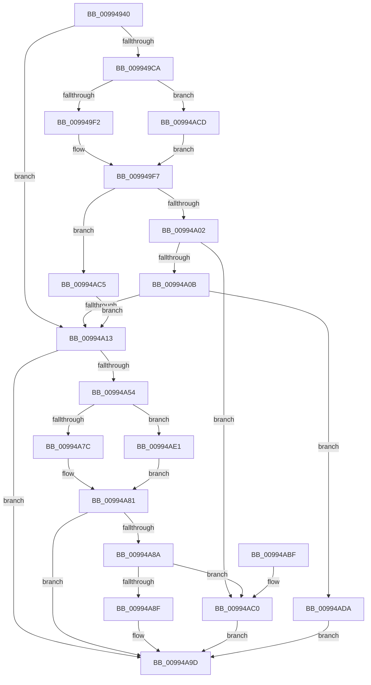

# CmGetInstallerClassRegProp

- RVA: `0x00994940`–`0x00994AEB` (길이 `427` bytes)
- VA: `0x0000000140994940`
- 실행 섹션: `PAGE`
- PDB 이름 있음: `예`; PDB Function 태그: `아니요`
- unwind 정보 RVA: `0x00099070`
- 디코드: `119`개 명령, `427/427` bytes 표시
- 미해석 바이트: `0` (있으면 어셈블리에 `.byte`로 보존)

> 이 문서는 커널 이미지의 기계어와 PDB 기호를 분석해 생성했습니다. 4번과 5번은 함수 원형과 자료형을 바이너리 사용 방식에서 추정한 C 해석이며 원본 소스 복구 결과는 아닙니다.

## 1. Dependencies

- 직접 호출 지점: **7**; 고유 호출 대상: **5**
- 직접 호출자로 확인된 함수: **12**
- RIP 상대 이미지 참조: **2**

### Outgoing calls
- `0x0099498B` → [memset](../../text/6C/memset_function_006C6C40.md) (function, `0x006C6C40`)
- `0x009949F2` → [PiPnpRtlCmActionCallback](../8E/PiPnpRtlCmActionCallback_function_008EF110.md) (function, `0x008EF110`)
- `0x00994A48` → [CmGetInstallerClassRegPropWorker](CmGetInstallerClassRegPropWorker_function_00994AF4.md) (function, `0x00994AF4`)
- `0x00994A7C` → [PiPnpRtlCmActionCallback](../8E/PiPnpRtlCmActionCallback_function_008EF110.md) (function, `0x008EF110`)
- `0x00994AA6` → [_security_check_cookie](../../text/6A/_security_check_cookie_function_006AC640.md) (function, `0x006AC640`)
- `0x00994AD0` → [guard_dispatch_icall](../../text/6B/guard_dispatch_icall_function_006BAAD0.md) (function, `0x006BAAD0`)
- `0x00994AE4` → [guard_dispatch_icall](../../text/6B/guard_dispatch_icall_function_006BAAD0.md) (function, `0x006BAAD0`)

### Direct callers
- [CmServiceFilterCallback](../82/CmServiceFilterCallback_function_0082D7A0.md) at `0x0082DA51`
- [PiCMHandleIoctl](../8E/PiCMHandleIoctl_function_008EB880.md) at `0x008EC0C7`
- [sub_008EDC5D](../8E/Unknown_function_008EDC5D.md) at `0x008EDD09`
- [PipGetRegistryDwordWithFallback](PipGetRegistryDwordWithFallback_function_00995350.md) at `0x009953FA`
- [PipGetRegistrySecurityWithFallback](PipGetRegistrySecurityWithFallback_function_0099542C.md) at `0x00995507`
- [PipGetRegistrySecurityWithFallback](PipGetRegistrySecurityWithFallback_function_0099542C.md) at `0x0099568C`
- [PnpCallDriverQueryServiceHelper](PnpCallDriverQueryServiceHelper_function_00995FB0.md) at `0x00996135`
- [_CmGetInstallerClassMappedPropertyFromRegProp](../9D/_CmGetInstallerClassMappedPropertyFromRegProp_function_009D3E34.md) at `0x009D3F0C`
- [_CmGetInstallerClassMappedPropertyFromRegProp](../9D/_CmGetInstallerClassMappedPropertyFromRegProp_function_009D3E34.md) at `0x009D4020`
- [PpForEachDeviceInstanceDriver](../A0/PpForEachDeviceInstanceDriver_function_00A07D2C.md) at `0x00A0820D`
- [sub_00B1DC0E](../B1/Unknown_function_00B1DC0E.md) at `0x00B1DC33`
- [sub_00B2C332](../B2/Unknown_function_00B2C332.md) at `0x00B2C3A9`
- [sub_00B2F794](../B2/Unknown_function_00B2F794.md) at `0x00B2F7B6`
- [sub_00B346F2](../B3/Unknown_function_00B346F2.md) at `0x00B3471C`

### Static image references
- `0x00994959` → RVA `0x00E0A740` (`.data`; read)
- `0x00994997` → RVA `0x008EF110` (`PiPnpRtlCmActionCallback`; read)

## 2. Other-region calls and transfers

- 다른 실행 섹션으로 향하는 call: **4**
  - `0x0099498B` → [memset](../../text/6C/memset_function_006C6C40.md) (`PAGE` → `.text`)
  - `0x00994AA6` → [_security_check_cookie](../../text/6A/_security_check_cookie_function_006AC640.md) (`PAGE` → `.text`)
  - `0x00994AD0` → [guard_dispatch_icall](../../text/6B/guard_dispatch_icall_function_006BAAD0.md) (`PAGE` → `.text`)
  - `0x00994AE4` → [guard_dispatch_icall](../../text/6B/guard_dispatch_icall_function_006BAAD0.md) (`PAGE` → `.text`)
- 별도 외부 분기/꼬리 이동을 확인하지 못했습니다.

## 3. Assembly (complete function range)

```asm
00994940  40 55                           push rbp
00994942  53                              push rbx
00994943  56                              push rsi
00994944  57                              push rdi
00994945  41 54                           push r12
00994947  41 55                           push r13
00994949  41 56                           push r14
0099494B  41 57                           push r15
0099494D  48 8D 6C 24 F9                  lea rbp, [rsp - 7]
00994952  48 81 EC C8 00 00 00            sub rsp, 0xc8
00994959  48 8B 05 E0 5D 47 00            mov rax, qword ptr [rip + 0x475de0]
00994960  48 33 C4                        xor rax, rsp
00994963  48 89 45 EF                     mov qword ptr [rbp - 0x11], rax
00994967  48 8B 5D 6F                     mov rbx, qword ptr [rbp + 0x6f]
0099496B  4D 8B F0                        mov r14, r8
0099496E  48 8B 7D 77                     mov rdi, qword ptr [rbp + 0x77]
00994972  4C 8B E9                        mov r13, rcx
00994975  48 8B 75 7F                     mov rsi, qword ptr [rbp + 0x7f]
00994979  48 8D 4D 8F                     lea rcx, [rbp - 0x71]
0099497D  48 89 54 24 40                  mov qword ptr [rsp + 0x40], rdx
00994982  45 8B F9                        mov r15d, r9d
00994985  33 D2                           xor edx, edx
00994987  44 8D 42 58                     lea r8d, [rdx + 0x58]
0099498B  E8 B0 22 D3 FF                  call 0x1406c6c40
00994990  4D 8B A5 F8 01 00 00            mov r12, qword ptr [r13 + 0x1f8]
00994997  48 8D 05 72 A7 F5 FF            lea rax, [rip - 0xa588e]
0099499E  83 65 C7 00                     and dword ptr [rbp - 0x39], 0
009949A2  48 89 75 BF                     mov qword ptr [rbp - 0x41], rsi
009949A6  BE 02 00 00 00                  mov esi, 2
009949AB  4C 89 75 9F                     mov qword ptr [rbp - 0x61], r14
009949AF  44 89 7D A7                     mov dword ptr [rbp - 0x59], r15d
009949B3  41 BF 20 01 00 C0               mov r15d, 0xc0000120
009949B9  48 89 5D AF                     mov qword ptr [rbp - 0x51], rbx
009949BD  48 89 7D B7                     mov qword ptr [rbp - 0x49], rdi
009949C1  44 8D 76 07                     lea r14d, [rsi + 7]
009949C5  4D 85 E4                        test r12, r12
009949C8  74 49                           je 0x140994a13
009949CA  48 8B 54 24 40                  mov rdx, qword ptr [rsp + 0x40]
009949CF  4C 3B E0                        cmp r12, rax
009949D2  48 8D 45 8F                     lea rax, [rbp - 0x71]
009949D6  45 8B CE                        mov r9d, r14d
009949D9  48 89 44 24 28                  mov qword ptr [rsp + 0x28], rax
009949DE  44 8B C6                        mov r8d, esi
009949E1  C7 44 24 20 01 00 00 00         mov dword ptr [rsp + 0x20], 1
009949E9  49 8B CD                        mov rcx, r13
009949EC  0F 85 DB 00 00 00               jne 0x140994acd
009949F2  E8 19 A7 F5 FF                  call 0x1408ef110
009949F7  3D 02 00 00 C0                  cmp eax, 0xc0000002
009949FC  0F 84 C3 00 00 00               je 0x140994ac5
00994A02  41 3B C7                        cmp eax, r15d
00994A05  0F 84 B5 00 00 00               je 0x140994ac0
00994A0B  85 C0                           test eax, eax
00994A0D  0F 85 C7 00 00 00               jne 0x140994ada
00994A13  8B 45 C7                        mov eax, dword ptr [rbp - 0x39]
00994A16  49 8B CD                        mov rcx, r13
00994A19  48 8B 7C 24 40                  mov rdi, qword ptr [rsp + 0x40]
00994A1E  44 8B 4D A7                     mov r9d, dword ptr [rbp - 0x59]
00994A22  48 8B D7                        mov rdx, rdi
00994A25  4C 8B 45 9F                     mov r8, qword ptr [rbp - 0x61]
00994A29  89 44 24 38                     mov dword ptr [rsp + 0x38], eax
00994A2D  48 8B 45 BF                     mov rax, qword ptr [rbp - 0x41]
00994A31  48 89 44 24 30                  mov qword ptr [rsp + 0x30], rax
00994A36  48 8B 45 B7                     mov rax, qword ptr [rbp - 0x49]
00994A3A  48 89 44 24 28                  mov qword ptr [rsp + 0x28], rax
00994A3F  48 8B 45 AF                     mov rax, qword ptr [rbp - 0x51]
00994A43  48 89 44 24 20                  mov qword ptr [rsp + 0x20], rax
00994A48  E8 A7 00 00 00                  call 0x140994af4
00994A4D  8B D8                           mov ebx, eax
00994A4F  4D 85 E4                        test r12, r12
00994A52  74 49                           je 0x140994a9d
00994A54  89 45 8F                        mov dword ptr [rbp - 0x71], eax
00994A57  45 8B CE                        mov r9d, r14d
00994A5A  48 8D 05 AF A6 F5 FF            lea rax, [rip - 0xa5951]
00994A61  44 8B C6                        mov r8d, esi
00994A64  4C 3B E0                        cmp r12, rax
00994A67  48 8B D7                        mov rdx, rdi
00994A6A  48 8D 45 8F                     lea rax, [rbp - 0x71]
00994A6E  49 8B CD                        mov rcx, r13
00994A71  48 89 44 24 28                  mov qword ptr [rsp + 0x28], rax
00994A76  89 74 24 20                     mov dword ptr [rsp + 0x20], esi
00994A7A  75 65                           jne 0x140994ae1
00994A7C  E8 8F A6 F5 FF                  call 0x1408ef110
00994A81  8B C8                           mov ecx, eax
00994A83  3D 02 00 00 C0                  cmp eax, 0xc0000002
00994A88  74 13                           je 0x140994a9d
00994A8A  41 3B C7                        cmp eax, r15d
00994A8D  74 31                           je 0x140994ac0
00994A8F  8B C3                           mov eax, ebx
00994A91  85 C9                           test ecx, ecx
00994A93  BB E5 00 00 C0                  mov ebx, 0xc00000e5
00994A98  0F 45 C3                        cmovne eax, ebx
00994A9B  8B D8                           mov ebx, eax
00994A9D  8B C3                           mov eax, ebx
00994A9F  48 8B 4D EF                     mov rcx, qword ptr [rbp - 0x11]
00994AA3  48 33 CC                        xor rcx, rsp
00994AA6  E8 95 7B D1 FF                  call 0x1406ac640
00994AAB  48 81 C4 C8 00 00 00            add rsp, 0xc8
00994AB2  41 5F                           pop r15
00994AB4  41 5E                           pop r14
00994AB6  41 5D                           pop r13
00994AB8  41 5C                           pop r12
00994ABA  5F                              pop rdi
00994ABB  5E                              pop rsi
00994ABC  5B                              pop rbx
00994ABD  5D                              pop rbp
00994ABE  C3                              ret
00994ABF  CC                              int3
00994AC0  8B 5D 8F                        mov ebx, dword ptr [rbp - 0x71]
00994AC3  EB D8                           jmp 0x140994a9d
00994AC5  45 33 E4                        xor r12d, r12d
00994AC8  E9 46 FF FF FF                  jmp 0x140994a13
00994ACD  49 8B C4                        mov rax, r12
00994AD0  E8 FB 5F D2 FF                  call 0x1406baad0
00994AD5  E9 1D FF FF FF                  jmp 0x1409949f7
00994ADA  BB E5 00 00 C0                  mov ebx, 0xc00000e5
00994ADF  EB BC                           jmp 0x140994a9d
00994AE1  49 8B C4                        mov rax, r12
00994AE4  E8 E7 5F D2 FF                  call 0x1406baad0
00994AE9  EB 96                           jmp 0x140994a81
```

## 4. C-style interpretation (structured pseudocode)

```c
__int64 __fastcall CmGetInstallerClassRegProp(__int64 a1, __int64 a2, __int64 a3, int a4, __int64 a5, __int64 a6, __int64 a7)
{
    __int64 result;
    __int64 v_r12;
    __int64 v_rsp;
    unsigned __int64 v_stack_m47;
    unsigned __int64 v_stack_m58;
    unsigned int v_stack_m80;
    unsigned __int64 v_stack_m88;
    unsigned __int64 v_stack_m90;
    unsigned __int64 v_stack_m98;
    unsigned int v_stack_mA0;
    unsigned __int64 v_stack_mA8;
    unsigned __int64 v_stack_mB8;
    unsigned __int64 v_stack_mC8;
    unsigned int v_stack_mD0;
    unsigned __int64 v_stack_mD8;
    unsigned __int64 v_stack_mE0;
    unsigned int v_stack_mE8;

    v_rsp = (v_rsp) - (200);
    result = (*(unsigned __int64 *)(v_rip + 4677088)) ^ (v_rsp);
    v_stack_m58 = result;
    v_stack_mC8 = a2;
    a2 = 0;
    result = memset(v_stack_mB8, a2, a2 + 88, a4);
    v_stack_m88 = a7;
    v_stack_mA8 = a3;
    v_stack_mA0 = (unsigned int)((unsigned int)(a4));
    v_stack_m98 = a5;
    v_stack_m90 = a6;
    if (*(unsigned __int64 *)(a1 + 504) == 0) goto loc_00994A13;
    v_stack_mE0 = v_stack_mB8;
    v_stack_mE8 = 1;
    if ((*(unsigned __int64 *)(a1 + 504)) != (v_rip - 678030)) goto loc_00994ACD;
    result = PiPnpRtlCmActionCallback(a1, v_stack_mC8, 2, (unsigned int)((unsigned int)(2 + 7)));
loc_009949F7:
    if (((unsigned int)(result)) == 0xC0000002ULL) goto loc_00994AC5;
    if (((unsigned int)(result)) == ((unsigned int)((unsigned int)(0xC0000120ULL)))) goto loc_00994AC0;
    if ((unsigned int)(result) != 0) goto loc_00994ADA;
loc_00994A13:
    v_stack_mD0 = (unsigned int)((unsigned int)(v_stack_m80));
    v_stack_mD8 = v_stack_m88;
    v_stack_mE0 = v_stack_m90;
    v_stack_mE8 = v_stack_m98;
    result = CmGetInstallerClassRegPropWorker(a1, v_stack_mC8, v_stack_mA8, (unsigned int)(v_stack_mA0));
    if (*(unsigned __int64 *)(a1 + 504) == 0) goto loc_00994A9D;
    v_stack_mB8 = (unsigned int)(result);
    v_stack_mE0 = v_stack_mB8;
    v_stack_mE8 = 2;
    if ((*(unsigned __int64 *)(a1 + 504)) != (v_rip - 678225)) goto loc_00994AE1;
    result = PiPnpRtlCmActionCallback(a1, v_stack_mC8, 2, (unsigned int)((unsigned int)(2 + 7)));
loc_00994A81:
    if (((unsigned int)(result)) == 0xC0000002ULL) goto loc_00994A9D;
    if (((unsigned int)(result)) == ((unsigned int)((unsigned int)(0xC0000120ULL)))) goto loc_00994AC0;
    result = (unsigned int)((unsigned int)((unsigned int)((unsigned int)(result))));
    if ((unsigned int)((unsigned int)((unsigned int)(result))) != 0) { result = (unsigned int)((unsigned int)(0xC00000E5ULL)); }
loc_00994A9D:
    a1 = (v_stack_m58) ^ (v_rsp);
    result = _security_check_cookie(a1, v_stack_mC8, 2, (unsigned int)((unsigned int)(2 + 7)));
    v_rsp = (v_rsp) + (200);
    return result;
loc_00994AC0:
    goto loc_00994A9D;
loc_00994AC5:
    v_r12 = 0;
    goto loc_00994A13;
loc_00994ACD:
    result = guard_dispatch_icall(a1, v_stack_mC8, 2, (unsigned int)((unsigned int)(2 + 7)));
    goto loc_009949F7;
loc_00994ADA:
    goto loc_00994A9D;
loc_00994AE1:
    result = guard_dispatch_icall(a1, v_stack_mC8, 2, (unsigned int)((unsigned int)(2 + 7)));
    goto loc_00994A81;
}
```

## 5. (Beta) C Style

```c
int64_t CmGetInstallerClassRegProp(void *Arg1, int64_t Arg2, int64_t Arg3, int32_t Arg4, int64_t Arg5, int64_t Arg6, int64_t Arg7)
{
    uint8_t *arg1 = (uint8_t *)Arg1;

    int64_t result;
    int64_t local_r12;
    int64_t local_rsp;
    uint64_t v_stack_m47;
    uint64_t v_stack_m58;
    uint32_t v_stack_m80;
    uint64_t v_stack_m88;
    uint64_t v_stack_m90;
    uint64_t v_stack_m98;
    uint32_t v_stack_mA0;
    uint64_t v_stack_mA8;
    uint64_t v_stack_mB8;
    uint64_t v_stack_mC8;
    uint32_t v_stack_mD0;
    uint64_t v_stack_mD8;
    uint64_t v_stack_mE0;
    uint32_t v_stack_mE8;

    local_rsp = (local_rsp) - (200);
    result = (*(uint64_t *)(v_rip + 0x475DE0)) ^ (local_rsp);
    v_stack_m58 = result;
    v_stack_mC8 = Arg2;
    Arg2 = 0;
    result = memset(v_stack_mB8, Arg2, Arg2 + 88, Arg4);
    v_stack_m88 = Arg7;
    v_stack_mA8 = Arg3;
    v_stack_mA0 = (uint32_t)((uint32_t)(Arg4));
    v_stack_m98 = Arg5;
    v_stack_m90 = Arg6;
    if (*(uint64_t *)(arg1 + 0x1F8) == 0) goto loc_00994A13;
    v_stack_mE0 = v_stack_mB8;
    v_stack_mE8 = 1;
    if ((*(uint64_t *)(arg1 + 0x1F8)) != (v_rip - 678030)) goto loc_00994ACD;
    result = PiPnpRtlCmActionCallback(Arg1, v_stack_mC8, 2, (uint32_t)((uint32_t)(2 + 7)));
loc_009949F7:
    if (((uint32_t)(result)) == 0xC0000002ULL) goto loc_00994AC5;
    if (((uint32_t)(result)) == ((uint32_t)((uint32_t)(0xC0000120ULL)))) goto loc_00994AC0;
    if ((uint32_t)(result) != 0) goto loc_00994ADA;
loc_00994A13:
    v_stack_mD0 = (uint32_t)((uint32_t)(v_stack_m80));
    v_stack_mD8 = v_stack_m88;
    v_stack_mE0 = v_stack_m90;
    v_stack_mE8 = v_stack_m98;
    result = CmGetInstallerClassRegPropWorker(Arg1, v_stack_mC8, v_stack_mA8, (uint32_t)(v_stack_mA0));
    if (*(uint64_t *)(arg1 + 0x1F8) == 0) goto loc_00994A9D;
    v_stack_mB8 = (uint32_t)(result);
    v_stack_mE0 = v_stack_mB8;
    v_stack_mE8 = 2;
    if ((*(uint64_t *)(arg1 + 0x1F8)) != (v_rip - 678225)) goto loc_00994AE1;
    result = PiPnpRtlCmActionCallback(Arg1, v_stack_mC8, 2, (uint32_t)((uint32_t)(2 + 7)));
loc_00994A81:
    if (((uint32_t)(result)) == 0xC0000002ULL) goto loc_00994A9D;
    if (((uint32_t)(result)) == ((uint32_t)((uint32_t)(0xC0000120ULL)))) goto loc_00994AC0;
    result = (uint32_t)((uint32_t)((uint32_t)((uint32_t)(result))));
    if ((uint32_t)((uint32_t)((uint32_t)(result))) != 0) { result = (uint32_t)((uint32_t)(0xC00000E5ULL)); }
loc_00994A9D:
    Arg1 = (v_stack_m58) ^ (local_rsp);
    result = _security_check_cookie(Arg1, v_stack_mC8, 2, (uint32_t)((uint32_t)(2 + 7)));
    local_rsp = (local_rsp) + (200);
    return result;
loc_00994AC0:
    goto loc_00994A9D;
loc_00994AC5:
    local_r12 = 0;
    goto loc_00994A13;
loc_00994ACD:
    result = guard_dispatch_icall(Arg1, v_stack_mC8, 2, (uint32_t)((uint32_t)(2 + 7)));
    goto loc_009949F7;
loc_00994ADA:
    goto loc_00994A9D;
loc_00994AE1:
    result = guard_dispatch_icall(Arg1, v_stack_mC8, 2, (uint32_t)((uint32_t)(2 + 7)));
    goto loc_00994A81;
}
```

### 관측된 메모리 오프셋

구조체 형식이 확인되지 않은 접근은 인자 기준의 오프셋으로만 기록했습니다.

| 기준 인자 | 오프셋 표현 | 폭 (bit) | 접근 |
|---|---:|---:|---|
| `Arg1` | `+ 0x1F8` | `64` | `R` |

## 6. Execution-region graph

[열기: 2D/3D 그래프와 함수 탐색 컨트롤 패널](../../../control-panel.html?section=page&rva=0x00994940&view=graph)

- 2D 그래프는 위에서 아래로 흐르고, 3D 그래프는 빈 공간을 드래그해 회전합니다. Shift+드래그는 이동, 휠은 확대·축소, 함수 노드 선택은 대상 보고서 이동입니다.

### Static fallback


