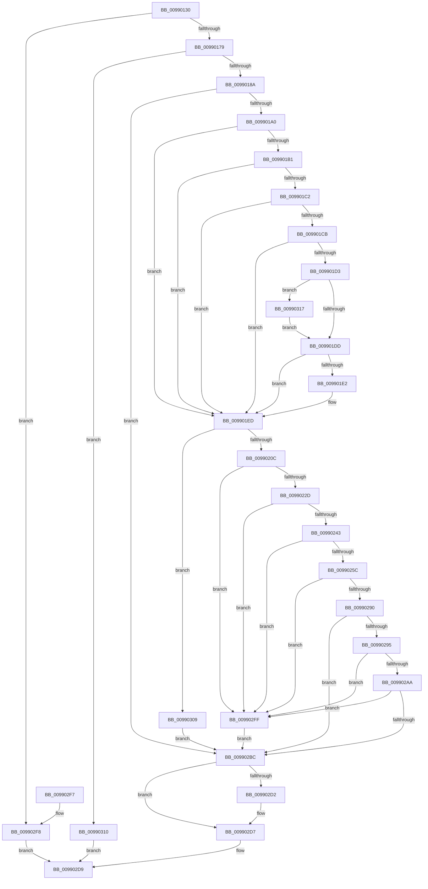

# CmRealKCBToVirtualPath

- RVA: `0x00990130`–`0x00990330` (길이 `512` bytes)
- VA: `0x0000000140990130`
- 실행 섹션: `PAGE`
- PDB 이름 있음: `예`; PDB Function 태그: `아니요`
- unwind 정보 RVA: `0x00098BA0`
- 디코드: `146`개 명령, `512/512` bytes 표시
- 미해석 바이트: `0` (있으면 어셈블리에 `.byte`로 보존)

> 이 문서는 커널 이미지의 기계어와 PDB 기호를 분석해 생성했습니다. 4번과 5번은 함수 원형과 자료형을 바이너리 사용 방식에서 추정한 C 해석이며 원본 소스 복구 결과는 아닙니다.

## 1. Dependencies

- 직접 호출 지점: **12**; 고유 호출 대상: **8**
- 직접 호출자로 확인된 함수: **5**
- RIP 상대 이미지 참조: **4**

### Outgoing calls
- `0x00990179` → [CmpConstructName](../85/CmpConstructName_function_00856BE0.md) (function, `0x00856BE0`)
- `0x00990191` → [CmpGetVirtualizationID](CmpGetVirtualizationID_function_00990338.md) (function, `0x00990338`)
- `0x009901FA` → [ExAllocatePool2](../../poolcode/B8/ExAllocatePool2_function_00B820F0.md) (function, `0x00B820F0`)
- `0x0099021E` → [RtlAppendUnicodeToString](../../text/40/RtlAppendUnicodeToString_function_0040F990.md) (function, `0x0040F990`)
- `0x00990234` → [RtlAppendUnicodeStringToString](../../text/40/RtlAppendUnicodeStringToString_function_0040FA50.md) (function, `0x0040FA50`)
- `0x0099024D` → [RtlAppendUnicodeToString](../../text/40/RtlAppendUnicodeToString_function_0040F990.md) (function, `0x0040F990`)
- `0x00990285` → [RtlAppendUnicodeStringToString](../../text/40/RtlAppendUnicodeStringToString_function_0040FA50.md) (function, `0x0040FA50`)
- `0x0099029F` → [RtlAppendUnicodeToString](../../text/40/RtlAppendUnicodeToString_function_0040F990.md) (function, `0x0040F990`)
- `0x009902B1` → [RtlAppendUnicodeStringToString](../../text/40/RtlAppendUnicodeStringToString_function_0040FA50.md) (function, `0x0040FA50`)
- `0x009902C4` → [CmpFreePoolWithTag](../../text/44/CmpFreePoolWithTag_function_004489E0.md) (function, `0x004489E0`)
- `0x009902D2` → [ExFreePool](../../poolcode/B8/ExFreePool_function_00B82850.md) (function, `0x00B82850`)
- `0x00990302` → [RtlFreeAnsiString](../9C/RtlFreeAnsiString_function_009C0800.md) (function, `0x009C0800`)

### Direct callers
- [CmpReparseToVirtualPath](../7E/CmpReparseToVirtualPath_function_007EBA48.md) at `0x007EBA90`
- [CmpReplicateKeyToVirtual](../7E/CmpReplicateKeyToVirtual_function_007EBAEC.md) at `0x007EBBB4`
- [CmpReportAuditVirtualizationEvent](../7E/CmpReportAuditVirtualizationEvent_function_007ED758.md) at `0x007ED8AB`
- [CmpVEExecuteRealStoreParseLogic](../84/CmpVEExecuteRealStoreParseLogic_function_0084CCD4.md) at `0x0084CE5F`
- [sub_00B37F04](../B3/Unknown_function_00B37F04.md) at `0x00B3802F`

### Static image references
- `0x00990155` → RVA `0x00E0ECA0` (`.data`; read)
- `0x0099020C` → RVA `0x00B08E90` (` ?? ::NNGAKEGL::`string'`; read)
- `0x00990243` → RVA `0x00B09920` (` ?? ::NNGAKEGL::`string'`; read)
- `0x00990295` → RVA `0x00AFC990` (` ?? ::NNGAKEGL::`string'`; read)

## 2. Other-region calls and transfers

- 다른 실행 섹션으로 향하는 call: **9**
  - `0x009901FA` → [ExAllocatePool2](../../poolcode/B8/ExAllocatePool2_function_00B820F0.md) (`PAGE` → `POOLCODE`)
  - `0x0099021E` → [RtlAppendUnicodeToString](../../text/40/RtlAppendUnicodeToString_function_0040F990.md) (`PAGE` → `.text`)
  - `0x00990234` → [RtlAppendUnicodeStringToString](../../text/40/RtlAppendUnicodeStringToString_function_0040FA50.md) (`PAGE` → `.text`)
  - `0x0099024D` → [RtlAppendUnicodeToString](../../text/40/RtlAppendUnicodeToString_function_0040F990.md) (`PAGE` → `.text`)
  - `0x00990285` → [RtlAppendUnicodeStringToString](../../text/40/RtlAppendUnicodeStringToString_function_0040FA50.md) (`PAGE` → `.text`)
  - `0x0099029F` → [RtlAppendUnicodeToString](../../text/40/RtlAppendUnicodeToString_function_0040F990.md) (`PAGE` → `.text`)
  - `0x009902B1` → [RtlAppendUnicodeStringToString](../../text/40/RtlAppendUnicodeStringToString_function_0040FA50.md) (`PAGE` → `.text`)
  - `0x009902C4` → [CmpFreePoolWithTag](../../text/44/CmpFreePoolWithTag_function_004489E0.md) (`PAGE` → `.text`)
  - `0x009902D2` → [ExFreePool](../../poolcode/B8/ExFreePool_function_00B82850.md) (`PAGE` → `POOLCODE`)
- 별도 외부 분기/꼬리 이동을 확인하지 못했습니다.

## 3. Assembly (complete function range)

```asm
00990130  48 8B C4                        mov rax, rsp
00990133  48 89 58 08                     mov qword ptr [rax + 8], rbx
00990137  48 89 70 10                     mov qword ptr [rax + 0x10], rsi
0099013B  48 89 78 18                     mov qword ptr [rax + 0x18], rdi
0099013F  4C 89 60 20                     mov qword ptr [rax + 0x20], r12
00990143  55                              push rbp
00990144  41 56                           push r14
00990146  41 57                           push r15
00990148  48 8B EC                        mov rbp, rsp
0099014B  48 83 EC 50                     sub rsp, 0x50
0099014F  45 33 E4                        xor r12d, r12d
00990152  0F 57 C0                        xorps xmm0, xmm0
00990155  44 38 25 44 EB 47 00            cmp byte ptr [rip + 0x47eb44], r12b
0099015C  0F 57 C9                        xorps xmm1, xmm1
0099015F  49 8B F9                        mov rdi, r9
00990162  49 8B D8                        mov rbx, r8
00990165  4C 8B F2                        mov r14, rdx
00990168  45 8A FC                        mov r15b, r12b
0099016B  0F 11 45 E0                     movups xmmword ptr [rbp - 0x20], xmm0
0099016F  0F 11 4D D0                     movups xmmword ptr [rbp - 0x30], xmm1
00990173  0F 84 7F 01 00 00               je 0x1409902f8
00990179  E8 62 6A EC FF                  call 0x140856be0
0099017E  48 8B F0                        mov rsi, rax
00990181  48 85 C0                        test rax, rax
00990184  0F 84 86 01 00 00               je 0x140990310
0099018A  48 8B D3                        mov rdx, rbx
0099018D  48 8D 4D E0                     lea rcx, [rbp - 0x20]
00990191  E8 A2 01 00 00                  call 0x140990338
00990196  8B D8                           mov ebx, eax
00990198  85 C0                           test eax, eax
0099019A  0F 88 1C 01 00 00               js 0x1409902bc
009901A0  0F B7 5D E0                     movzx ebx, word ptr [rbp - 0x20]
009901A4  0F B7 0E                        movzx ecx, word ptr [rsi]
009901A7  83 C3 26                        add ebx, 0x26
009901AA  03 D9                           add ebx, ecx
009901AC  4D 85 F6                        test r14, r14
009901AF  74 3C                           je 0x1409901ed
009901B1  41 0F 10 06                     movups xmm0, xmmword ptr [r14]
009901B5  49 8B 4E 08                     mov rcx, qword ptr [r14 + 8]
009901B9  0F 11 45 D0                     movups xmmword ptr [rbp - 0x30], xmm0
009901BD  48 85 C9                        test rcx, rcx
009901C0  74 2B                           je 0x1409901ed
009901C2  0F B7 45 D0                     movzx eax, word ptr [rbp - 0x30]
009901C6  66 85 C0                        test ax, ax
009901C9  74 22                           je 0x1409901ed
009901CB  0F B7 11                        movzx edx, word ptr [rcx]
009901CE  66 85 D2                        test dx, dx
009901D1  74 1A                           je 0x1409901ed
009901D3  66 83 FA 5C                     cmp dx, 0x5c
009901D7  0F 84 3A 01 00 00               je 0x140990317
009901DD  66 85 C0                        test ax, ax
009901E0  74 0B                           je 0x1409901ed
009901E2  0F B7 C0                        movzx eax, ax
009901E5  83 C3 02                        add ebx, 2
009901E8  03 D8                           add ebx, eax
009901EA  41 B7 01                        mov r15b, 1
009901ED  8B D3                           mov edx, ebx
009901EF  B9 00 01 00 00                  mov ecx, 0x100
009901F4  41 B8 43 4D 4E 62               mov r8d, 0x624e4d43
009901FA  E8 F1 1E 1F 00                  call 0x140b820f0
009901FF  48 89 47 08                     mov qword ptr [rdi + 8], rax
00990203  48 85 C0                        test rax, rax
00990206  0F 84 FD 00 00 00               je 0x140990309
0099020C  48 8D 15 7D 8C 17 00            lea rdx, [rip + 0x178c7d]
00990213  66 89 5F 02                     mov word ptr [rdi + 2], bx
00990217  48 8B CF                        mov rcx, rdi
0099021A  66 44 89 27                     mov word ptr [rdi], r12w
0099021E  E8 6D F7 A7 FF                  call 0x14040f990
00990223  8B D8                           mov ebx, eax
00990225  85 C0                           test eax, eax
00990227  0F 88 D2 00 00 00               js 0x1409902ff
0099022D  48 8D 55 E0                     lea rdx, [rbp - 0x20]
00990231  48 8B CF                        mov rcx, rdi
00990234  E8 17 F8 A7 FF                  call 0x14040fa50
00990239  8B D8                           mov ebx, eax
0099023B  85 C0                           test eax, eax
0099023D  0F 88 BC 00 00 00               js 0x1409902ff
00990243  48 8D 15 D6 96 17 00            lea rdx, [rip + 0x1796d6]
0099024A  48 8B CF                        mov rcx, rdi
0099024D  E8 3E F7 A7 FF                  call 0x14040f990
00990252  8B D8                           mov ebx, eax
00990254  85 C0                           test eax, eax
00990256  0F 88 A3 00 00 00               js 0x1409902ff
0099025C  0F 10 06                        movups xmm0, xmmword ptr [rsi]
0099025F  48 8B 46 08                     mov rax, qword ptr [rsi + 8]
00990263  48 8D 55 F0                     lea rdx, [rbp - 0x10]
00990267  B9 12 00 00 00                  mov ecx, 0x12
0099026C  48 03 C1                        add rax, rcx
0099026F  F3 0F 7F 45 F0                  movdqu xmmword ptr [rbp - 0x10], xmm0
00990274  48 89 45 F8                     mov qword ptr [rbp - 8], rax
00990278  0F B7 06                        movzx eax, word ptr [rsi]
0099027B  66 2B C1                        sub ax, cx
0099027E  48 8B CF                        mov rcx, rdi
00990281  66 89 45 F0                     mov word ptr [rbp - 0x10], ax
00990285  E8 C6 F7 A7 FF                  call 0x14040fa50
0099028A  8B D8                           mov ebx, eax
0099028C  85 C0                           test eax, eax
0099028E  78 6F                           js 0x1409902ff
00990290  45 84 FF                        test r15b, r15b
00990293  74 27                           je 0x1409902bc
00990295  48 8D 15 F4 C6 16 00            lea rdx, [rip + 0x16c6f4]
0099029C  48 8B CF                        mov rcx, rdi
0099029F  E8 EC F6 A7 FF                  call 0x14040f990
009902A4  8B D8                           mov ebx, eax
009902A6  85 C0                           test eax, eax
009902A8  78 55                           js 0x1409902ff
009902AA  48 8D 55 D0                     lea rdx, [rbp - 0x30]
009902AE  48 8B CF                        mov rcx, rdi
009902B1  E8 9A F7 A7 FF                  call 0x14040fa50
009902B6  8B D8                           mov ebx, eax
009902B8  85 C0                           test eax, eax
009902BA  78 43                           js 0x1409902ff
009902BC  BA 43 4D 4E 62                  mov edx, 0x624e4d43
009902C1  48 8B CE                        mov rcx, rsi
009902C4  E8 17 87 AB FF                  call 0x1404489e0
009902C9  48 8B 4D E8                     mov rcx, qword ptr [rbp - 0x18]
009902CD  48 85 C9                        test rcx, rcx
009902D0  74 05                           je 0x1409902d7
009902D2  E8 79 25 1F 00                  call 0x140b82850
009902D7  8B C3                           mov eax, ebx
009902D9  4C 8D 5C 24 50                  lea r11, [rsp + 0x50]
009902DE  49 8B 5B 20                     mov rbx, qword ptr [r11 + 0x20]
009902E2  49 8B 73 28                     mov rsi, qword ptr [r11 + 0x28]
009902E6  49 8B 7B 30                     mov rdi, qword ptr [r11 + 0x30]
009902EA  4D 8B 63 38                     mov r12, qword ptr [r11 + 0x38]
009902EE  49 8B E3                        mov rsp, r11
009902F1  41 5F                           pop r15
009902F3  41 5E                           pop r14
009902F5  5D                              pop rbp
009902F6  C3                              ret
009902F7  CC                              int3
009902F8  B8 0D 00 00 C0                  mov eax, 0xc000000d
009902FD  EB DA                           jmp 0x1409902d9
009902FF  48 8B CF                        mov rcx, rdi
00990302  E8 F9 04 03 00                  call 0x1409c0800
00990307  EB B3                           jmp 0x1409902bc
00990309  BB 9A 00 00 C0                  mov ebx, 0xc000009a
0099030E  EB AC                           jmp 0x1409902bc
00990310  B8 9A 00 00 C0                  mov eax, 0xc000009a
00990315  EB C2                           jmp 0x1409902d9
00990317  48 83 C1 02                     add rcx, 2
0099031B  48 89 4D D8                     mov qword ptr [rbp - 0x28], rcx
0099031F  B9 FE FF 00 00                  mov ecx, 0xfffe
00990324  66 03 C1                        add ax, cx
00990327  66 89 45 D0                     mov word ptr [rbp - 0x30], ax
0099032B  E9 AD FE FF FF                  jmp 0x1409901dd
```

## 4. C-style interpretation (structured pseudocode)

```c
__int64 __fastcall CmRealKCBToVirtualPath(__int64 a1, __int64 a2, __int64 a3, __int64 a4)
{
    __int64 result;
    __int64 v_r12;
    __int64 v_r15;
    __int64 v_rbx;
    __int64 v_rsp;
    unsigned __int64 v_stack_m18;
    unsigned __int64 v_stack_m20;
    unsigned __int64 v_stack_m28;
    unsigned __int64 v_stack_m30;
    unsigned __int64 v_stack_m38;
    unsigned __int64 v_stack_m40;
    unsigned __int64 v_stack_m48;

    *(unsigned __int64 *)(v_rsp + 8) = v_rbx;
    *(unsigned __int64 *)(v_rsp + 16) = v_rsi;
    *(unsigned __int64 *)(v_rsp + 24) = v_rdi;
    *(unsigned __int64 *)(v_rsp + 32) = v_r12;
    v_rsp = (v_rsp) - (80);
    v_r12 = 0;
    v_stack_m38 = v_xmm0;
    v_stack_m48 = v_xmm1;
    if ((*(unsigned __int8 *)(v_rip + 4713284)) == 0) goto loc_009902F8;
    result = CmpConstructName(a1, a2, a3, a4);
    if (result == 0) goto loc_00990310;
    result = CmpGetVirtualizationID(v_stack_m38, a3, a3, a4);
    if (sign_flag) goto loc_009902BC;
    v_rbx = (unsigned int)((v_stack_m38) + (38));
    v_rbx = (unsigned int)((v_rbx) + ((unsigned int)(*(unsigned __int16 *)(result))));
    if (a2 == 0) goto loc_009901ED;
    v_stack_m48 = v_xmm0;
    if (*(unsigned __int64 *)(a2 + 8) == 0) goto loc_009901ED;
    if ((unsigned __int16)(v_stack_m48) == 0) goto loc_009901ED;
    if ((unsigned __int16)(*(unsigned __int16 *)(*(unsigned __int64 *)(a2 + 8))) == 0) goto loc_009901ED;
    if (((unsigned __int16)(*(unsigned __int16 *)(*(unsigned __int64 *)(a2 + 8)))) == 92) goto loc_00990317;
loc_009901DD:
    result = v_stack_m48;
    v_r15 = 0;
    if ((unsigned __int16)(v_stack_m48) != 0) {
        result = (unsigned __int16)(v_stack_m48);
        v_rbx = (unsigned int)((v_rbx) + (2));
        v_rbx = (unsigned int)((v_rbx) + ((unsigned int)(result)));
        v_r15 = 1;
    }
    result = ExAllocatePool2(256, (unsigned int)((unsigned int)(v_rbx)), (unsigned int)(0x624E4D43ULL), a4);
    *(unsigned __int64 *)(a4 + 8) = result;
    if (result == 0) goto loc_00990309;
    *(unsigned __int16 *)(a4 + 2) = (unsigned __int16)(v_rbx);
    *(unsigned __int16 *)(a4) = 0;
    result = RtlAppendUnicodeToString(a4, v_rip + 1543293, (unsigned int)(0x624E4D43ULL), a4);
    if (sign_flag) goto loc_009902FF;
    result = RtlAppendUnicodeStringToString(a4, v_stack_m38, (unsigned int)(0x624E4D43ULL), a4);
    if (sign_flag) goto loc_009902FF;
    result = RtlAppendUnicodeToString(a4, v_rip + 1545942, (unsigned int)(0x624E4D43ULL), a4);
    if (sign_flag) goto loc_009902FF;
    result = (*(unsigned __int64 *)(result + 8)) + (18);
    v_stack_m28 = v_xmm0;
    v_stack_m20 = result;
    result = (unsigned __int16)((*(unsigned __int16 *)(result)) - (18));
    v_stack_m28 = (unsigned __int16)(result);
    result = RtlAppendUnicodeStringToString(a4, v_stack_m28, (unsigned int)(0x624E4D43ULL), a4);
    if (sign_flag) goto loc_009902FF;
    if ((unsigned __int8)(v_r15) == 0) goto loc_009902BC;
    result = RtlAppendUnicodeToString(a4, v_rip + 1492724, (unsigned int)(0x624E4D43ULL), a4);
    if (sign_flag) goto loc_009902FF;
    result = RtlAppendUnicodeStringToString(a4, v_stack_m48, (unsigned int)(0x624E4D43ULL), a4);
    if (sign_flag) goto loc_009902FF;
loc_009902BC:
    result = CmpFreePoolWithTag(result, (unsigned int)(0x624E4D43ULL), (unsigned int)(0x624E4D43ULL), a4);
    if (v_stack_m30 != 0) {
        result = ExFreePool(v_stack_m30, (unsigned int)(0x624E4D43ULL), (unsigned int)(0x624E4D43ULL), a4);
    }
loc_009902D9:
    return (unsigned int)((unsigned int)((unsigned int)((unsigned int)(result))));
loc_009902F8:
    goto loc_009902D9;
loc_009902FF:
    result = RtlFreeAnsiString(*(unsigned __int64 *)(v_stack_m18 + 48), (unsigned int)(0x624E4D43ULL), (unsigned int)(0x624E4D43ULL), a4);
    goto loc_009902BC;
loc_00990309:
    goto loc_009902BC;
loc_00990310:
    goto loc_009902D9;
loc_00990317:
    a1 = (*(unsigned __int64 *)(v_stack_m18 + 48)) + (2);
    v_stack_m40 = a1;
    result = (unsigned __int16)(((unsigned int)(0xC000009AULL)) + ((unsigned __int16)((unsigned int)(0xFFFEULL))));
    v_stack_m48 = (unsigned __int16)(result);
    goto loc_009901DD;
}
```

## 5. (Beta) C Style

```c
int64_t CmRealKCBToVirtualPath(int64_t Arg1, int64_t Arg2, int64_t Arg3, void *Arg4)
{
    uint8_t *arg4 = (uint8_t *)Arg4;

    int64_t result;
    int64_t local_r12;
    int64_t local_r15;
    int64_t local_rbx;
    int64_t local_rsp;
    uint64_t v_stack_m18;
    uint64_t v_stack_m20;
    uint64_t v_stack_m28;
    uint64_t v_stack_m30;
    uint64_t v_stack_m38;
    uint64_t v_stack_m40;
    uint64_t v_stack_m48;

    *(uint64_t *)(local_rsp + 0x8) = local_rbx;
    *(uint64_t *)(local_rsp + 0x10) = local_rsi;
    *(uint64_t *)(local_rsp + 0x18) = local_rdi;
    *(uint64_t *)(local_rsp + 0x20) = local_r12;
    local_rsp = (local_rsp) - (80);
    local_r12 = 0;
    v_stack_m38 = v_xmm0;
    v_stack_m48 = v_xmm1;
    if ((*(uint8_t *)(v_rip + 0x47EB44)) == 0) goto loc_009902F8;
    result = CmpConstructName(Arg1, Arg2, Arg3, Arg4);
    if (result == 0) goto loc_00990310;
    result = CmpGetVirtualizationID(v_stack_m38, Arg3, Arg3, Arg4);
    if (sign_flag) goto loc_009902BC;
    local_rbx = (uint32_t)((v_stack_m38) + (38));
    local_rbx = (uint32_t)((local_rbx) + ((uint32_t)(*(uint16_t *)(result))));
    if (Arg2 == 0) goto loc_009901ED;
    v_stack_m48 = v_xmm0;
    if (*(uint64_t *)(Arg2 + 0x8) == 0) goto loc_009901ED;
    if ((uint16_t)(v_stack_m48) == 0) goto loc_009901ED;
    if ((uint16_t)(*(uint16_t *)(*(uint64_t *)(Arg2 + 0x8))) == 0) goto loc_009901ED;
    if (((uint16_t)(*(uint16_t *)(*(uint64_t *)(Arg2 + 0x8)))) == 92) goto loc_00990317;
loc_009901DD:
    result = v_stack_m48;
    local_r15 = 0;
    if ((uint16_t)(v_stack_m48) != 0) {
        result = (uint16_t)(v_stack_m48);
        local_rbx = (uint32_t)((local_rbx) + (2));
        local_rbx = (uint32_t)((local_rbx) + ((uint32_t)(result)));
        local_r15 = 1;
    }
    result = ExAllocatePool2(256, (uint32_t)((uint32_t)(local_rbx)), (uint32_t)(0x624E4D43ULL), Arg4);
    *(uint64_t *)(arg4 + 0x8) = result;
    if (result == 0) goto loc_00990309;
    *(uint16_t *)(arg4 + 0x2) = (uint16_t)(local_rbx);
    *(uint16_t *)(arg4) = 0;
    result = RtlAppendUnicodeToString(Arg4, v_rip + 1543293, (uint32_t)(0x624E4D43ULL), Arg4);
    if (sign_flag) goto loc_009902FF;
    result = RtlAppendUnicodeStringToString(Arg4, v_stack_m38, (uint32_t)(0x624E4D43ULL), Arg4);
    if (sign_flag) goto loc_009902FF;
    result = RtlAppendUnicodeToString(Arg4, v_rip + 1545942, (uint32_t)(0x624E4D43ULL), Arg4);
    if (sign_flag) goto loc_009902FF;
    result = (*(uint64_t *)(result + 0x8)) + (18);
    v_stack_m28 = v_xmm0;
    v_stack_m20 = result;
    result = (uint16_t)((*(uint16_t *)(result)) - (18));
    v_stack_m28 = (uint16_t)(result);
    result = RtlAppendUnicodeStringToString(Arg4, v_stack_m28, (uint32_t)(0x624E4D43ULL), Arg4);
    if (sign_flag) goto loc_009902FF;
    if ((uint8_t)(local_r15) == 0) goto loc_009902BC;
    result = RtlAppendUnicodeToString(Arg4, v_rip + 1492724, (uint32_t)(0x624E4D43ULL), Arg4);
    if (sign_flag) goto loc_009902FF;
    result = RtlAppendUnicodeStringToString(Arg4, v_stack_m48, (uint32_t)(0x624E4D43ULL), Arg4);
    if (sign_flag) goto loc_009902FF;
loc_009902BC:
    result = CmpFreePoolWithTag(result, (uint32_t)(0x624E4D43ULL), (uint32_t)(0x624E4D43ULL), Arg4);
    if (v_stack_m30 != 0) {
        result = ExFreePool(v_stack_m30, (uint32_t)(0x624E4D43ULL), (uint32_t)(0x624E4D43ULL), Arg4);
    }
loc_009902D9:
    return (uint32_t)((uint32_t)((uint32_t)((uint32_t)(result))));
loc_009902F8:
    goto loc_009902D9;
loc_009902FF:
    result = RtlFreeAnsiString(*(uint64_t *)(v_stack_m18 + 0x30), (uint32_t)(0x624E4D43ULL), (uint32_t)(0x624E4D43ULL), Arg4);
    goto loc_009902BC;
loc_00990309:
    goto loc_009902BC;
loc_00990310:
    goto loc_009902D9;
loc_00990317:
    Arg1 = (*(uint64_t *)(v_stack_m18 + 0x30)) + (2);
    v_stack_m40 = Arg1;
    result = (uint16_t)(((uint32_t)(0xC000009AULL)) + ((uint16_t)((uint32_t)(0xFFFEULL))));
    v_stack_m48 = (uint16_t)(result);
    goto loc_009901DD;
}
```

### 관측된 메모리 오프셋

구조체 형식이 확인되지 않은 접근은 인자 기준의 오프셋으로만 기록했습니다.

| 기준 인자 | 오프셋 표현 | 폭 (bit) | 접근 |
|---|---:|---:|---|
| `Arg4` | `+ 0x0` | `16` | `W` |
| `Arg4` | `+ 0x2` | `16` | `W` |
| `Arg4` | `+ 0x8` | `64` | `W` |

## 6. Execution-region graph

[열기: 2D/3D 그래프와 함수 탐색 컨트롤 패널](../../../control-panel.html?section=page&rva=0x00990130&view=graph)

- 2D 그래프는 위에서 아래로 흐르고, 3D 그래프는 빈 공간을 드래그해 회전합니다. Shift+드래그는 이동, 휠은 확대·축소, 함수 노드 선택은 대상 보고서 이동입니다.

### Static fallback


