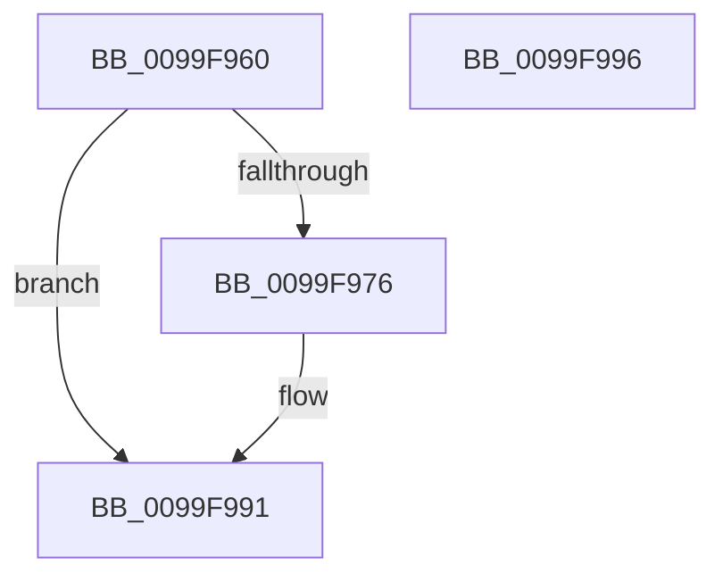

# CmpDereferenceKeyControlBlockUnsafe

- RVA: `0x0099F960`–`0x0099F997` (길이 `55` bytes)
- VA: `0x000000014099F960`
- 실행 섹션: `PAGE`
- PDB 이름 있음: `예`; PDB Function 태그: `아니요`
- unwind 정보 RVA: `0x0005D2F4`
- 디코드: `15`개 명령, `55/55` bytes 표시
- 미해석 바이트: `0` (있으면 어셈블리에 `.byte`로 보존)

> 이 문서는 커널 이미지의 기계어와 PDB 기호를 분석해 생성했습니다. 4번과 5번은 함수 원형과 자료형을 바이너리 사용 방식에서 추정한 C 해석이며 원본 소스 복구 결과는 아닙니다.

## 1. Dependencies

- 직접 호출 지점: **1**; 고유 호출 대상: **1**
- 직접 호출자로 확인된 함수: **10**
- RIP 상대 이미지 참조: **0**

### Outgoing calls
- `0x0099F98B` → [KeBugCheckEx](../../text/4F/KeBugCheckEx_function_004FD660.md) (function, `0x004FD660`)

### Direct callers
- [CmpLoadKeyCommon](../../text/46/CmpLoadKeyCommon_function_0046E9F8.md) at `0x0046ED04`
- [CmRenameKey](../7E/CmRenameKey_function_007E8F48.md) at `0x007E97F4`
- [CmRenameKey](../7E/CmRenameKey_function_007E8F48.md) at `0x007E98C6`
- [CmpCreateGlobalKeyLockEntry](../7E/CmpCreateGlobalKeyLockEntry_function_007EDC88.md) at `0x007EDCC8`
- [CmpCreateSiloKeyLockEntry](../7E/CmpCreateSiloKeyLockEntry_function_007EDCE4.md) at `0x007EDD1C`
- [CmpCreateKeyControlBlock](../85/CmpCreateKeyControlBlock_function_00851DB0.md) at `0x00852548`
- [CmpDoParseKey](../85/CmpDoParseKey_function_0085F750.md) at `0x00860066`
- [CmpDoParseKey](../85/CmpDoParseKey_function_0085F750.md) at `0x00860DA3`
- [CmpDoParseKey](../85/CmpDoParseKey_function_0085F750.md) at `0x008615E6`
- [CmpCommitDiscardReplacePost](../86/CmpCommitDiscardReplacePost_function_008624D4.md) at `0x008626D7`
- [CmpCommitDiscardReplacePost](../86/CmpCommitDiscardReplacePost_function_008624D4.md) at `0x008626FA`
- [CmpCommitDiscardReplacePost](../86/CmpCommitDiscardReplacePost_function_008624D4.md) at `0x00862732`
- [CmpRundownUnitOfWork](../87/CmpRundownUnitOfWork_function_0087497C.md) at `0x00874A52`
- [sub_008C405D](../8C/Unknown_function_008C405D.md) at `0x008C41A6`
- [CmpFreezeHive](../9A/CmpFreezeHive_function_009AE818.md) at `0x009AE84F`

### Static image references
- 디코드된 RIP-relative 메모리 참조가 없습니다.

## 2. Other-region calls and transfers

- 다른 실행 섹션으로 향하는 call: **1**
  - `0x0099F98B` → [KeBugCheckEx](../../text/4F/KeBugCheckEx_function_004FD660.md) (`PAGE` → `.text`)
- 별도 외부 분기/꼬리 이동을 확인하지 못했습니다.

## 3. Assembly (complete function range)

```asm
0099F960  48 83 EC 38                     sub rsp, 0x38
0099F964  48 C7 C0 FF FF FF FF            mov rax, 0xffffffffffffffff
0099F96B  F0 48 0F C1 01                  lock xadd qword ptr [rcx], rax
0099F970  48 83 F8 01                     cmp rax, 1
0099F974  75 1B                           jne 0x14099f991
0099F976  45 33 C9                        xor r9d, r9d
0099F979  48 C7 44 24 20 00 00 00 00      mov qword ptr [rsp + 0x20], 0
0099F982  45 33 C0                        xor r8d, r8d
0099F985  8D 50 1E                        lea edx, [rax + 0x1e]
0099F988  8D 48 50                        lea ecx, [rax + 0x50]
0099F98B  E8 D0 DC B5 FF                  call 0x1404fd660
0099F990  CC                              int3
0099F991  48 83 C4 38                     add rsp, 0x38
0099F995  C3                              ret
0099F996  CC                              int3
```

## 4. C-style interpretation (structured pseudocode)

```c
__int64 __fastcall CmpDereferenceKeyControlBlockUnsafe(__int64 a1, __int64 a2, int a3, int a4)
{
    __int64 result;
    __int64 v_rsp;
    unsigned __int64 v_stack_m18;

    v_rsp = (v_rsp) - (56);
    result = -1;
    if (-1 == 1) {
        a4 = 0;
        v_stack_m18 = 0;
        a3 = 0;
        a2 = -1 + 30;
        a1 = -1 + 80;
        result = KeBugCheckEx(a1, a2, a3, a4);
    }
    v_rsp = (v_rsp) + (56);
    return result;
}
```

## 5. (Beta) C Style

```c
int64_t CmpDereferenceKeyControlBlockUnsafe(void *Arg1, int64_t Arg2, int32_t Arg3, int32_t Arg4)
{
    uint8_t *arg1 = (uint8_t *)Arg1;

    int64_t result;
    int64_t local_rsp;
    uint64_t v_stack_m18;

    local_rsp = (local_rsp) - (56);
    result = -1;
    if (-1 == 1) {
        Arg4 = 0;
        v_stack_m18 = 0;
        Arg3 = 0;
        Arg2 = -1 + 30;
        Arg1 = -1 + 80;
        result = KeBugCheckEx(Arg1, Arg2, Arg3, Arg4);
    }
    local_rsp = (local_rsp) + (56);
    return result;
}
```

### 관측된 메모리 오프셋

구조체 형식이 확인되지 않은 접근은 인자 기준의 오프셋으로만 기록했습니다.

| 기준 인자 | 오프셋 표현 | 폭 (bit) | 접근 |
|---|---:|---:|---|
| `Arg1` | `+ 0x0` | `64` | `R/W` |

## 6. Execution-region graph

[열기: 2D/3D 그래프와 함수 탐색 컨트롤 패널](../../../control-panel.html?section=page&rva=0x0099F960&view=graph)

- 2D 그래프는 위에서 아래로 흐르고, 3D 그래프는 빈 공간을 드래그해 회전합니다. Shift+드래그는 이동, 휠은 확대·축소, 함수 노드 선택은 대상 보고서 이동입니다.

### Static fallback


