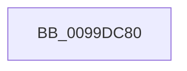

# CmpGetSecurityDescriptorForKcbStack

- RVA: `0x0099DC80`–`0x0099DCA3` (길이 `35` bytes)
- VA: `0x000000014099DC80`
- 실행 섹션: `PAGE`
- PDB 이름 있음: `예`; PDB Function 태그: `아니요`
- unwind 정보 RVA: `0x0009A11C`
- 디코드: `12`개 명령, `35/35` bytes 표시
- 미해석 바이트: `0` (있으면 어셈블리에 `.byte`로 보존)

> 이 문서는 커널 이미지의 기계어와 PDB 기호를 분석해 생성했습니다. 4번과 5번은 함수 원형과 자료형을 바이너리 사용 방식에서 추정한 C 해석이며 원본 소스 복구 결과는 아닙니다.

## 1. Dependencies

- 직접 호출 지점: **0**; 고유 호출 대상: **0**
- 직접 호출자로 확인된 함수: **1**
- RIP 상대 이미지 참조: **0**

### Outgoing calls
- 직접 디코드된 call 명령이 없습니다.

### Direct callers
- [CmpCreateTombstone](../../text/66/CmpCreateTombstone_function_0066AF50.md) at `0x0066B0B8`

### Static image references
- 디코드된 RIP-relative 메모리 참조가 없습니다.

## 2. Other-region calls and transfers

- 다른 실행 섹션으로 향하는 call: **0**
- call이 아닌 외부 분기/꼬리 이동: **1**
  - `0x0099DCA1` → [sub_0099DCFA](Unknown_function_0099DCFA.md) (`tail-transfer`)

## 3. Assembly (complete function range)

```asm
0099DC80  48 89 5C 24 10                  mov qword ptr [rsp + 0x10], rbx
0099DC85  48 89 6C 24 18                  mov qword ptr [rsp + 0x18], rbp
0099DC8A  56                              push rsi
0099DC8B  57                              push rdi
0099DC8C  41 56                           push r14
0099DC8E  48 83 EC 20                     sub rsp, 0x20
0099DC92  0F B7 79 02                     movzx edi, word ptr [rcx + 2]
0099DC96  33 ED                           xor ebp, ebp
0099DC98  4C 8B F2                        mov r14, rdx
0099DC9B  48 8B F1                        mov rsi, rcx
0099DC9E  66 85 FF                        test di, di
0099DCA1  78 57                           js 0x14099dcfa
```

## 4. C-style interpretation (structured pseudocode)

```c
void __fastcall CmpGetSecurityDescriptorForKcbStack(__int64 a1, __int64 a2)
{
    __int64 v_rbp;
    __int64 v_rsp;
    unsigned __int64 v_stack_p10;
    unsigned __int64 v_stack_p18;

    v_stack_p10 = v_rbx;
    v_stack_p18 = v_rbp;
    v_rsp = (v_rsp) - (32);
    v_rbp = 0;
}
```

## 5. (Beta) C Style

```c
void CmpGetSecurityDescriptorForKcbStack(void *Arg1, int64_t Arg2)
{
    uint8_t *arg1 = (uint8_t *)Arg1;

    int64_t local_rbp;
    int64_t local_rsp;
    uint64_t v_stack_p10;
    uint64_t v_stack_p18;

    v_stack_p10 = local_rbx;
    v_stack_p18 = local_rbp;
    local_rsp = (local_rsp) - (32);
    local_rbp = 0;
}
```

### 관측된 메모리 오프셋

구조체 형식이 확인되지 않은 접근은 인자 기준의 오프셋으로만 기록했습니다.

| 기준 인자 | 오프셋 표현 | 폭 (bit) | 접근 |
|---|---:|---:|---|
| `Arg1` | `+ 0x2` | `16` | `R` |

## 6. Execution-region graph

[열기: 2D/3D 그래프와 함수 탐색 컨트롤 패널](../../../control-panel.html?section=page&rva=0x0099DC80&view=graph)

- 2D 그래프는 위에서 아래로 흐르고, 3D 그래프는 빈 공간을 드래그해 회전합니다. Shift+드래그는 이동, 휠은 확대·축소, 함수 노드 선택은 대상 보고서 이동입니다.

### Static fallback


