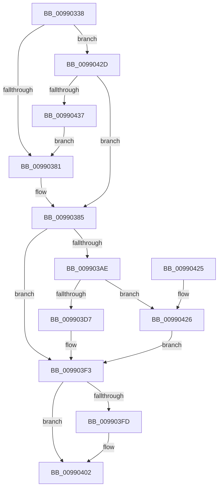

# CmpGetVirtualizationID

- RVA: `0x00990338`–`0x0099043C` (길이 `260` bytes)
- VA: `0x0000000140990338`
- 실행 섹션: `PAGE`
- PDB 이름 있음: `예`; PDB Function 태그: `아니요`
- unwind 정보 RVA: `0x00098BC0`
- 디코드: `63`개 명령, `260/260` bytes 표시
- 미해석 바이트: `0` (있으면 어셈블리에 `.byte`로 보존)

> 이 문서는 커널 이미지의 기계어와 PDB 기호를 분석해 생성했습니다. 4번과 5번은 함수 원형과 자료형을 바이너리 사용 방식에서 추정한 C 해석이며 원본 소스 복구 결과는 아닙니다.

## 1. Dependencies

- 직접 호출 지점: **8**; 고유 호출 대상: **8**
- 직접 호출자로 확인된 함수: **2**
- RIP 상대 이미지 참조: **2**

### Outgoing calls
- `0x00990370` → [memset](../../text/6C/memset_function_006C6C40.md) (function, `0x006C6C40`)
- `0x00990391` → [SeQueryUserSidToken](SeQueryUserSidToken_function_00990950.md) (function, `0x00990950`)
- `0x009903A3` → [RtlConvertSidToUnicodeString](../92/RtlConvertSidToUnicodeString_function_00927B30.md) (function, `0x00927B30`)
- `0x009903C9` → [ExAllocatePool2](../../poolcode/B8/ExAllocatePool2_function_00B820F0.md) (function, `0x00B820F0`)
- `0x009903DF` → [RtlCopyUnicodeString](../../text/3F/RtlCopyUnicodeString_function_003FEF30.md) (function, `0x003FEF30`)
- `0x009903EE` → [RtlAppendUnicodeToString](../../text/40/RtlAppendUnicodeToString_function_0040F990.md) (function, `0x0040F990`)
- `0x009903FD` → [ExFreePool](../../poolcode/B8/ExFreePool_function_00B82850.md) (function, `0x00B82850`)
- `0x0099040F` → [_security_check_cookie](../../text/6A/_security_check_cookie_function_006AC640.md) (function, `0x006AC640`)

### Direct callers
- [CmpGetVirtualStoreRoot](../7E/CmpGetVirtualStoreRoot_function_007EB974.md) at `0x007EB9B3`
- [CmRealKCBToVirtualPath](CmRealKCBToVirtualPath_function_00990130.md) at `0x00990191`

### Static image references
- `0x00990345` → RVA `0x00E0A740` (`.data`; read)
- `0x009903E4` → RVA `0x00B09900` (` ?? ::NNGAKEGL::`string'`; read)

## 2. Other-region calls and transfers

- 다른 실행 섹션으로 향하는 call: **6**
  - `0x00990370` → [memset](../../text/6C/memset_function_006C6C40.md) (`PAGE` → `.text`)
  - `0x009903C9` → [ExAllocatePool2](../../poolcode/B8/ExAllocatePool2_function_00B820F0.md) (`PAGE` → `POOLCODE`)
  - `0x009903DF` → [RtlCopyUnicodeString](../../text/3F/RtlCopyUnicodeString_function_003FEF30.md) (`PAGE` → `.text`)
  - `0x009903EE` → [RtlAppendUnicodeToString](../../text/40/RtlAppendUnicodeToString_function_0040F990.md) (`PAGE` → `.text`)
  - `0x009903FD` → [ExFreePool](../../poolcode/B8/ExFreePool_function_00B82850.md) (`PAGE` → `POOLCODE`)
  - `0x0099040F` → [_security_check_cookie](../../text/6A/_security_check_cookie_function_006AC640.md) (`PAGE` → `.text`)
- 별도 외부 분기/꼬리 이동을 확인하지 못했습니다.

## 3. Assembly (complete function range)

```asm
00990338  48 89 5C 24 18                  mov qword ptr [rsp + 0x18], rbx
0099033D  57                              push rdi
0099033E  48 81 EC 90 00 00 00            sub rsp, 0x90
00990345  48 8B 05 F4 A3 47 00            mov rax, qword ptr [rip + 0x47a3f4]
0099034C  48 33 C4                        xor rax, rsp
0099034F  48 89 84 24 80 00 00 00         mov qword ptr [rsp + 0x80], rax
00990357  48 8B DA                        mov rbx, rdx
0099035A  48 8B F9                        mov rdi, rcx
0099035D  33 D2                           xor edx, edx
0099035F  48 8D 4C 24 30                  lea rcx, [rsp + 0x30]
00990364  0F 57 C0                        xorps xmm0, xmm0
00990367  0F 11 44 24 20                  movups xmmword ptr [rsp + 0x20], xmm0
0099036C  44 8D 42 44                     lea r8d, [rdx + 0x44]
00990370  E8 CB 68 D3 FF                  call 0x1406c6c40
00990375  48 8B 0B                        mov rcx, qword ptr [rbx]
00990378  48 85 C9                        test rcx, rcx
0099037B  0F 85 AC 00 00 00               jne 0x14099042d
00990381  48 8B 4B 10                     mov rcx, qword ptr [rbx + 0x10]
00990385  45 33 C9                        xor r9d, r9d
00990388  48 8D 54 24 30                  lea rdx, [rsp + 0x30]
0099038D  45 8D 41 44                     lea r8d, [r9 + 0x44]
00990391  E8 BA 05 00 00                  call 0x140990950
00990396  41 B0 01                        mov r8b, 1
00990399  48 8D 54 24 30                  lea rdx, [rsp + 0x30]
0099039E  48 8D 4C 24 20                  lea rcx, [rsp + 0x20]
009903A3  E8 88 77 F9 FF                  call 0x140927b30
009903A8  8B D8                           mov ebx, eax
009903AA  85 C0                           test eax, eax
009903AC  78 45                           js 0x1409903f3
009903AE  0F B7 4C 24 20                  movzx ecx, word ptr [rsp + 0x20]
009903B3  41 B8 43 4D 56 65               mov r8d, 0x65564d43
009903B9  66 83 C1 14                     add cx, 0x14
009903BD  0F B7 D1                        movzx edx, cx
009903C0  B9 00 01 00 00                  mov ecx, 0x100
009903C5  66 89 57 02                     mov word ptr [rdi + 2], dx
009903C9  E8 22 1D 1F 00                  call 0x140b820f0
009903CE  48 89 47 08                     mov qword ptr [rdi + 8], rax
009903D2  48 85 C0                        test rax, rax
009903D5  74 4F                           je 0x140990426
009903D7  48 8D 54 24 20                  lea rdx, [rsp + 0x20]
009903DC  48 8B CF                        mov rcx, rdi
009903DF  E8 4C EB A6 FF                  call 0x1403fef30
009903E4  48 8D 15 15 95 17 00            lea rdx, [rip + 0x179515]
009903EB  48 8B CF                        mov rcx, rdi
009903EE  E8 9D F5 A7 FF                  call 0x14040f990
009903F3  48 8B 4C 24 28                  mov rcx, qword ptr [rsp + 0x28]
009903F8  48 85 C9                        test rcx, rcx
009903FB  74 05                           je 0x140990402
009903FD  E8 4E 24 1F 00                  call 0x140b82850
00990402  8B C3                           mov eax, ebx
00990404  48 8B 8C 24 80 00 00 00         mov rcx, qword ptr [rsp + 0x80]
0099040C  48 33 CC                        xor rcx, rsp
0099040F  E8 2C C2 D1 FF                  call 0x1406ac640
00990414  48 8B 9C 24 B0 00 00 00         mov rbx, qword ptr [rsp + 0xb0]
0099041C  48 81 C4 90 00 00 00            add rsp, 0x90
00990423  5F                              pop rdi
00990424  C3                              ret
00990425  CC                              int3
00990426  BB 9A 00 00 C0                  mov ebx, 0xc000009a
0099042B  EB C6                           jmp 0x1409903f3
0099042D  83 7B 08 02                     cmp dword ptr [rbx + 8], 2
00990431  0F 8D 4E FF FF FF               jge 0x140990385
00990437  E9 45 FF FF FF                  jmp 0x140990381
```

## 4. C-style interpretation (structured pseudocode)

```c
__int64 __fastcall CmpGetVirtualizationID(__int64 a1, __int64 a2, __int64 a3, int a4)
{
    __int64 result;
    __int64 v_rsp;
    unsigned __int64 v_stack_m18;
    unsigned __int64 v_stack_m68;
    unsigned __int64 v_stack_m70;
    unsigned __int64 v_stack_m78;
    unsigned __int64 v_stack_p18;

    v_stack_p18 = v_rbx;
    v_rsp = (v_rsp) - (144);
    result = (*(unsigned __int64 *)(v_rip + 4695028)) ^ (v_rsp);
    v_stack_m18 = result;
    a2 = 0;
    v_stack_m78 = v_xmm0;
    result = memset(v_stack_m68, a2, a2 + 68, a4);
    if (*(unsigned __int64 *)(a2) != 0) goto loc_0099042D;
loc_00990381:
loc_00990385:
    a4 = 0;
    result = SeQueryUserSidToken(*(unsigned __int64 *)(a2 + 16), v_stack_m68, a4 + 68, a4);
    result = RtlConvertSidToUnicodeString(v_stack_m78, v_stack_m68, 1, a4);
    if (sign_flag) goto loc_009903F3;
    a1 = (unsigned __int16)((v_stack_m78) + (20));
    *(unsigned __int16 *)(a1 + 2) = (unsigned __int16)((unsigned __int16)(a1));
    result = ExAllocatePool2(256, (unsigned __int16)(a1), (unsigned int)(0x65564D43ULL), a4);
    *(unsigned __int64 *)(a1 + 8) = result;
    if (result == 0) goto loc_00990426;
    result = RtlCopyUnicodeString(a1, v_stack_m78, (unsigned int)(0x65564D43ULL), a4);
    result = RtlAppendUnicodeToString(a1, v_rip + 1545493, (unsigned int)(0x65564D43ULL), a4);
loc_009903F3:
    if (v_stack_m70 != 0) {
        result = ExFreePool(v_stack_m70, v_rip + 1545493, (unsigned int)(0x65564D43ULL), a4);
    }
    a1 = (v_stack_m18) ^ (v_rsp);
    result = _security_check_cookie(a1, v_rip + 1545493, (unsigned int)(0x65564D43ULL), a4);
    v_rsp = (v_rsp) + (144);
    return result;
loc_00990426:
    goto loc_009903F3;
loc_0099042D:
    if ((*(unsigned int *)((unsigned int)(0xC000009AULL) + 8)) >= 2) goto loc_00990385;
    goto loc_00990381;
}
```

## 5. (Beta) C Style

```c
int64_t CmpGetVirtualizationID(void *Arg1, void *Arg2, int64_t Arg3, int32_t Arg4)
{
    uint8_t *arg1 = (uint8_t *)Arg1;
    uint8_t *arg2 = (uint8_t *)Arg2;

    int64_t result;
    int64_t local_rsp;
    uint64_t v_stack_m18;
    uint64_t v_stack_m68;
    uint64_t v_stack_m70;
    uint64_t v_stack_m78;
    uint64_t v_stack_p18;

    v_stack_p18 = local_rbx;
    local_rsp = (local_rsp) - (144);
    result = (*(uint64_t *)(v_rip + 0x47A3F4)) ^ (local_rsp);
    v_stack_m18 = result;
    Arg2 = 0;
    v_stack_m78 = v_xmm0;
    result = memset(v_stack_m68, Arg2, Arg2 + 68, Arg4);
    if (*(uint64_t *)(arg2) != 0) goto loc_0099042D;
loc_00990381:
loc_00990385:
    Arg4 = 0;
    result = SeQueryUserSidToken(*(uint64_t *)(arg2 + 0x10), v_stack_m68, Arg4 + 68, Arg4);
    result = RtlConvertSidToUnicodeString(v_stack_m78, v_stack_m68, 1, Arg4);
    if (sign_flag) goto loc_009903F3;
    Arg1 = (uint16_t)((v_stack_m78) + (20));
    *(uint16_t *)(arg1 + 0x2) = (uint16_t)((uint16_t)(Arg1));
    result = ExAllocatePool2(256, (uint16_t)(Arg1), (uint32_t)(0x65564D43ULL), Arg4);
    *(uint64_t *)(arg1 + 0x8) = result;
    if (result == 0) goto loc_00990426;
    result = RtlCopyUnicodeString(Arg1, v_stack_m78, (uint32_t)(0x65564D43ULL), Arg4);
    result = RtlAppendUnicodeToString(Arg1, v_rip + 1545493, (uint32_t)(0x65564D43ULL), Arg4);
loc_009903F3:
    if (v_stack_m70 != 0) {
        result = ExFreePool(v_stack_m70, v_rip + 1545493, (uint32_t)(0x65564D43ULL), Arg4);
    }
    Arg1 = (v_stack_m18) ^ (local_rsp);
    result = _security_check_cookie(Arg1, v_rip + 1545493, (uint32_t)(0x65564D43ULL), Arg4);
    local_rsp = (local_rsp) + (144);
    return result;
loc_00990426:
    goto loc_009903F3;
loc_0099042D:
    if ((*(uint32_t *)((uint32_t)(0xC000009AULL) + 0x8)) >= 2) goto loc_00990385;
    goto loc_00990381;
}
```

### 관측된 메모리 오프셋

구조체 형식이 확인되지 않은 접근은 인자 기준의 오프셋으로만 기록했습니다.

| 기준 인자 | 오프셋 표현 | 폭 (bit) | 접근 |
|---|---:|---:|---|
| `Arg1` | `+ 0x2` | `16` | `W` |
| `Arg1` | `+ 0x8` | `64` | `W` |
| `Arg2` | `+ 0x0` | `64` | `R` |
| `Arg2` | `+ 0x8` | `32` | `R` |
| `Arg2` | `+ 0x10` | `64` | `R` |

## 6. Execution-region graph

[열기: 2D/3D 그래프와 함수 탐색 컨트롤 패널](../../../control-panel.html?section=page&rva=0x00990338&view=graph)

- 2D 그래프는 위에서 아래로 흐르고, 3D 그래프는 빈 공간을 드래그해 회전합니다. Shift+드래그는 이동, 휠은 확대·축소, 함수 노드 선택은 대상 보고서 이동입니다.

### Static fallback


