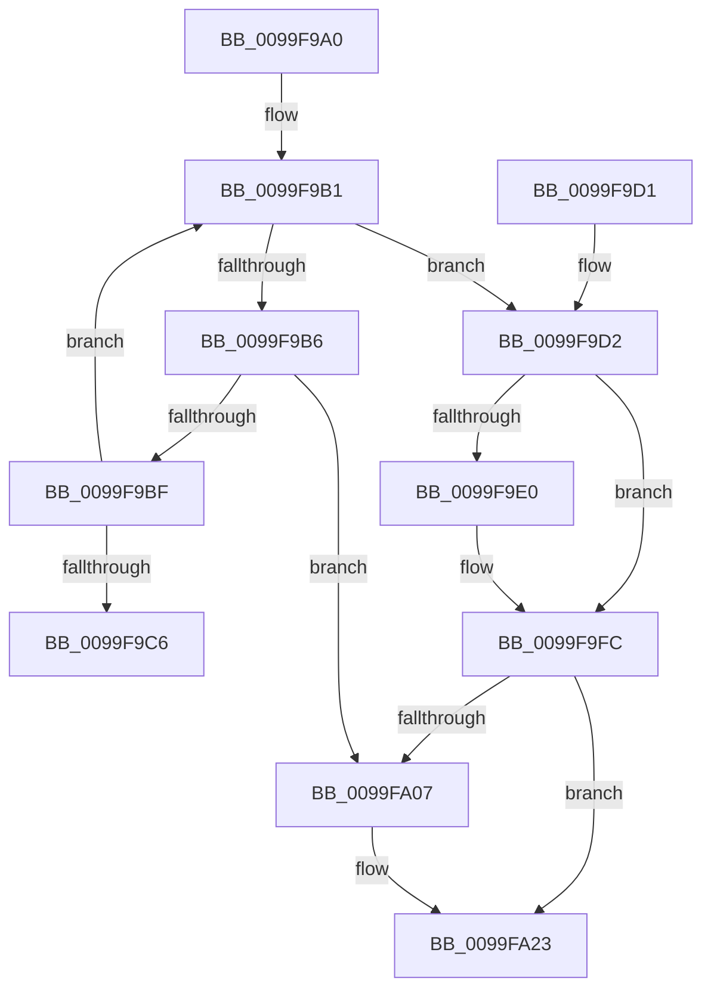

# CmpReferenceKeyControlBlockLockNotHeld

- RVA: `0x0099F9A0`–`0x0099FA2D` (길이 `141` bytes)
- VA: `0x000000014099F9A0`
- 실행 섹션: `PAGE`
- PDB 이름 있음: `예`; PDB Function 태그: `아니요`
- unwind 정보 RVA: `0x0009B210`
- 디코드: `39`개 명령, `141/141` bytes 표시
- 미해석 바이트: `0` (있으면 어셈블리에 `.byte`로 보존)

> 이 문서는 커널 이미지의 기계어와 PDB 기호를 분석해 생성했습니다. 4번과 5번은 함수 원형과 자료형을 바이너리 사용 방식에서 추정한 C 해석이며 원본 소스 복구 결과는 아닙니다.

## 1. Dependencies

- 직접 호출 지점: **3**; 고유 호출 대상: **2**
- 직접 호출자로 확인된 함수: **2**
- RIP 상대 이미지 참조: **0**

### Outgoing calls
- `0x0099F9D2` → [CmpLockKcbShared](../../pagecmrc/BC/CmpLockKcbShared_function_00BC9A1C.md) (function, `0x00BC9A1C`)
- `0x0099F9F6` → [KeBugCheckEx](../../text/4F/KeBugCheckEx_function_004FD660.md) (function, `0x004FD660`)
- `0x0099FA1D` → [KeBugCheckEx](../../text/4F/KeBugCheckEx_function_004FD660.md) (function, `0x004FD660`)

### Direct callers
- [CmpCreateKeyControlBlock](../85/CmpCreateKeyControlBlock_function_00851DB0.md) at `0x0085272F`
- [CmpWalkOneLevel](../85/CmpWalkOneLevel_function_00852BA0.md) at `0x0085333B`

### Static image references
- 디코드된 RIP-relative 메모리 참조가 없습니다.

## 2. Other-region calls and transfers

- 다른 실행 섹션으로 향하는 call: **3**
  - `0x0099F9D2` → [CmpLockKcbShared](../../pagecmrc/BC/CmpLockKcbShared_function_00BC9A1C.md) (`PAGE` → `PAGECMRC`)
  - `0x0099F9F6` → [KeBugCheckEx](../../text/4F/KeBugCheckEx_function_004FD660.md) (`PAGE` → `.text`)
  - `0x0099FA1D` → [KeBugCheckEx](../../text/4F/KeBugCheckEx_function_004FD660.md) (`PAGE` → `.text`)
- call이 아닌 외부 분기/꼬리 이동: **1**
  - `0x0099FA27` → [sub_0099FAAF + 0x54](Unknown_function_0099FAAF.md) (`tail-transfer`)

## 3. Assembly (complete function range)

```asm
0099F9A0  40 53                           push rbx
0099F9A2  48 83 EC 30                     sub rsp, 0x30
0099F9A6  48 8B 01                        mov rax, qword ptr [rcx]
0099F9A9  48 8B D9                        mov rbx, rcx
0099F9AC  48 89 6C 24 48                  mov qword ptr [rsp + 0x48], rbp
0099F9B1  48 85 C0                        test rax, rax
0099F9B4  74 1C                           je 0x14099f9d2
0099F9B6  48 8D 50 01                     lea rdx, [rax + 1]
0099F9BA  48 85 D2                        test rdx, rdx
0099F9BD  74 48                           je 0x14099fa07
0099F9BF  F0 48 0F B1 11                  lock cmpxchg qword ptr [rcx], rdx
0099F9C4  75 EB                           jne 0x14099f9b1
0099F9C6  48 8B 6C 24 48                  mov rbp, qword ptr [rsp + 0x48]
0099F9CB  48 83 C4 30                     add rsp, 0x30
0099F9CF  5B                              pop rbx
0099F9D0  C3                              ret
0099F9D1  CC                              int3
0099F9D2  E8 45 A0 22 00                  call 0x140bc9a1c
0099F9D7  F7 43 08 00 00 08 00            test dword ptr [rbx + 8], 0x80000
0099F9DE  74 1C                           je 0x14099f9fc
0099F9E0  45 33 C9                        xor r9d, r9d
0099F9E3  48 C7 44 24 20 00 00 00 00      mov qword ptr [rsp + 0x20], 0
0099F9EC  4C 8B C3                        mov r8, rbx
0099F9EF  41 8D 51 20                     lea edx, [r9 + 0x20]
0099F9F3  8D 4A 31                        lea ecx, [rdx + 0x31]
0099F9F6  E8 65 DC B5 FF                  call 0x1404fd660
0099F9FB  CC                              int3
0099F9FC  BD 01 00 00 00                  mov ebp, 1
0099FA01  F0 48 FF 03                     lock inc qword ptr [rbx]
0099FA05  75 1C                           jne 0x14099fa23
0099FA07  45 33 C9                        xor r9d, r9d
0099FA0A  48 C7 44 24 20 00 00 00 00      mov qword ptr [rsp + 0x20], 0
0099FA13  4C 8B C3                        mov r8, rbx
0099FA16  41 8D 51 24                     lea edx, [r9 + 0x24]
0099FA1A  8D 4A 2D                        lea ecx, [rdx + 0x2d]
0099FA1D  E8 3E DC B5 FF                  call 0x1404fd660
0099FA22  CC                              int3
0099FA23  F6 43 40 02                     test byte ptr [rbx + 0x40], 2
0099FA27  0F 84 D6 00 00 00               je 0x14099fb03
```

## 4. C-style interpretation (structured pseudocode)

```c
__int64 __fastcall CmpReferenceKeyControlBlockLockNotHeld(__int64 a1, __int64 a2, __int64 a3, int a4)
{
    __int64 result;
    __int64 v_rsp;
    unsigned __int64 v_stack_p10;
    unsigned __int64 v_stack_p20;

    v_rsp = (v_rsp) - (48);
    v_stack_p10 = v_rbp;
loc_0099F9B1:
    if (*(unsigned __int64 *)(a1) == 0) goto loc_0099F9D2;
    if (*(unsigned __int64 *)(a1) + 1 == 0) goto loc_0099FA07;
    if (*(unsigned __int64 *)(a1) + 1 != 0) goto loc_0099F9B1;
    v_rsp = (v_rsp) + (48);
    return *(unsigned __int64 *)(a1);
loc_0099F9D2:
    result = CmpLockKcbShared(a1, *(unsigned __int64 *)(a1) + 1, a3, a4);
    if (((*(unsigned int *)(a1 + 8)) & (0x80000ULL)) != 0) {
        a4 = 0;
        v_stack_p20 = 0;
        a3 = a1;
        a2 = a4 + 32;
        a1 = a2 + 49;
        result = KeBugCheckEx(a1, a2, a3, a4);
    }
    if (!(condition_is_not_equal)) {
        a4 = 0;
        v_stack_p20 = 0;
        a3 = a1;
        a2 = a4 + 36;
        a1 = a2 + 45;
        result = KeBugCheckEx(a1, a2, a3, a4);
    }
}
```

## 5. (Beta) C Style

```c
int64_t CmpReferenceKeyControlBlockLockNotHeld(void *Arg1, int64_t Arg2, int64_t Arg3, int32_t Arg4)
{
    uint8_t *arg1 = (uint8_t *)Arg1;

    int64_t result;
    int64_t local_rsp;
    uint64_t v_stack_p10;
    uint64_t v_stack_p20;

    local_rsp = (local_rsp) - (48);
    v_stack_p10 = local_rbp;
loc_0099F9B1:
    if (*(uint64_t *)(arg1) == 0) goto loc_0099F9D2;
    if (*(uint64_t *)(arg1) + 1 == 0) goto loc_0099FA07;
    if (*(uint64_t *)(arg1) + 1 != 0) goto loc_0099F9B1;
    local_rsp = (local_rsp) + (48);
    return *(uint64_t *)(arg1);
loc_0099F9D2:
    result = CmpLockKcbShared(Arg1, *(uint64_t *)(arg1) + 1, Arg3, Arg4);
    if (((*(uint32_t *)(arg1 + 0x8)) & (0x80000ULL)) != 0) {
        Arg4 = 0;
        v_stack_p20 = 0;
        Arg3 = Arg1;
        Arg2 = Arg4 + 32;
        Arg1 = Arg2 + 49;
        result = KeBugCheckEx(Arg1, Arg2, Arg3, Arg4);
    }
    if (!(condition_is_not_equal)) {
        Arg4 = 0;
        v_stack_p20 = 0;
        Arg3 = Arg1;
        Arg2 = Arg4 + 36;
        Arg1 = Arg2 + 45;
        result = KeBugCheckEx(Arg1, Arg2, Arg3, Arg4);
    }
}
```

### 관측된 메모리 오프셋

구조체 형식이 확인되지 않은 접근은 인자 기준의 오프셋으로만 기록했습니다.

| 기준 인자 | 오프셋 표현 | 폭 (bit) | 접근 |
|---|---:|---:|---|
| `Arg1` | `+ 0x0` | `64` | `R` |
| `Arg1` | `+ 0x0` | `64` | `R/W` |
| `Arg1` | `+ 0x8` | `32` | `R` |
| `Arg1` | `+ 0x40` | `8` | `R` |

## 6. Execution-region graph

[열기: 2D/3D 그래프와 함수 탐색 컨트롤 패널](../../../control-panel.html?section=page&rva=0x0099F9A0&view=graph)

- 2D 그래프는 위에서 아래로 흐르고, 3D 그래프는 빈 공간을 드래그해 회전합니다. Shift+드래그는 이동, 휠은 확대·축소, 함수 노드 선택은 대상 보고서 이동입니다.

### Static fallback


