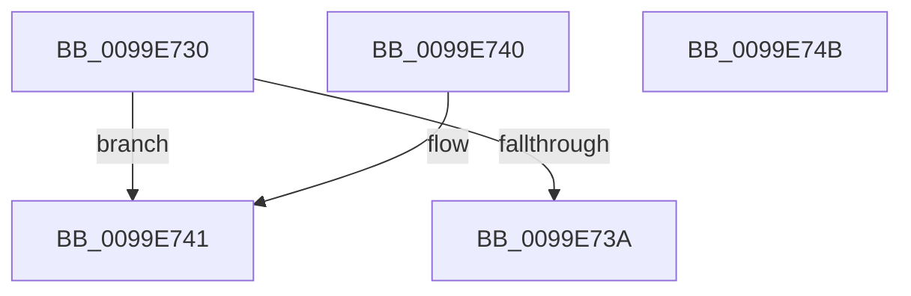

# CmpSetKcbAtLayerHeight

- RVA: `0x0099E730`–`0x0099E74C` (길이 `28` bytes)
- VA: `0x000000014099E730`
- 실행 섹션: `PAGE`
- PDB 이름 있음: `예`; PDB Function 태그: `아니요`
- unwind 정보 RVA: `0x000DB714`
- 디코드: `10`개 명령, `28/28` bytes 표시
- 미해석 바이트: `0` (있으면 어셈블리에 `.byte`로 보존)

> 이 문서는 커널 이미지의 기계어와 PDB 기호를 분석해 생성했습니다. 4번과 5번은 함수 원형과 자료형을 바이너리 사용 방식에서 추정한 C 해석이며 원본 소스 복구 결과는 아닙니다.

## 1. Dependencies

- 직접 호출 지점: **0**; 고유 호출 대상: **0**
- 직접 호출자로 확인된 함수: **1**
- RIP 상대 이미지 참조: **0**

### Outgoing calls
- 직접 디코드된 call 명령이 없습니다.

### Direct callers
- [CmpDoParseKey](../85/CmpDoParseKey_function_0085F750.md) at `0x00860E78`

### Static image references
- 디코드된 RIP-relative 메모리 참조가 없습니다.

## 2. Other-region calls and transfers

- 다른 실행 섹션으로 향하는 call: **0**
- 별도 외부 분기/꼬리 이동을 확인하지 못했습니다.

## 3. Assembly (complete function range)

```asm
0099E730  48 0F BF C2                     movsx rax, dx
0099E734  66 83 FA 02                     cmp dx, 2
0099E738  7D 07                           jge 0x14099e741
0099E73A  4C 89 44 C1 08                  mov qword ptr [rcx + rax*8 + 8], r8
0099E73F  C3                              ret
0099E740  CC                              int3
0099E741  48 8B 49 18                     mov rcx, qword ptr [rcx + 0x18]
0099E745  4C 89 44 C1 F0                  mov qword ptr [rcx + rax*8 - 0x10], r8
0099E74A  C3                              ret
0099E74B  CC                              int3
```

## 4. C-style interpretation (structured pseudocode)

```c
__int64 __fastcall CmpSetKcbAtLayerHeight(__int64 a1, unsigned __int16 a2, __int64 a3)
{
    if (a2 >= 2) goto loc_0099E741;
    *(unsigned __int64 *)(a1 + (__int16)(a2) * 8 + 8) = a3;
    return (__int16)(a2);
loc_0099E741:
    *(unsigned __int64 *)(*(unsigned __int64 *)(a1 + 24) + (__int16)(a2) * 8 - 16) = a3;
    return (__int16)(a2);
}
```

## 5. (Beta) C Style

```c
int64_t CmpSetKcbAtLayerHeight(void *Arg1, uint16_t Arg2, int64_t Arg3)
{
    uint8_t *arg1 = (uint8_t *)Arg1;

    if (Arg2 >= 2) goto loc_0099E741;
    *(uint64_t *)(arg1 + (int16_t)(Arg2) * 8 + 0x8) = Arg3;
    return (int16_t)(Arg2);
loc_0099E741:
    *(uint64_t *)(*(uint64_t *)(arg1 + 0x18) + (int16_t)(Arg2) * 8 - 0x10) = Arg3;
    return (int16_t)(Arg2);
}
```

### 관측된 메모리 오프셋

구조체 형식이 확인되지 않은 접근은 인자 기준의 오프셋으로만 기록했습니다.

| 기준 인자 | 오프셋 표현 | 폭 (bit) | 접근 |
|---|---:|---:|---|
| `Arg1` | `+ 0x8 + rax*8` | `64` | `W` |
| `Arg1` | `+ 0x18` | `64` | `R` |

## 6. Execution-region graph

[열기: 2D/3D 그래프와 함수 탐색 컨트롤 패널](../../../control-panel.html?section=page&rva=0x0099E730&view=graph)

- 2D 그래프는 위에서 아래로 흐르고, 3D 그래프는 빈 공간을 드래그해 회전합니다. Shift+드래그는 이동, 휠은 확대·축소, 함수 노드 선택은 대상 보고서 이동입니다.

### Static fallback


