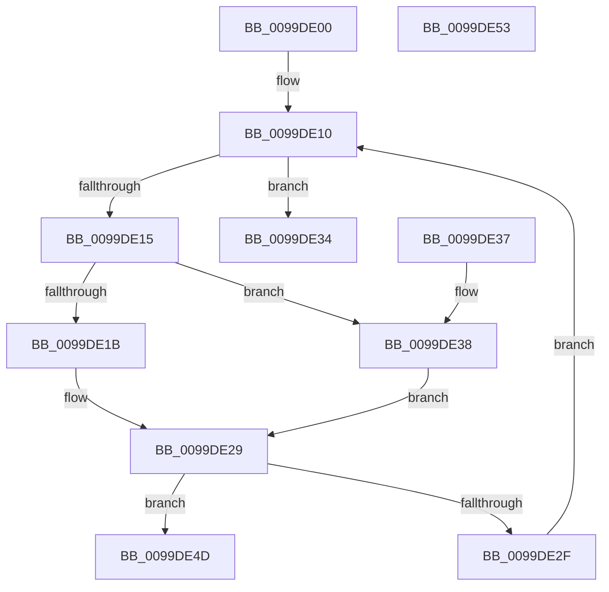

# CmpValidateComponents

- RVA: `0x0099DE00`–`0x0099DE54` (길이 `84` bytes)
- VA: `0x000000014099DE00`
- 실행 섹션: `PAGE`
- PDB 이름 있음: `예`; PDB Function 태그: `아니요`
- unwind 정보 RVA: `0x000DB714`
- 디코드: `26`개 명령, `84/84` bytes 표시
- 미해석 바이트: `0` (있으면 어셈블리에 `.byte`로 보존)

> 이 문서는 커널 이미지의 기계어와 PDB 기호를 분석해 생성했습니다. 4번과 5번은 함수 원형과 자료형을 바이너리 사용 방식에서 추정한 C 해석이며 원본 소스 복구 결과는 아닙니다.

## 1. Dependencies

- 직접 호출 지점: **0**; 고유 호출 대상: **0**
- 직접 호출자로 확인된 함수: **1**
- RIP 상대 이미지 참조: **0**

### Outgoing calls
- 직접 디코드된 call 명령이 없습니다.

### Direct callers
- [sub_00857A33](../85/Unknown_function_00857A33.md) at `0x00857A85`

### Static image references
- 디코드된 RIP-relative 메모리 참조가 없습니다.

## 2. Other-region calls and transfers

- 다른 실행 섹션으로 향하는 call: **0**
- 별도 외부 분기/꼬리 이동을 확인하지 못했습니다.

## 3. Assembly (complete function range)

```asm
0099DE00  45 33 C0                        xor r8d, r8d
0099DE03  41 B9 00 02 00 00               mov r9d, 0x200
0099DE09  0F 1F 80 00 00 00 00            nop dword ptr [rax]
0099DE10  44 3B C1                        cmp r8d, ecx
0099DE13  73 1F                           jae 0x14099de34
0099DE15  41 83 F8 08                     cmp r8d, 8
0099DE19  73 1D                           jae 0x14099de38
0099DE1B  41 8B C0                        mov eax, r8d
0099DE1E  48 83 C0 02                     add rax, 2
0099DE22  48 C1 E0 04                     shl rax, 4
0099DE26  48 03 C2                        add rax, rdx
0099DE29  66 44 39 08                     cmp word ptr [rax], r9w
0099DE2D  77 1E                           ja 0x14099de4d
0099DE2F  41 FF C0                        inc r8d
0099DE32  EB DC                           jmp 0x14099de10
0099DE34  33 C0                           xor eax, eax
0099DE36  C3                              ret
0099DE37  CC                              int3
0099DE38  41 8D 40 F8                     lea eax, [r8 - 8]
0099DE3C  48 83 C0 06                     add rax, 6
0099DE40  48 C1 E0 04                     shl rax, 4
0099DE44  48 03 82 A0 00 00 00            add rax, qword ptr [rdx + 0xa0]
0099DE4B  EB DC                           jmp 0x14099de29
0099DE4D  B8 0D 00 00 C0                  mov eax, 0xc000000d
0099DE52  C3                              ret
0099DE53  CC                              int3
```

## 4. C-style interpretation (structured pseudocode)

```c
__int64 __fastcall CmpValidateComponents(int a1, __int64 a2, int a3)
{
    __int64 result;

    a3 = 0;
loc_0099DE10:
    if (0 >= a1) goto loc_0099DE34;
    if (0 >= 8) goto loc_0099DE38;
    result = (0) + (2);
    result = (result) << (4);
    result = (result) + (a2);
loc_0099DE29:
    if ((*(unsigned __int16 *)(result)) > 512) goto loc_0099DE4D;
    a3 = (unsigned int)((a3) + 1);
    goto loc_0099DE10;
loc_0099DE34:
    result = 0;
    return result;
loc_0099DE38:
    result = (a3 - 8) + (6);
    result = (result) << (4);
    result = (result) + (*(unsigned __int64 *)(a2 + 160));
    goto loc_0099DE29;
loc_0099DE4D:
    return (unsigned int)(0xC000000DULL);
}
```

## 5. (Beta) C Style

```c
int64_t CmpValidateComponents(int32_t Arg1, void *Arg2, int32_t Arg3)
{
    uint8_t *arg2 = (uint8_t *)Arg2;

    int64_t result;

    Arg3 = 0;
loc_0099DE10:
    if (0 >= Arg1) goto loc_0099DE34;
    if (0 >= 8) goto loc_0099DE38;
    result = (0) + (2);
    result = (result) << (4);
    result = (result) + (Arg2);
loc_0099DE29:
    if ((*(uint16_t *)(result)) > 512) goto loc_0099DE4D;
    Arg3 = (uint32_t)((Arg3) + 1);
    goto loc_0099DE10;
loc_0099DE34:
    result = 0;
    return result;
loc_0099DE38:
    result = (Arg3 - 8) + (6);
    result = (result) << (4);
    result = (result) + (*(uint64_t *)(arg2 + 0xA0));
    goto loc_0099DE29;
loc_0099DE4D:
    return (uint32_t)(0xC000000DULL);
}
```

### 관측된 메모리 오프셋

구조체 형식이 확인되지 않은 접근은 인자 기준의 오프셋으로만 기록했습니다.

| 기준 인자 | 오프셋 표현 | 폭 (bit) | 접근 |
|---|---:|---:|---|
| `Arg2` | `+ 0xA0` | `64` | `R` |

## 6. Execution-region graph

[열기: 2D/3D 그래프와 함수 탐색 컨트롤 패널](../../../control-panel.html?section=page&rva=0x0099DE00&view=graph)

- 2D 그래프는 위에서 아래로 흐르고, 3D 그래프는 빈 공간을 드래그해 회전합니다. Shift+드래그는 이동, 휠은 확대·축소, 함수 노드 선택은 대상 보고서 이동입니다.

### Static fallback


