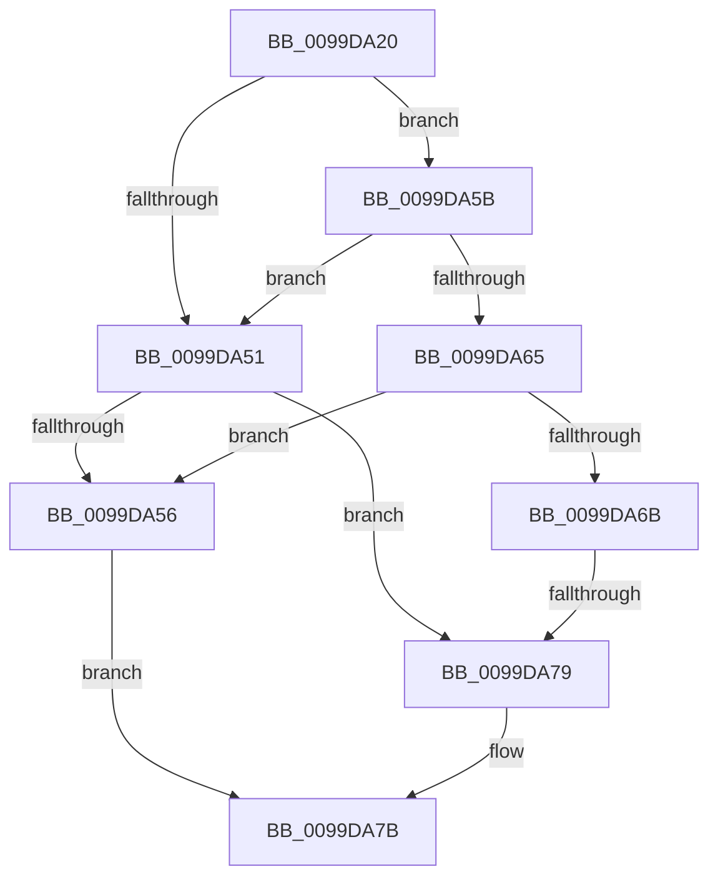

# CompareUnicodeStrings

- RVA: `0x0099DA20`–`0x0099DA7E` (길이 `94` bytes)
- VA: `0x000000014099DA20`
- 실행 섹션: `PAGE`
- PDB 이름 있음: `예`; PDB Function 태그: `아니요`
- unwind 정보 RVA: `0x00099C24`
- 디코드: `30`개 명령, `94/94` bytes 표시
- 미해석 바이트: `0` (있으면 어셈블리에 `.byte`로 보존)

> 이 문서는 커널 이미지의 기계어와 PDB 기호를 분석해 생성했습니다. 4번과 5번은 함수 원형과 자료형을 바이너리 사용 방식에서 추정한 C 해석이며 원본 소스 복구 결과는 아닙니다.

## 1. Dependencies

- 직접 호출 지점: **1**; 고유 호출 대상: **1**
- 직접 호출자로 확인된 함수: **2**
- RIP 상대 이미지 참조: **0**

### Outgoing calls
- `0x0099DA33` → [PsGetCurrentServerSiloGlobals](../../text/2F/PsGetCurrentServerSiloGlobals_function_002FE1F0.md) (function, `0x002FE1F0`)

### Direct callers
- [RtlInsertUnicodePrefix](RtlInsertUnicodePrefix_function_0099D590.md) at `0x0099D5F8`
- [RtlInsertUnicodePrefix](RtlInsertUnicodePrefix_function_0099D590.md) at `0x0099D6B5`
- [RtlFindUnicodePrefix](RtlFindUnicodePrefix_function_0099D710.md) at `0x0099D976`

### Static image references
- 디코드된 RIP-relative 메모리 참조가 없습니다.

## 2. Other-region calls and transfers

- 다른 실행 섹션으로 향하는 call: **1**
  - `0x0099DA33` → [PsGetCurrentServerSiloGlobals](../../text/2F/PsGetCurrentServerSiloGlobals_function_002FE1F0.md) (`PAGE` → `.text`)
- call이 아닌 외부 분기/꼬리 이동: **1**
  - `0x0099DA73` → [sub_0099DC45](Unknown_function_0099DC45.md) (`tail-transfer`)

## 3. Assembly (complete function range)

```asm
0099DA20  40 55                           push rbp
0099DA22  57                              push rdi
0099DA23  41 55                           push r13
0099DA25  41 56                           push r14
0099DA27  41 57                           push r15
0099DA29  48 83 EC 20                     sub rsp, 0x20
0099DA2D  4C 8B EA                        mov r13, rdx
0099DA30  4C 8B D9                        mov r11, rcx
0099DA33  E8 B8 07 96 FF                  call 0x1402fe1f0
0099DA38  41 0F B7 2B                     movzx ebp, word ptr [r11]
0099DA3C  44 0F B7 32                     movzx r14d, word ptr [rdx]
0099DA40  D1 ED                           shr ebp, 1
0099DA42  4C 8B B8 B0 04 00 00            mov r15, qword ptr [rax + 0x4b0]
0099DA49  41 D1 EE                        shr r14d, 1
0099DA4C  83 FD 01                        cmp ebp, 1
0099DA4F  74 0A                           je 0x14099da5b
0099DA51  41 3B EE                        cmp ebp, r14d
0099DA54  72 23                           jb 0x14099da79
0099DA56  41 8B FE                        mov edi, r14d
0099DA59  EB 20                           jmp 0x14099da7b
0099DA5B  49 8B 43 08                     mov rax, qword ptr [r11 + 8]
0099DA5F  66 83 38 5C                     cmp word ptr [rax], 0x5c
0099DA63  75 EC                           jne 0x14099da51
0099DA65  41 83 FE 01                     cmp r14d, 1
0099DA69  76 EB                           jbe 0x14099da56
0099DA6B  48 8B 42 08                     mov rax, qword ptr [rdx + 8]
0099DA6F  66 83 38 5C                     cmp word ptr [rax], 0x5c
0099DA73  0F 84 CC 01 00 00               je 0x14099dc45
0099DA79  8B FD                           mov edi, ebp
0099DA7B  44 3B C7                        cmp r8d, edi
```

## 4. C-style interpretation (structured pseudocode)

```c
__int64 __fastcall CompareUnicodeStrings(__int64 a1, __int64 a2, int a3)
{
    __int64 result;
    __int64 v_r14;
    __int64 v_rbp;
    __int64 v_rsp;

    v_rsp = (v_rsp) - (32);
    result = PsGetCurrentServerSiloGlobals(a1, a2, a3, a4);
    v_rbp = (unsigned int)((*(unsigned __int16 *)(a1)) >> (1));
    v_r14 = (unsigned int)((*(unsigned __int16 *)(a2)) >> (1));
    if (((unsigned int)(v_rbp)) == 1) goto loc_0099DA5B;
loc_0099DA51:
    if (((unsigned int)(v_rbp)) < ((unsigned int)(v_r14))) goto loc_0099DA79;
loc_0099DA56:
    goto loc_0099DA7B;
loc_0099DA5B:
    if ((*(unsigned __int16 *)(*(unsigned __int64 *)(a1 + 8))) != 92) goto loc_0099DA51;
    if (((unsigned int)(v_r14)) <= 1) goto loc_0099DA56;
loc_0099DA79:
loc_0099DA7B:
    return *(unsigned __int64 *)(a2 + 8);
}
```

## 5. (Beta) C Style

```c
int64_t CompareUnicodeStrings(int64_t Arg1, int64_t Arg2, int32_t Arg3)
{
    int64_t result;
    int64_t local_r14;
    int64_t local_rbp;
    int64_t local_rsp;

    local_rsp = (local_rsp) - (32);
    result = PsGetCurrentServerSiloGlobals(Arg1, Arg2, Arg3, a4);
    local_rbp = (uint32_t)((*(uint16_t *)(Arg1)) >> (1));
    local_r14 = (uint32_t)((*(uint16_t *)(Arg2)) >> (1));
    if (((uint32_t)(local_rbp)) == 1) goto loc_0099DA5B;
loc_0099DA51:
    if (((uint32_t)(local_rbp)) < ((uint32_t)(local_r14))) goto loc_0099DA79;
loc_0099DA56:
    goto loc_0099DA7B;
loc_0099DA5B:
    if ((*(uint16_t *)(*(uint64_t *)(Arg1 + 0x8))) != 92) goto loc_0099DA51;
    if (((uint32_t)(local_r14)) <= 1) goto loc_0099DA56;
loc_0099DA79:
loc_0099DA7B:
    return *(uint64_t *)(Arg2 + 0x8);
}
```

## 6. Execution-region graph

[열기: 2D/3D 그래프와 함수 탐색 컨트롤 패널](../../../control-panel.html?section=page&rva=0x0099DA20&view=graph)

- 2D 그래프는 위에서 아래로 흐르고, 3D 그래프는 빈 공간을 드래그해 회전합니다. Shift+드래그는 이동, 휠은 확대·축소, 함수 노드 선택은 대상 보고서 이동입니다.

### Static fallback


