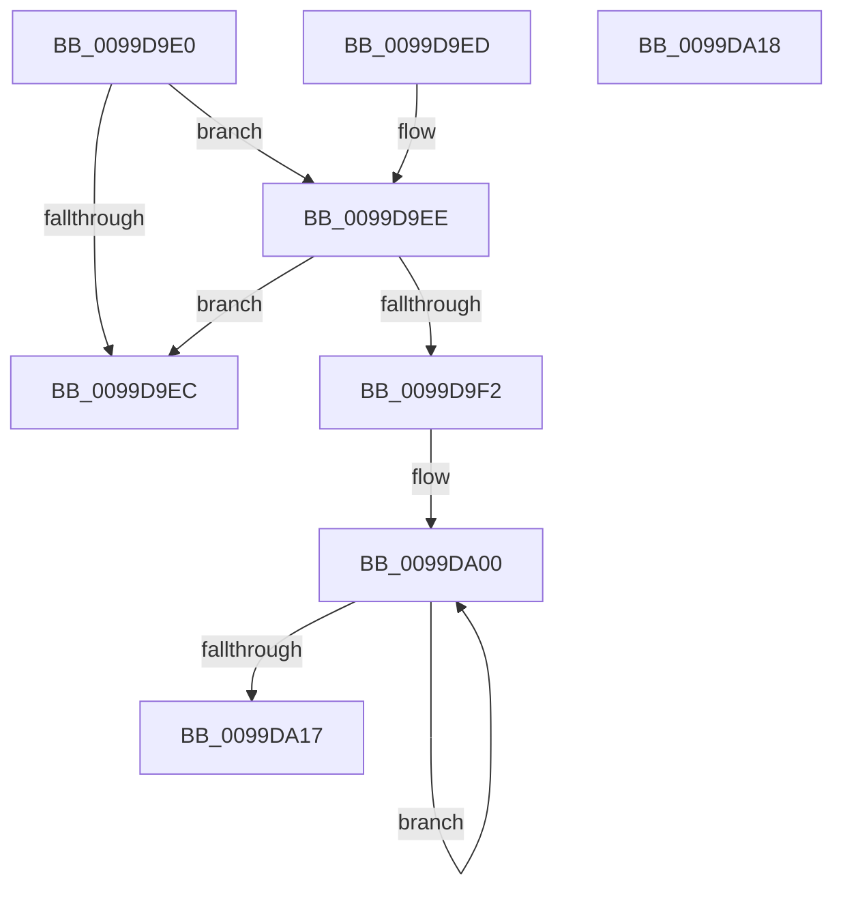

# ComputeUnicodeNameLength

- RVA: `0x0099D9E0`–`0x0099DA19` (길이 `57` bytes)
- VA: `0x000000014099D9E0`
- 실행 섹션: `PAGE`
- PDB 이름 있음: `예`; PDB Function 태그: `아니요`
- unwind 정보 RVA: `0x000DB714`
- 디코드: `20`개 명령, `57/57` bytes 표시
- 미해석 바이트: `0` (있으면 어셈블리에 `.byte`로 보존)

> 이 문서는 커널 이미지의 기계어와 PDB 기호를 분석해 생성했습니다. 4번과 5번은 함수 원형과 자료형을 바이너리 사용 방식에서 추정한 C 해석이며 원본 소스 복구 결과는 아닙니다.

## 1. Dependencies

- 직접 호출 지점: **0**; 고유 호출 대상: **0**
- 직접 호출자로 확인된 함수: **2**
- RIP 상대 이미지 참조: **0**

### Outgoing calls
- 직접 디코드된 call 명령이 없습니다.

### Direct callers
- [RtlInsertUnicodePrefix](RtlInsertUnicodePrefix_function_0099D590.md) at `0x0099D5B9`
- [RtlFindUnicodePrefix](RtlFindUnicodePrefix_function_0099D710.md) at `0x0099D738`

### Static image references
- 디코드된 RIP-relative 메모리 참조가 없습니다.

## 2. Other-region calls and transfers

- 다른 실행 섹션으로 향하는 call: **0**
- 별도 외부 분기/꼬리 이동을 확인하지 못했습니다.

## 3. Assembly (complete function range)

```asm
0099D9E0  0F B7 11                        movzx edx, word ptr [rcx]
0099D9E3  B8 01 00 00 00                  mov eax, 1
0099D9E8  D1 EA                           shr edx, 1
0099D9EA  75 02                           jne 0x14099d9ee
0099D9EC  C3                              ret
0099D9ED  CC                              int3
0099D9EE  2B D0                           sub edx, eax
0099D9F0  74 FA                           je 0x14099d9ec
0099D9F2  4C 8B 41 08                     mov r8, qword ptr [rcx + 8]
0099D9F6  44 8B CA                        mov r9d, edx
0099D9F9  0F 1F 80 00 00 00 00            nop dword ptr [rax]
0099DA00  66 41 83 38 5C                  cmp word ptr [r8], 0x5c
0099DA05  8D 50 01                        lea edx, [rax + 1]
0099DA08  4D 8D 40 02                     lea r8, [r8 + 2]
0099DA0C  0F 45 D0                        cmovne edx, eax
0099DA0F  8B C2                           mov eax, edx
0099DA11  49 83 E9 01                     sub r9, 1
0099DA15  75 E9                           jne 0x14099da00
0099DA17  C3                              ret
0099DA18  CC                              int3
```

## 4. C-style interpretation (structured pseudocode)

```c
__int64 __fastcall ComputeUnicodeNameLength(__int64 a1)
{
    a2 = (unsigned int)((*(unsigned __int16 *)(a1)) >> (1));
    if (condition_is_not_equal) goto loc_0099D9EE;
loc_0099D9EC:
    return 1;
loc_0099D9EE:
    a2 = (unsigned int)((a2) - (1));
    if (condition_is_equal) goto loc_0099D9EC;
loc_0099DA00:
    a2 = 1 + 1;
    if ((*(unsigned __int16 *)(*(unsigned __int64 *)(a1 + 8))) != 92) { a2 = 1; }
    a4 = ((unsigned int)((unsigned int)(a2))) - (1);
    if (condition_is_not_equal) goto loc_0099DA00;
    return (unsigned int)((unsigned int)(a2));
}
```

## 5. (Beta) C Style

```c
int64_t ComputeUnicodeNameLength(void *Arg1)
{
    uint8_t *arg1 = (uint8_t *)Arg1;

    a2 = (uint32_t)((*(uint16_t *)(arg1)) >> (1));
    if (condition_is_not_equal) goto loc_0099D9EE;
loc_0099D9EC:
    return 1;
loc_0099D9EE:
    a2 = (uint32_t)((a2) - (1));
    if (condition_is_equal) goto loc_0099D9EC;
loc_0099DA00:
    a2 = 1 + 1;
    if ((*(uint16_t *)(*(uint64_t *)(arg1 + 0x8))) != 92) { a2 = 1; }
    a4 = ((uint32_t)((uint32_t)(a2))) - (1);
    if (condition_is_not_equal) goto loc_0099DA00;
    return (uint32_t)((uint32_t)(a2));
}
```

### 관측된 메모리 오프셋

구조체 형식이 확인되지 않은 접근은 인자 기준의 오프셋으로만 기록했습니다.

| 기준 인자 | 오프셋 표현 | 폭 (bit) | 접근 |
|---|---:|---:|---|
| `Arg1` | `+ 0x0` | `16` | `R` |
| `Arg1` | `+ 0x8` | `64` | `R` |

## 6. Execution-region graph

[열기: 2D/3D 그래프와 함수 탐색 컨트롤 패널](../../../control-panel.html?section=page&rva=0x0099D9E0&view=graph)

- 2D 그래프는 위에서 아래로 흐르고, 3D 그래프는 빈 공간을 드래그해 회전합니다. Shift+드래그는 이동, 휠은 확대·축소, 함수 노드 선택은 대상 보고서 이동입니다.

### Static fallback


