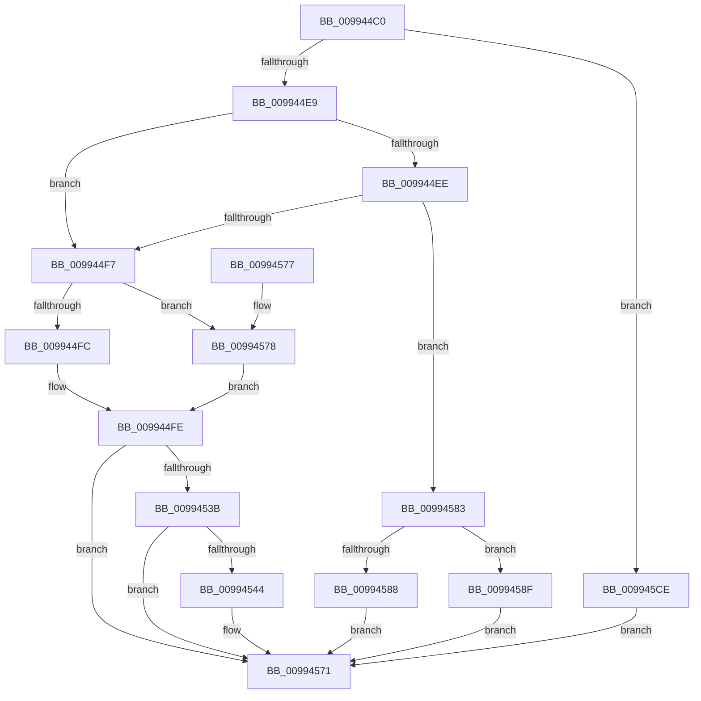

# DrvDbBuildDeviceIdDriverInfMatch

- RVA: `0x009944C0`–`0x009945F6` (길이 `310` bytes)
- VA: `0x00000001409944C0`
- 실행 섹션: `PAGE`
- PDB 이름 있음: `예`; PDB Function 태그: `아니요`
- unwind 정보 RVA: `0x00099028`
- 디코드: `75`개 명령, `310/310` bytes 표시
- 미해석 바이트: `0` (있으면 어셈블리에 `.byte`로 보존)

> 이 문서는 커널 이미지의 기계어와 PDB 기호를 분석해 생성했습니다. 4번과 5번은 함수 원형과 자료형을 바이너리 사용 방식에서 추정한 C 해석이며 원본 소스 복구 결과는 아닙니다.

## 1. Dependencies

- 직접 호출 지점: **4**; 고유 호출 대상: **2**
- 직접 호출자로 확인된 함수: **1**
- RIP 상대 이미지 참조: **4**

### Outgoing calls
- `0x00994532` → [RtlStringCchPrintfExW](../../text/42/RtlStringCchPrintfExW_function_0042B390.md) (function, `0x0042B390`)
- `0x0099456C` → [RtlStringCchPrintfExW](../../text/42/RtlStringCchPrintfExW_function_0042B390.md) (function, `0x0042B390`)
- `0x009945C7` → [RtlStringCchPrintfExW](../../text/42/RtlStringCchPrintfExW_function_0042B390.md) (function, `0x0042B390`)
- `0x009945EC` → [RtlStringCchCopyExW](../../text/41/RtlStringCchCopyExW_function_0041E1C0.md) (function, `0x0041E1C0`)

### Direct callers
- [DrvDbGetDeviceIdDriverInfMatches](DrvDbGetDeviceIdDriverInfMatches_function_00994250.md) at `0x00994380`

### Static image references
- `0x00994502` → RVA `0x00AFCAD0` (` ?? ::NNGAKEGL::`string'`; read)
- `0x0099450E` → RVA `0x00B0D9E0` (` ?? ::NNGAKEGL::`string'`; read)
- `0x00994549` → RVA `0x00B0D9F0` (` ?? ::NNGAKEGL::`string'`; read)
- `0x009945A6` → RVA `0x00B0DA00` (` ?? ::NNGAKEGL::`string'`; read)

## 2. Other-region calls and transfers

- 다른 실행 섹션으로 향하는 call: **4**
  - `0x00994532` → [RtlStringCchPrintfExW](../../text/42/RtlStringCchPrintfExW_function_0042B390.md) (`PAGE` → `.text`)
  - `0x0099456C` → [RtlStringCchPrintfExW](../../text/42/RtlStringCchPrintfExW_function_0042B390.md) (`PAGE` → `.text`)
  - `0x009945C7` → [RtlStringCchPrintfExW](../../text/42/RtlStringCchPrintfExW_function_0042B390.md) (`PAGE` → `.text`)
  - `0x009945EC` → [RtlStringCchCopyExW](../../text/41/RtlStringCchCopyExW_function_0041E1C0.md) (`PAGE` → `.text`)
- 별도 외부 분기/꼬리 이동을 확인하지 못했습니다.

## 3. Assembly (complete function range)

```asm
009944C0  48 89 4C 24 08                  mov qword ptr [rsp + 8], rcx
009944C5  53                              push rbx
009944C6  48 83 EC 40                     sub rsp, 0x40
009944CA  48 83 64 24 58 00               and qword ptr [rsp + 0x58], 0
009944D0  48 8B DA                        mov rbx, rdx
009944D3  0F B6 12                        movzx edx, byte ptr [rdx]
009944D6  4D 8B D0                        mov r10, r8
009944D9  48 83 64 24 50 00               and qword ptr [rsp + 0x50], 0
009944DF  8B CA                           mov ecx, edx
009944E1  85 D2                           test edx, edx
009944E3  0F 84 E5 00 00 00               je 0x1409945ce
009944E9  83 E9 01                        sub ecx, 1
009944EC  74 09                           je 0x1409944f7
009944EE  83 E9 01                        sub ecx, 1
009944F1  0F 85 8C 00 00 00               jne 0x140994583
009944F7  80 FA 01                        cmp dl, 1
009944FA  75 7C                           jne 0x140994578
009944FC  33 C0                           xor eax, eax
009944FE  89 44 24 38                     mov dword ptr [rsp + 0x38], eax
00994502  4C 8D 05 C7 85 16 00            lea r8, [rip + 0x1685c7]
00994509  4C 89 44 24 30                  mov qword ptr [rsp + 0x30], r8
0099450E  48 8D 05 CB 94 17 00            lea rax, [rip + 0x1794cb]
00994515  41 8B D1                        mov edx, r9d
00994518  4C 8D 44 24 58                  lea r8, [rsp + 0x58]
0099451D  48 89 44 24 28                  mov qword ptr [rsp + 0x28], rax
00994522  4C 8D 4C 24 50                  lea r9, [rsp + 0x50]
00994527  49 8B CA                        mov rcx, r10
0099452A  C7 44 24 20 00 08 00 00         mov dword ptr [rsp + 0x20], 0x800
00994532  E8 59 6E A9 FF                  call 0x14042b390
00994537  85 C0                           test eax, eax
00994539  78 36                           js 0x140994571
0099453B  0F B6 4B 01                     movzx ecx, byte ptr [rbx + 1]
0099453F  80 F9 FF                        cmp cl, 0xff
00994542  74 2D                           je 0x140994571
00994544  48 8B 54 24 50                  mov rdx, qword ptr [rsp + 0x50]
00994549  48 8D 05 A0 94 17 00            lea rax, [rip + 0x1794a0]
00994550  89 4C 24 30                     mov dword ptr [rsp + 0x30], ecx
00994554  45 33 C9                        xor r9d, r9d
00994557  48 8B 4C 24 58                  mov rcx, qword ptr [rsp + 0x58]
0099455C  45 33 C0                        xor r8d, r8d
0099455F  48 89 44 24 28                  mov qword ptr [rsp + 0x28], rax
00994564  C7 44 24 20 00 08 00 00         mov dword ptr [rsp + 0x20], 0x800
0099456C  E8 1F 6E A9 FF                  call 0x14042b390
00994571  48 83 C4 40                     add rsp, 0x40
00994575  5B                              pop rbx
00994576  C3                              ret
00994577  CC                              int3
00994578  0F B7 43 02                     movzx eax, word ptr [rbx + 2]
0099457C  FF C0                           inc eax
0099457E  E9 7B FF FF FF                  jmp 0x1409944fe
00994583  83 F9 01                        cmp ecx, 1
00994586  74 07                           je 0x14099458f
00994588  B8 0D 00 00 C0                  mov eax, 0xc000000d
0099458D  EB E2                           jmp 0x140994571
0099458F  0F B7 43 02                     movzx eax, word ptr [rbx + 2]
00994593  4C 8D 05 36 85 16 00            lea r8, [rip + 0x168536]
0099459A  89 44 24 38                     mov dword ptr [rsp + 0x38], eax
0099459E  49 8B CA                        mov rcx, r10
009945A1  4C 89 44 24 30                  mov qword ptr [rsp + 0x30], r8
009945A6  48 8D 05 53 94 17 00            lea rax, [rip + 0x179453]
009945AD  41 8B D1                        mov edx, r9d
009945B0  4C 8D 44 24 58                  lea r8, [rsp + 0x58]
009945B5  48 89 44 24 28                  mov qword ptr [rsp + 0x28], rax
009945BA  4C 8D 4C 24 50                  lea r9, [rsp + 0x50]
009945BF  C7 44 24 20 00 08 00 00         mov dword ptr [rsp + 0x20], 0x800
009945C7  E8 C4 6D A9 FF                  call 0x14042b390
009945CC  EB A3                           jmp 0x140994571
009945CE  41 8B D1                        mov edx, r9d
009945D1  4C 8D 05 F8 84 16 00            lea r8, [rip + 0x1684f8]
009945D8  C7 44 24 28 00 08 00 00         mov dword ptr [rsp + 0x28], 0x800
009945E0  45 33 C9                        xor r9d, r9d
009945E3  48 83 64 24 20 00               and qword ptr [rsp + 0x20], 0
009945E9  49 8B CA                        mov rcx, r10
009945EC  E8 CF 9B A8 FF                  call 0x14041e1c0
009945F1  E9 7B FF FF FF                  jmp 0x140994571
```

## 4. C-style interpretation (structured pseudocode)

```c
__int64 __fastcall DrvDbBuildDeviceIdDriverInfMatch(__int64 a1, __int64 a2, __int64 a3, int a4)
{
    __int64 result;
    __int64 v_rsp;
    unsigned int v_stack_m10;
    unsigned __int64 v_stack_m18;
    unsigned __int64 v_stack_m20;
    unsigned int v_stack_m28;
    unsigned __int64 v_stack_p10;
    unsigned int v_stack_p20;
    unsigned __int64 v_stack_p28;
    unsigned __int64 v_stack_p30;
    unsigned int v_stack_p38;
    unsigned __int64 v_stack_p50;
    unsigned __int64 v_stack_p58;
    unsigned __int64 v_stack_p8;

    v_stack_p8 = a1;
    v_rsp = (v_rsp) - (64);
    if ((unsigned int)(*(unsigned __int8 *)(a2)) == 0) goto loc_009945CE;
    a1 = (unsigned int)(((unsigned int)((unsigned int)(*(unsigned __int8 *)(a2)))) - (1));
    if (condition_is_equal) goto loc_009944F7;
    a1 = (unsigned int)((a1) - (1));
    if (condition_is_not_equal) goto loc_00994583;
loc_009944F7:
    if (((unsigned __int8)(*(unsigned __int8 *)(a2))) != 1) goto loc_00994578;
    result = 0;
loc_009944FE:
    v_stack_m10 = 0;
    v_stack_m18 = v_rip + 1476039;
    v_stack_m20 = v_rip + 1545419;
    v_stack_m28 = 0x800ULL;
    result = RtlStringCchPrintfExW(a3, (unsigned int)(a4), v_stack_p10, v_stack_p8);
    if (sign_flag) goto loc_00994571;
    if (((unsigned __int8)(*(unsigned __int8 *)(a2 + 1))) != 255) {
        a2 = v_stack_p8;
        result = v_rip + 1545376;
        v_stack_m18 = (unsigned int)(*(unsigned __int8 *)(a2 + 1));
        a4 = 0;
        a1 = v_stack_p10;
        a3 = 0;
        v_stack_m20 = result;
        v_stack_m28 = 0x800ULL;
        result = RtlStringCchPrintfExW(a1, a2, a3, a4);
    }
    v_rsp = (v_rsp) + (64);
    return result;
loc_00994578:
    result = (unsigned int)((*(unsigned __int16 *)(a2 + 2)) + 1);
    goto loc_009944FE;
loc_00994583:
    if (((unsigned int)(a1)) == 1) goto loc_0099458F;
    goto loc_00994571;
loc_0099458F:
    v_stack_p38 = (unsigned int)(*(unsigned __int16 *)(a2 + 2));
    v_stack_p30 = v_rip + 1475894;
    v_stack_p28 = v_rip + 1545299;
    v_stack_p20 = 0x800ULL;
    result = RtlStringCchPrintfExW(0, 0, v_stack_p58, v_stack_p50);
    goto loc_00994571;
loc_009945CE:
    v_stack_p28 = 0x800ULL;
    a4 = 0;
    result = RtlStringCchCopyExW(0, (unsigned int)((unsigned int)(v_stack_p50)), v_rip + 1475832, a4);
    goto loc_00994571;
}
```

## 5. (Beta) C Style

```c
int64_t DrvDbBuildDeviceIdDriverInfMatch(int64_t Arg1, void *Arg2, int64_t Arg3, int32_t Arg4)
{
    uint8_t *arg2 = (uint8_t *)Arg2;

    int64_t result;
    int64_t local_rsp;
    uint32_t v_stack_m10;
    uint64_t v_stack_m18;
    uint64_t v_stack_m20;
    uint32_t v_stack_m28;
    uint64_t v_stack_p10;
    uint32_t v_stack_p20;
    uint64_t v_stack_p28;
    uint64_t v_stack_p30;
    uint32_t v_stack_p38;
    uint64_t v_stack_p50;
    uint64_t v_stack_p58;
    uint64_t v_stack_p8;

    v_stack_p8 = Arg1;
    local_rsp = (local_rsp) - (64);
    if ((uint32_t)(*(uint8_t *)(arg2)) == 0) goto loc_009945CE;
    Arg1 = (uint32_t)(((uint32_t)((uint32_t)(*(uint8_t *)(arg2)))) - (1));
    if (condition_is_equal) goto loc_009944F7;
    Arg1 = (uint32_t)((Arg1) - (1));
    if (condition_is_not_equal) goto loc_00994583;
loc_009944F7:
    if (((uint8_t)(*(uint8_t *)(arg2))) != 1) goto loc_00994578;
    result = 0;
loc_009944FE:
    v_stack_m10 = 0;
    v_stack_m18 = v_rip + 1476039;
    v_stack_m20 = v_rip + 1545419;
    v_stack_m28 = 0x800ULL;
    result = RtlStringCchPrintfExW(Arg3, (uint32_t)(Arg4), v_stack_p10, v_stack_p8);
    if (sign_flag) goto loc_00994571;
    if (((uint8_t)(*(uint8_t *)(arg2 + 0x1))) != 255) {
        Arg2 = v_stack_p8;
        result = v_rip + 1545376;
        v_stack_m18 = (uint32_t)(*(uint8_t *)(arg2 + 0x1));
        Arg4 = 0;
        Arg1 = v_stack_p10;
        Arg3 = 0;
        v_stack_m20 = result;
        v_stack_m28 = 0x800ULL;
        result = RtlStringCchPrintfExW(Arg1, Arg2, Arg3, Arg4);
    }
    local_rsp = (local_rsp) + (64);
    return result;
loc_00994578:
    result = (uint32_t)((*(uint16_t *)(arg2 + 0x2)) + 1);
    goto loc_009944FE;
loc_00994583:
    if (((uint32_t)(Arg1)) == 1) goto loc_0099458F;
    goto loc_00994571;
loc_0099458F:
    v_stack_p38 = (uint32_t)(*(uint16_t *)(arg2 + 0x2));
    v_stack_p30 = v_rip + 1475894;
    v_stack_p28 = v_rip + 1545299;
    v_stack_p20 = 0x800ULL;
    result = RtlStringCchPrintfExW(0, 0, v_stack_p58, v_stack_p50);
    goto loc_00994571;
loc_009945CE:
    v_stack_p28 = 0x800ULL;
    Arg4 = 0;
    result = RtlStringCchCopyExW(0, (uint32_t)((uint32_t)(v_stack_p50)), v_rip + 1475832, Arg4);
    goto loc_00994571;
}
```

### 관측된 메모리 오프셋

구조체 형식이 확인되지 않은 접근은 인자 기준의 오프셋으로만 기록했습니다.

| 기준 인자 | 오프셋 표현 | 폭 (bit) | 접근 |
|---|---:|---:|---|
| `Arg2` | `+ 0x0` | `8` | `R` |
| `Arg2` | `+ 0x1` | `8` | `R` |
| `Arg2` | `+ 0x2` | `16` | `R` |

## 6. Execution-region graph

[열기: 2D/3D 그래프와 함수 탐색 컨트롤 패널](../../../control-panel.html?section=page&rva=0x009944C0&view=graph)

- 2D 그래프는 위에서 아래로 흐르고, 3D 그래프는 빈 공간을 드래그해 회전합니다. Shift+드래그는 이동, 휠은 확대·축소, 함수 노드 선택은 대상 보고서 이동입니다.

### Static fallback


