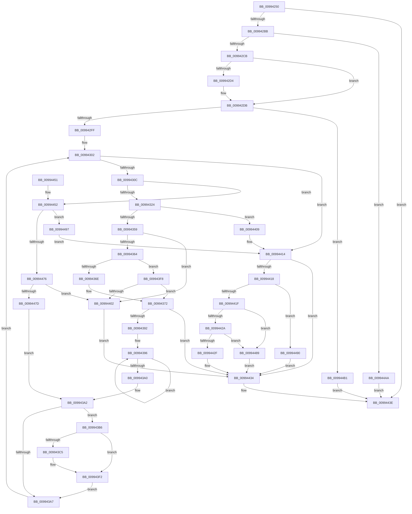

# DrvDbGetDeviceIdDriverInfMatches

- RVA: `0x00994250`–`0x009944B8` (길이 `616` bytes)
- VA: `0x0000000140994250`
- 실행 섹션: `PAGE`
- PDB 이름 있음: `예`; PDB Function 태그: `아니요`
- unwind 정보 RVA: `0x0009900C`
- 디코드: `183`개 명령, `616/616` bytes 표시
- 미해석 바이트: `0` (있으면 어셈블리에 `.byte`로 보존)

> 이 문서는 커널 이미지의 기계어와 PDB 기호를 분석해 생성했습니다. 4번과 5번은 함수 원형과 자료형을 바이너리 사용 방식에서 추정한 C 해석이며 원본 소스 복구 결과는 아닙니다.

## 1. Dependencies

- 직접 호출 지점: **7**; 고유 호출 대상: **6**
- 직접 호출자로 확인된 함수: **1**
- RIP 상대 이미지 참조: **0**

### Outgoing calls
- `0x009942AC` → [RegRtlQueryInfoKey](RegRtlQueryInfoKey_function_0099463C.md) (function, `0x0099463C`)
- `0x009942EB` → [ExAllocatePool2](../../poolcode/B8/ExAllocatePool2_function_00B820F0.md) (function, `0x00B820F0`)
- `0x00994349` → [RegRtlEnumValue](RegRtlEnumValue_function_0099369C.md) (function, `0x0099369C`)
- `0x00994380` → [DrvDbBuildDeviceIdDriverInfMatch](DrvDbBuildDeviceIdDriverInfMatch_function_009944C0.md) (function, `0x009944C0`)
- `0x009943E6` → [RtlStringCchCopyExW](../../text/41/RtlStringCchCopyExW_function_0041E1C0.md) (function, `0x0041E1C0`)
- `0x00994439` → [ExFreePoolWithTag](../../poolcode/B8/ExFreePoolWithTag_function_00B82870.md) (function, `0x00B82870`)
- `0x00994468` → [RegRtlEnumValue](RegRtlEnumValue_function_0099369C.md) (function, `0x0099369C`)

### Direct callers
- [DrvDbGetDeviceIdMappedProperty](../92/DrvDbGetDeviceIdMappedProperty_function_0092F690.md) at `0x0092F886`
- [DrvDbGetDeviceIdMappedProperty](../92/DrvDbGetDeviceIdMappedProperty_function_0092F690.md) at `0x0092F9ED`

### Static image references
- 디코드된 RIP-relative 메모리 참조가 없습니다.

## 2. Other-region calls and transfers

- 다른 실행 섹션으로 향하는 call: **3**
  - `0x009942EB` → [ExAllocatePool2](../../poolcode/B8/ExAllocatePool2_function_00B820F0.md) (`PAGE` → `POOLCODE`)
  - `0x009943E6` → [RtlStringCchCopyExW](../../text/41/RtlStringCchCopyExW_function_0041E1C0.md) (`PAGE` → `.text`)
  - `0x00994439` → [ExFreePoolWithTag](../../poolcode/B8/ExFreePoolWithTag_function_00B82870.md) (`PAGE` → `POOLCODE`)
- 별도 외부 분기/꼬리 이동을 확인하지 못했습니다.

## 3. Assembly (complete function range)

```asm
00994250  4C 8B DC                        mov r11, rsp
00994253  45 89 4B 20                     mov dword ptr [r11 + 0x20], r9d
00994257  4D 89 43 18                     mov qword ptr [r11 + 0x18], r8
0099425B  49 89 53 10                     mov qword ptr [r11 + 0x10], rdx
0099425F  49 89 4B 08                     mov qword ptr [r11 + 8], rcx
00994263  55                              push rbp
00994264  53                              push rbx
00994265  56                              push rsi
00994266  57                              push rdi
00994267  41 54                           push r12
00994269  41 55                           push r13
0099426B  41 56                           push r14
0099426D  41 57                           push r15
0099426F  48 8B EC                        mov rbp, rsp
00994272  48 83 EC 58                     sub rsp, 0x58
00994276  4C 8B 7D 68                     mov r15, qword ptr [rbp + 0x68]
0099427A  48 8D 45 48                     lea rax, [rbp + 0x48]
0099427E  33 F6                           xor esi, esi
00994280  4C 8D 4D E8                     lea r9, [rbp - 0x18]
00994284  48 8B FA                        mov rdi, rdx
00994287  49 89 73 90                     mov qword ptr [r11 - 0x70], rsi
0099428B  4D 8B E0                        mov r12, r8
0099428E  89 75 E8                        mov dword ptr [rbp - 0x18], esi
00994291  45 33 C0                        xor r8d, r8d
00994294  41 89 37                        mov dword ptr [r15], esi
00994297  33 D2                           xor edx, edx
00994299  89 75 48                        mov dword ptr [rbp + 0x48], esi
0099429C  48 8B CF                        mov rcx, rdi
0099429F  89 75 F0                        mov dword ptr [rbp - 0x10], esi
009942A2  89 75 EC                        mov dword ptr [rbp - 0x14], esi
009942A5  89 75 F4                        mov dword ptr [rbp - 0xc], esi
009942A8  49 89 43 88                     mov qword ptr [r11 - 0x78], rax
009942AC  E8 8B 03 00 00                  call 0x14099463c
009942B1  8B D8                           mov ebx, eax
009942B3  85 C0                           test eax, eax
009942B5  0F 88 83 01 00 00               js 0x14099443e
009942BB  44 8B 75 48                     mov r14d, dword ptr [rbp + 0x48]
009942BF  41 FF C6                        inc r14d
009942C2  39 75 E8                        cmp dword ptr [rbp - 0x18], esi
009942C5  0F 84 DF 01 00 00               je 0x1409944aa
009942CB  41 8B C6                        mov eax, r14d
009942CE  40 38 75 70                     cmp byte ptr [rbp + 0x70], sil
009942D2  74 07                           je 0x1409942db
009942D4  41 8D 46 10                     lea eax, [r14 + 0x10]
009942D8  44 8B F0                        mov r14d, eax
009942DB  8B D0                           mov edx, eax
009942DD  B9 00 01 00 00                  mov ecx, 0x100
009942E2  48 03 D2                        add rdx, rdx
009942E5  41 B8 50 44 44 42               mov r8d, 0x42444450
009942EB  E8 00 DE 1E 00                  call 0x140b820f0
009942F0  45 33 C0                        xor r8d, r8d
009942F3  48 8B F0                        mov rsi, rax
009942F6  48 85 C0                        test rax, rax
009942F9  0F 84 B2 01 00 00               je 0x1409944b1
009942FF  45 8B E8                        mov r13d, r8d
00994302  44 3B 6D E8                     cmp r13d, dword ptr [rbp - 0x18]
00994306  0F 83 08 01 00 00               jae 0x140994414
0099430C  4C 8D 4D 48                     lea r9, [rbp + 0x48]
00994310  44 89 75 48                     mov dword ptr [rbp + 0x48], r14d
00994314  41 8B D5                        mov edx, r13d
00994317  48 8B CF                        mov rcx, rdi
0099431A  44 38 45 70                     cmp byte ptr [rbp + 0x70], r8b
0099431E  0F 84 2E 01 00 00               je 0x140994452
00994324  48 8D 45 68                     lea rax, [rbp + 0x68]
00994328  C7 45 68 04 00 00 00            mov dword ptr [rbp + 0x68], 4
0099432F  48 89 44 24 30                  mov qword ptr [rsp + 0x30], rax
00994334  4C 8B C6                        mov r8, rsi
00994337  48 8D 45 EC                     lea rax, [rbp - 0x14]
0099433B  48 89 44 24 28                  mov qword ptr [rsp + 0x28], rax
00994340  48 8D 45 F0                     lea rax, [rbp - 0x10]
00994344  48 89 44 24 20                  mov qword ptr [rsp + 0x20], rax
00994349  E8 4E F3 FF FF                  call 0x14099369c
0099434E  45 33 C0                        xor r8d, r8d
00994351  85 C0                           test eax, eax
00994353  0F 88 B0 00 00 00               js 0x140994409
00994359  8B 45 48                        mov eax, dword ptr [rbp + 0x48]
0099435C  85 C0                           test eax, eax
0099435E  0F 84 9E 00 00 00               je 0x140994402
00994364  83 7D F0 03                     cmp dword ptr [rbp - 0x10], 3
00994368  0F 84 8A 00 00 00               je 0x1409943f8
0099436E  44 89 45 EC                     mov dword ptr [rbp - 0x14], r8d
00994372  45 8B CE                        mov r9d, r14d
00994375  4C 8D 04 46                     lea r8, [rsi + rax*2]
00994379  44 2B C8                        sub r9d, eax
0099437C  48 8D 55 EC                     lea rdx, [rbp - 0x14]
00994380  E8 3B 01 00 00                  call 0x1409944c0
00994385  45 33 C0                        xor r8d, r8d
00994388  8B D8                           mov ebx, eax
0099438A  85 C0                           test eax, eax
0099438C  0F 88 A2 00 00 00               js 0x140994434
00994392  48 83 CF FF                     or rdi, 0xffffffffffffffff
00994396  48 FF C7                        inc rdi
00994399  66 44 39 04 7E                  cmp word ptr [rsi + rdi*2], r8w
0099439E  75 F6                           jne 0x140994396
009943A0  FF C7                           inc edi
009943A2  4D 85 E4                        test r12, r12
009943A5  75 0F                           jne 0x1409943b6
009943A7  41 01 3F                        add dword ptr [r15], edi
009943AA  48 8B 7D 50                     mov rdi, qword ptr [rbp + 0x50]
009943AE  41 FF C5                        inc r13d
009943B1  E9 4C FF FF FF                  jmp 0x140994302
009943B6  8B 4D F4                        mov ecx, dword ptr [rbp - 0xc]
009943B9  8B 45 60                        mov eax, dword ptr [rbp + 0x60]
009943BC  44 8D 24 0F                     lea r12d, [rdi + rcx]
009943C0  44 3B E0                        cmp r12d, eax
009943C3  73 2D                           jae 0x1409943f2
009943C5  2B C1                           sub eax, ecx
009943C7  C7 44 24 28 00 09 00 00         mov dword ptr [rsp + 0x28], 0x900
009943CF  8B D0                           mov edx, eax
009943D1  45 33 C9                        xor r9d, r9d
009943D4  8B C1                           mov eax, ecx
009943D6  4C 89 44 24 20                  mov qword ptr [rsp + 0x20], r8
009943DB  48 8B 4D 58                     mov rcx, qword ptr [rbp + 0x58]
009943DF  4C 8B C6                        mov r8, rsi
009943E2  48 8D 0C 41                     lea rcx, [rcx + rax*2]
009943E6  E8 D5 9D A8 FF                  call 0x14041e1c0
009943EB  45 33 C0                        xor r8d, r8d
009943EE  44 89 65 F4                     mov dword ptr [rbp - 0xc], r12d
009943F2  4C 8B 65 58                     mov r12, qword ptr [rbp + 0x58]
009943F6  EB AF                           jmp 0x1409943a7
009943F8  83 7D 68 04                     cmp dword ptr [rbp + 0x68], 4
009943FC  0F 84 70 FF FF FF               je 0x140994372
00994402  BB E5 00 00 C0                  mov ebx, 0xc00000e5
00994407  EB 2B                           jmp 0x140994434
00994409  3D 1A 00 00 80                  cmp eax, 0x8000001a
0099440E  41 8B D8                        mov ebx, r8d
00994411  0F 45 D8                        cmovne ebx, eax
00994414  85 DB                           test ebx, ebx
00994416  78 1C                           js 0x140994434
00994418  41 8B 07                        mov eax, dword ptr [r15]
0099441B  85 C0                           test eax, eax
0099441D  74 71                           je 0x140994490
0099441F  8D 48 01                        lea ecx, [rax + 1]
00994422  41 89 0F                        mov dword ptr [r15], ecx
00994425  4D 85 E4                        test r12, r12
00994428  74 5F                           je 0x140994489
0099442A  3B 4D 60                        cmp ecx, dword ptr [rbp + 0x60]
0099442D  77 5A                           ja 0x140994489
0099442F  66 45 89 04 44                  mov word ptr [r12 + rax*2], r8w
00994434  33 D2                           xor edx, edx
00994436  48 8B CE                        mov rcx, rsi
00994439  E8 32 E4 1E 00                  call 0x140b82870
0099443E  8B C3                           mov eax, ebx
00994440  48 83 C4 58                     add rsp, 0x58
00994444  41 5F                           pop r15
00994446  41 5E                           pop r14
00994448  41 5D                           pop r13
0099444A  41 5C                           pop r12
0099444C  5F                              pop rdi
0099444D  5E                              pop rsi
0099444E  5B                              pop rbx
0099444F  5D                              pop rbp
00994450  C3                              ret
00994451  CC                              int3
00994452  4C 89 44 24 30                  mov qword ptr [rsp + 0x30], r8
00994457  48 8D 45 F0                     lea rax, [rbp - 0x10]
0099445B  4C 89 44 24 28                  mov qword ptr [rsp + 0x28], r8
00994460  4C 8B C6                        mov r8, rsi
00994463  48 89 44 24 20                  mov qword ptr [rsp + 0x20], rax
00994468  E8 2F F2 FF FF                  call 0x14099369c
0099446D  45 33 C0                        xor r8d, r8d
00994470  8B D8                           mov ebx, eax
00994472  85 C0                           test eax, eax
00994474  78 21                           js 0x140994497
00994476  8B 7D 48                        mov edi, dword ptr [rbp + 0x48]
00994479  85 FF                           test edi, edi
0099447B  74 85                           je 0x140994402
0099447D  66 44 89 04 7E                  mov word ptr [rsi + rdi*2], r8w
00994482  FF C7                           inc edi
00994484  E9 19 FF FF FF                  jmp 0x1409943a2
00994489  BB 23 00 00 C0                  mov ebx, 0xc0000023
0099448E  EB A4                           jmp 0x140994434
00994490  BB 25 02 00 C0                  mov ebx, 0xc0000225
00994495  EB 9D                           jmp 0x140994434
00994497  81 FB 1A 00 00 80               cmp ebx, 0x8000001a
0099449D  41 8B C0                        mov eax, r8d
009944A0  0F 45 C3                        cmovne eax, ebx
009944A3  8B D8                           mov ebx, eax
009944A5  E9 6A FF FF FF                  jmp 0x140994414
009944AA  BB 25 02 00 C0                  mov ebx, 0xc0000225
009944AF  EB 8D                           jmp 0x14099443e
009944B1  BB 17 00 00 C0                  mov ebx, 0xc0000017
009944B6  EB 86                           jmp 0x14099443e
```

## 4. C-style interpretation (structured pseudocode)

```c
__int64 __fastcall DrvDbGetDeviceIdDriverInfMatches(__int64 a1, __int64 a2, __int64 a3, int a4, unsigned int a5, unsigned __int8 a6)
{
    __int64 result;
    __int64 v_r13;
    __int64 v_r14;
    __int64 v_rbx;
    __int64 v_rdi;
    __int64 v_rsi;
    __int64 v_rsp;
    unsigned int v_stack_m4C;
    unsigned int v_stack_m50;
    unsigned int v_stack_m54;
    unsigned __int64 v_stack_m58;
    unsigned __int64 v_stack_m68;
    unsigned __int64 v_stack_m70;
    unsigned __int64 v_stack_m78;
    unsigned __int64 v_stack_p10;
    unsigned __int64 v_stack_p18;
    unsigned int v_stack_p20;
    unsigned int v_stack_p28;
    unsigned __int64 v_stack_p30;
    unsigned __int64 v_stack_p8;

    *(unsigned int *)(v_rsp + 32) = a4;
    *(unsigned __int64 *)(v_rsp + 24) = a3;
    *(unsigned __int64 *)(v_rsp + 16) = a2;
    *(unsigned __int64 *)(v_rsp + 8) = a1;
    v_rsp = (v_rsp) - (88);
    v_rsi = 0;
    *(unsigned __int64 *)(v_rsp - 112) = 0;
    v_stack_m58 = 0;
    a3 = 0;
    *(unsigned int *)(a5) = 0;
    a2 = 0;
    v_stack_p8 = 0;
    v_stack_m50 = 0;
    v_stack_m54 = 0;
    v_stack_m4C = 0;
    *(unsigned __int64 *)(v_rsp - 120) = v_stack_p8;
    result = RegRtlQueryInfoKey(0, a2, a3, v_stack_m58);
    if (sign_flag) goto loc_0099443E;
    v_r14 = (unsigned int)(((unsigned int)(v_stack_p8)) + 1);
    if (v_stack_m58 == 0) goto loc_009944AA;
    result = (unsigned int)((unsigned int)(v_r14));
    if (a6 != 0) {
        result = v_r14 + 16;
        v_r14 = (unsigned int)(result);
    }
    a2 = ((unsigned int)((unsigned int)(result))) + ((unsigned int)((unsigned int)(result)));
    result = ExAllocatePool2(256, a2, (unsigned int)(0x42444450ULL), v_stack_m58);
    a3 = 0;
    if (result == 0) goto loc_009944B1;
loc_00994302:
    if (0 >= v_stack_m58) goto loc_00994414;
    v_stack_p8 = (unsigned int)(v_r14);
    if (a6 == 0) goto loc_00994452;
    v_stack_p28 = 4;
    v_stack_m68 = a5;
    v_stack_m70 = v_stack_m54;
    v_stack_m78 = v_stack_m50;
    result = RegRtlEnumValue(a2, 0, result, v_stack_p8);
    a3 = 0;
    if (sign_flag) goto loc_00994409;
    if ((unsigned int)((unsigned int)(v_stack_p8)) == 0) goto loc_00994402;
    if (v_stack_m50 == 3) goto loc_009943F8;
    v_stack_m54 = 0;
loc_00994372:
    a4 = (unsigned int)(((unsigned int)((unsigned int)(v_r14))) - ((unsigned int)((unsigned int)(v_stack_p8))));
    result = DrvDbBuildDeviceIdDriverInfMatch(a2, v_stack_m54, result + (unsigned int)(v_stack_p8) * 2, a4);
    a3 = 0;
    if (sign_flag) goto loc_00994434;
    v_rdi = (a2) | (-1);
loc_00994396:
    v_rdi = (v_rdi) + 1;
    if ((*(unsigned __int16 *)(result + v_rdi * 2)) != 0) goto loc_00994396;
    v_rdi = (unsigned int)((v_rdi) + 1);
loc_009943A2:
    if (0 != 0) goto loc_009943B6;
loc_009943A7:
    v_r13 = (unsigned int)((0) + 1);
    goto loc_00994302;
loc_009943B6:
    result = (unsigned int)(v_stack_p20);
    if (((unsigned int)(v_stack_p10 + (unsigned int)(v_stack_m4C) * 1)) < ((unsigned int)((unsigned int)(v_stack_p20)))) {
        result = (unsigned int)(((unsigned int)(v_stack_p20)) - ((unsigned int)((unsigned int)(v_stack_m4C))));
        v_stack_m70 = 0x900ULL;
        a2 = (unsigned int)(result);
        a4 = 0;
        result = (unsigned int)((unsigned int)(v_stack_m4C));
        v_stack_m78 = 0;
        a1 = v_stack_p18;
        a3 = result;
        a1 = a1 + result * 2;
        result = RtlStringCchCopyExW(a1, a2, a3, a4);
        a3 = 0;
        v_stack_m4C = (unsigned int)(v_stack_p10 + (unsigned int)(v_stack_m4C) * 1);
    }
    goto loc_009943A7;
loc_009943F8:
    if (a5 == 4) goto loc_00994372;
loc_00994402:
    goto loc_00994434;
loc_00994409:
    v_rbx = 0;
    if (((unsigned int)(result)) != 0x8000001AULL) { v_rbx = (unsigned int)(result); }
loc_00994414:
    if (sign_flag) goto loc_00994434;
    if ((unsigned int)((unsigned int)(*(unsigned int *)(a5))) == 0) goto loc_00994490;
    *(unsigned int *)(a5) = (unsigned int)((unsigned int)(*(unsigned int *)(a5)) + 1);
    if (v_stack_p18 == 0) goto loc_00994489;
    if (((unsigned int)((unsigned int)(*(unsigned int *)(a5)) + 1)) > v_stack_p20) goto loc_00994489;
    *(unsigned __int16 *)(v_stack_p18 + (unsigned int)(*(unsigned int *)(a5)) * 2) = 0;
loc_00994434:
    a2 = 0;
    result = ExFreePoolWithTag(result, a2, a3, a4);
loc_0099443E:
    v_rsp = (v_rsp) + (88);
    return (unsigned int)((unsigned int)(v_rbx));
loc_00994452:
    v_stack_p30 = 0;
    v_stack_p28 = 0;
    v_stack_p20 = v_stack_m50;
    result = RegRtlEnumValue(result, a2, result, a4);
    a3 = 0;
    if (sign_flag) goto loc_00994497;
    if ((unsigned int)((unsigned int)(v_stack_p8)) == 0) goto loc_00994402;
    *(unsigned __int16 *)(result + (unsigned int)(v_stack_p8) * 2) = 0;
    v_rdi = (unsigned int)(((unsigned int)(v_stack_p8)) + 1);
    goto loc_009943A2;
loc_00994489:
    goto loc_00994434;
loc_00994490:
    goto loc_00994434;
loc_00994497:
    result = 0;
    if (((unsigned int)((unsigned int)(0xC0000225ULL))) != 0x8000001AULL) { result = (unsigned int)((unsigned int)(0xC0000225ULL)); }
    goto loc_00994414;
loc_009944AA:
    goto loc_0099443E;
loc_009944B1:
    goto loc_0099443E;
}
```

## 5. (Beta) C Style

```c
int64_t DrvDbGetDeviceIdDriverInfMatches(int64_t Arg1, int64_t Arg2, int64_t Arg3, int32_t Arg4, void *Arg5, uint8_t Arg6)
{
    uint8_t *arg5 = (uint8_t *)Arg5;

    int64_t result;
    int64_t local_r13;
    int64_t local_r14;
    int64_t local_rbx;
    int64_t local_rdi;
    int64_t local_rsi;
    int64_t local_rsp;
    uint32_t v_stack_m4C;
    uint32_t v_stack_m50;
    uint32_t v_stack_m54;
    uint64_t v_stack_m58;
    uint64_t v_stack_m68;
    uint64_t v_stack_m70;
    uint64_t v_stack_m78;
    uint64_t v_stack_p10;
    uint64_t v_stack_p18;
    uint32_t v_stack_p20;
    uint32_t v_stack_p28;
    uint64_t v_stack_p30;
    uint64_t v_stack_p8;

    *(uint32_t *)(local_rsp + 0x20) = Arg4;
    *(uint64_t *)(local_rsp + 0x18) = Arg3;
    *(uint64_t *)(local_rsp + 0x10) = Arg2;
    *(uint64_t *)(local_rsp + 0x8) = Arg1;
    local_rsp = (local_rsp) - (88);
    local_rsi = 0;
    *(uint64_t *)(local_rsp - 0x70) = 0;
    v_stack_m58 = 0;
    Arg3 = 0;
    *(uint32_t *)(arg5) = 0;
    Arg2 = 0;
    v_stack_p8 = 0;
    v_stack_m50 = 0;
    v_stack_m54 = 0;
    v_stack_m4C = 0;
    *(uint64_t *)(local_rsp - 0x78) = v_stack_p8;
    result = RegRtlQueryInfoKey(0, Arg2, Arg3, v_stack_m58);
    if (sign_flag) goto loc_0099443E;
    local_r14 = (uint32_t)(((uint32_t)(v_stack_p8)) + 1);
    if (v_stack_m58 == 0) goto loc_009944AA;
    result = (uint32_t)((uint32_t)(local_r14));
    if (Arg6 != 0) {
        result = local_r14 + 16;
        local_r14 = (uint32_t)(result);
    }
    Arg2 = ((uint32_t)((uint32_t)(result))) + ((uint32_t)((uint32_t)(result)));
    result = ExAllocatePool2(256, Arg2, (uint32_t)(0x42444450ULL), v_stack_m58);
    Arg3 = 0;
    if (result == 0) goto loc_009944B1;
loc_00994302:
    if (0 >= v_stack_m58) goto loc_00994414;
    v_stack_p8 = (uint32_t)(local_r14);
    if (Arg6 == 0) goto loc_00994452;
    v_stack_p28 = 4;
    v_stack_m68 = Arg5;
    v_stack_m70 = v_stack_m54;
    v_stack_m78 = v_stack_m50;
    result = RegRtlEnumValue(Arg2, 0, result, v_stack_p8);
    Arg3 = 0;
    if (sign_flag) goto loc_00994409;
    if ((uint32_t)((uint32_t)(v_stack_p8)) == 0) goto loc_00994402;
    if (v_stack_m50 == 3) goto loc_009943F8;
    v_stack_m54 = 0;
loc_00994372:
    Arg4 = (uint32_t)(((uint32_t)((uint32_t)(local_r14))) - ((uint32_t)((uint32_t)(v_stack_p8))));
    result = DrvDbBuildDeviceIdDriverInfMatch(Arg2, v_stack_m54, result + (uint32_t)(v_stack_p8) * 2, Arg4);
    Arg3 = 0;
    if (sign_flag) goto loc_00994434;
    local_rdi = (Arg2) | (-1);
loc_00994396:
    local_rdi = (local_rdi) + 1;
    if ((*(uint16_t *)(result + local_rdi * 2)) != 0) goto loc_00994396;
    local_rdi = (uint32_t)((local_rdi) + 1);
loc_009943A2:
    if (0 != 0) goto loc_009943B6;
loc_009943A7:
    local_r13 = (uint32_t)((0) + 1);
    goto loc_00994302;
loc_009943B6:
    result = (uint32_t)(v_stack_p20);
    if (((uint32_t)(v_stack_p10 + (uint32_t)(v_stack_m4C) * 1)) < ((uint32_t)((uint32_t)(v_stack_p20)))) {
        result = (uint32_t)(((uint32_t)(v_stack_p20)) - ((uint32_t)((uint32_t)(v_stack_m4C))));
        v_stack_m70 = 0x900ULL;
        Arg2 = (uint32_t)(result);
        Arg4 = 0;
        result = (uint32_t)((uint32_t)(v_stack_m4C));
        v_stack_m78 = 0;
        Arg1 = v_stack_p18;
        Arg3 = result;
        Arg1 = Arg1 + result * 2;
        result = RtlStringCchCopyExW(Arg1, Arg2, Arg3, Arg4);
        Arg3 = 0;
        v_stack_m4C = (uint32_t)(v_stack_p10 + (uint32_t)(v_stack_m4C) * 1);
    }
    goto loc_009943A7;
loc_009943F8:
    if (Arg5 == 4) goto loc_00994372;
loc_00994402:
    goto loc_00994434;
loc_00994409:
    local_rbx = 0;
    if (((uint32_t)(result)) != 0x8000001AULL) { local_rbx = (uint32_t)(result); }
loc_00994414:
    if (sign_flag) goto loc_00994434;
    if ((uint32_t)((uint32_t)(*(uint32_t *)(arg5))) == 0) goto loc_00994490;
    *(uint32_t *)(arg5) = (uint32_t)((uint32_t)(*(uint32_t *)(arg5)) + 1);
    if (v_stack_p18 == 0) goto loc_00994489;
    if (((uint32_t)((uint32_t)(*(uint32_t *)(arg5)) + 1)) > v_stack_p20) goto loc_00994489;
    *(uint16_t *)(v_stack_p18 + (uint32_t)(*(uint32_t *)(arg5)) * 2) = 0;
loc_00994434:
    Arg2 = 0;
    result = ExFreePoolWithTag(result, Arg2, Arg3, Arg4);
loc_0099443E:
    local_rsp = (local_rsp) + (88);
    return (uint32_t)((uint32_t)(local_rbx));
loc_00994452:
    v_stack_p30 = 0;
    v_stack_p28 = 0;
    v_stack_p20 = v_stack_m50;
    result = RegRtlEnumValue(result, Arg2, result, Arg4);
    Arg3 = 0;
    if (sign_flag) goto loc_00994497;
    if ((uint32_t)((uint32_t)(v_stack_p8)) == 0) goto loc_00994402;
    *(uint16_t *)(result + (uint32_t)(v_stack_p8) * 2) = 0;
    local_rdi = (uint32_t)(((uint32_t)(v_stack_p8)) + 1);
    goto loc_009943A2;
loc_00994489:
    goto loc_00994434;
loc_00994490:
    goto loc_00994434;
loc_00994497:
    result = 0;
    if (((uint32_t)((uint32_t)(0xC0000225ULL))) != 0x8000001AULL) { result = (uint32_t)((uint32_t)(0xC0000225ULL)); }
    goto loc_00994414;
loc_009944AA:
    goto loc_0099443E;
loc_009944B1:
    goto loc_0099443E;
}
```

### 관측된 메모리 오프셋

구조체 형식이 확인되지 않은 접근은 인자 기준의 오프셋으로만 기록했습니다.

| 기준 인자 | 오프셋 표현 | 폭 (bit) | 접근 |
|---|---:|---:|---|
| `Arg5` | `+ 0x0` | `32` | `R` |
| `Arg5` | `+ 0x0` | `32` | `R/W` |
| `Arg5` | `+ 0x0` | `32` | `W` |

## 6. Execution-region graph

[열기: 2D/3D 그래프와 함수 탐색 컨트롤 패널](../../../control-panel.html?section=page&rva=0x00994250&view=graph)

- 2D 그래프는 위에서 아래로 흐르고, 3D 그래프는 빈 공간을 드래그해 회전합니다. Shift+드래그는 이동, 휠은 확대·축소, 함수 노드 선택은 대상 보고서 이동입니다.

### Static fallback


