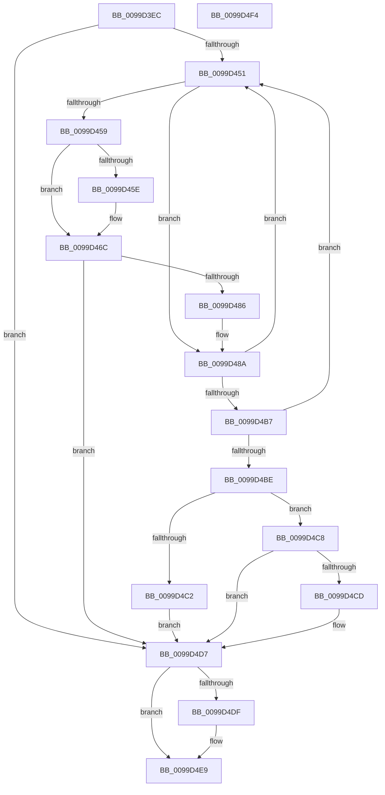

# EtwpCapturePreviousRegistryData

- RVA: `0x0099D3EC`–`0x0099D4F5` (길이 `265` bytes)
- VA: `0x000000014099D3EC`
- 실행 섹션: `PAGE`
- PDB 이름 있음: `예`; PDB Function 태그: `아니요`
- unwind 정보 RVA: `0x00099BAC`
- 디코드: `72`개 명령, `265/265` bytes 표시
- 미해석 바이트: `0` (있으면 어셈블리에 `.byte`로 보존)

> 이 문서는 커널 이미지의 기계어와 PDB 기호를 분석해 생성했습니다. 4번과 5번은 함수 원형과 자료형을 바이너리 사용 방식에서 추정한 C 해석이며 원본 소스 복구 결과는 아닙니다.

## 1. Dependencies

- 직접 호출 지점: **6**; 고유 호출 대상: **5**
- 직접 호출자로 확인된 함수: **1**
- RIP 상대 이미지 참조: **1**

### Outgoing calls
- `0x0099D444` → [ObOpenObjectByPointer](../8B/ObOpenObjectByPointer_function_008B7420.md) (function, `0x008B7420`)
- `0x0099D463` → [ExFreePoolWithTag](../../poolcode/B8/ExFreePoolWithTag_function_00B82870.md) (function, `0x00B82870`)
- `0x0099D479` → [ExAllocatePool2](../../poolcode/B8/ExAllocatePool2_function_00B820F0.md) (function, `0x00B820F0`)
- `0x0099D4AB` → [ZwQueryValueKey](../../text/6A/ZwQueryValueKey_function_006AD3B0.md) (function, `0x006AD3B0`)
- `0x0099D4D2` → [ExFreePoolWithTag](../../poolcode/B8/ExFreePoolWithTag_function_00B82870.md) (function, `0x00B82870`)
- `0x0099D4E4` → [ZwClose](../../text/6A/ZwClose_function_006AD2B0.md) (function, `0x006AD2B0`)

### Direct callers
- [sub_0099CD37](Unknown_function_0099CD37.md) at `0x0099D02A`

### Static image references
- `0x0099D42F` → RVA `0x00FC6AC0` (`ALMOSTRO`; read)

## 2. Other-region calls and transfers

- 다른 실행 섹션으로 향하는 call: **5**
  - `0x0099D463` → [ExFreePoolWithTag](../../poolcode/B8/ExFreePoolWithTag_function_00B82870.md) (`PAGE` → `POOLCODE`)
  - `0x0099D479` → [ExAllocatePool2](../../poolcode/B8/ExAllocatePool2_function_00B820F0.md) (`PAGE` → `POOLCODE`)
  - `0x0099D4AB` → [ZwQueryValueKey](../../text/6A/ZwQueryValueKey_function_006AD3B0.md) (`PAGE` → `.text`)
  - `0x0099D4D2` → [ExFreePoolWithTag](../../poolcode/B8/ExFreePoolWithTag_function_00B82870.md) (`PAGE` → `POOLCODE`)
  - `0x0099D4E4` → [ZwClose](../../text/6A/ZwClose_function_006AD2B0.md) (`PAGE` → `.text`)
- 별도 외부 분기/꼬리 이동을 확인하지 못했습니다.

## 3. Assembly (complete function range)

```asm
0099D3EC  4C 8B DC                        mov r11, rsp
0099D3EF  49 89 5B 18                     mov qword ptr [r11 + 0x18], rbx
0099D3F3  56                              push rsi
0099D3F4  48 83 EC 50                     sub rsp, 0x50
0099D3F8  83 64 24 60 00                  and dword ptr [rsp + 0x60], 0
0099D3FD  48 8B F1                        mov rsi, rcx
0099D400  48 8B 09                        mov rcx, qword ptr [rcx]
0099D403  0F 57 C0                        xorps xmm0, xmm0
0099D406  49 83 63 10 00                  and qword ptr [r11 + 0x10], 0
0099D40B  33 DB                           xor ebx, ebx
0099D40D  0F 11 44 24 40                  movups xmmword ptr [rsp + 0x40], xmm0
0099D412  48 8B 46 08                     mov rax, qword ptr [rsi + 8]
0099D416  41 B9 19 00 02 00               mov r9d, 0x20019
0099D41C  45 33 C0                        xor r8d, r8d
0099D41F  BA 00 02 00 00                  mov edx, 0x200
0099D424  0F 10 00                        movups xmm0, xmmword ptr [rax]
0099D427  49 8D 43 10                     lea rax, [r11 + 0x10]
0099D42B  49 89 43 D8                     mov qword ptr [r11 - 0x28], rax
0099D42F  48 8B 05 8A 96 62 00            mov rax, qword ptr [rip + 0x62968a]
0099D436  88 5C 24 28                     mov byte ptr [rsp + 0x28], bl
0099D43A  49 89 43 C8                     mov qword ptr [r11 - 0x38], rax
0099D43E  F3 0F 7F 44 24 40               movdqu xmmword ptr [rsp + 0x40], xmm0
0099D444  E8 D7 9F F1 FF                  call 0x1408b7420
0099D449  85 C0                           test eax, eax
0099D44B  0F 88 86 00 00 00               js 0x14099d4d7
0099D451  8B 44 24 60                     mov eax, dword ptr [rsp + 0x60]
0099D455  85 C0                           test eax, eax
0099D457  74 31                           je 0x14099d48a
0099D459  48 85 DB                        test rbx, rbx
0099D45C  74 0E                           je 0x14099d46c
0099D45E  33 D2                           xor edx, edx
0099D460  48 8B CB                        mov rcx, rbx
0099D463  E8 08 54 1E 00                  call 0x140b82870
0099D468  8B 44 24 60                     mov eax, dword ptr [rsp + 0x60]
0099D46C  8B D0                           mov edx, eax
0099D46E  B9 00 01 00 00                  mov ecx, 0x100
0099D473  41 B8 45 74 77 31               mov r8d, 0x31777445
0099D479  E8 72 4C 1E 00                  call 0x140b820f0
0099D47E  48 8B D8                        mov rbx, rax
0099D481  48 85 C0                        test rax, rax
0099D484  74 51                           je 0x14099d4d7
0099D486  8B 44 24 60                     mov eax, dword ptr [rsp + 0x60]
0099D48A  48 8D 4C 24 60                  lea rcx, [rsp + 0x60]
0099D48F  4C 8B CB                        mov r9, rbx
0099D492  48 89 4C 24 28                  mov qword ptr [rsp + 0x28], rcx
0099D497  48 8D 54 24 40                  lea rdx, [rsp + 0x40]
0099D49C  48 8B 4C 24 68                  mov rcx, qword ptr [rsp + 0x68]
0099D4A1  41 B8 02 00 00 00               mov r8d, 2
0099D4A7  89 44 24 20                     mov dword ptr [rsp + 0x20], eax
0099D4AB  E8 00 FF D0 FF                  call 0x1406ad3b0
0099D4B0  3D 05 00 00 80                  cmp eax, 0x80000005
0099D4B5  74 9A                           je 0x14099d451
0099D4B7  3D 23 00 00 C0                  cmp eax, 0xc0000023
0099D4BC  74 93                           je 0x14099d451
0099D4BE  85 C0                           test eax, eax
0099D4C0  78 06                           js 0x14099d4c8
0099D4C2  48 89 5E 28                     mov qword ptr [rsi + 0x28], rbx
0099D4C6  EB 0F                           jmp 0x14099d4d7
0099D4C8  48 85 DB                        test rbx, rbx
0099D4CB  74 0A                           je 0x14099d4d7
0099D4CD  33 D2                           xor edx, edx
0099D4CF  48 8B CB                        mov rcx, rbx
0099D4D2  E8 99 53 1E 00                  call 0x140b82870
0099D4D7  48 83 7C 24 68 00               cmp qword ptr [rsp + 0x68], 0
0099D4DD  74 0A                           je 0x14099d4e9
0099D4DF  48 8B 4C 24 68                  mov rcx, qword ptr [rsp + 0x68]
0099D4E4  E8 C7 FD D0 FF                  call 0x1406ad2b0
0099D4E9  48 8B 5C 24 70                  mov rbx, qword ptr [rsp + 0x70]
0099D4EE  48 83 C4 50                     add rsp, 0x50
0099D4F2  5E                              pop rsi
0099D4F3  C3                              ret
0099D4F4  CC                              int3
```

## 4. C-style interpretation (structured pseudocode)

```c
__int64 __fastcall EtwpCapturePreviousRegistryData(__int64 a1, __int64 a2, int a3)
{
    __int64 result;
    __int64 v_rbx;
    __int64 v_rsp;
    unsigned __int64 v_stack_m18;
    unsigned __int8 v_stack_m30;
    unsigned int v_stack_m38;
    unsigned __int64 v_stack_p10;
    unsigned __int64 v_stack_p18;
    unsigned int v_stack_p8;

    *(unsigned __int64 *)(v_rsp + 24) = v_rbx;
    v_rsp = (v_rsp) - (80);
    v_rbx = 0;
    v_stack_m18 = v_xmm0;
    a3 = 0;
    *(unsigned __int64 *)(v_rsp - 40) = v_rsp + 16;
    v_stack_m30 = 0;
    *(unsigned __int64 *)(v_rsp - 56) = *(unsigned __int64 *)(v_rip + 6461066);
    v_stack_m18 = v_xmm0;
    result = ObOpenObjectByPointer(*(unsigned __int64 *)(a1), 512, a3, (unsigned int)(0x20019ULL));
    if (sign_flag) goto loc_0099D4D7;
loc_0099D451:
    if ((unsigned int)((unsigned int)(v_stack_p8)) == 0) goto loc_0099D48A;
    result = (unsigned int)(v_stack_p8);
    if (0 != 0) {
        a2 = 0;
        a1 = 0;
        result = ExFreePoolWithTag(a1, a2, a3, (unsigned int)(0x20019ULL));
        result = v_stack_p8;
    }
    result = ExAllocatePool2(256, (unsigned int)((unsigned int)(result)), (unsigned int)(0x31777445ULL), (unsigned int)(0x20019ULL));
    if (result == 0) goto loc_0099D4D7;
loc_0099D48A:
    v_stack_m30 = v_stack_p8;
    v_stack_m38 = (unsigned int)((unsigned int)(v_stack_p8));
    result = ZwQueryValueKey(v_stack_p10, v_stack_m18, 2, result);
    if (((unsigned int)(result)) == 0x80000005ULL) goto loc_0099D451;
    if (((unsigned int)(result)) == 0xC0000023ULL) goto loc_0099D451;
    if (sign_flag) goto loc_0099D4C8;
    *(unsigned __int64 *)(a1 + 40) = result;
    goto loc_0099D4D7;
loc_0099D4C8:
    if (result != 0) {
        a2 = 0;
        a1 = result;
        result = ExFreePoolWithTag(a1, a2, 2, result);
    }
    if (v_stack_p10 != 0) {
        a1 = v_stack_p10;
        result = ZwClose(a1, a2, 2, result);
    }
    v_rsp = (v_rsp) + (80);
    return result;
}
```

## 5. (Beta) C Style

```c
int64_t EtwpCapturePreviousRegistryData(void *Arg1, int64_t Arg2, int32_t Arg3)
{
    uint8_t *arg1 = (uint8_t *)Arg1;

    int64_t result;
    int64_t local_rbx;
    int64_t local_rsp;
    uint64_t v_stack_m18;
    uint8_t v_stack_m30;
    uint32_t v_stack_m38;
    uint64_t v_stack_p10;
    uint64_t v_stack_p18;
    uint32_t v_stack_p8;

    *(uint64_t *)(local_rsp + 0x18) = local_rbx;
    local_rsp = (local_rsp) - (80);
    local_rbx = 0;
    v_stack_m18 = v_xmm0;
    Arg3 = 0;
    *(uint64_t *)(local_rsp - 0x28) = local_rsp + 16;
    v_stack_m30 = 0;
    *(uint64_t *)(local_rsp - 0x38) = *(uint64_t *)(v_rip + 0x62968A);
    v_stack_m18 = v_xmm0;
    result = ObOpenObjectByPointer(*(uint64_t *)(arg1), 512, Arg3, (uint32_t)(0x20019ULL));
    if (sign_flag) goto loc_0099D4D7;
loc_0099D451:
    if ((uint32_t)((uint32_t)(v_stack_p8)) == 0) goto loc_0099D48A;
    result = (uint32_t)(v_stack_p8);
    if (0 != 0) {
        Arg2 = 0;
        Arg1 = 0;
        result = ExFreePoolWithTag(Arg1, Arg2, Arg3, (uint32_t)(0x20019ULL));
        result = v_stack_p8;
    }
    result = ExAllocatePool2(256, (uint32_t)((uint32_t)(result)), (uint32_t)(0x31777445ULL), (uint32_t)(0x20019ULL));
    if (result == 0) goto loc_0099D4D7;
loc_0099D48A:
    v_stack_m30 = v_stack_p8;
    v_stack_m38 = (uint32_t)((uint32_t)(v_stack_p8));
    result = ZwQueryValueKey(v_stack_p10, v_stack_m18, 2, result);
    if (((uint32_t)(result)) == 0x80000005ULL) goto loc_0099D451;
    if (((uint32_t)(result)) == 0xC0000023ULL) goto loc_0099D451;
    if (sign_flag) goto loc_0099D4C8;
    *(uint64_t *)(arg1 + 0x28) = result;
    goto loc_0099D4D7;
loc_0099D4C8:
    if (result != 0) {
        Arg2 = 0;
        Arg1 = result;
        result = ExFreePoolWithTag(Arg1, Arg2, 2, result);
    }
    if (v_stack_p10 != 0) {
        Arg1 = v_stack_p10;
        result = ZwClose(Arg1, Arg2, 2, result);
    }
    local_rsp = (local_rsp) + (80);
    return result;
}
```

### 관측된 메모리 오프셋

구조체 형식이 확인되지 않은 접근은 인자 기준의 오프셋으로만 기록했습니다.

| 기준 인자 | 오프셋 표현 | 폭 (bit) | 접근 |
|---|---:|---:|---|
| `Arg1` | `+ 0x0` | `64` | `R` |
| `Arg1` | `+ 0x8` | `64` | `R` |
| `Arg1` | `+ 0x28` | `64` | `W` |

## 6. Execution-region graph

[열기: 2D/3D 그래프와 함수 탐색 컨트롤 패널](../../../control-panel.html?section=page&rva=0x0099D3EC&view=graph)

- 2D 그래프는 위에서 아래로 흐르고, 3D 그래프는 빈 공간을 드래그해 회전합니다. Shift+드래그는 이동, 휠은 확대·축소, 함수 노드 선택은 대상 보고서 이동입니다.

### Static fallback


