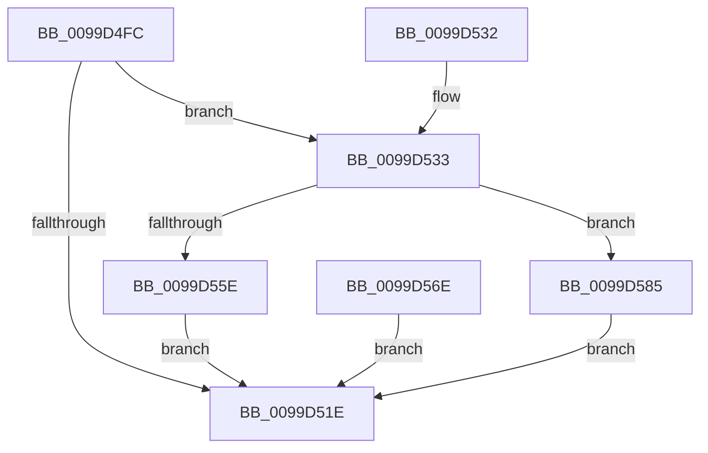

# EtwpCaptureRegistryData

- RVA: `0x0099D4FC`–`0x0099D589` (길이 `141` bytes)
- VA: `0x000000014099D4FC`
- 실행 섹션: `PAGE`
- PDB 이름 있음: `예`; PDB Function 태그: `아니요`
- unwind 정보 RVA: `0x00099BBC`
- 디코드: `47`개 명령, `141/141` bytes 표시
- 미해석 바이트: `0` (있으면 어셈블리에 `.byte`로 보존)

> 이 문서는 커널 이미지의 기계어와 PDB 기호를 분석해 생성했습니다. 4번과 5번은 함수 원형과 자료형을 바이너리 사용 방식에서 추정한 C 해석이며 원본 소스 복구 결과는 아닙니다.

## 1. Dependencies

- 직접 호출 지점: **3**; 고유 호출 대상: **3**
- 직접 호출자로 확인된 함수: **1**
- RIP 상대 이미지 참조: **0**

### Outgoing calls
- `0x0099D54C` → [ExAllocatePool2](../../poolcode/B8/ExAllocatePool2_function_00B820F0.md) (function, `0x00B820F0`)
- `0x0099D567` → [memcpy](../../text/6C/memcpy_function_006C6840.md) (function, `0x006C6840`)
- `0x0099D575` → [ExFreePoolWithTag](../../poolcode/B8/ExFreePoolWithTag_function_00B82870.md) (function, `0x00B82870`)

### Direct callers
- [sub_0099CD37](Unknown_function_0099CD37.md) at `0x0099CFE3`
- [sub_0099CD37](Unknown_function_0099CD37.md) at `0x0099D212`
- [sub_0099CD37](Unknown_function_0099CD37.md) at `0x0099D291`
- [sub_0099CD37](Unknown_function_0099CD37.md) at `0x0099D2BD`
- [sub_0099CD37](Unknown_function_0099CD37.md) at `0x0099D2E7`

### Static image references
- 디코드된 RIP-relative 메모리 참조가 없습니다.

## 2. Other-region calls and transfers

- 다른 실행 섹션으로 향하는 call: **3**
  - `0x0099D54C` → [ExAllocatePool2](../../poolcode/B8/ExAllocatePool2_function_00B820F0.md) (`PAGE` → `POOLCODE`)
  - `0x0099D567` → [memcpy](../../text/6C/memcpy_function_006C6840.md) (`PAGE` → `.text`)
  - `0x0099D575` → [ExFreePoolWithTag](../../poolcode/B8/ExFreePoolWithTag_function_00B82870.md) (`PAGE` → `POOLCODE`)
- 별도 외부 분기/꼬리 이동을 확인하지 못했습니다.

## 3. Assembly (complete function range)

```asm
0099D4FC  48 89 5C 24 10                  mov qword ptr [rsp + 0x10], rbx
0099D501  48 89 4C 24 08                  mov qword ptr [rsp + 8], rcx
0099D506  56                              push rsi
0099D507  57                              push rdi
0099D508  41 56                           push r14
0099D50A  48 83 EC 20                     sub rsp, 0x20
0099D50E  41 8B D8                        mov ebx, r8d
0099D511  4C 8B F2                        mov r14, rdx
0099D514  48 8B F1                        mov rsi, rcx
0099D517  33 FF                           xor edi, edi
0099D519  45 85 C0                        test r8d, r8d
0099D51C  75 15                           jne 0x14099d533
0099D51E  48 89 3E                        mov qword ptr [rsi], rdi
0099D521  0F B7 C3                        movzx eax, bx
0099D524  48 8B 5C 24 48                  mov rbx, qword ptr [rsp + 0x48]
0099D529  48 83 C4 20                     add rsp, 0x20
0099D52D  41 5E                           pop r14
0099D52F  5F                              pop rdi
0099D530  5E                              pop rsi
0099D531  C3                              ret
0099D532  CC                              int3
0099D533  B8 00 08 00 00                  mov eax, 0x800
0099D538  3B D8                           cmp ebx, eax
0099D53A  0F 46 C3                        cmovbe eax, ebx
0099D53D  8B D8                           mov ebx, eax
0099D53F  41 B8 45 74 77 31               mov r8d, 0x31777445
0099D545  8B D0                           mov edx, eax
0099D547  B9 00 01 00 00                  mov ecx, 0x100
0099D54C  E8 9F 4B 1E 00                  call 0x140b820f0
0099D551  48 8B F8                        mov rdi, rax
0099D554  48 89 44 24 58                  mov qword ptr [rsp + 0x58], rax
0099D559  48 85 C0                        test rax, rax
0099D55C  74 27                           je 0x14099d585
0099D55E  44 8B C3                        mov r8d, ebx
0099D561  49 8B D6                        mov rdx, r14
0099D564  48 8B C8                        mov rcx, rax
0099D567  E8 D4 92 D2 FF                  call 0x1406c6840
0099D56C  EB B0                           jmp 0x14099d51e
0099D56E  33 D2                           xor edx, edx
0099D570  48 8B 4C 24 58                  mov rcx, qword ptr [rsp + 0x58]
0099D575  E8 F6 52 1E 00                  call 0x140b82870
0099D57A  33 DB                           xor ebx, ebx
0099D57C  33 FF                           xor edi, edi
0099D57E  48 8B 74 24 40                  mov rsi, qword ptr [rsp + 0x40]
0099D583  EB 99                           jmp 0x14099d51e
0099D585  33 DB                           xor ebx, ebx
0099D587  EB 95                           jmp 0x14099d51e
```

## 4. C-style interpretation (structured pseudocode)

```c
__int64 __fastcall EtwpCaptureRegistryData(__int64 a1, __int64 a2, int a3)
{
    __int64 result;
    __int64 v_rbx;
    __int64 v_rdi;
    __int64 v_rsp;
    unsigned __int64 v_stack_p10;
    unsigned __int64 v_stack_p40;
    unsigned __int64 v_stack_p58;
    unsigned __int64 v_stack_p8;

    v_stack_p10 = v_rbx;
    v_stack_p8 = a1;
    v_rsp = (v_rsp) - (32);
    v_rdi = 0;
    if (a3 != 0) goto loc_0099D533;
loc_0099D51E:
    *(unsigned __int64 *)(a1) = 0;
    v_rsp = (v_rsp) + (32);
    return (unsigned __int16)((unsigned int)(a3));
loc_0099D533:
    result = (unsigned int)(0x800ULL);
    if (((unsigned int)(v_stack_p10)) <= ((unsigned int)((unsigned int)(0x800ULL)))) { result = (unsigned int)(v_stack_p10); }
    result = ExAllocatePool2(256, (unsigned int)((unsigned int)(result)), (unsigned int)(0x31777445ULL), a4);
    v_stack_p58 = result;
    if (result == 0) goto loc_0099D585;
    result = memcpy(result, a2, (unsigned int)((unsigned int)((unsigned int)((unsigned int)(result)))), a4);
    goto loc_0099D51E;
loc_0099D585:
    v_rbx = 0;
    goto loc_0099D51E;
}
```

## 5. (Beta) C Style

```c
int64_t EtwpCaptureRegistryData(void *Arg1, int64_t Arg2, int32_t Arg3)
{
    uint8_t *arg1 = (uint8_t *)Arg1;

    int64_t result;
    int64_t local_rbx;
    int64_t local_rdi;
    int64_t local_rsp;
    uint64_t v_stack_p10;
    uint64_t v_stack_p40;
    uint64_t v_stack_p58;
    uint64_t v_stack_p8;

    v_stack_p10 = local_rbx;
    v_stack_p8 = Arg1;
    local_rsp = (local_rsp) - (32);
    local_rdi = 0;
    if (Arg3 != 0) goto loc_0099D533;
loc_0099D51E:
    *(uint64_t *)(arg1) = 0;
    local_rsp = (local_rsp) + (32);
    return (uint16_t)((uint32_t)(Arg3));
loc_0099D533:
    result = (uint32_t)(0x800ULL);
    if (((uint32_t)(v_stack_p10)) <= ((uint32_t)((uint32_t)(0x800ULL)))) { result = (uint32_t)(v_stack_p10); }
    result = ExAllocatePool2(256, (uint32_t)((uint32_t)(result)), (uint32_t)(0x31777445ULL), a4);
    v_stack_p58 = result;
    if (result == 0) goto loc_0099D585;
    result = memcpy(result, Arg2, (uint32_t)((uint32_t)((uint32_t)((uint32_t)(result)))), a4);
    goto loc_0099D51E;
loc_0099D585:
    local_rbx = 0;
    goto loc_0099D51E;
}
```

### 관측된 메모리 오프셋

구조체 형식이 확인되지 않은 접근은 인자 기준의 오프셋으로만 기록했습니다.

| 기준 인자 | 오프셋 표현 | 폭 (bit) | 접근 |
|---|---:|---:|---|
| `Arg1` | `+ 0x0` | `64` | `W` |

## 6. Execution-region graph

[열기: 2D/3D 그래프와 함수 탐색 컨트롤 패널](../../../control-panel.html?section=page&rva=0x0099D4FC&view=graph)

- 2D 그래프는 위에서 아래로 흐르고, 3D 그래프는 빈 공간을 드래그해 회전합니다. Shift+드래그는 이동, 휠은 확대·축소, 함수 노드 선택은 대상 보고서 이동입니다.

### Static fallback


