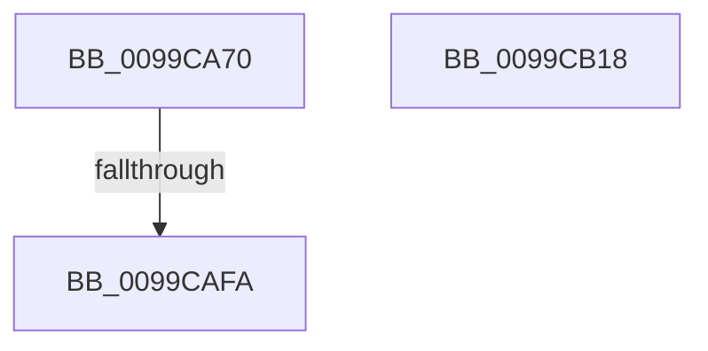

# EtwpRegTraceCallback

- RVA: `0x0099CA70`–`0x0099CB19` (길이 `169` bytes)
- VA: `0x000000014099CA70`
- 실행 섹션: `PAGE`
- PDB 이름 있음: `예`; PDB Function 태그: `아니요`
- unwind 정보 RVA: `0x00099B50`
- 디코드: `44`개 명령, `169/169` bytes 표시
- 미해석 바이트: `0` (있으면 어셈블리에 `.byte`로 보존)

> 이 문서는 커널 이미지의 기계어와 PDB 기호를 분석해 생성했습니다. 4번과 5번은 함수 원형과 자료형을 바이너리 사용 방식에서 추정한 C 해석이며 원본 소스 복구 결과는 아닙니다.

## 1. Dependencies

- 직접 호출 지점: **1**; 고유 호출 대상: **1**
- 직접 호출자로 확인된 함수: **0**
- RIP 상대 이미지 참조: **1**

### Outgoing calls
- `0x0099CB06` → [_security_check_cookie](../../text/6A/_security_check_cookie_function_006AC640.md) (function, `0x006AC640`)

### Direct callers
- 이 함수 시작 RVA로 연결되는 직접 call은 확인되지 않았습니다. 간접 호출은 완전히 역산할 수 없습니다.

### Static image references
- `0x0099CA85` → RVA `0x00E0A740` (`.data`; read)

## 2. Other-region calls and transfers

- 다른 실행 섹션으로 향하는 call: **1**
  - `0x0099CB06` → [_security_check_cookie](../../text/6A/_security_check_cookie_function_006AC640.md) (`PAGE` → `.text`)
- call이 아닌 외부 분기/꼬리 이동: **1**
  - `0x0099CAF8` → [sub_0099CB19](Unknown_function_0099CB19.md) (`tail-transfer`)

## 3. Assembly (complete function range)

```asm
0099CA70  40 55                           push rbp
0099CA72  56                              push rsi
0099CA73  57                              push rdi
0099CA74  41 57                           push r15
0099CA76  48 8D AC 24 48 FF FF FF         lea rbp, [rsp - 0xb8]
0099CA7E  48 81 EC B8 01 00 00            sub rsp, 0x1b8
0099CA85  48 8B 05 B4 DC 46 00            mov rax, qword ptr [rip + 0x46dcb4]
0099CA8C  48 33 C4                        xor rax, rsp
0099CA8F  48 89 85 A0 00 00 00            mov qword ptr [rbp + 0xa0], rax
0099CA96  45 33 FF                        xor r15d, r15d
0099CA99  0F 57 C0                        xorps xmm0, xmm0
0099CA9C  FF CA                           dec edx
0099CA9E  4C 89 7D 98                     mov qword ptr [rbp - 0x68], r15
0099CAA2  4C 89 7D 90                     mov qword ptr [rbp - 0x70], r15
0099CAA6  49 8B F8                        mov rdi, r8
0099CAA9  4C 89 7C 24 60                  mov qword ptr [rsp + 0x60], r15
0099CAAE  41 8B F7                        mov esi, r15d
0099CAB1  44 89 7C 24 68                  mov dword ptr [rsp + 0x68], r15d
0099CAB6  45 8B DF                        mov r11d, r15d
0099CAB9  44 89 7C 24 78                  mov dword ptr [rsp + 0x78], r15d
0099CABE  44 89 7C 24 58                  mov dword ptr [rsp + 0x58], r15d
0099CAC3  44 89 7C 24 4C                  mov dword ptr [rsp + 0x4c], r15d
0099CAC8  4C 89 7C 24 50                  mov qword ptr [rsp + 0x50], r15
0099CACD  4C 89 7D 88                     mov qword ptr [rbp - 0x78], r15
0099CAD1  4C 89 7C 24 70                  mov qword ptr [rsp + 0x70], r15
0099CAD6  44 89 7D 80                     mov dword ptr [rbp - 0x80], r15d
0099CADA  44 89 7C 24 7C                  mov dword ptr [rsp + 0x7c], r15d
0099CADF  66 44 89 7C 24 34               mov word ptr [rsp + 0x34], r15w
0099CAE5  66 44 89 7C 24 30               mov word ptr [rsp + 0x30], r15w
0099CAEB  66 44 89 7C 24 48               mov word ptr [rsp + 0x48], r15w
0099CAF1  0F 11 45 A0                     movups xmmword ptr [rbp - 0x60], xmm0
0099CAF5  83 FA 26                        cmp edx, 0x26
0099CAF8  76 1F                           jbe 0x14099cb19
0099CAFA  33 C0                           xor eax, eax
0099CAFC  48 8B 8D A0 00 00 00            mov rcx, qword ptr [rbp + 0xa0]
0099CB03  48 33 CC                        xor rcx, rsp
0099CB06  E8 35 FB D0 FF                  call 0x1406ac640
0099CB0B  48 81 C4 B8 01 00 00            add rsp, 0x1b8
0099CB12  41 5F                           pop r15
0099CB14  5F                              pop rdi
0099CB15  5E                              pop rsi
0099CB16  5D                              pop rbp
0099CB17  C3                              ret
0099CB18  CC                              int3
```

## 4. C-style interpretation (structured pseudocode)

```c
__int64 __fastcall EtwpRegTraceCallback(__int64 a1, int a2, __int64 a3)
{
    __int64 result;
    __int64 v_r15;
    __int64 v_rsp;
    unsigned __int64 v_stack_m138;
    unsigned __int64 v_stack_m140;
    unsigned __int64 v_stack_m148;
    unsigned __int64 v_stack_m150;
    unsigned int v_stack_m158;
    unsigned int v_stack_m15C;
    unsigned int v_stack_m160;
    unsigned __int64 v_stack_m168;
    unsigned int v_stack_m170;
    unsigned __int64 v_stack_m178;
    unsigned int v_stack_m180;
    unsigned __int64 v_stack_m188;
    unsigned int v_stack_m18C;
    unsigned __int16 v_stack_m190;
    unsigned __int16 v_stack_m1A4;
    unsigned __int16 v_stack_m1A8;
    unsigned __int64 v_stack_m38;
    unsigned __int64 v_stack_mD8;

    v_rsp = (v_rsp) - (440);
    result = (*(unsigned __int64 *)(v_rip + 4644020)) ^ (v_rsp);
    v_stack_m38 = result;
    v_r15 = 0;
    a2 = (unsigned int)((a2) - 1);
    v_stack_m140 = 0;
    v_stack_m148 = 0;
    v_stack_m178 = 0;
    v_stack_m170 = 0;
    v_stack_m160 = 0;
    v_stack_m180 = 0;
    v_stack_m18C = 0;
    v_stack_m188 = 0;
    v_stack_m150 = 0;
    v_stack_m168 = 0;
    v_stack_m158 = 0;
    v_stack_m15C = 0;
    v_stack_m1A4 = 0;
    v_stack_m1A8 = 0;
    v_stack_m190 = 0;
    v_stack_m138 = v_xmm0;
    result = 0;
    a1 = (v_stack_m38) ^ (v_rsp);
    result = _security_check_cookie(a1, a2, a3, a4);
    v_rsp = (v_rsp) + (440);
    return result;
}
```

## 5. (Beta) C Style

```c
int64_t EtwpRegTraceCallback(int64_t Arg1, int32_t Arg2, int64_t Arg3)
{
    int64_t result;
    int64_t local_r15;
    int64_t local_rsp;
    uint64_t v_stack_m138;
    uint64_t v_stack_m140;
    uint64_t v_stack_m148;
    uint64_t v_stack_m150;
    uint32_t v_stack_m158;
    uint32_t v_stack_m15C;
    uint32_t v_stack_m160;
    uint64_t v_stack_m168;
    uint32_t v_stack_m170;
    uint64_t v_stack_m178;
    uint32_t v_stack_m180;
    uint64_t v_stack_m188;
    uint32_t v_stack_m18C;
    uint16_t v_stack_m190;
    uint16_t v_stack_m1A4;
    uint16_t v_stack_m1A8;
    uint64_t v_stack_m38;
    uint64_t v_stack_mD8;

    local_rsp = (local_rsp) - (440);
    result = (*(uint64_t *)(v_rip + 0x46DCB4)) ^ (local_rsp);
    v_stack_m38 = result;
    local_r15 = 0;
    Arg2 = (uint32_t)((Arg2) - 1);
    v_stack_m140 = 0;
    v_stack_m148 = 0;
    v_stack_m178 = 0;
    v_stack_m170 = 0;
    v_stack_m160 = 0;
    v_stack_m180 = 0;
    v_stack_m18C = 0;
    v_stack_m188 = 0;
    v_stack_m150 = 0;
    v_stack_m168 = 0;
    v_stack_m158 = 0;
    v_stack_m15C = 0;
    v_stack_m1A4 = 0;
    v_stack_m1A8 = 0;
    v_stack_m190 = 0;
    v_stack_m138 = v_xmm0;
    result = 0;
    Arg1 = (v_stack_m38) ^ (local_rsp);
    result = _security_check_cookie(Arg1, Arg2, Arg3, a4);
    local_rsp = (local_rsp) + (440);
    return result;
}
```

## 6. Execution-region graph

[열기: 2D/3D 그래프와 함수 탐색 컨트롤 패널](../../../control-panel.html?section=page&rva=0x0099CA70&view=graph)

- 2D 그래프는 위에서 아래로 흐르고, 3D 그래프는 빈 공간을 드래그해 회전합니다. Shift+드래그는 이동, 휠은 확대·축소, 함수 노드 선택은 대상 보고서 이동입니다.

### Static fallback


