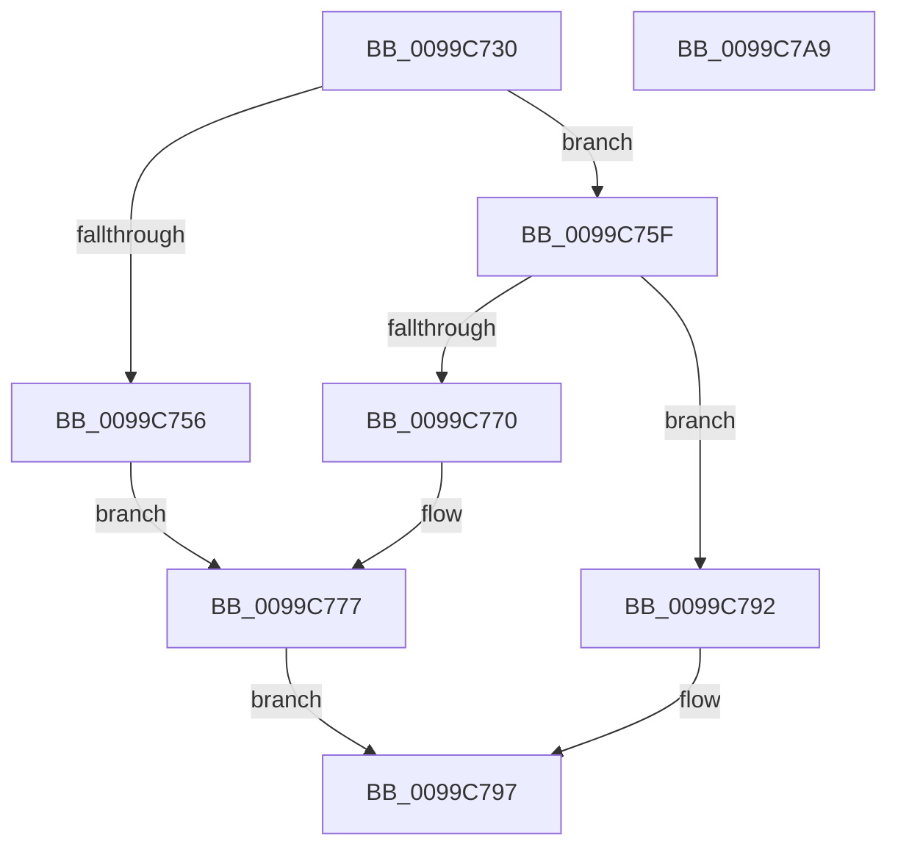

# ExpSetCrossVmEvent

- RVA: `0x0099C730`–`0x0099C7AA` (길이 `122` bytes)
- VA: `0x000000014099C730`
- 실행 섹션: `PAGE`
- PDB 이름 있음: `예`; PDB Function 태그: `아니요`
- unwind 정보 RVA: `0x00060BC4`
- 디코드: `33`개 명령, `122/122` bytes 표시
- 미해석 바이트: `0` (있으면 어셈블리에 `.byte`로 보존)

> 이 문서는 커널 이미지의 기계어와 PDB 기호를 분석해 생성했습니다. 4번과 5번은 함수 원형과 자료형을 바이너리 사용 방식에서 추정한 C 해석이며 원본 소스 복구 결과는 아닙니다.

## 1. Dependencies

- 직접 호출 지점: **4**; 고유 호출 대상: **3**
- 직접 호출자로 확인된 함수: **1**
- RIP 상대 이미지 참조: **2**

### Outgoing calls
- `0x0099C74C` → [ExGetExtensionTable](../../text/42/ExGetExtensionTable_function_00428814.md) (function, `0x00428814`)
- `0x0099C766` → [ExGetExtensionTable](../../text/42/ExGetExtensionTable_function_00428814.md) (function, `0x00428814`)
- `0x0099C781` → [guard_dispatch_icall](../../text/6B/guard_dispatch_icall_function_006BAAD0.md) (function, `0x006BAAD0`)
- `0x0099C78B` → [ExReleaseExtensionTable](../../text/45/ExReleaseExtensionTable_function_00456DC0.md) (function, `0x00456DC0`)

### Direct callers
- [NtSetEventEx](NtSetEventEx_function_0099C570.md) at `0x0099C6E0`

### Static image references
- `0x0099C745` → RVA `0x00EFA120` (`.data`; read)
- `0x0099C75F` → RVA `0x00EFA118` (`.data`; read)

## 2. Other-region calls and transfers

- 다른 실행 섹션으로 향하는 call: **4**
  - `0x0099C74C` → [ExGetExtensionTable](../../text/42/ExGetExtensionTable_function_00428814.md) (`PAGE` → `.text`)
  - `0x0099C766` → [ExGetExtensionTable](../../text/42/ExGetExtensionTable_function_00428814.md) (`PAGE` → `.text`)
  - `0x0099C781` → [guard_dispatch_icall](../../text/6B/guard_dispatch_icall_function_006BAAD0.md) (`PAGE` → `.text`)
  - `0x0099C78B` → [ExReleaseExtensionTable](../../text/45/ExReleaseExtensionTable_function_00456DC0.md) (`PAGE` → `.text`)
- 별도 외부 분기/꼬리 이동을 확인하지 못했습니다.

## 3. Assembly (complete function range)

```asm
0099C730  48 89 5C 24 08                  mov qword ptr [rsp + 8], rbx
0099C735  48 89 74 24 10                  mov qword ptr [rsp + 0x10], rsi
0099C73A  57                              push rdi
0099C73B  48 83 EC 20                     sub rsp, 0x20
0099C73F  48 8B F1                        mov rsi, rcx
0099C742  48 8B DA                        mov rbx, rdx
0099C745  48 8B 0D D4 D9 55 00            mov rcx, qword ptr [rip + 0x55d9d4]
0099C74C  E8 C3 C0 A8 FF                  call 0x140428814
0099C751  48 85 C0                        test rax, rax
0099C754  74 09                           je 0x14099c75f
0099C756  48 8B 3D C3 D9 55 00            mov rdi, qword ptr [rip + 0x55d9c3]
0099C75D  EB 18                           jmp 0x14099c777
0099C75F  48 8B 0D B2 D9 55 00            mov rcx, qword ptr [rip + 0x55d9b2]
0099C766  E8 A9 C0 A8 FF                  call 0x140428814
0099C76B  48 85 C0                        test rax, rax
0099C76E  74 22                           je 0x14099c792
0099C770  48 8B 3D A1 D9 55 00            mov rdi, qword ptr [rip + 0x55d9a1]
0099C777  48 8B 40 18                     mov rax, qword ptr [rax + 0x18]
0099C77B  48 8B D3                        mov rdx, rbx
0099C77E  48 8B CE                        mov rcx, rsi
0099C781  E8 4A E3 D1 FF                  call 0x1406baad0
0099C786  8B D8                           mov ebx, eax
0099C788  48 8B CF                        mov rcx, rdi
0099C78B  E8 30 A6 AB FF                  call 0x140456dc0
0099C790  EB 05                           jmp 0x14099c797
0099C792  BB 02 00 00 C0                  mov ebx, 0xc0000002
0099C797  48 8B 74 24 38                  mov rsi, qword ptr [rsp + 0x38]
0099C79C  8B C3                           mov eax, ebx
0099C79E  48 8B 5C 24 30                  mov rbx, qword ptr [rsp + 0x30]
0099C7A3  48 83 C4 20                     add rsp, 0x20
0099C7A7  5F                              pop rdi
0099C7A8  C3                              ret
0099C7A9  CC                              int3
```

## 4. C-style interpretation (structured pseudocode)

```c
__int64 __fastcall ExpSetCrossVmEvent(__int64 a1, __int64 a2)
{
    __int64 result;
    __int64 v_rsp;
    unsigned __int64 v_stack_p10;
    unsigned __int64 v_stack_p8;

    v_stack_p8 = v_rbx;
    v_stack_p10 = v_rsi;
    v_rsp = (v_rsp) - (32);
    result = ExGetExtensionTable(*(unsigned __int64 *)(v_rip + 5626324), a2, a3, a4);
    if (result == 0) goto loc_0099C75F;
    goto loc_0099C777;
loc_0099C75F:
    result = ExGetExtensionTable(*(unsigned __int64 *)(v_rip + 5626290), a2, a3, a4);
    if (result == 0) goto loc_0099C792;
loc_0099C777:
    result = guard_dispatch_icall(a1, a2, a3, a4);
    result = ExReleaseExtensionTable(*(unsigned __int64 *)(v_rip + 5626273), a2, a3, a4);
    goto loc_0099C797;
loc_0099C792:
loc_0099C797:
    v_rsp = (v_rsp) + (32);
    return (unsigned int)((unsigned int)((unsigned int)(0xC0000002ULL)));
}
```

## 5. (Beta) C Style

```c
int64_t ExpSetCrossVmEvent(int64_t Arg1, int64_t Arg2)
{
    int64_t result;
    int64_t local_rsp;
    uint64_t v_stack_p10;
    uint64_t v_stack_p8;

    v_stack_p8 = local_rbx;
    v_stack_p10 = local_rsi;
    local_rsp = (local_rsp) - (32);
    result = ExGetExtensionTable(*(uint64_t *)(v_rip + 0x55D9D4), Arg2, a3, a4);
    if (result == 0) goto loc_0099C75F;
    goto loc_0099C777;
loc_0099C75F:
    result = ExGetExtensionTable(*(uint64_t *)(v_rip + 0x55D9B2), Arg2, a3, a4);
    if (result == 0) goto loc_0099C792;
loc_0099C777:
    result = guard_dispatch_icall(Arg1, Arg2, a3, a4);
    result = ExReleaseExtensionTable(*(uint64_t *)(v_rip + 0x55D9A1), Arg2, a3, a4);
    goto loc_0099C797;
loc_0099C792:
loc_0099C797:
    local_rsp = (local_rsp) + (32);
    return (uint32_t)((uint32_t)((uint32_t)(0xC0000002ULL)));
}
```

## 6. Execution-region graph

[열기: 2D/3D 그래프와 함수 탐색 컨트롤 패널](../../../control-panel.html?section=page&rva=0x0099C730&view=graph)

- 2D 그래프는 위에서 아래로 흐르고, 3D 그래프는 빈 공간을 드래그해 회전합니다. Shift+드래그는 이동, 휠은 확대·축소, 함수 노드 선택은 대상 보고서 이동입니다.

### Static fallback


