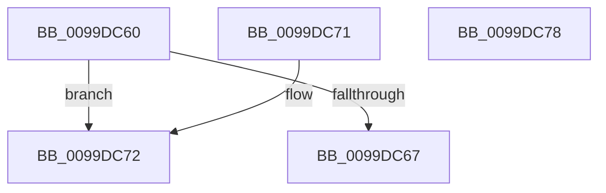

# FsRtlGetEcpListFromIrp

- RVA: `0x0099DC60`–`0x0099DC79` (길이 `25` bytes)
- VA: `0x000000014099DC60`
- 실행 섹션: `PAGE`
- PDB 이름 있음: `예`; PDB Function 태그: `아니요`
- unwind 정보 RVA: `0x000DB714`
- 디코드: `11`개 명령, `25/25` bytes 표시
- 미해석 바이트: `0` (있으면 어셈블리에 `.byte`로 보존)

> 이 문서는 커널 이미지의 기계어와 PDB 기호를 분석해 생성했습니다. 4번과 5번은 함수 원형과 자료형을 바이너리 사용 방식에서 추정한 C 해석이며 원본 소스 복구 결과는 아닙니다.

## 1. Dependencies

- 직접 호출 지점: **0**; 고유 호출 대상: **0**
- 직접 호출자로 확인된 함수: **1**
- RIP 상대 이미지 참조: **0**

### Outgoing calls
- 직접 디코드된 call 명령이 없습니다.

### Direct callers
- [sub_0041DDC3](../../text/41/Unknown_function_0041DDC3.md) at `0x0041DDD2`

### Static image references
- 디코드된 RIP-relative 메모리 참조가 없습니다.

## 2. Other-region calls and transfers

- 다른 실행 섹션으로 향하는 call: **0**
- 별도 외부 분기/꼬리 이동을 확인하지 못했습니다.

## 3. Assembly (complete function range)

```asm
0099DC60  8B 41 10                        mov eax, dword ptr [rcx + 0x10]
0099DC63  84 C0                           test al, al
0099DC65  79 0B                           jns 0x14099dc72
0099DC67  48 8B 41 70                     mov rax, qword ptr [rcx + 0x70]
0099DC6B  48 89 02                        mov qword ptr [rdx], rax
0099DC6E  33 C0                           xor eax, eax
0099DC70  C3                              ret
0099DC71  CC                              int3
0099DC72  B8 0D 00 00 C0                  mov eax, 0xc000000d
0099DC77  C3                              ret
0099DC78  CC                              int3
```

## 4. C-style interpretation (structured pseudocode)

```c
__int64 __fastcall FsRtlGetEcpListFromIrp(__int64 a1, __int64 a2)
{
    __int64 result;

    if (!sign_flag) goto loc_0099DC72;
    *(unsigned __int64 *)(a2) = *(unsigned __int64 *)(a1 + 112);
    result = 0;
    return result;
loc_0099DC72:
    return (unsigned int)(0xC000000DULL);
}
```

## 5. (Beta) C Style

```c
int64_t FsRtlGetEcpListFromIrp(void *Arg1, void *Arg2)
{
    uint8_t *arg1 = (uint8_t *)Arg1;
    uint8_t *arg2 = (uint8_t *)Arg2;

    int64_t result;

    if (!sign_flag) goto loc_0099DC72;
    *(uint64_t *)(arg2) = *(uint64_t *)(arg1 + 0x70);
    result = 0;
    return result;
loc_0099DC72:
    return (uint32_t)(0xC000000DULL);
}
```

### 관측된 메모리 오프셋

구조체 형식이 확인되지 않은 접근은 인자 기준의 오프셋으로만 기록했습니다.

| 기준 인자 | 오프셋 표현 | 폭 (bit) | 접근 |
|---|---:|---:|---|
| `Arg1` | `+ 0x10` | `32` | `R` |
| `Arg1` | `+ 0x70` | `64` | `R` |
| `Arg2` | `+ 0x0` | `64` | `W` |

## 6. Execution-region graph

[열기: 2D/3D 그래프와 함수 탐색 컨트롤 패널](../../../control-panel.html?section=page&rva=0x0099DC60&view=graph)

- 2D 그래프는 위에서 아래로 흐르고, 3D 그래프는 빈 공간을 드래그해 회전합니다. Shift+드래그는 이동, 휠은 확대·축소, 함수 노드 선택은 대상 보고서 이동입니다.

### Static fallback


