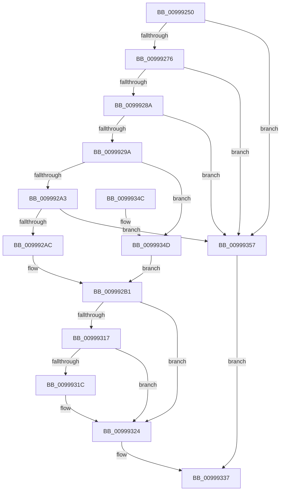

# IoOpenDeviceRegistryKey

- RVA: `0x00999250`–`0x0099935E` (길이 `270` bytes)
- VA: `0x0000000140999250`
- 실행 섹션: `PAGE`
- PDB 이름 있음: `예`; PDB Function 태그: `아니요`
- unwind 정보 RVA: `0x00091C60`
- 디코드: `64`개 명령, `270/270` bytes 표시
- 미해석 바이트: `0` (있으면 어셈블리에 `.byte`로 보존)

> 이 문서는 커널 이미지의 기계어와 PDB 기호를 분석해 생성했습니다. 4번과 5번은 함수 원형과 자료형을 바이너리 사용 방식에서 추정한 C 해석이며 원본 소스 복구 결과는 아닙니다.

## 1. Dependencies

- 직접 호출 지점: **5**; 고유 호출 대상: **5**
- 직접 호출자로 확인된 함수: **2**
- RIP 상대 이미지 참조: **2**

### Outgoing calls
- `0x009992D7` → [ExAcquireResourceSharedLite](../../text/21/ExAcquireResourceSharedLite_function_00211BC0.md) (function, `0x00211BC0`)
- `0x0099930C` → [_CmOpenDeviceRegKey](../8E/_CmOpenDeviceRegKey_function_008EE540.md) (function, `0x008EE540`)
- `0x0099931F` → [IopApplyMutableTagToRegistryKey](IopApplyMutableTagToRegistryKey_function_00999364.md) (function, `0x00999364`)
- `0x0099932B` → [ExReleaseResourceLite](../../text/25/ExReleaseResourceLite_function_0025FA10.md) (function, `0x0025FA10`)
- `0x00999330` → [KeLeaveCriticalRegion](../../text/25/KeLeaveCriticalRegion_function_0025D8B0.md) (function, `0x0025D8B0`)

### Direct callers
- [DifIoOpenDeviceRegistryKeyWrapper](../../text/62/DifIoOpenDeviceRegistryKeyWrapper_function_0062BA50.md) at `0x0062BB47`
- [PipDmgGetDeviceDmarRegistryValue](../73/PipDmgGetDeviceDmarRegistryValue_function_007307F0.md) at `0x00730834`

### Static image references
- `0x009992B3` → RVA `0x00F8C600` (`.data`; read)
- `0x009992EF` → RVA `0x00E66398` (`.data`; read)

## 2. Other-region calls and transfers

- 다른 실행 섹션으로 향하는 call: **3**
  - `0x009992D7` → [ExAcquireResourceSharedLite](../../text/21/ExAcquireResourceSharedLite_function_00211BC0.md) (`PAGE` → `.text`)
  - `0x0099932B` → [ExReleaseResourceLite](../../text/25/ExReleaseResourceLite_function_0025FA10.md) (`PAGE` → `.text`)
  - `0x00999330` → [KeLeaveCriticalRegion](../../text/25/KeLeaveCriticalRegion_function_0025D8B0.md) (`PAGE` → `.text`)
- 별도 외부 분기/꼬리 이동을 확인하지 못했습니다.

## 3. Assembly (complete function range)

```asm
00999250  48 89 5C 24 08                  mov qword ptr [rsp + 8], rbx
00999255  48 89 6C 24 10                  mov qword ptr [rsp + 0x10], rbp
0099925A  48 89 74 24 18                  mov qword ptr [rsp + 0x18], rsi
0099925F  57                              push rdi
00999260  48 83 EC 40                     sub rsp, 0x40
00999264  49 8B F9                        mov rdi, r9
00999267  41 8B E8                        mov ebp, r8d
0099926A  48 8B F1                        mov rsi, rcx
0099926D  48 85 C9                        test rcx, rcx
00999270  0F 84 E1 00 00 00               je 0x140999357
00999276  48 8B 81 38 01 00 00            mov rax, qword ptr [rcx + 0x138]
0099927D  48 8B 40 28                     mov rax, qword ptr [rax + 0x28]
00999281  48 85 C0                        test rax, rax
00999284  0F 84 CD 00 00 00               je 0x140999357
0099928A  F7 80 8C 01 00 00 00 00 02 00   test dword ptr [rax + 0x18c], 0x20000
00999294  0F 85 BD 00 00 00               jne 0x140999357
0099929A  F6 C2 01                        test dl, 1
0099929D  0F 85 AA 00 00 00               jne 0x14099934d
009992A3  F6 C2 02                        test dl, 2
009992A6  0F 84 AB 00 00 00               je 0x140999357
009992AC  B8 12 00 00 00                  mov eax, 0x12
009992B1  8B D8                           mov ebx, eax
009992B3  48 8D 0D 46 33 5F 00            lea rcx, [rip + 0x5f3346]
009992BA  0F BA EB 09                     bts ebx, 9
009992BE  F6 C2 04                        test dl, 4
009992C1  B2 01                           mov dl, 1
009992C3  0F 44 D8                        cmove ebx, eax
009992C6  65 48 8B 04 25 88 01 00 00      mov rax, qword ptr gs:[0x188]
009992CF  66 FF 88 E4 01 00 00            dec word ptr [rax + 0x1e4]
009992D6  90                              nop
009992D7  E8 E4 88 87 FF                  call 0x140211bc0
009992DC  48 83 64 24 38 00               and qword ptr [rsp + 0x38], 0
009992E2  45 33 C9                        xor r9d, r9d
009992E5  48 8B 86 38 01 00 00            mov rax, qword ptr [rsi + 0x138]
009992EC  44 8B C3                        mov r8d, ebx
009992EF  48 8B 0D A2 D0 4C 00            mov rcx, qword ptr [rip + 0x4cd0a2]
009992F6  48 89 7C 24 30                  mov qword ptr [rsp + 0x30], rdi
009992FB  C6 44 24 28 01                  mov byte ptr [rsp + 0x28], 1
00999300  48 8B 50 28                     mov rdx, qword ptr [rax + 0x28]
00999304  89 6C 24 20                     mov dword ptr [rsp + 0x20], ebp
00999308  48 8B 52 30                     mov rdx, qword ptr [rdx + 0x30]
0099930C  E8 2F 52 F5 FF                  call 0x1408ee540
00999311  8B D8                           mov ebx, eax
00999313  85 C0                           test eax, eax
00999315  78 0D                           js 0x140999324
00999317  48 85 FF                        test rdi, rdi
0099931A  74 08                           je 0x140999324
0099931C  48 8B 0F                        mov rcx, qword ptr [rdi]
0099931F  E8 40 00 00 00                  call 0x140999364
00999324  48 8D 0D D5 32 5F 00            lea rcx, [rip + 0x5f32d5]
0099932B  E8 E0 66 8C FF                  call 0x14025fa10
00999330  E8 7B 45 8C FF                  call 0x14025d8b0
00999335  8B C3                           mov eax, ebx
00999337  48 8B 5C 24 50                  mov rbx, qword ptr [rsp + 0x50]
0099933C  48 8B 6C 24 58                  mov rbp, qword ptr [rsp + 0x58]
00999341  48 8B 74 24 60                  mov rsi, qword ptr [rsp + 0x60]
00999346  48 83 C4 40                     add rsp, 0x40
0099934A  5F                              pop rdi
0099934B  C3                              ret
0099934C  CC                              int3
0099934D  B8 11 00 00 00                  mov eax, 0x11
00999352  E9 5A FF FF FF                  jmp 0x1409992b1
00999357  B8 0D 00 00 C0                  mov eax, 0xc000000d
0099935C  EB D9                           jmp 0x140999337
```

## 4. C-style interpretation (structured pseudocode)

```c
__int64 __fastcall IoOpenDeviceRegistryKey(__int64 a1, unsigned __int8 a2, int a3, __int64 a4)
{
    __int64 result;
    __int64 v_rbx;
    __int64 v_rsp;
    unsigned __int64 v_stack_m10;
    unsigned __int64 v_stack_m18;
    unsigned __int8 v_stack_m20;
    unsigned int v_stack_m28;
    unsigned __int64 v_stack_p10;
    unsigned __int64 v_stack_p18;
    unsigned __int64 v_stack_p8;

    v_stack_p8 = v_rbx;
    v_stack_p10 = v_rbp;
    v_stack_p18 = v_rsi;
    v_rsp = (v_rsp) - (64);
    if (a1 == 0) goto loc_00999357;
    if (*(unsigned __int64 *)(*(unsigned __int64 *)(a1 + 312) + 40) == 0) goto loc_00999357;
    if (((*(unsigned int *)(*(unsigned __int64 *)(*(unsigned __int64 *)(a1 + 312) + 40) + 396)) & (0x20000ULL)) != 0) goto loc_00999357;
    if (((a2) & (1)) != 0) goto loc_0099934D;
    if (((a2) & (2)) == 0) goto loc_00999357;
loc_009992B1:
    v_rbx = 18;
    if (((a2) & (4)) == 0) { v_rbx = 18; }
    result = ExAcquireResourceSharedLite(v_rip + 6239046, 1, a3, a4);
    a4 = 0;
    v_stack_m18 = 0;
    v_stack_m20 = 1;
    v_stack_m28 = (unsigned int)((unsigned int)(a3));
    result = _CmOpenDeviceRegKey(*(unsigned __int64 *)(v_rip + 5034146), *(unsigned __int64 *)(*(unsigned __int64 *)(*(unsigned __int64 *)(a1 + 312) + 40) + 48), (unsigned int)((unsigned int)(v_rbx)), a4);
    if (sign_flag) goto loc_00999324;
    if (0 != 0) {
        a1 = *(unsigned __int64 *)(a4);
        result = IopApplyMutableTagToRegistryKey(a1, *(unsigned __int64 *)(*(unsigned __int64 *)(*(unsigned __int64 *)(a1 + 312) + 40) + 48), (unsigned int)((unsigned int)(v_rbx)), a4);
    }
    result = ExReleaseResourceLite(v_rip + 6238933, *(unsigned __int64 *)(*(unsigned __int64 *)(*(unsigned __int64 *)(a1 + 312) + 40) + 48), (unsigned int)((unsigned int)(v_rbx)), a4);
    result = KeLeaveCriticalRegion(v_rip + 6238933, *(unsigned __int64 *)(*(unsigned __int64 *)(*(unsigned __int64 *)(a1 + 312) + 40) + 48), (unsigned int)((unsigned int)(v_rbx)), a4);
loc_00999337:
    v_rsp = (v_rsp) + (64);
    return (unsigned int)((unsigned int)((unsigned int)((unsigned int)(result))));
loc_0099934D:
    goto loc_009992B1;
loc_00999357:
    goto loc_00999337;
}
```

## 5. (Beta) C Style

```c
int64_t IoOpenDeviceRegistryKey(void *Arg1, uint8_t Arg2, int32_t Arg3, int64_t Arg4)
{
    uint8_t *arg1 = (uint8_t *)Arg1;

    int64_t result;
    int64_t local_rbx;
    int64_t local_rsp;
    uint64_t v_stack_m10;
    uint64_t v_stack_m18;
    uint8_t v_stack_m20;
    uint32_t v_stack_m28;
    uint64_t v_stack_p10;
    uint64_t v_stack_p18;
    uint64_t v_stack_p8;

    v_stack_p8 = local_rbx;
    v_stack_p10 = local_rbp;
    v_stack_p18 = local_rsi;
    local_rsp = (local_rsp) - (64);
    if (Arg1 == NULL) goto loc_00999357;
    if (*(uint64_t *)(*(uint64_t *)(arg1 + 0x138) + 0x28) == 0) goto loc_00999357;
    if (((*(uint32_t *)(*(uint64_t *)(*(uint64_t *)(arg1 + 0x138) + 0x28) + 0x18C)) & (0x20000ULL)) != 0) goto loc_00999357;
    if (((Arg2) & (1)) != 0) goto loc_0099934D;
    if (((Arg2) & (2)) == 0) goto loc_00999357;
loc_009992B1:
    local_rbx = 18;
    if (((Arg2) & (4)) == 0) { local_rbx = 18; }
    result = ExAcquireResourceSharedLite(v_rip + 6239046, 1, Arg3, Arg4);
    Arg4 = 0;
    v_stack_m18 = 0;
    v_stack_m20 = 1;
    v_stack_m28 = (uint32_t)((uint32_t)(Arg3));
    result = _CmOpenDeviceRegKey(*(uint64_t *)(v_rip + 0x4CD0A2), *(uint64_t *)(*(uint64_t *)(*(uint64_t *)(arg1 + 0x138) + 0x28) + 0x30), (uint32_t)((uint32_t)(local_rbx)), Arg4);
    if (sign_flag) goto loc_00999324;
    if (0 != 0) {
        Arg1 = *(uint64_t *)(Arg4);
        result = IopApplyMutableTagToRegistryKey(Arg1, *(uint64_t *)(*(uint64_t *)(*(uint64_t *)(arg1 + 0x138) + 0x28) + 0x30), (uint32_t)((uint32_t)(local_rbx)), Arg4);
    }
    result = ExReleaseResourceLite(v_rip + 6238933, *(uint64_t *)(*(uint64_t *)(*(uint64_t *)(arg1 + 0x138) + 0x28) + 0x30), (uint32_t)((uint32_t)(local_rbx)), Arg4);
    result = KeLeaveCriticalRegion(v_rip + 6238933, *(uint64_t *)(*(uint64_t *)(*(uint64_t *)(arg1 + 0x138) + 0x28) + 0x30), (uint32_t)((uint32_t)(local_rbx)), Arg4);
loc_00999337:
    local_rsp = (local_rsp) + (64);
    return (uint32_t)((uint32_t)((uint32_t)((uint32_t)(result))));
loc_0099934D:
    goto loc_009992B1;
loc_00999357:
    goto loc_00999337;
}
```

### 관측된 메모리 오프셋

구조체 형식이 확인되지 않은 접근은 인자 기준의 오프셋으로만 기록했습니다.

| 기준 인자 | 오프셋 표현 | 폭 (bit) | 접근 |
|---|---:|---:|---|
| `Arg1` | `+ 0x138` | `64` | `R` |

## 6. Execution-region graph

[열기: 2D/3D 그래프와 함수 탐색 컨트롤 패널](../../../control-panel.html?section=page&rva=0x00999250&view=graph)

- 2D 그래프는 위에서 아래로 흐르고, 3D 그래프는 빈 공간을 드래그해 회전합니다. Shift+드래그는 이동, 휠은 확대·축소, 함수 노드 선택은 대상 보고서 이동입니다.

### Static fallback


