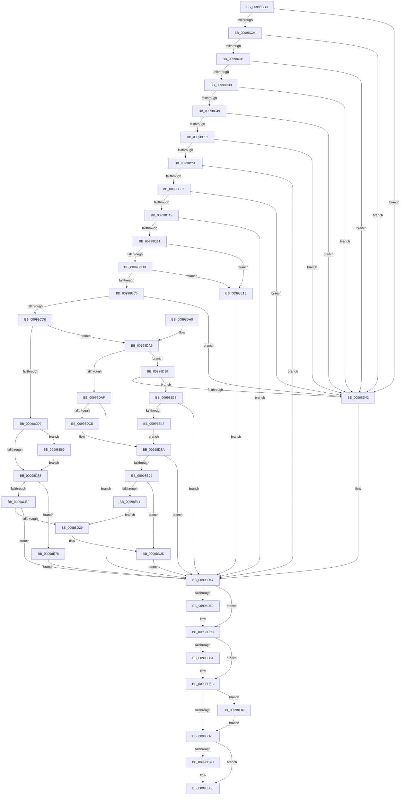

# IoOpenDriverRegistryKey

- RVA: `0x00998BB0`–`0x00998E8C` (길이 `732` bytes)
- VA: `0x0000000140998BB0`
- 실행 섹션: `PAGE`
- PDB 이름 있음: `예`; PDB Function 태그: `아니요`
- unwind 정보 RVA: `0x00099434`
- 디코드: `188`개 명령, `732/732` bytes 표시
- 미해석 바이트: `0` (있으면 어셈블리에 `.byte`로 보존)

> 이 문서는 커널 이미지의 기계어와 PDB 기호를 분석해 생성했습니다. 4번과 5번은 함수 원형과 자료형을 바이너리 사용 방식에서 추정한 C 해석이며 원본 소스 복구 결과는 아닙니다.

## 1. Dependencies

- 직접 호출 지점: **12**; 고유 호출 대상: **10**
- 직접 호출자로 확인된 함수: **1**
- RIP 상대 이미지 참조: **6**

### Outgoing calls
- `0x00998C0F` → [RtlInitUnicodeString](../../text/42/RtlInitUnicodeString_function_0042A780.md) (function, `0x0042A780`)
- `0x00998C6F` → [PipOpenServiceEnumKeys](PipOpenServiceEnumKeys_function_00998E94.md) (function, `0x00998E94`)
- `0x00998C93` → [IopGetRegistryValue](IopGetRegistryValue_function_009990EC.md) (function, `0x009990EC`)
- `0x00998D1E` → [ZwOpenKey](../../text/6A/ZwOpenKey_function_006AD310.md) (function, `0x006AD310`)
- `0x00998D50` → [ExFreePool](../../poolcode/B8/ExFreePool_function_00B82850.md) (function, `0x00B82850`)
- `0x00998D66` → [ExFreePoolWithTag](../../poolcode/B8/ExFreePoolWithTag_function_00B82870.md) (function, `0x00B82870`)
- `0x00998D80` → [ZwClose](../../text/6A/ZwClose_function_006AD2B0.md) (function, `0x006AD2B0`)
- `0x00998DBA` → [PiGetServiceNameInfo](PiGetServiceNameInfo_function_00998AA8.md) (function, `0x00998AA8`)
- `0x00998DF5` → [PiCreateServiceStateKey](PiCreateServiceStateKey_function_009993E0.md) (function, `0x009993E0`)
- `0x00998E14` → [IopApplyMutableTagToRegistryKey](IopApplyMutableTagToRegistryKey_function_00999364.md) (function, `0x00999364`)
- `0x00998E33` → [PiGetServiceNameInfo](PiGetServiceNameInfo_function_00998AA8.md) (function, `0x00998AA8`)
- `0x00998E82` → [ZwClose](../../text/6A/ZwClose_function_006AD2B0.md) (function, `0x006AD2B0`)

### Direct callers
- [DifIoOpenDriverRegistryKeyWrapper](../../text/62/DifIoOpenDriverRegistryKeyWrapper_function_0062BBE0.md) at `0x0062BCE4`

### Static image references
- `0x00998C89` → RVA `0x00AFC720` (` ?? ::NNGAKEGL::`string'`; read)
- `0x00998CEF` → RVA `0x000029C0` (`.rdata`; read)
- `0x00998DC8` → RVA `0x000029D0` (`.rdata`; read)
- `0x00998DD1` → RVA `0x000029E0` (`.rdata`; read)
- `0x00998E45` → RVA `0x00009FA0` (`.rdata`; read)
- `0x00998E4E` → RVA `0x00009FC0` (`.rdata`; read)

## 2. Other-region calls and transfers

- 다른 실행 섹션으로 향하는 call: **6**
  - `0x00998C0F` → [RtlInitUnicodeString](../../text/42/RtlInitUnicodeString_function_0042A780.md) (`PAGE` → `.text`)
  - `0x00998D1E` → [ZwOpenKey](../../text/6A/ZwOpenKey_function_006AD310.md) (`PAGE` → `.text`)
  - `0x00998D50` → [ExFreePool](../../poolcode/B8/ExFreePool_function_00B82850.md) (`PAGE` → `POOLCODE`)
  - `0x00998D66` → [ExFreePoolWithTag](../../poolcode/B8/ExFreePoolWithTag_function_00B82870.md) (`PAGE` → `POOLCODE`)
  - `0x00998D80` → [ZwClose](../../text/6A/ZwClose_function_006AD2B0.md) (`PAGE` → `.text`)
  - `0x00998E82` → [ZwClose](../../text/6A/ZwClose_function_006AD2B0.md) (`PAGE` → `.text`)
- 별도 외부 분기/꼬리 이동을 확인하지 못했습니다.

## 3. Assembly (complete function range)

```asm
00998BB0  48 8B C4                        mov rax, rsp
00998BB3  48 89 58 10                     mov qword ptr [rax + 0x10], rbx
00998BB7  48 89 70 18                     mov qword ptr [rax + 0x18], rsi
00998BBB  48 89 78 20                     mov qword ptr [rax + 0x20], rdi
00998BBF  55                              push rbp
00998BC0  41 54                           push r12
00998BC2  41 55                           push r13
00998BC4  41 56                           push r14
00998BC6  41 57                           push r15
00998BC8  48 8D 68 A9                     lea rbp, [rax - 0x57]
00998BCC  48 81 EC A0 00 00 00            sub rsp, 0xa0
00998BD3  0F 57 C0                        xorps xmm0, xmm0
00998BD6  45 33 E4                        xor r12d, r12d
00998BD9  33 C0                           xor eax, eax
00998BDB  4C 89 65 CF                     mov qword ptr [rbp - 0x31], r12
00998BDF  44 8B F2                        mov r14d, edx
00998BE2  48 89 45 17                     mov qword ptr [rbp + 0x17], rax
00998BE6  4C 8B E9                        mov r13, rcx
00998BE9  89 45 1F                        mov dword ptr [rbp + 0x1f], eax
00998BEC  33 D2                           xor edx, edx
00998BEE  44 88 65 5F                     mov byte ptr [rbp + 0x5f], r12b
00998BF2  48 8D 4D E7                     lea rcx, [rbp - 0x19]
00998BF6  4C 89 65 D7                     mov qword ptr [rbp - 0x29], r12
00998BFA  0F 11 45 F7                     movups xmmword ptr [rbp - 9], xmm0
00998BFE  41 8B F4                        mov esi, r12d
00998C01  41 8B D9                        mov ebx, r9d
00998C04  0F 11 45 07                     movups xmmword ptr [rbp + 7], xmm0
00998C08  41 8B F8                        mov edi, r8d
00998C0B  0F 11 45 E7                     movups xmmword ptr [rbp - 0x19], xmm0
00998C0F  E8 6C 1B A9 FF                  call 0x14042a780
00998C14  4C 89 65 DF                     mov qword ptr [rbp - 0x21], r12
00998C18  45 8B FC                        mov r15d, r12d
00998C1B  4D 85 ED                        test r13, r13
00998C1E  0F 84 1E 01 00 00               je 0x140998d42
00998C24  49 8B 45 30                     mov rax, qword ptr [r13 + 0x30]
00998C28  48 85 C0                        test rax, rax
00998C2B  0F 84 11 01 00 00               je 0x140998d42
00998C31  4C 39 60 20                     cmp qword ptr [rax + 0x20], r12
00998C35  0F 84 07 01 00 00               je 0x140998d42
00998C3B  48 8D 48 18                     lea rcx, [rax + 0x18]
00998C3F  66 44 39 21                     cmp word ptr [rcx], r12w
00998C43  0F 84 F9 00 00 00               je 0x140998d42
00998C49  85 DB                           test ebx, ebx
00998C4B  0F 85 F1 00 00 00               jne 0x140998d42
00998C51  4C 8B 65 7F                     mov r12, qword ptr [rbp + 0x7f]
00998C55  4D 85 E4                        test r12, r12
00998C58  0F 84 E4 00 00 00               je 0x140998d42
00998C5E  45 33 C9                        xor r9d, r9d
00998C61  40 88 74 24 20                  mov byte ptr [rsp + 0x20], sil
00998C66  4C 8D 45 DF                     lea r8, [rbp - 0x21]
00998C6A  BA 1D 00 02 00                  mov edx, 0x2001d
00998C6F  E8 20 02 00 00                  call 0x140998e94
00998C74  4C 8B 7D DF                     mov r15, qword ptr [rbp - 0x21]
00998C78  8B D8                           mov ebx, eax
00998C7A  85 C0                           test eax, eax
00998C7C  0F 88 C5 00 00 00               js 0x140998d47
00998C82  4C 8D 4D D7                     lea r9, [rbp - 0x29]
00998C86  45 33 C0                        xor r8d, r8d
00998C89  48 8D 15 90 3A 16 00            lea rdx, [rip + 0x163a90]
00998C90  49 8B CF                        mov rcx, r15
00998C93  E8 54 04 00 00                  call 0x1409990ec
00998C98  48 8B 75 D7                     mov rsi, qword ptr [rbp - 0x29]
00998C9C  8B D8                           mov ebx, eax
00998C9E  3D 34 00 00 C0                  cmp eax, 0xc0000034
00998CA3  0F 84 99 00 00 00               je 0x140998d42
00998CA9  85 C0                           test eax, eax
00998CAB  0F 88 96 00 00 00               js 0x140998d47
00998CB1  83 7E 04 04                     cmp dword ptr [rsi + 4], 4
00998CB5  0F 85 63 01 00 00               jne 0x140998e1e
00998CBB  83 7E 0C 04                     cmp dword ptr [rsi + 0xc], 4
00998CBF  0F 85 59 01 00 00               jne 0x140998e1e
00998CC5  8B 46 08                        mov eax, dword ptr [rsi + 8]
00998CC8  8B 0C 30                        mov ecx, dword ptr [rax + rsi]
00998CCB  F6 C1 0B                        test cl, 0xb
00998CCE  74 72                           je 0x140998d42
00998CD0  45 85 F6                        test r14d, r14d
00998CD3  0F 85 D0 00 00 00               jne 0x140998da9
00998CD9  0F BA E7 19                     bt edi, 0x19
00998CDD  0F 82 86 01 00 00               jb 0x140998e69
00998CE3  F7 C7 E6 FF FD 7F               test edi, 0x7ffdffe6
00998CE9  0F 85 89 01 00 00               jne 0x140998e78
00998CEF  48 8D 05 CA 9C 66 FF            lea rax, [rip - 0x996336]
00998CF6  C7 45 F7 30 00 00 00            mov dword ptr [rbp - 9], 0x30
00998CFD  0F 57 C0                        xorps xmm0, xmm0
00998D00  48 89 45 07                     mov qword ptr [rbp + 7], rax
00998D04  4C 8D 45 F7                     lea r8, [rbp - 9]
00998D08  4C 89 7D FF                     mov qword ptr [rbp - 1], r15
00998D0C  8B D7                           mov edx, edi
00998D0E  C7 45 0F 40 02 00 00            mov dword ptr [rbp + 0xf], 0x240
00998D15  48 8D 4D CF                     lea rcx, [rbp - 0x31]
00998D19  F3 0F 7F 45 17                  movdqu xmmword ptr [rbp + 0x17], xmm0
00998D1E  E8 ED 45 D1 FF                  call 0x1406ad310
00998D23  8B D8                           mov ebx, eax
00998D25  85 C0                           test eax, eax
00998D27  78 1E                           js 0x140998d47
00998D29  48 8B 45 CF                     mov rax, qword ptr [rbp - 0x31]
00998D2D  48 83 65 CF 00                  and qword ptr [rbp - 0x31], 0
00998D32  49 89 04 24                     mov qword ptr [r12], rax
00998D36  EB 0F                           jmp 0x140998d47
00998D38  41 83 FE 01                     cmp r14d, 1
00998D3C  0F 84 E6 00 00 00               je 0x140998e28
00998D42  BB 0D 00 00 C0                  mov ebx, 0xc000000d
00998D47  48 8B 4D EF                     mov rcx, qword ptr [rbp - 0x11]
00998D4B  48 85 C9                        test rcx, rcx
00998D4E  74 0C                           je 0x140998d5c
00998D50  E8 FB 9A 1E 00                  call 0x140b82850
00998D55  0F 57 C0                        xorps xmm0, xmm0
00998D58  0F 11 45 E7                     movups xmmword ptr [rbp - 0x19], xmm0
00998D5C  48 85 F6                        test rsi, rsi
00998D5F  74 0A                           je 0x140998d6b
00998D61  33 D2                           xor edx, edx
00998D63  48 8B CE                        mov rcx, rsi
00998D66  E8 05 9B 1E 00                  call 0x140b82870
00998D6B  48 8B 4D CF                     mov rcx, qword ptr [rbp - 0x31]
00998D6F  48 85 C9                        test rcx, rcx
00998D72  0F 85 0A 01 00 00               jne 0x140998e82
00998D78  4D 85 FF                        test r15, r15
00998D7B  74 08                           je 0x140998d85
00998D7D  49 8B CF                        mov rcx, r15
00998D80  E8 2B 45 D1 FF                  call 0x1406ad2b0
00998D85  4C 8D 9C 24 A0 00 00 00         lea r11, [rsp + 0xa0]
00998D8D  8B C3                           mov eax, ebx
00998D8F  49 8B 5B 38                     mov rbx, qword ptr [r11 + 0x38]
00998D93  49 8B 73 40                     mov rsi, qword ptr [r11 + 0x40]
00998D97  49 8B 7B 48                     mov rdi, qword ptr [r11 + 0x48]
00998D9B  49 8B E3                        mov rsp, r11
00998D9E  41 5F                           pop r15
00998DA0  41 5E                           pop r14
00998DA2  41 5D                           pop r13
00998DA4  41 5C                           pop r12
00998DA6  5D                              pop rbp
00998DA7  C3                              ret
00998DA8  CC                              int3
00998DA9  41 83 EE 01                     sub r14d, 1
00998DAD  75 89                           jne 0x140998d38
00998DAF  4C 8D 45 5F                     lea r8, [rbp + 0x5f]
00998DB3  49 8B CD                        mov rcx, r13
00998DB6  48 8D 55 E7                     lea rdx, [rbp - 0x19]
00998DBA  E8 E9 FC FF FF                  call 0x140998aa8
00998DBF  8B D8                           mov ebx, eax
00998DC1  85 C0                           test eax, eax
00998DC3  78 82                           js 0x140998d47
00998DC5  8A 55 5F                        mov dl, byte ptr [rbp + 0x5f]
00998DC8  48 8D 05 01 9C 66 FF            lea rax, [rip - 0x9963ff]
00998DCF  84 D2                           test dl, dl
00998DD1  4C 8D 0D 08 9C 66 FF            lea r9, [rip - 0x9963f8]
00998DD8  4C 0F 45 C8                     cmovne r9, rax
00998DDC  48 8D 45 CF                     lea rax, [rbp - 0x31]
00998DE0  48 89 44 24 30                  mov qword ptr [rsp + 0x30], rax
00998DE5  44 88 74 24 28                  mov byte ptr [rsp + 0x28], r14b
00998DEA  4D 8B C7                        mov r8, r15
00998DED  89 7C 24 20                     mov dword ptr [rsp + 0x20], edi
00998DF1  48 8D 4D E7                     lea rcx, [rbp - 0x19]
00998DF5  E8 E6 05 00 00                  call 0x1409993e0
00998DFA  8B D8                           mov ebx, eax
00998DFC  85 C0                           test eax, eax
00998DFE  0F 88 43 FF FF FF               js 0x140998d47
00998E04  48 8B 45 CF                     mov rax, qword ptr [rbp - 0x31]
00998E08  48 85 C0                        test rax, rax
00998E0B  0F 84 1C FF FF FF               je 0x140998d2d
00998E11  48 8B C8                        mov rcx, rax
00998E14  E8 4B 05 00 00                  call 0x140999364
00998E19  E9 0B FF FF FF                  jmp 0x140998d29
00998E1E  BB 4C 01 00 C0                  mov ebx, 0xc000014c
00998E23  E9 1F FF FF FF                  jmp 0x140998d47
00998E28  4C 8D 45 5F                     lea r8, [rbp + 0x5f]
00998E2C  49 8B CD                        mov rcx, r13
00998E2F  48 8D 55 E7                     lea rdx, [rbp - 0x19]
00998E33  E8 70 FC FF FF                  call 0x140998aa8
00998E38  8B D8                           mov ebx, eax
00998E3A  85 C0                           test eax, eax
00998E3C  0F 88 05 FF FF FF               js 0x140998d47
00998E42  8A 55 5F                        mov dl, byte ptr [rbp + 0x5f]
00998E45  48 8D 05 54 11 67 FF            lea rax, [rip - 0x98eeac]
00998E4C  84 D2                           test dl, dl
00998E4E  4C 8D 0D 6B 11 67 FF            lea r9, [rip - 0x98ee95]
00998E55  4C 0F 45 C8                     cmovne r9, rax
00998E59  48 8D 45 CF                     lea rax, [rbp - 0x31]
00998E5D  48 89 44 24 30                  mov qword ptr [rsp + 0x30], rax
00998E62  C6 44 24 28 01                  mov byte ptr [rsp + 0x28], 1
00998E67  EB 81                           jmp 0x140998dea
00998E69  0F BA F7 19                     btr edi, 0x19
00998E6D  81 CF 19 00 02 00               or edi, 0x20019
00998E73  E9 6B FE FF FF                  jmp 0x140998ce3
00998E78  BB 22 00 00 C0                  mov ebx, 0xc0000022
00998E7D  E9 C5 FE FF FF                  jmp 0x140998d47
00998E82  E8 29 44 D1 FF                  call 0x1406ad2b0
00998E87  E9 EC FE FF FF                  jmp 0x140998d78
```

## 4. C-style interpretation (structured pseudocode)

```c
__int64 __fastcall IoOpenDriverRegistryKey(__int64 a1, int a2, int a3, int a4)
{
    __int64 result;
    __int64 v_r12;
    __int64 v_r14;
    __int64 v_rdi;
    __int64 v_rsp;
    unsigned __int64 v_stack_m28;
    unsigned __int64 v_stack_m70;
    unsigned __int8 v_stack_m78;
    unsigned int v_stack_m80;
    unsigned __int8 v_stack_mA8;

    *(unsigned __int64 *)(v_rsp + 16) = v_rbx;
    *(unsigned __int64 *)(v_rsp + 24) = v_rsi;
    *(unsigned __int64 *)(v_rsp + 32) = v_rdi;
    v_rsp = (v_rsp) - (160);
    v_r12 = 0;
    result = 0;
    *(unsigned __int64 *)(v_rsp - 87 - 49) = 0;
    *(unsigned __int64 *)(v_rsp - 87 + 23) = 0;
    *(unsigned int *)(v_rsp - 87 + 31) = 0;
    a2 = 0;
    *(unsigned __int8 *)(v_rsp - 87 + 95) = 0;
    *(unsigned __int64 *)(v_rsp - 87 - 41) = 0;
    *(unsigned __int64 *)(v_rsp - 87 - 9) = v_xmm0;
    *(unsigned __int64 *)(v_rsp - 87 + 7) = v_xmm0;
    *(unsigned __int64 *)(v_rsp - 87 - 25) = v_xmm0;
    result = RtlInitUnicodeString(v_rsp - 87 - 25, a2, a3, a4);
    *(unsigned __int64 *)(v_rsp - 87 - 33) = 0;
    if (a1 == 0) goto loc_00998D42;
    if (*(unsigned __int64 *)(a1 + 48) == 0) goto loc_00998D42;
    if ((*(unsigned __int64 *)(*(unsigned __int64 *)(a1 + 48) + 32)) == 0) goto loc_00998D42;
    if ((*(unsigned __int16 *)(*(unsigned __int64 *)(a1 + 48) + 24)) == 0) goto loc_00998D42;
    if ((unsigned int)((unsigned int)(a4)) != 0) goto loc_00998D42;
    if (*(unsigned __int64 *)(v_rsp - 87 + 127) == 0) goto loc_00998D42;
    a4 = 0;
    v_stack_mA8 = 0;
    result = PipOpenServiceEnumKeys(*(unsigned __int64 *)(a1 + 48) + 24, (unsigned int)(0x2001DULL), v_rsp - 87 - 33, a4);
    if (sign_flag) goto loc_00998D47;
    a3 = 0;
    result = IopGetRegistryValue(*(unsigned __int64 *)(v_rsp - 87 - 33), v_rip + 1456784, a3, v_rsp - 87 - 41);
    if (((unsigned int)(result)) == 0xC0000034ULL) goto loc_00998D42;
    if (sign_flag) goto loc_00998D47;
    if ((*(unsigned int *)(*(unsigned __int64 *)(v_rsp - 87 - 41) + 4)) != 4) goto loc_00998E1E;
    if ((*(unsigned int *)(*(unsigned __int64 *)(v_rsp - 87 - 41) + 12)) != 4) goto loc_00998E1E;
    if ((((unsigned __int8)((unsigned int)(*(unsigned int *)((unsigned int)(*(unsigned int *)(*(unsigned __int64 *)(v_rsp - 87 - 41) + 8)) + *(unsigned __int64 *)(v_rsp - 87 - 41) * 1)))) & (11)) == 0) goto loc_00998D42;
    if ((unsigned int)((unsigned int)(a2)) != 0) goto loc_00998DA9;
    if (condition_is_below) goto loc_00998E69;
loc_00998CE3:
    if ((((unsigned int)((unsigned int)(a3))) & (0x7FFDFFE6ULL)) != 0) goto loc_00998E78;
    *(unsigned int *)(v_rsp - 87 - 9) = 48;
    *(unsigned __int64 *)(v_rsp - 87 + 7) = v_rip - 10052406;
    *(unsigned __int64 *)(v_rsp - 87 - 1) = *(unsigned __int64 *)(v_rsp - 87 - 33);
    *(unsigned int *)(v_rsp - 87 + 15) = 576;
    *(unsigned __int64 *)(v_rsp - 87 + 23) = v_xmm0;
    result = ZwOpenKey(v_rsp - 87 - 49, (unsigned int)((unsigned int)((unsigned int)(a3))), v_rsp - 87 - 9, v_rsp - 87 - 41);
    if (sign_flag) goto loc_00998D47;
loc_00998D29:
loc_00998D2D:
    *(unsigned __int64 *)(*(unsigned __int64 *)(v_rsp - 87 + 127)) = *(unsigned __int64 *)(v_rsp - 87 - 49);
    goto loc_00998D47;
loc_00998D38:
    if (((unsigned int)((unsigned int)(a2))) == 1) goto loc_00998E28;
loc_00998D42:
loc_00998D47:
    result = *(unsigned __int64 *)(v_rsp - 87 - 49);
    if (*(unsigned __int64 *)(v_rsp - 87 - 17) != 0) {
        result = ExFreePool(*(unsigned __int64 *)(v_rsp - 87 - 17), (unsigned int)((unsigned int)((unsigned int)(a3))), v_rsp - 87 - 9, v_rsp - 87 - 41);
        *(unsigned __int64 *)(v_rsp - 87 - 25) = v_xmm0;
    }
    if (*(unsigned __int64 *)(v_rsp - 87 - 41) != 0) {
        a2 = 0;
        a1 = *(unsigned __int64 *)(v_rsp - 87 - 41);
        result = ExFreePoolWithTag(a1, a2, v_rsp - 87 - 9, v_rsp - 87 - 41);
    }
    if (*(unsigned __int64 *)(v_rsp - 87 - 49) != 0) goto loc_00998E82;
loc_00998D78:
    if (*(unsigned __int64 *)(v_rsp - 87 - 33) != 0) {
        a1 = *(unsigned __int64 *)(v_rsp - 87 - 33);
        result = ZwClose(a1, a2, v_rsp - 87 - 9, v_rsp - 87 - 41);
    }
    return (unsigned int)((unsigned int)((unsigned int)(0xC000000DULL)));
loc_00998DA9:
    v_r14 = (unsigned int)(((unsigned int)(a2)) - (1));
    if (condition_is_not_equal) goto loc_00998D38;
    result = PiGetServiceNameInfo(a1, v_rsp - 87 - 25, v_rsp - 87 + 95, v_rsp - 87 - 41);
    if (sign_flag) goto loc_00998D47;
    a4 = v_rip - 10052600;
    if ((unsigned __int8)(*(unsigned __int8 *)(v_rsp - 87 + 95)) != 0) { a4 = v_rip - 10052607; }
    v_stack_m70 = v_rsp - 87 - 49;
    v_stack_m78 = (unsigned __int8)(v_r14);
loc_00998DEA:
    v_stack_m80 = (unsigned int)(*(unsigned __int64 *)(v_stack_m28 + 72));
    result = PiCreateServiceStateKey(v_rsp - 87 - 25, *(unsigned __int8 *)(v_rsp - 87 + 95), *(unsigned __int64 *)(v_rsp - 87 - 33), a4);
    if (sign_flag) goto loc_00998D47;
    if (*(unsigned __int64 *)(v_rsp - 87 - 49) == 0) goto loc_00998D2D;
    result = IopApplyMutableTagToRegistryKey(*(unsigned __int64 *)(v_rsp - 87 - 49), *(unsigned __int8 *)(v_rsp - 87 + 95), *(unsigned __int64 *)(v_rsp - 87 - 33), a4);
    goto loc_00998D29;
loc_00998E1E:
    goto loc_00998D47;
loc_00998E28:
    result = PiGetServiceNameInfo(a1, v_rsp - 87 - 25, v_rsp - 87 + 95, a4);
    if (sign_flag) goto loc_00998D47;
    a4 = v_rip - 10022549;
    if ((unsigned __int8)(*(unsigned __int8 *)(v_rsp - 87 + 95)) != 0) { a4 = v_rip - 10022572; }
    v_stack_m70 = v_rsp - 87 - 49;
    v_stack_m78 = 1;
    goto loc_00998DEA;
loc_00998E69:
    v_rdi = (unsigned int)((*(unsigned __int64 *)(v_stack_m28 + 72)) | (0x20019ULL));
    goto loc_00998CE3;
loc_00998E78:
    goto loc_00998D47;
loc_00998E82:
    result = ZwClose(a1, *(unsigned __int8 *)(v_rsp - 87 + 95), v_rsp - 87 + 95, a4);
    goto loc_00998D78;
}
```

## 5. (Beta) C Style

```c
int64_t IoOpenDriverRegistryKey(int64_t Arg1, int32_t Arg2, int32_t Arg3, int32_t Arg4)
{
    int64_t result;
    int64_t local_r12;
    int64_t local_r14;
    int64_t local_rdi;
    int64_t local_rsp;
    uint64_t v_stack_m28;
    uint64_t v_stack_m70;
    uint8_t v_stack_m78;
    uint32_t v_stack_m80;
    uint8_t v_stack_mA8;

    *(uint64_t *)(local_rsp + 0x10) = local_rbx;
    *(uint64_t *)(local_rsp + 0x18) = local_rsi;
    *(uint64_t *)(local_rsp + 0x20) = local_rdi;
    local_rsp = (local_rsp) - (160);
    local_r12 = 0;
    result = 0;
    *(uint64_t *)(local_rsp - 0x57 - 0x31) = 0;
    *(uint64_t *)(local_rsp - 0x57 + 0x17) = 0;
    *(uint32_t *)(local_rsp - 0x57 + 0x1F) = 0;
    Arg2 = 0;
    *(uint8_t *)(local_rsp - 0x57 + 0x5F) = 0;
    *(uint64_t *)(local_rsp - 0x57 - 0x29) = 0;
    *(uint64_t *)(local_rsp - 0x57 - 0x9) = v_xmm0;
    *(uint64_t *)(local_rsp - 0x57 + 0x7) = v_xmm0;
    *(uint64_t *)(local_rsp - 0x57 - 0x19) = v_xmm0;
    result = RtlInitUnicodeString(local_rsp - 87 - 25, Arg2, Arg3, Arg4);
    *(uint64_t *)(local_rsp - 0x57 - 0x21) = 0;
    if (Arg1 == 0) goto loc_00998D42;
    if (*(uint64_t *)(Arg1 + 0x30) == 0) goto loc_00998D42;
    if ((*(uint64_t *)(*(uint64_t *)(Arg1 + 0x30) + 0x20)) == 0) goto loc_00998D42;
    if ((*(uint16_t *)(*(uint64_t *)(Arg1 + 0x30) + 0x18)) == 0) goto loc_00998D42;
    if ((uint32_t)((uint32_t)(Arg4)) != 0) goto loc_00998D42;
    if (*(uint64_t *)(local_rsp - 0x57 + 0x7F) == 0) goto loc_00998D42;
    Arg4 = 0;
    v_stack_mA8 = 0;
    result = PipOpenServiceEnumKeys(*(uint64_t *)(Arg1 + 0x30) + 24, (uint32_t)(0x2001DULL), local_rsp - 87 - 33, Arg4);
    if (sign_flag) goto loc_00998D47;
    Arg3 = 0;
    result = IopGetRegistryValue(*(uint64_t *)(local_rsp - 0x57 - 0x21), v_rip + 1456784, Arg3, local_rsp - 87 - 41);
    if (((uint32_t)(result)) == 0xC0000034ULL) goto loc_00998D42;
    if (sign_flag) goto loc_00998D47;
    if ((*(uint32_t *)(*(uint64_t *)(local_rsp - 0x57 - 0x29) + 0x4)) != 4) goto loc_00998E1E;
    if ((*(uint32_t *)(*(uint64_t *)(local_rsp - 0x57 - 0x29) + 0xC)) != 4) goto loc_00998E1E;
    if ((((uint8_t)((uint32_t)(*(uint32_t *)((uint32_t)(*(uint32_t *)(*(uint64_t *)(local_rsp - 0x57 - 0x29) + 0x8)) + *(uint64_t *)(local_rsp - 0x57 - 0x29) * 1)))) & (11)) == 0) goto loc_00998D42;
    if ((uint32_t)((uint32_t)(Arg2)) != 0) goto loc_00998DA9;
    if (condition_is_below) goto loc_00998E69;
loc_00998CE3:
    if ((((uint32_t)((uint32_t)(Arg3))) & (0x7FFDFFE6ULL)) != 0) goto loc_00998E78;
    *(uint32_t *)(local_rsp - 0x57 - 0x9) = 48;
    *(uint64_t *)(local_rsp - 0x57 + 0x7) = v_rip - 10052406;
    *(uint64_t *)(local_rsp - 0x57 - 0x1) = *(uint64_t *)(local_rsp - 0x57 - 0x21);
    *(uint32_t *)(local_rsp - 0x57 + 0xF) = 576;
    *(uint64_t *)(local_rsp - 0x57 + 0x17) = v_xmm0;
    result = ZwOpenKey(local_rsp - 87 - 49, (uint32_t)((uint32_t)((uint32_t)(Arg3))), local_rsp - 87 - 9, local_rsp - 87 - 41);
    if (sign_flag) goto loc_00998D47;
loc_00998D29:
loc_00998D2D:
    *(uint64_t *)(*(uint64_t *)(local_rsp - 0x57 + 0x7F)) = *(uint64_t *)(local_rsp - 0x57 - 0x31);
    goto loc_00998D47;
loc_00998D38:
    if (((uint32_t)((uint32_t)(Arg2))) == 1) goto loc_00998E28;
loc_00998D42:
loc_00998D47:
    result = *(uint64_t *)(local_rsp - 0x57 - 0x31);
    if (*(uint64_t *)(local_rsp - 0x57 - 0x11) != 0) {
        result = ExFreePool(*(uint64_t *)(local_rsp - 0x57 - 0x11), (uint32_t)((uint32_t)((uint32_t)(Arg3))), local_rsp - 87 - 9, local_rsp - 87 - 41);
        *(uint64_t *)(local_rsp - 0x57 - 0x19) = v_xmm0;
    }
    if (*(uint64_t *)(local_rsp - 0x57 - 0x29) != 0) {
        Arg2 = 0;
        Arg1 = *(uint64_t *)(local_rsp - 0x57 - 0x29);
        result = ExFreePoolWithTag(Arg1, Arg2, local_rsp - 87 - 9, local_rsp - 87 - 41);
    }
    if (*(uint64_t *)(local_rsp - 0x57 - 0x31) != 0) goto loc_00998E82;
loc_00998D78:
    if (*(uint64_t *)(local_rsp - 0x57 - 0x21) != 0) {
        Arg1 = *(uint64_t *)(local_rsp - 0x57 - 0x21);
        result = ZwClose(Arg1, Arg2, local_rsp - 87 - 9, local_rsp - 87 - 41);
    }
    return (uint32_t)((uint32_t)((uint32_t)(0xC000000DULL)));
loc_00998DA9:
    local_r14 = (uint32_t)(((uint32_t)(Arg2)) - (1));
    if (condition_is_not_equal) goto loc_00998D38;
    result = PiGetServiceNameInfo(Arg1, local_rsp - 87 - 25, local_rsp - 87 + 95, local_rsp - 87 - 41);
    if (sign_flag) goto loc_00998D47;
    Arg4 = v_rip - 10052600;
    if ((uint8_t)(*(uint8_t *)(local_rsp - 0x57 + 0x5F)) != 0) { Arg4 = v_rip - 10052607; }
    v_stack_m70 = local_rsp - 87 - 49;
    v_stack_m78 = (uint8_t)(local_r14);
loc_00998DEA:
    v_stack_m80 = (uint32_t)(*(uint64_t *)(v_stack_m28 + 0x48));
    result = PiCreateServiceStateKey(local_rsp - 87 - 25, *(uint8_t *)(local_rsp - 0x57 + 0x5F), *(uint64_t *)(local_rsp - 0x57 - 0x21), Arg4);
    if (sign_flag) goto loc_00998D47;
    if (*(uint64_t *)(local_rsp - 0x57 - 0x31) == 0) goto loc_00998D2D;
    result = IopApplyMutableTagToRegistryKey(*(uint64_t *)(local_rsp - 0x57 - 0x31), *(uint8_t *)(local_rsp - 0x57 + 0x5F), *(uint64_t *)(local_rsp - 0x57 - 0x21), Arg4);
    goto loc_00998D29;
loc_00998E1E:
    goto loc_00998D47;
loc_00998E28:
    result = PiGetServiceNameInfo(Arg1, local_rsp - 87 - 25, local_rsp - 87 + 95, Arg4);
    if (sign_flag) goto loc_00998D47;
    Arg4 = v_rip - 10022549;
    if ((uint8_t)(*(uint8_t *)(local_rsp - 0x57 + 0x5F)) != 0) { Arg4 = v_rip - 10022572; }
    v_stack_m70 = local_rsp - 87 - 49;
    v_stack_m78 = 1;
    goto loc_00998DEA;
loc_00998E69:
    local_rdi = (uint32_t)((*(uint64_t *)(v_stack_m28 + 0x48)) | (0x20019ULL));
    goto loc_00998CE3;
loc_00998E78:
    goto loc_00998D47;
loc_00998E82:
    result = ZwClose(Arg1, *(uint8_t *)(local_rsp - 0x57 + 0x5F), local_rsp - 87 + 95, Arg4);
    goto loc_00998D78;
}
```

## 6. Execution-region graph

[열기: 2D/3D 그래프와 함수 탐색 컨트롤 패널](../../../control-panel.html?section=page&rva=0x00998BB0&view=graph)

- 2D 그래프는 위에서 아래로 흐르고, 3D 그래프는 빈 공간을 드래그해 회전합니다. Shift+드래그는 이동, 휠은 확대·축소, 함수 노드 선택은 대상 보고서 이동입니다.

### Static fallback


