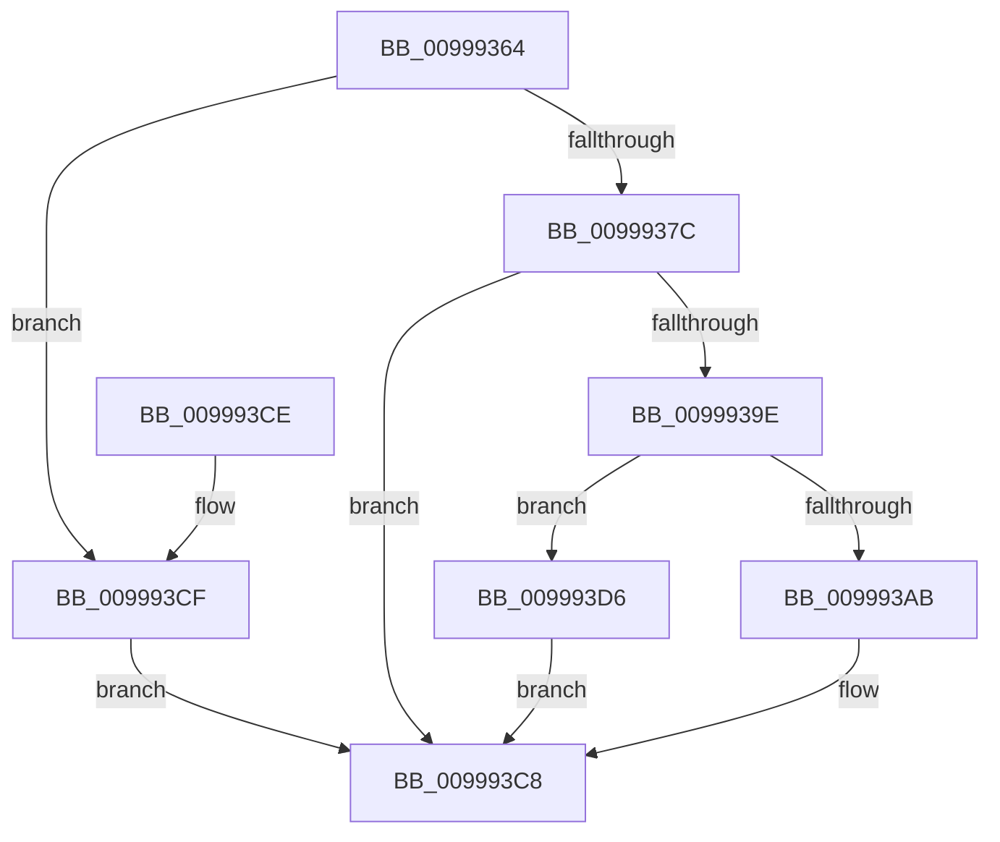

# IopApplyMutableTagToRegistryKey

- RVA: `0x00999364`–`0x009993DA` (길이 `118` bytes)
- VA: `0x0000000140999364`
- 실행 섹션: `PAGE`
- PDB 이름 있음: `예`; PDB Function 태그: `아니요`
- unwind 정보 RVA: `0x00086DE4`
- 디코드: `34`개 명령, `118/118` bytes 표시
- 미해석 바이트: `0` (있으면 어셈블리에 `.byte`로 보존)

> 이 문서는 커널 이미지의 기계어와 PDB 기호를 분석해 생성했습니다. 4번과 5번은 함수 원형과 자료형을 바이너리 사용 방식에서 추정한 C 해석이며 원본 소스 복구 결과는 아닙니다.

## 1. Dependencies

- 직접 호출 지점: **2**; 고유 호출 대상: **2**
- 직접 호출자로 확인된 함수: **3**
- RIP 상대 이미지 참조: **0**

### Outgoing calls
- `0x00999395` → [ZwQueryKey](../../text/6A/ZwQueryKey_function_006AD390.md) (function, `0x006AD390`)
- `0x009993C3` → [ZwSetInformationKey](../../text/6B/ZwSetInformationKey_function_006B0630.md) (function, `0x006B0630`)

### Direct callers
- [IoOpenDriverRegistryKey](IoOpenDriverRegistryKey_function_00998BB0.md) at `0x00998E14`
- [IoOpenDeviceRegistryKey](IoOpenDeviceRegistryKey_function_00999250.md) at `0x0099931F`
- [IoOpenDeviceInterfaceRegistryKey](../AC/IoOpenDeviceInterfaceRegistryKey_function_00AC5C60.md) at `0x00AC5D13`

### Static image references
- 디코드된 RIP-relative 메모리 참조가 없습니다.

## 2. Other-region calls and transfers

- 다른 실행 섹션으로 향하는 call: **2**
  - `0x00999395` → [ZwQueryKey](../../text/6A/ZwQueryKey_function_006AD390.md) (`PAGE` → `.text`)
  - `0x009993C3` → [ZwSetInformationKey](../../text/6B/ZwSetInformationKey_function_006B0630.md) (`PAGE` → `.text`)
- 별도 외부 분기/꼬리 이동을 확인하지 못했습니다.

## 3. Assembly (complete function range)

```asm
00999364  40 53                           push rbx
00999366  48 83 EC 30                     sub rsp, 0x30
0099936A  83 64 24 40 00                  and dword ptr [rsp + 0x40], 0
0099936F  48 8B D9                        mov rbx, rcx
00999372  83 64 24 48 00                  and dword ptr [rsp + 0x48], 0
00999377  48 85 C9                        test rcx, rcx
0099937A  74 53                           je 0x1409993cf
0099937C  41 B9 04 00 00 00               mov r9d, 4
00999382  48 8D 44 24 48                  lea rax, [rsp + 0x48]
00999387  4C 8D 44 24 40                  lea r8, [rsp + 0x40]
0099938C  48 89 44 24 20                  mov qword ptr [rsp + 0x20], rax
00999391  41 8D 51 03                     lea edx, [r9 + 3]
00999395  E8 F6 3F D1 FF                  call 0x1406ad390
0099939A  85 C0                           test eax, eax
0099939C  78 2A                           js 0x1409993c8
0099939E  8B 44 24 40                     mov eax, dword ptr [rsp + 0x40]
009993A2  B9 00 10 00 00                  mov ecx, 0x1000
009993A7  85 C1                           test ecx, eax
009993A9  75 2B                           jne 0x1409993d6
009993AB  0B C1                           or eax, ecx
009993AD  4C 8D 44 24 40                  lea r8, [rsp + 0x40]
009993B2  41 B9 04 00 00 00               mov r9d, 4
009993B8  89 44 24 40                     mov dword ptr [rsp + 0x40], eax
009993BC  48 8B CB                        mov rcx, rbx
009993BF  41 8D 51 01                     lea edx, [r9 + 1]
009993C3  E8 68 72 D1 FF                  call 0x1406b0630
009993C8  48 83 C4 30                     add rsp, 0x30
009993CC  5B                              pop rbx
009993CD  C3                              ret
009993CE  CC                              int3
009993CF  B8 0D 00 00 C0                  mov eax, 0xc000000d
009993D4  EB F2                           jmp 0x1409993c8
009993D6  33 C0                           xor eax, eax
009993D8  EB EE                           jmp 0x1409993c8
```

## 4. C-style interpretation (structured pseudocode)

```c
__int64 __fastcall IopApplyMutableTagToRegistryKey(__int64 a1)
{
    __int64 result;
    __int64 v_rsp;
    unsigned __int64 v_stack_m18;
    unsigned int v_stack_p10;
    unsigned int v_stack_p8;

    v_rsp = (v_rsp) - (48);
    if (a1 == 0) goto loc_009993CF;
    v_stack_m18 = v_stack_p10;
    result = ZwQueryKey(a1, 4 + 3, v_stack_p8, 4);
    if (sign_flag) goto loc_009993C8;
    if ((((unsigned int)((unsigned int)(0x1000ULL))) & ((unsigned int)((unsigned int)(v_stack_p8)))) != 0) goto loc_009993D6;
    result = (unsigned int)(((unsigned int)(v_stack_p8)) | ((unsigned int)((unsigned int)(0x1000ULL))));
    v_stack_p8 = (unsigned int)(result);
    result = ZwSetInformationKey(a1, 4 + 1, v_stack_p8, 4);
loc_009993C8:
    v_rsp = (v_rsp) + (48);
    return result;
loc_009993CF:
    goto loc_009993C8;
loc_009993D6:
    result = 0;
    goto loc_009993C8;
}
```

## 5. (Beta) C Style

```c
int64_t IopApplyMutableTagToRegistryKey(int64_t Arg1)
{
    int64_t result;
    int64_t local_rsp;
    uint64_t v_stack_m18;
    uint32_t v_stack_p10;
    uint32_t v_stack_p8;

    local_rsp = (local_rsp) - (48);
    if (Arg1 == 0) goto loc_009993CF;
    v_stack_m18 = v_stack_p10;
    result = ZwQueryKey(Arg1, 4 + 3, v_stack_p8, 4);
    if (sign_flag) goto loc_009993C8;
    if ((((uint32_t)((uint32_t)(0x1000ULL))) & ((uint32_t)((uint32_t)(v_stack_p8)))) != 0) goto loc_009993D6;
    result = (uint32_t)(((uint32_t)(v_stack_p8)) | ((uint32_t)((uint32_t)(0x1000ULL))));
    v_stack_p8 = (uint32_t)(result);
    result = ZwSetInformationKey(Arg1, 4 + 1, v_stack_p8, 4);
loc_009993C8:
    local_rsp = (local_rsp) + (48);
    return result;
loc_009993CF:
    goto loc_009993C8;
loc_009993D6:
    result = 0;
    goto loc_009993C8;
}
```

## 6. Execution-region graph

[열기: 2D/3D 그래프와 함수 탐색 컨트롤 패널](../../../control-panel.html?section=page&rva=0x00999364&view=graph)

- 2D 그래프는 위에서 아래로 흐르고, 3D 그래프는 빈 공간을 드래그해 회전합니다. Shift+드래그는 이동, 휠은 확대·축소, 함수 노드 선택은 대상 보고서 이동입니다.

### Static fallback


