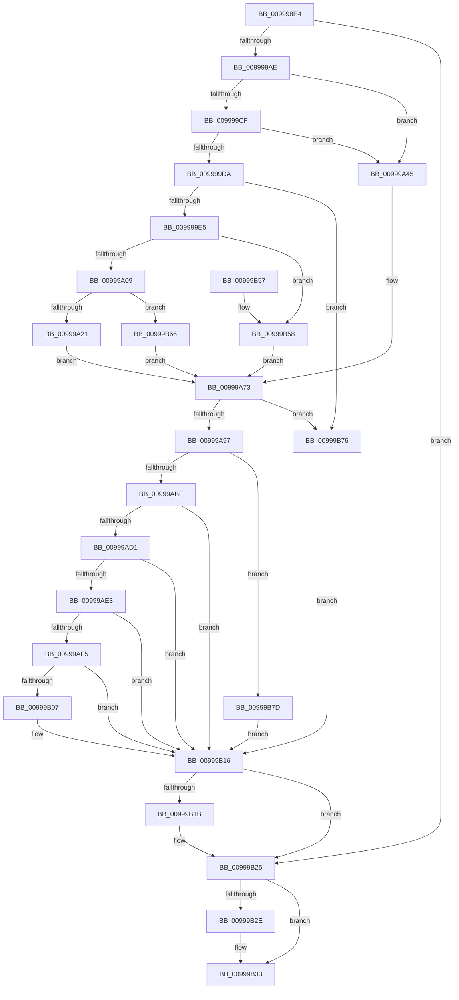

# IopBuildFullDriverPath

- RVA: `0x009998E4`–`0x00999B84` (길이 `672` bytes)
- VA: `0x00000001409998E4`
- 실행 섹션: `PAGE`
- PDB 이름 있음: `예`; PDB Function 태그: `아니요`
- unwind 정보 RVA: `0x0009951C`
- 디코드: `180`개 명령, `672/672` bytes 표시
- 미해석 바이트: `0` (있으면 어셈블리에 `.byte`로 보존)

> 이 문서는 커널 이미지의 기계어와 PDB 기호를 분석해 생성했습니다. 4번과 5번은 함수 원형과 자료형을 바이너리 사용 방식에서 추정한 C 해석이며 원본 소스 복구 결과는 아닙니다.

## 1. Dependencies

- 직접 호출 지점: **18**; 고유 호출 대상: **8**
- 직접 호출자로 확인된 함수: **3**
- RIP 상대 이미지 참조: **4**

### Outgoing calls
- `0x00999955` → [RtlInitUnicodeString](../../text/42/RtlInitUnicodeString_function_0042A780.md) (function, `0x0042A780`)
- `0x00999960` → [RtlInitUnicodeString](../../text/42/RtlInitUnicodeString_function_0042A780.md) (function, `0x0042A780`)
- `0x0099996B` → [RtlInitUnicodeString](../../text/42/RtlInitUnicodeString_function_0042A780.md) (function, `0x0042A780`)
- `0x00999976` → [RtlInitUnicodeString](../../text/42/RtlInitUnicodeString_function_0042A780.md) (function, `0x0042A780`)
- `0x00999981` → [RtlInitUnicodeString](../../text/42/RtlInitUnicodeString_function_0042A780.md) (function, `0x0042A780`)
- `0x0099998C` → [RtlInitUnicodeString](../../text/42/RtlInitUnicodeString_function_0042A780.md) (function, `0x0042A780`)
- `0x0099999F` → [IopQueryRegistryKeySystemPath](IopQueryRegistryKeySystemPath_function_0099A1CC.md) (function, `0x0099A1CC`)
- `0x009999C2` → [IopGetRegistryValue](IopGetRegistryValue_function_009990EC.md) (function, `0x009990EC`)
- `0x00999A14` → [RtlPrefixUnicodeString](../8F/RtlPrefixUnicodeString_function_008F4F70.md) (function, `0x008F4F70`)
- `0x00999A6A` → [RtlInitUnicodeString](../../text/42/RtlInitUnicodeString_function_0042A780.md) (function, `0x0042A780`)
- `0x00999AAD` → [ExAllocatePool2](../../poolcode/B8/ExAllocatePool2_function_00B820F0.md) (function, `0x00B820F0`)
- `0x00999AC6` → [RtlAppendUnicodeStringToString](../../text/40/RtlAppendUnicodeStringToString_function_0040FA50.md) (function, `0x0040FA50`)
- `0x00999AD8` → [RtlAppendUnicodeStringToString](../../text/40/RtlAppendUnicodeStringToString_function_0040FA50.md) (function, `0x0040FA50`)
- `0x00999AEA` → [RtlAppendUnicodeStringToString](../../text/40/RtlAppendUnicodeStringToString_function_0040FA50.md) (function, `0x0040FA50`)
- `0x00999AFC` → [RtlAppendUnicodeStringToString](../../text/40/RtlAppendUnicodeStringToString_function_0040FA50.md) (function, `0x0040FA50`)
- `0x00999B20` → [ExFreePoolWithTag](../../poolcode/B8/ExFreePoolWithTag_function_00B82870.md) (function, `0x00B82870`)
- `0x00999B2E` → [ExFreePool](../../poolcode/B8/ExFreePool_function_00B82850.md) (function, `0x00B82850`)
- `0x00999B6C` → [RtlInitUnicodeString](../../text/42/RtlInitUnicodeString_function_0042A780.md) (function, `0x0042A780`)

### Direct callers
- [IopLoadDriver](IopLoadDriver_function_00997B54.md) at `0x00997CD2`
- [PiNormalizeDeviceText](PiNormalizeDeviceText_function_0099A43C.md) at `0x0099A657`
- [PpCheckInDriverDatabase](PpCheckInDriverDatabase_function_0099A9E4.md) at `0x0099AA1F`

### Static image references
- `0x00999915` → RVA `0x00AFC880` (` ?? ::NNGAKEGL::`string'`; read)
- `0x0099992B` → RVA `0x00AFC820` (` ?? ::NNGAKEGL::`string'`; read)
- `0x009999B8` → RVA `0x00AFC910` (` ?? ::NNGAKEGL::`string'`; read)
- `0x00999A49` → RVA `0x00AFC900` (` ?? ::NNGAKEGL::`string'`; read)

## 2. Other-region calls and transfers

- 다른 실행 섹션으로 향하는 call: **15**
  - `0x00999955` → [RtlInitUnicodeString](../../text/42/RtlInitUnicodeString_function_0042A780.md) (`PAGE` → `.text`)
  - `0x00999960` → [RtlInitUnicodeString](../../text/42/RtlInitUnicodeString_function_0042A780.md) (`PAGE` → `.text`)
  - `0x0099996B` → [RtlInitUnicodeString](../../text/42/RtlInitUnicodeString_function_0042A780.md) (`PAGE` → `.text`)
  - `0x00999976` → [RtlInitUnicodeString](../../text/42/RtlInitUnicodeString_function_0042A780.md) (`PAGE` → `.text`)
  - `0x00999981` → [RtlInitUnicodeString](../../text/42/RtlInitUnicodeString_function_0042A780.md) (`PAGE` → `.text`)
  - `0x0099998C` → [RtlInitUnicodeString](../../text/42/RtlInitUnicodeString_function_0042A780.md) (`PAGE` → `.text`)
  - `0x00999A6A` → [RtlInitUnicodeString](../../text/42/RtlInitUnicodeString_function_0042A780.md) (`PAGE` → `.text`)
  - `0x00999AAD` → [ExAllocatePool2](../../poolcode/B8/ExAllocatePool2_function_00B820F0.md) (`PAGE` → `POOLCODE`)
  - `0x00999AC6` → [RtlAppendUnicodeStringToString](../../text/40/RtlAppendUnicodeStringToString_function_0040FA50.md) (`PAGE` → `.text`)
  - `0x00999AD8` → [RtlAppendUnicodeStringToString](../../text/40/RtlAppendUnicodeStringToString_function_0040FA50.md) (`PAGE` → `.text`)
  - `0x00999AEA` → [RtlAppendUnicodeStringToString](../../text/40/RtlAppendUnicodeStringToString_function_0040FA50.md) (`PAGE` → `.text`)
  - `0x00999AFC` → [RtlAppendUnicodeStringToString](../../text/40/RtlAppendUnicodeStringToString_function_0040FA50.md) (`PAGE` → `.text`)
  - `0x00999B20` → [ExFreePoolWithTag](../../poolcode/B8/ExFreePoolWithTag_function_00B82870.md) (`PAGE` → `POOLCODE`)
  - `0x00999B2E` → [ExFreePool](../../poolcode/B8/ExFreePool_function_00B82850.md) (`PAGE` → `POOLCODE`)
  - `0x00999B6C` → [RtlInitUnicodeString](../../text/42/RtlInitUnicodeString_function_0042A780.md) (`PAGE` → `.text`)
- 별도 외부 분기/꼬리 이동을 확인하지 못했습니다.

## 3. Assembly (complete function range)

```asm
009998E4  48 8B C4                        mov rax, rsp
009998E7  48 89 58 08                     mov qword ptr [rax + 8], rbx
009998EB  48 89 70 10                     mov qword ptr [rax + 0x10], rsi
009998EF  48 89 78 18                     mov qword ptr [rax + 0x18], rdi
009998F3  55                              push rbp
009998F4  41 56                           push r14
009998F6  41 57                           push r15
009998F8  48 8D 68 A1                     lea rbp, [rax - 0x5f]
009998FC  48 81 EC A0 00 00 00            sub rsp, 0xa0
00999903  0F 57 C0                        xorps xmm0, xmm0
00999906  0F 29 70 D8                     movaps xmmword ptr [rax - 0x28], xmm6
0099990A  0F 57 C9                        xorps xmm1, xmm1
0099990D  48 C7 45 F7 18 00 1A 00         mov qword ptr [rbp - 9], 0x1a0018
00999915  48 8D 05 64 2F 16 00            lea rax, [rip + 0x162f64]
0099991C  48 C7 45 07 22 00 24 00         mov qword ptr [rbp + 7], 0x240022
00999924  48 89 45 FF                     mov qword ptr [rbp - 1], rax
00999928  48 8B F2                        mov rsi, rdx
0099992B  48 8D 05 EE 2E 16 00            lea rax, [rip + 0x162eee]
00999932  4C 8B F1                        mov r14, rcx
00999935  33 D2                           xor edx, edx
00999937  48 89 45 0F                     mov qword ptr [rbp + 0xf], rax
0099993B  49 8B C8                        mov rcx, r8
0099993E  49 8B F8                        mov rdi, r8
00999941  0F 11 45 E7                     movups xmmword ptr [rbp - 0x19], xmm0
00999945  0F 11 4D D7                     movups xmmword ptr [rbp - 0x29], xmm1
00999949  0F 11 45 17                     movups xmmword ptr [rbp + 0x17], xmm0
0099994D  0F 11 4D C7                     movups xmmword ptr [rbp - 0x39], xmm1
00999951  0F 11 45 27                     movups xmmword ptr [rbp + 0x27], xmm0
00999955  E8 26 0E A9 FF                  call 0x14042a780
0099995A  33 D2                           xor edx, edx
0099995C  48 8D 4D E7                     lea rcx, [rbp - 0x19]
00999960  E8 1B 0E A9 FF                  call 0x14042a780
00999965  33 D2                           xor edx, edx
00999967  48 8D 4D D7                     lea rcx, [rbp - 0x29]
0099996B  E8 10 0E A9 FF                  call 0x14042a780
00999970  33 D2                           xor edx, edx
00999972  48 8D 4D 17                     lea rcx, [rbp + 0x17]
00999976  E8 05 0E A9 FF                  call 0x14042a780
0099997B  33 D2                           xor edx, edx
0099997D  48 8D 4D C7                     lea rcx, [rbp - 0x39]
00999981  E8 FA 0D A9 FF                  call 0x14042a780
00999986  33 D2                           xor edx, edx
00999988  48 8D 4D 27                     lea rcx, [rbp + 0x27]
0099998C  E8 EF 0D A9 FF                  call 0x14042a780
00999991  45 33 FF                        xor r15d, r15d
00999994  48 8D 55 E7                     lea rdx, [rbp - 0x19]
00999998  48 8B CE                        mov rcx, rsi
0099999B  4C 89 7D 7F                     mov qword ptr [rbp + 0x7f], r15
0099999F  E8 28 08 00 00                  call 0x14099a1cc
009999A4  8B D8                           mov ebx, eax
009999A6  85 C0                           test eax, eax
009999A8  0F 88 77 01 00 00               js 0x140999b25
009999AE  4C 8D 4D 7F                     lea r9, [rbp + 0x7f]
009999B2  41 B8 00 01 00 00               mov r8d, 0x100
009999B8  48 8D 15 51 2F 16 00            lea rdx, [rip + 0x162f51]
009999BF  48 8B CE                        mov rcx, rsi
009999C2  E8 25 F7 FF FF                  call 0x1409990ec
009999C7  48 8B 75 7F                     mov rsi, qword ptr [rbp + 0x7f]
009999CB  85 C0                           test eax, eax
009999CD  78 76                           js 0x140999a45
009999CF  8B 46 0C                        mov eax, dword ptr [rsi + 0xc]
009999D2  41 8D 4F 02                     lea ecx, [r15 + 2]
009999D6  3B C1                           cmp eax, ecx
009999D8  72 6B                           jb 0x140999a45
009999DA  3D FF FF 00 00                  cmp eax, 0xffff
009999DF  0F 87 91 01 00 00               ja 0x140999b76
009999E5  44 8B 76 08                     mov r14d, dword ptr [rsi + 8]
009999E9  0F B7 D8                        movzx ebx, ax
009999EC  4C 03 F6                        add r14, rsi
009999EF  66 89 45 C9                     mov word ptr [rbp - 0x37], ax
009999F3  66 2B D9                        sub bx, cx
009999F6  4C 89 75 CF                     mov qword ptr [rbp - 0x31], r14
009999FA  66 89 5D C7                     mov word ptr [rbp - 0x39], bx
009999FE  66 41 83 3E 5C                  cmp word ptr [r14], 0x5c
00999A03  0F 85 4F 01 00 00               jne 0x140999b58
00999A09  41 B0 01                        mov r8b, 1
00999A0C  48 8D 55 C7                     lea rdx, [rbp - 0x39]
00999A10  48 8D 4D F7                     lea rcx, [rbp - 9]
00999A14  E8 57 B5 F5 FF                  call 0x1408f4f70
00999A19  84 C0                           test al, al
00999A1B  0F 84 45 01 00 00               je 0x140999b66
00999A21  0F 28 45 E7                     movaps xmm0, xmmword ptr [rbp - 0x19]
00999A25  41 8D 4F 18                     lea ecx, [r15 + 0x18]
00999A29  0F B7 C1                        movzx eax, cx
00999A2C  48 D1 E8                        shr rax, 1
00999A2F  66 2B D9                        sub bx, cx
00999A32  66 0F 7F 45 D7                  movdqa xmmword ptr [rbp - 0x29], xmm0
00999A37  66 89 5D C7                     mov word ptr [rbp - 0x39], bx
00999A3B  49 8D 04 46                     lea rax, [r14 + rax*2]
00999A3F  48 89 45 CF                     mov qword ptr [rbp - 0x31], rax
00999A43  EB 2E                           jmp 0x140999a73
00999A45  41 0F 10 36                     movups xmm6, xmmword ptr [r14]
00999A49  48 8D 15 B0 2E 16 00            lea rdx, [rip + 0x162eb0]
00999A50  0F 28 45 E7                     movaps xmm0, xmmword ptr [rbp - 0x19]
00999A54  48 8D 4D 27                     lea rcx, [rbp + 0x27]
00999A58  0F 28 4D 07                     movaps xmm1, xmmword ptr [rbp + 7]
00999A5C  0F 11 75 C7                     movups xmmword ptr [rbp - 0x39], xmm6
00999A60  66 0F 7F 45 D7                  movdqa xmmword ptr [rbp - 0x29], xmm0
00999A65  66 0F 7F 4D 17                  movdqa xmmword ptr [rbp + 0x17], xmm1
00999A6A  E8 11 0D A9 FF                  call 0x14042a780
00999A6F  66 0F 7E F3                     movd ebx, xmm6
00999A73  0F B7 45 17                     movzx eax, word ptr [rbp + 0x17]
00999A77  0F B7 4D 27                     movzx ecx, word ptr [rbp + 0x27]
00999A7B  03 C8                           add ecx, eax
00999A7D  0F B7 D3                        movzx edx, bx
00999A80  0F B7 45 D7                     movzx eax, word ptr [rbp - 0x29]
00999A84  83 C0 02                        add eax, 2
00999A87  03 C8                           add ecx, eax
00999A89  03 D1                           add edx, ecx
00999A8B  81 FA FF FF 00 00               cmp edx, 0xffff
00999A91  0F 87 DF 00 00 00               ja 0x140999b76
00999A97  0F B7 D2                        movzx edx, dx
00999A9A  B9 00 01 00 00                  mov ecx, 0x100
00999A9F  41 B8 49 6F 20 20               mov r8d, 0x20206f49
00999AA5  66 89 57 02                     mov word ptr [rdi + 2], dx
00999AA9  66 44 89 3F                     mov word ptr [rdi], r15w
00999AAD  E8 3E 86 1E 00                  call 0x140b820f0
00999AB2  48 89 47 08                     mov qword ptr [rdi + 8], rax
00999AB6  48 85 C0                        test rax, rax
00999AB9  0F 84 BE 00 00 00               je 0x140999b7d
00999ABF  48 8D 55 D7                     lea rdx, [rbp - 0x29]
00999AC3  48 8B CF                        mov rcx, rdi
00999AC6  E8 85 5F A7 FF                  call 0x14040fa50
00999ACB  8B D8                           mov ebx, eax
00999ACD  85 C0                           test eax, eax
00999ACF  78 45                           js 0x140999b16
00999AD1  48 8D 55 17                     lea rdx, [rbp + 0x17]
00999AD5  48 8B CF                        mov rcx, rdi
00999AD8  E8 73 5F A7 FF                  call 0x14040fa50
00999ADD  8B D8                           mov ebx, eax
00999ADF  85 C0                           test eax, eax
00999AE1  78 33                           js 0x140999b16
00999AE3  48 8D 55 C7                     lea rdx, [rbp - 0x39]
00999AE7  48 8B CF                        mov rcx, rdi
00999AEA  E8 61 5F A7 FF                  call 0x14040fa50
00999AEF  8B D8                           mov ebx, eax
00999AF1  85 C0                           test eax, eax
00999AF3  78 21                           js 0x140999b16
00999AF5  48 8D 55 27                     lea rdx, [rbp + 0x27]
00999AF9  48 8B CF                        mov rcx, rdi
00999AFC  E8 4F 5F A7 FF                  call 0x14040fa50
00999B01  8B D8                           mov ebx, eax
00999B03  85 C0                           test eax, eax
00999B05  78 0F                           js 0x140999b16
00999B07  0F B7 17                        movzx edx, word ptr [rdi]
00999B0A  48 8B 47 08                     mov rax, qword ptr [rdi + 8]
00999B0E  48 D1 EA                        shr rdx, 1
00999B11  66 44 89 3C 50                  mov word ptr [rax + rdx*2], r15w
00999B16  48 85 F6                        test rsi, rsi
00999B19  74 0A                           je 0x140999b25
00999B1B  33 D2                           xor edx, edx
00999B1D  48 8B CE                        mov rcx, rsi
00999B20  E8 4B 8D 1E 00                  call 0x140b82870
00999B25  48 8B 4D EF                     mov rcx, qword ptr [rbp - 0x11]
00999B29  48 85 C9                        test rcx, rcx
00999B2C  74 05                           je 0x140999b33
00999B2E  E8 1D 8D 1E 00                  call 0x140b82850
00999B33  4C 8D 9C 24 A0 00 00 00         lea r11, [rsp + 0xa0]
00999B3B  8B C3                           mov eax, ebx
00999B3D  49 8B 5B 20                     mov rbx, qword ptr [r11 + 0x20]
00999B41  49 8B 73 28                     mov rsi, qword ptr [r11 + 0x28]
00999B45  49 8B 7B 30                     mov rdi, qword ptr [r11 + 0x30]
00999B49  41 0F 28 73 F0                  movaps xmm6, xmmword ptr [r11 - 0x10]
00999B4E  49 8B E3                        mov rsp, r11
00999B51  41 5F                           pop r15
00999B53  41 5E                           pop r14
00999B55  5D                              pop rbp
00999B56  C3                              ret
00999B57  CC                              int3
00999B58  0F 28 45 E7                     movaps xmm0, xmmword ptr [rbp - 0x19]
00999B5C  66 0F 7F 45 D7                  movdqa xmmword ptr [rbp - 0x29], xmm0
00999B61  E9 0D FF FF FF                  jmp 0x140999a73
00999B66  33 D2                           xor edx, edx
00999B68  48 8D 4D D7                     lea rcx, [rbp - 0x29]
00999B6C  E8 0F 0C A9 FF                  call 0x14042a780
00999B71  E9 FD FE FF FF                  jmp 0x140999a73
00999B76  BB 05 00 00 80                  mov ebx, 0x80000005
00999B7B  EB 99                           jmp 0x140999b16
00999B7D  BB 9A 00 00 C0                  mov ebx, 0xc000009a
00999B82  EB 92                           jmp 0x140999b16
```

## 4. C-style interpretation (structured pseudocode)

```c
__int64 __fastcall IopBuildFullDriverPath(__int64 a1, __int64 a2, __int64 a3)
{
    __int64 result;
    __int64 v_r14;
    __int64 v_r15;
    __int64 v_rbx;
    __int64 v_rsp;
    unsigned __int64 v_stack_m18;

    *(unsigned __int64 *)(v_rsp + 8) = v_rbx;
    *(unsigned __int64 *)(v_rsp + 16) = v_rsi;
    *(unsigned __int64 *)(v_rsp + 24) = v_rdi;
    v_rsp = (v_rsp) - (160);
    *(unsigned __int64 *)(v_rsp - 40) = v_xmm6;
    *(unsigned __int64 *)(v_rsp - 95 - 9) = 0x1A0018ULL;
    *(unsigned __int64 *)(v_rsp - 95 + 7) = 0x240022ULL;
    *(unsigned __int64 *)(v_rsp - 95 - 1) = v_rip + 1453924;
    a2 = 0;
    *(unsigned __int64 *)(v_rsp - 95 + 15) = v_rip + 1453806;
    *(unsigned __int64 *)(v_rsp - 95 - 25) = v_xmm0;
    *(unsigned __int64 *)(v_rsp - 95 - 41) = v_xmm1;
    *(unsigned __int64 *)(v_rsp - 95 + 23) = v_xmm0;
    *(unsigned __int64 *)(v_rsp - 95 - 57) = v_xmm1;
    *(unsigned __int64 *)(v_rsp - 95 + 39) = v_xmm0;
    result = RtlInitUnicodeString(a3, a2, a3, a4);
    a2 = 0;
    result = RtlInitUnicodeString(v_rsp - 95 - 25, a2, a3, a4);
    a2 = 0;
    result = RtlInitUnicodeString(v_rsp - 95 - 41, a2, a3, a4);
    a2 = 0;
    result = RtlInitUnicodeString(v_rsp - 95 + 23, a2, a3, a4);
    a2 = 0;
    result = RtlInitUnicodeString(v_rsp - 95 - 57, a2, a3, a4);
    a2 = 0;
    result = RtlInitUnicodeString(v_rsp - 95 + 39, a2, a3, a4);
    v_r15 = 0;
    *(unsigned __int64 *)(v_rsp - 95 + 127) = 0;
    result = IopQueryRegistryKeySystemPath(0, v_rsp - 95 - 25, a3, a4);
    if (sign_flag) goto loc_00999B25;
    result = IopGetRegistryValue(0, v_rip + 1453905, 256, v_rsp - 95 + 127);
    if (sign_flag) goto loc_00999A45;
    if (((unsigned int)((unsigned int)(*(unsigned int *)(*(unsigned __int64 *)(v_rsp - 95 + 127) + 12)))) < ((unsigned int)(v_r15 + 2))) goto loc_00999A45;
    if (((unsigned int)((unsigned int)(*(unsigned int *)(*(unsigned __int64 *)(v_rsp - 95 + 127) + 12)))) > 0xFFFFULL) goto loc_00999B76;
    v_r14 = ((unsigned int)(*(unsigned int *)(*(unsigned __int64 *)(v_rsp - 95 + 127) + 8))) + (*(unsigned __int64 *)(v_rsp - 95 + 127));
    *(unsigned __int16 *)(v_rsp - 95 - 55) = (unsigned __int16)((unsigned int)(*(unsigned int *)(*(unsigned __int64 *)(v_rsp - 95 + 127) + 12)));
    v_rbx = (unsigned __int16)(((unsigned __int16)((unsigned int)(*(unsigned int *)(*(unsigned __int64 *)(v_rsp - 95 + 127) + 12)))) - ((unsigned __int16)(v_r15 + 2)));
    *(unsigned __int64 *)(v_rsp - 95 - 49) = v_r14;
    *(unsigned __int16 *)(v_rsp - 95 - 57) = (unsigned __int16)(v_rbx);
    if ((*(unsigned __int16 *)(v_r14)) != 92) goto loc_00999B58;
    result = RtlPrefixUnicodeString(v_rsp - 95 - 9, v_rsp - 95 - 57, 1, v_rsp - 95 + 127);
    if ((unsigned __int8)(result) == 0) goto loc_00999B66;
    result = ((unsigned __int16)(v_r15 + 24)) >> (1);
    v_rbx = (unsigned __int16)((v_rbx) - ((unsigned __int16)(v_r15 + 24)));
    *(unsigned __int64 *)(v_rsp - 95 - 41) = v_xmm0;
    *(unsigned __int16 *)(v_rsp - 95 - 57) = (unsigned __int16)(v_rbx);
    *(unsigned __int64 *)(v_rsp - 95 - 49) = v_r14 + result * 2;
    goto loc_00999A73;
loc_00999A45:
    *(unsigned __int64 *)(v_rsp - 95 - 57) = v_xmm6;
    *(unsigned __int64 *)(v_rsp - 95 - 41) = v_xmm0;
    *(unsigned __int64 *)(v_rsp - 95 + 23) = v_xmm1;
    result = RtlInitUnicodeString(v_rsp - 95 + 39, v_rip + 1453744, 1, v_rsp - 95 + 127);
loc_00999A73:
    a1 = (unsigned int)((*(unsigned __int16 *)(v_rsp - 95 + 39)) + ((unsigned int)(*(unsigned __int16 *)(v_rsp - 95 + 23))));
    result = (unsigned int)((*(unsigned __int16 *)(v_rsp - 95 - 41)) + (2));
    a1 = (unsigned int)((a1) + ((unsigned int)(result)));
    a2 = (unsigned int)(((unsigned __int16)(v_rbx)) + ((unsigned int)(a1)));
    if (((unsigned int)(a2)) > 0xFFFFULL) goto loc_00999B76;
    *(unsigned __int16 *)(a3 + 2) = (unsigned __int16)((unsigned __int16)(a2));
    *(unsigned __int16 *)(a3) = 0;
    result = ExAllocatePool2(256, (unsigned __int16)(a2), (unsigned int)(0x20206F49ULL), v_rsp - 95 + 127);
    *(unsigned __int64 *)(a3 + 8) = result;
    if (result == 0) goto loc_00999B7D;
    result = RtlAppendUnicodeStringToString(a3, v_rsp - 95 - 41, (unsigned int)(0x20206F49ULL), v_rsp - 95 + 127);
    if (sign_flag) goto loc_00999B16;
    result = RtlAppendUnicodeStringToString(a3, v_rsp - 95 + 23, (unsigned int)(0x20206F49ULL), v_rsp - 95 + 127);
    if (sign_flag) goto loc_00999B16;
    result = RtlAppendUnicodeStringToString(a3, v_rsp - 95 - 57, (unsigned int)(0x20206F49ULL), v_rsp - 95 + 127);
    if (sign_flag) goto loc_00999B16;
    result = RtlAppendUnicodeStringToString(a3, v_rsp - 95 + 39, (unsigned int)(0x20206F49ULL), v_rsp - 95 + 127);
    if (!(sign_flag)) {
        a2 = *(unsigned __int16 *)(a3);
        result = *(unsigned __int64 *)(a3 + 8);
        a2 = (a2) >> (1);
        *(unsigned __int16 *)(result + a2 * 2) = 0;
    }
    if (*(unsigned __int64 *)(v_rsp - 95 + 127) != 0) {
        a2 = 0;
        a1 = *(unsigned __int64 *)(v_rsp - 95 + 127);
        result = ExFreePoolWithTag(a1, a2, (unsigned int)(0x20206F49ULL), v_rsp - 95 + 127);
    }
    if (*(unsigned __int64 *)(v_rsp - 95 - 17) != 0) {
        result = ExFreePool(*(unsigned __int64 *)(v_rsp - 95 - 17), a2, (unsigned int)(0x20206F49ULL), v_rsp - 95 + 127);
    }
    return (unsigned int)((unsigned int)((unsigned int)((unsigned int)(result))));
loc_00999B58:
    *(unsigned __int64 *)(v_rsp - 95 - 41) = v_xmm0;
    goto loc_00999A73;
loc_00999B66:
    a2 = 0;
    result = RtlInitUnicodeString(v_rsp - 95 - 41, a2, (unsigned int)(0x20206F49ULL), v_rsp - 95 + 127);
    goto loc_00999A73;
loc_00999B76:
    goto loc_00999B16;
loc_00999B7D:
    goto loc_00999B16;
}
```

## 5. (Beta) C Style

```c
int64_t IopBuildFullDriverPath(void *Arg1, int64_t Arg2, void *Arg3)
{
    uint8_t *arg1 = (uint8_t *)Arg1;
    uint8_t *arg3 = (uint8_t *)Arg3;

    int64_t result;
    int64_t local_r14;
    int64_t local_r15;
    int64_t local_rbx;
    int64_t local_rsp;
    uint64_t v_stack_m18;

    *(uint64_t *)(local_rsp + 0x8) = local_rbx;
    *(uint64_t *)(local_rsp + 0x10) = local_rsi;
    *(uint64_t *)(local_rsp + 0x18) = local_rdi;
    local_rsp = (local_rsp) - (160);
    *(uint64_t *)(local_rsp - 0x28) = v_xmm6;
    *(uint64_t *)(local_rsp - 0x5F - 0x9) = 0x1A0018ULL;
    *(uint64_t *)(local_rsp - 0x5F + 0x7) = 0x240022ULL;
    *(uint64_t *)(local_rsp - 0x5F - 0x1) = v_rip + 1453924;
    Arg2 = 0;
    *(uint64_t *)(local_rsp - 0x5F + 0xF) = v_rip + 1453806;
    *(uint64_t *)(local_rsp - 0x5F - 0x19) = v_xmm0;
    *(uint64_t *)(local_rsp - 0x5F - 0x29) = v_xmm1;
    *(uint64_t *)(local_rsp - 0x5F + 0x17) = v_xmm0;
    *(uint64_t *)(local_rsp - 0x5F - 0x39) = v_xmm1;
    *(uint64_t *)(local_rsp - 0x5F + 0x27) = v_xmm0;
    result = RtlInitUnicodeString(Arg3, Arg2, Arg3, a4);
    Arg2 = 0;
    result = RtlInitUnicodeString(local_rsp - 95 - 25, Arg2, Arg3, a4);
    Arg2 = 0;
    result = RtlInitUnicodeString(local_rsp - 95 - 41, Arg2, Arg3, a4);
    Arg2 = 0;
    result = RtlInitUnicodeString(local_rsp - 95 + 23, Arg2, Arg3, a4);
    Arg2 = 0;
    result = RtlInitUnicodeString(local_rsp - 95 - 57, Arg2, Arg3, a4);
    Arg2 = 0;
    result = RtlInitUnicodeString(local_rsp - 95 + 39, Arg2, Arg3, a4);
    local_r15 = 0;
    *(uint64_t *)(local_rsp - 0x5F + 0x7F) = 0;
    result = IopQueryRegistryKeySystemPath(0, local_rsp - 95 - 25, Arg3, a4);
    if (sign_flag) goto loc_00999B25;
    result = IopGetRegistryValue(0, v_rip + 1453905, 256, local_rsp - 95 + 127);
    if (sign_flag) goto loc_00999A45;
    if (((uint32_t)((uint32_t)(*(uint32_t *)(*(uint64_t *)(local_rsp - 0x5F + 0x7F) + 0xC)))) < ((uint32_t)(local_r15 + 2))) goto loc_00999A45;
    if (((uint32_t)((uint32_t)(*(uint32_t *)(*(uint64_t *)(local_rsp - 0x5F + 0x7F) + 0xC)))) > 0xFFFFULL) goto loc_00999B76;
    local_r14 = ((uint32_t)(*(uint32_t *)(*(uint64_t *)(local_rsp - 0x5F + 0x7F) + 0x8))) + (*(uint64_t *)(local_rsp - 0x5F + 0x7F));
    *(uint16_t *)(local_rsp - 0x5F - 0x37) = (uint16_t)((uint32_t)(*(uint32_t *)(*(uint64_t *)(local_rsp - 0x5F + 0x7F) + 0xC)));
    local_rbx = (uint16_t)(((uint16_t)((uint32_t)(*(uint32_t *)(*(uint64_t *)(local_rsp - 0x5F + 0x7F) + 0xC)))) - ((uint16_t)(local_r15 + 2)));
    *(uint64_t *)(local_rsp - 0x5F - 0x31) = local_r14;
    *(uint16_t *)(local_rsp - 0x5F - 0x39) = (uint16_t)(local_rbx);
    if ((*(uint16_t *)(local_r14)) != 92) goto loc_00999B58;
    result = RtlPrefixUnicodeString(local_rsp - 95 - 9, local_rsp - 95 - 57, 1, local_rsp - 95 + 127);
    if ((uint8_t)(result) == 0) goto loc_00999B66;
    result = ((uint16_t)(local_r15 + 24)) >> (1);
    local_rbx = (uint16_t)((local_rbx) - ((uint16_t)(local_r15 + 24)));
    *(uint64_t *)(local_rsp - 0x5F - 0x29) = v_xmm0;
    *(uint16_t *)(local_rsp - 0x5F - 0x39) = (uint16_t)(local_rbx);
    *(uint64_t *)(local_rsp - 0x5F - 0x31) = local_r14 + result * 2;
    goto loc_00999A73;
loc_00999A45:
    *(uint64_t *)(local_rsp - 0x5F - 0x39) = v_xmm6;
    *(uint64_t *)(local_rsp - 0x5F - 0x29) = v_xmm0;
    *(uint64_t *)(local_rsp - 0x5F + 0x17) = v_xmm1;
    result = RtlInitUnicodeString(local_rsp - 95 + 39, v_rip + 1453744, 1, local_rsp - 95 + 127);
loc_00999A73:
    Arg1 = (uint32_t)((*(uint16_t *)(local_rsp - 0x5F + 0x27)) + ((uint32_t)(*(uint16_t *)(local_rsp - 0x5F + 0x17))));
    result = (uint32_t)((*(uint16_t *)(local_rsp - 0x5F - 0x29)) + (2));
    Arg1 = (uint32_t)((Arg1) + ((uint32_t)(result)));
    Arg2 = (uint32_t)(((uint16_t)(local_rbx)) + ((uint32_t)(Arg1)));
    if (((uint32_t)(Arg2)) > 0xFFFFULL) goto loc_00999B76;
    *(uint16_t *)(arg3 + 0x2) = (uint16_t)((uint16_t)(Arg2));
    *(uint16_t *)(arg3) = 0;
    result = ExAllocatePool2(256, (uint16_t)(Arg2), (uint32_t)(0x20206F49ULL), local_rsp - 95 + 127);
    *(uint64_t *)(arg3 + 0x8) = result;
    if (result == 0) goto loc_00999B7D;
    result = RtlAppendUnicodeStringToString(Arg3, local_rsp - 95 - 41, (uint32_t)(0x20206F49ULL), local_rsp - 95 + 127);
    if (sign_flag) goto loc_00999B16;
    result = RtlAppendUnicodeStringToString(Arg3, local_rsp - 95 + 23, (uint32_t)(0x20206F49ULL), local_rsp - 95 + 127);
    if (sign_flag) goto loc_00999B16;
    result = RtlAppendUnicodeStringToString(Arg3, local_rsp - 95 - 57, (uint32_t)(0x20206F49ULL), local_rsp - 95 + 127);
    if (sign_flag) goto loc_00999B16;
    result = RtlAppendUnicodeStringToString(Arg3, local_rsp - 95 + 39, (uint32_t)(0x20206F49ULL), local_rsp - 95 + 127);
    if (!(sign_flag)) {
        Arg2 = *(uint16_t *)(arg3);
        result = *(uint64_t *)(arg3 + 0x8);
        Arg2 = (Arg2) >> (1);
        *(uint16_t *)(result + Arg2 * 2) = 0;
    }
    if (*(uint64_t *)(local_rsp - 0x5F + 0x7F) != 0) {
        Arg2 = 0;
        Arg1 = *(uint64_t *)(local_rsp - 0x5F + 0x7F);
        result = ExFreePoolWithTag(Arg1, Arg2, (uint32_t)(0x20206F49ULL), local_rsp - 95 + 127);
    }
    if (*(uint64_t *)(local_rsp - 0x5F - 0x11) != 0) {
        result = ExFreePool(*(uint64_t *)(local_rsp - 0x5F - 0x11), Arg2, (uint32_t)(0x20206F49ULL), local_rsp - 95 + 127);
    }
    return (uint32_t)((uint32_t)((uint32_t)((uint32_t)(result))));
loc_00999B58:
    *(uint64_t *)(local_rsp - 0x5F - 0x29) = v_xmm0;
    goto loc_00999A73;
loc_00999B66:
    Arg2 = 0;
    result = RtlInitUnicodeString(local_rsp - 95 - 41, Arg2, (uint32_t)(0x20206F49ULL), local_rsp - 95 + 127);
    goto loc_00999A73;
loc_00999B76:
    goto loc_00999B16;
loc_00999B7D:
    goto loc_00999B16;
}
```

### 관측된 메모리 오프셋

구조체 형식이 확인되지 않은 접근은 인자 기준의 오프셋으로만 기록했습니다.

| 기준 인자 | 오프셋 표현 | 폭 (bit) | 접근 |
|---|---:|---:|---|
| `Arg1` | `+ 0x0` | `128` | `R` |
| `Arg3` | `+ 0x0` | `16` | `R` |
| `Arg3` | `+ 0x0` | `16` | `W` |
| `Arg3` | `+ 0x2` | `16` | `W` |
| `Arg3` | `+ 0x8` | `64` | `R` |
| `Arg3` | `+ 0x8` | `64` | `W` |

## 6. Execution-region graph

[열기: 2D/3D 그래프와 함수 탐색 컨트롤 패널](../../../control-panel.html?section=page&rva=0x009998E4&view=graph)

- 2D 그래프는 위에서 아래로 흐르고, 3D 그래프는 빈 공간을 드래그해 회전합니다. Shift+드래그는 이동, 휠은 확대·축소, 함수 노드 선택은 대상 보고서 이동입니다.

### Static fallback


