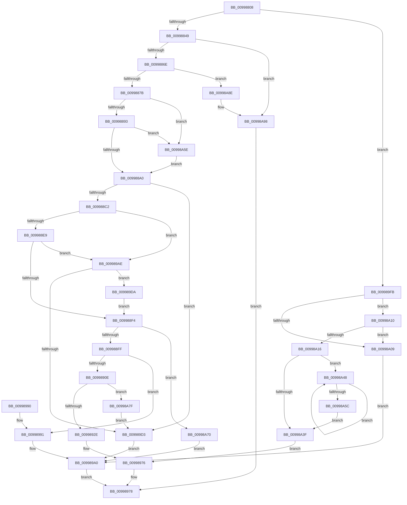

# IopGetDriverNameFromKeyNode

- RVA: `0x00998808`–`0x00998AA2` (길이 `666` bytes)
- VA: `0x0000000140998808`
- 실행 섹션: `PAGE`
- PDB 이름 있음: `예`; PDB Function 태그: `아니요`
- unwind 정보 RVA: `0x000993EC`
- 디코드: `182`개 명령, `666/666` bytes 표시
- 미해석 바이트: `0` (있으면 어셈블리에 `.byte`로 보존)

> 이 문서는 커널 이미지의 기계어와 PDB 기호를 분석해 생성했습니다. 4번과 5번은 함수 원형과 자료형을 바이너리 사용 방식에서 추정한 C 해석이며 원본 소스 복구 결과는 아닙니다.

## 1. Dependencies

- 직접 호출 지점: **17**; 고유 호출 대상: **6**
- 직접 호출자로 확인된 함수: **9**
- RIP 상대 이미지 참조: **4**

### Outgoing calls
- `0x0099883C` → [IopGetRegistryValue](IopGetRegistryValue_function_009990EC.md) (function, `0x009990EC`)
- `0x00998861` → [IopGetRegistryValue](IopGetRegistryValue_function_009990EC.md) (function, `0x009990EC`)
- `0x009988B1` → [ExAllocatePool2](../../poolcode/B8/ExAllocatePool2_function_00B820F0.md) (function, `0x00B820F0`)
- `0x009988D7` → [ZwQueryKey](../../text/6A/ZwQueryKey_function_006AD390.md) (function, `0x006AD390`)
- `0x0099891C` → [ExAllocatePool2](../../poolcode/B8/ExAllocatePool2_function_00B820F0.md) (function, `0x00B820F0`)
- `0x0099893D` → [RtlAppendUnicodeToString](../../text/40/RtlAppendUnicodeToString_function_0040F990.md) (function, `0x0040F990`)
- `0x0099895D` → [RtlAppendUnicodeStringToString](../../text/40/RtlAppendUnicodeStringToString_function_0040FA50.md) (function, `0x0040FA50`)
- `0x00998967` → [ExFreePoolWithTag](../../poolcode/B8/ExFreePoolWithTag_function_00B82870.md) (function, `0x00B82870`)
- `0x00998971` → [ExFreePoolWithTag](../../poolcode/B8/ExFreePoolWithTag_function_00B82870.md) (function, `0x00B82870`)
- `0x00998996` → [ExFreePoolWithTag](../../poolcode/B8/ExFreePoolWithTag_function_00B82870.md) (function, `0x00B82870`)
- `0x009989A5` → [ExFreePoolWithTag](../../poolcode/B8/ExFreePoolWithTag_function_00B82870.md) (function, `0x00B82870`)
- `0x009989B3` → [ExFreePoolWithTag](../../poolcode/B8/ExFreePoolWithTag_function_00B82870.md) (function, `0x00B82870`)
- `0x009989C6` → [ExAllocatePool2](../../poolcode/B8/ExAllocatePool2_function_00B820F0.md) (function, `0x00B820F0`)
- `0x009989EF` → [ZwQueryKey](../../text/6A/ZwQueryKey_function_006AD390.md) (function, `0x006AD390`)
- `0x00998A75` → [ExFreePoolWithTag](../../poolcode/B8/ExFreePoolWithTag_function_00B82870.md) (function, `0x00B82870`)
- `0x00998A84` → [ExFreePoolWithTag](../../poolcode/B8/ExFreePoolWithTag_function_00B82870.md) (function, `0x00B82870`)
- `0x00998A93` → [ExFreePoolWithTag](../../poolcode/B8/ExFreePoolWithTag_function_00B82870.md) (function, `0x00B82870`)

### Direct callers
- [PipCallDriverAddDeviceQueryRoutine](PipCallDriverAddDeviceQueryRoutine_function_00996604.md) at `0x009967D1`
- [IopLoadDriver](IopLoadDriver_function_00997B54.md) at `0x00997D3B`
- [PiGetDefaultMessageString](PiGetDefaultMessageString_function_0099A87C.md) at `0x0099A8D6`
- [IopUnloadDriver](../AB/IopUnloadDriver_function_00ABF868.md) at `0x00ABFA1E`
- [IopInitializeBootDrivers](../../init/C2/IopInitializeBootDrivers_function_00C2E6F4.md) at `0x00C2EB7A`
- [IopInitializeSystemDrivers](../../init/C7/IopInitializeSystemDrivers_function_00C73590.md) at `0x00C73612`
- [PipInitializeCoreDriversByGroup](../../init/C7/PipInitializeCoreDriversByGroup_function_00C740DC.md) at `0x00C74194`
- [PipInitializeEarlyLaunchDrivers](../../init/C7/PipInitializeEarlyLaunchDrivers_function_00C74288.md) at `0x00C7430F`
- [PnpLoadBootFilterDriver](../../init/C7/PnpLoadBootFilterDriver_function_00C77938.md) at `0x00C779EB`

### Static image references
- `0x0099882C` → RVA `0x00AFC730` (` ?? ::NNGAKEGL::`string'`; read)
- `0x00998853` → RVA `0x00AFC720` (` ?? ::NNGAKEGL::`string'`; read)
- `0x00998881` → RVA `0x00AFC700` (` ?? ::NNGAKEGL::`string'`; read)
- `0x00998A5E` → RVA `0x00AFC800` (` ?? ::NNGAKEGL::`string'`; read)

## 2. Other-region calls and transfers

- 다른 실행 섹션으로 향하는 call: **15**
  - `0x009988B1` → [ExAllocatePool2](../../poolcode/B8/ExAllocatePool2_function_00B820F0.md) (`PAGE` → `POOLCODE`)
  - `0x009988D7` → [ZwQueryKey](../../text/6A/ZwQueryKey_function_006AD390.md) (`PAGE` → `.text`)
  - `0x0099891C` → [ExAllocatePool2](../../poolcode/B8/ExAllocatePool2_function_00B820F0.md) (`PAGE` → `POOLCODE`)
  - `0x0099893D` → [RtlAppendUnicodeToString](../../text/40/RtlAppendUnicodeToString_function_0040F990.md) (`PAGE` → `.text`)
  - `0x0099895D` → [RtlAppendUnicodeStringToString](../../text/40/RtlAppendUnicodeStringToString_function_0040FA50.md) (`PAGE` → `.text`)
  - `0x00998967` → [ExFreePoolWithTag](../../poolcode/B8/ExFreePoolWithTag_function_00B82870.md) (`PAGE` → `POOLCODE`)
  - `0x00998971` → [ExFreePoolWithTag](../../poolcode/B8/ExFreePoolWithTag_function_00B82870.md) (`PAGE` → `POOLCODE`)
  - `0x00998996` → [ExFreePoolWithTag](../../poolcode/B8/ExFreePoolWithTag_function_00B82870.md) (`PAGE` → `POOLCODE`)
  - `0x009989A5` → [ExFreePoolWithTag](../../poolcode/B8/ExFreePoolWithTag_function_00B82870.md) (`PAGE` → `POOLCODE`)
  - `0x009989B3` → [ExFreePoolWithTag](../../poolcode/B8/ExFreePoolWithTag_function_00B82870.md) (`PAGE` → `POOLCODE`)
  - `0x009989C6` → [ExAllocatePool2](../../poolcode/B8/ExAllocatePool2_function_00B820F0.md) (`PAGE` → `POOLCODE`)
  - `0x009989EF` → [ZwQueryKey](../../text/6A/ZwQueryKey_function_006AD390.md) (`PAGE` → `.text`)
  - `0x00998A75` → [ExFreePoolWithTag](../../poolcode/B8/ExFreePoolWithTag_function_00B82870.md) (`PAGE` → `POOLCODE`)
  - `0x00998A84` → [ExFreePoolWithTag](../../poolcode/B8/ExFreePoolWithTag_function_00B82870.md) (`PAGE` → `POOLCODE`)
  - `0x00998A93` → [ExFreePoolWithTag](../../poolcode/B8/ExFreePoolWithTag_function_00B82870.md) (`PAGE` → `POOLCODE`)
- 별도 외부 분기/꼬리 이동을 확인하지 못했습니다.

## 3. Assembly (complete function range)

```asm
00998808  48 89 5C 24 08                  mov qword ptr [rsp + 8], rbx
0099880D  55                              push rbp
0099880E  56                              push rsi
0099880F  57                              push rdi
00998810  41 54                           push r12
00998812  41 55                           push r13
00998814  41 56                           push r14
00998816  41 57                           push r15
00998818  48 8B EC                        mov rbp, rsp
0099881B  48 83 EC 40                     sub rsp, 0x40
0099881F  33 DB                           xor ebx, ebx
00998821  4C 8D 4D 58                     lea r9, [rbp + 0x58]
00998825  4C 8B F2                        mov r14, rdx
00998828  48 89 5D 58                     mov qword ptr [rbp + 0x58], rbx
0099882C  48 8D 15 FD 3E 16 00            lea rdx, [rip + 0x163efd]
00998833  4C 8B E1                        mov r12, rcx
00998836  8D 73 40                        lea esi, [rbx + 0x40]
00998839  44 8B C6                        mov r8d, esi
0099883C  E8 AB 08 00 00                  call 0x1409990ec
00998841  85 C0                           test eax, eax
00998843  0F 89 B2 01 00 00               jns 0x1409989fb
00998849  0F 57 C0                        xorps xmm0, xmm0
0099884C  4C 8D 4D 58                     lea r9, [rbp + 0x58]
00998850  45 33 C0                        xor r8d, r8d
00998853  48 8D 15 C6 3E 16 00            lea rdx, [rip + 0x163ec6]
0099885A  49 8B CC                        mov rcx, r12
0099885D  0F 11 45 F0                     movups xmmword ptr [rbp - 0x10], xmm0
00998861  E8 86 08 00 00                  call 0x1409990ec
00998866  85 C0                           test eax, eax
00998868  0F 88 2A 02 00 00               js 0x140998a98
0099886E  48 8B 7D 58                     mov rdi, qword ptr [rbp + 0x58]
00998872  39 5F 0C                        cmp dword ptr [rdi + 0xc], ebx
00998875  0F 84 13 02 00 00               je 0x140998a8e
0099887B  8B 47 08                        mov eax, dword ptr [rdi + 8]
0099887E  8D 53 02                        lea edx, [rbx + 2]
00998881  4C 8D 2D 78 3E 16 00            lea r13, [rip + 0x163e78]
00998888  8B 0C 38                        mov ecx, dword ptr [rax + rdi]
0099888B  3B CA                           cmp ecx, edx
0099888D  0F 84 CB 01 00 00               je 0x140998a5e
00998893  44 8D 7B 10                     lea r15d, [rbx + 0x10]
00998897  83 F9 08                        cmp ecx, 8
0099889A  0F 84 BE 01 00 00               je 0x140998a5e
009988A0  BA A4 00 00 00                  mov edx, 0xa4
009988A5  41 B8 49 6F 4B 65               mov r8d, 0x654b6f49
009988AB  48 8B CE                        mov rcx, rsi
009988AE  89 55 50                        mov dword ptr [rbp + 0x50], edx
009988B1  E8 3A 98 1E 00                  call 0x140b820f0
009988B6  48 8B F0                        mov rsi, rax
009988B9  48 85 C0                        test rax, rax
009988BC  0F 84 11 01 00 00               je 0x1409989d3
009988C2  44 8B 4D 50                     mov r9d, dword ptr [rbp + 0x50]
009988C6  48 8D 45 50                     lea rax, [rbp + 0x50]
009988CA  4C 8B C6                        mov r8, rsi
009988CD  48 89 44 24 20                  mov qword ptr [rsp + 0x20], rax
009988D2  33 D2                           xor edx, edx
009988D4  49 8B CC                        mov rcx, r12
009988D7  E8 B4 4A D1 FF                  call 0x1406ad390
009988DC  8B D8                           mov ebx, eax
009988DE  3D 05 00 00 80                  cmp eax, 0x80000005
009988E3  0F 84 C5 00 00 00               je 0x1409989ae
009988E9  3D 23 00 00 C0                  cmp eax, 0xc0000023
009988EE  0F 84 BA 00 00 00               je 0x1409989ae
009988F4  45 33 E4                        xor r12d, r12d
009988F7  85 DB                           test ebx, ebx
009988F9  0F 88 71 01 00 00               js 0x140998a70
009988FF  8B 5E 0C                        mov ebx, dword ptr [rsi + 0xc]
00998902  41 03 DF                        add ebx, r15d
00998905  41 3B DF                        cmp ebx, r15d
00998908  0F 82 83 00 00 00               jb 0x140998991
0099890E  0F B7 D3                        movzx edx, bx
00998911  41 8D 4C 24 40                  lea ecx, [r12 + 0x40]
00998916  41 B8 49 6F 4E 31               mov r8d, 0x314e6f49
0099891C  E8 CF 97 1E 00                  call 0x140b820f0
00998921  49 89 46 08                     mov qword ptr [r14 + 8], rax
00998925  48 85 C0                        test rax, rax
00998928  0F 84 51 01 00 00               je 0x140998a7f
0099892E  49 8B D5                        mov rdx, r13
00998931  66 45 89 26                     mov word ptr [r14], r12w
00998935  49 8B CE                        mov rcx, r14
00998938  66 41 89 5E 02                  mov word ptr [r14 + 2], bx
0099893D  E8 4E 70 A7 FF                  call 0x14040f990
00998942  0F B7 46 0C                     movzx eax, word ptr [rsi + 0xc]
00998946  48 8D 55 F0                     lea rdx, [rbp - 0x10]
0099894A  66 89 45 F0                     mov word ptr [rbp - 0x10], ax
0099894E  49 8B CE                        mov rcx, r14
00998951  66 89 45 F2                     mov word ptr [rbp - 0xe], ax
00998955  48 8D 46 10                     lea rax, [rsi + 0x10]
00998959  48 89 45 F8                     mov qword ptr [rbp - 8], rax
0099895D  E8 EE 70 A7 FF                  call 0x14040fa50
00998962  33 D2                           xor edx, edx
00998964  48 8B CE                        mov rcx, rsi
00998967  E8 04 9F 1E 00                  call 0x140b82870
0099896C  33 D2                           xor edx, edx
0099896E  48 8B CF                        mov rcx, rdi
00998971  E8 FA 9E 1E 00                  call 0x140b82870
00998976  33 C0                           xor eax, eax
00998978  48 8B 9C 24 80 00 00 00         mov rbx, qword ptr [rsp + 0x80]
00998980  48 83 C4 40                     add rsp, 0x40
00998984  41 5F                           pop r15
00998986  41 5E                           pop r14
00998988  41 5D                           pop r13
0099898A  41 5C                           pop r12
0099898C  5F                              pop rdi
0099898D  5E                              pop rsi
0099898E  5D                              pop rbp
0099898F  C3                              ret
00998990  CC                              int3
00998991  33 D2                           xor edx, edx
00998993  48 8B CE                        mov rcx, rsi
00998996  E8 D5 9E 1E 00                  call 0x140b82870
0099899B  BB 95 00 00 C0                  mov ebx, 0xc0000095
009989A0  33 D2                           xor edx, edx
009989A2  48 8B CF                        mov rcx, rdi
009989A5  E8 C6 9E 1E 00                  call 0x140b82870
009989AA  8B C3                           mov eax, ebx
009989AC  EB CA                           jmp 0x140998978
009989AE  33 D2                           xor edx, edx
009989B0  48 8B CE                        mov rcx, rsi
009989B3  E8 B8 9E 1E 00                  call 0x140b82870
009989B8  8B 55 50                        mov edx, dword ptr [rbp + 0x50]
009989BB  B9 40 00 00 00                  mov ecx, 0x40
009989C0  41 B8 49 6F 4B 65               mov r8d, 0x654b6f49
009989C6  E8 25 97 1E 00                  call 0x140b820f0
009989CB  48 8B F0                        mov rsi, rax
009989CE  48 85 C0                        test rax, rax
009989D1  75 07                           jne 0x1409989da
009989D3  BB 9A 00 00 C0                  mov ebx, 0xc000009a
009989D8  EB C6                           jmp 0x1409989a0
009989DA  44 8B 4D 50                     mov r9d, dword ptr [rbp + 0x50]
009989DE  48 8D 45 50                     lea rax, [rbp + 0x50]
009989E2  4C 8B C6                        mov r8, rsi
009989E5  48 89 44 24 20                  mov qword ptr [rsp + 0x20], rax
009989EA  33 D2                           xor edx, edx
009989EC  49 8B CC                        mov rcx, r12
009989EF  E8 9C 49 D1 FF                  call 0x1406ad390
009989F4  8B D8                           mov ebx, eax
009989F6  E9 F9 FE FF FF                  jmp 0x1409988f4
009989FB  48 8B 7D 58                     mov rdi, qword ptr [rbp + 0x58]
009989FF  BA 02 00 00 00                  mov edx, 2
00998A04  39 57 0C                        cmp dword ptr [rdi + 0xc], edx
00998A07  77 07                           ja 0x140998a10
00998A09  BB 60 01 00 C0                  mov ebx, 0xc0000160
00998A0E  EB 90                           jmp 0x1409989a0
00998A10  83 7F 04 01                     cmp dword ptr [rdi + 4], 1
00998A14  75 F3                           jne 0x140998a09
00998A16  0F B7 47 0C                     movzx eax, word ptr [rdi + 0xc]
00998A1A  4C 8B D7                        mov r10, rdi
00998A1D  66 2B C2                        sub ax, dx
00998A20  0F B7 C8                        movzx ecx, ax
00998A23  66 41 89 0E                     mov word ptr [r14], cx
00998A27  44 8B C9                        mov r9d, ecx
00998A2A  0F B7 47 0C                     movzx eax, word ptr [rdi + 0xc]
00998A2E  66 41 89 46 02                  mov word ptr [r14 + 2], ax
00998A33  44 8B 47 08                     mov r8d, dword ptr [rdi + 8]
00998A37  4C 03 C7                        add r8, rdi
00998A3A  41 D1 E9                        shr r9d, 1
00998A3D  75 09                           jne 0x140998a48
00998A3F  49 89 7E 08                     mov qword ptr [r14 + 8], rdi
00998A43  E9 2E FF FF FF                  jmp 0x140998976
00998A48  41 0F B7 00                     movzx eax, word ptr [r8]
00998A4C  4C 03 C2                        add r8, rdx
00998A4F  66 41 89 02                     mov word ptr [r10], ax
00998A53  4C 03 D2                        add r10, rdx
00998A56  41 83 C1 FF                     add r9d, -1
00998A5A  75 EC                           jne 0x140998a48
00998A5C  EB E1                           jmp 0x140998a3f
00998A5E  4C 8D 2D 9B 3D 16 00            lea r13, [rip + 0x163d9b]
00998A65  41 BF 18 00 00 00               mov r15d, 0x18
00998A6B  E9 30 FE FF FF                  jmp 0x1409988a0
00998A70  33 D2                           xor edx, edx
00998A72  48 8B CE                        mov rcx, rsi
00998A75  E8 F6 9D 1E 00                  call 0x140b82870
00998A7A  E9 21 FF FF FF                  jmp 0x1409989a0
00998A7F  33 D2                           xor edx, edx
00998A81  48 8B CE                        mov rcx, rsi
00998A84  E8 E7 9D 1E 00                  call 0x140b82870
00998A89  E9 45 FF FF FF                  jmp 0x1409989d3
00998A8E  33 D2                           xor edx, edx
00998A90  48 8B CF                        mov rcx, rdi
00998A93  E8 D8 9D 1E 00                  call 0x140b82870
00998A98  B8 60 01 00 C0                  mov eax, 0xc0000160
00998A9D  E9 D6 FE FF FF                  jmp 0x140998978
```

## 4. C-style interpretation (structured pseudocode)

```c
__int64 __fastcall IopGetDriverNameFromKeyNode(__int64 a1, __int64 a2)
{
    __int64 result;
    __int64 v_r10;
    __int64 v_r12;
    __int64 v_rbx;
    __int64 v_rsp;
    unsigned __int64 v_stack_m40;
    unsigned __int16 v_stack_m46;
    unsigned __int64 v_stack_m48;
    unsigned __int64 v_stack_m58;
    unsigned int v_stack_p18;
    unsigned __int64 v_stack_p20;
    unsigned __int64 v_stack_p8;

    v_stack_p8 = v_rbx;
    v_rsp = (v_rsp) - (64);
    v_rbx = 0;
    v_stack_p20 = 0;
    result = IopGetRegistryValue(a1, v_rip + 1457917, (unsigned int)((unsigned int)(v_rbx + 64)), v_stack_p20);
    if (!sign_flag) goto loc_009989FB;
    a3 = 0;
    v_stack_m48 = v_xmm0;
    result = IopGetRegistryValue(a1, v_rip + 1457862, a3, v_stack_p20);
    if (sign_flag) goto loc_00998A98;
    if ((*(unsigned int *)(v_stack_p20 + 12)) == 0) goto loc_00998A8E;
    if (((unsigned int)((unsigned int)(*(unsigned int *)((unsigned int)(*(unsigned int *)(v_stack_p20 + 8)) + v_stack_p20 * 1)))) == ((unsigned int)(v_rbx + 2))) goto loc_00998A5E;
    if (((unsigned int)((unsigned int)(*(unsigned int *)((unsigned int)(*(unsigned int *)(v_stack_p20 + 8)) + v_stack_p20 * 1)))) == 8) goto loc_00998A5E;
loc_009988A0:
    v_stack_p18 = 164;
    result = ExAllocatePool2(v_rbx + 64, 164, (unsigned int)(0x654B6F49ULL), v_stack_p20);
    if (result == 0) goto loc_009989D3;
    v_stack_m58 = v_stack_p18;
    a2 = 0;
    result = ZwQueryKey(a1, a2, result, (unsigned int)(v_stack_p18));
    if (((unsigned int)(result)) == 0x80000005ULL) goto loc_009989AE;
    if (((unsigned int)(result)) == 0xC0000023ULL) goto loc_009989AE;
loc_009988F4:
    v_r12 = 0;
    if (sign_flag) goto loc_00998A70;
    v_rbx = (unsigned int)(((unsigned int)(*(unsigned int *)(result + 12))) + ((unsigned int)(v_rbx + 16)));
    if (((unsigned int)(v_rbx)) < ((unsigned int)(v_rbx + 16))) goto loc_00998991;
    result = ExAllocatePool2(v_r12 + 64, (unsigned __int16)(v_rbx), (unsigned int)(0x314E6F49ULL), (unsigned int)(v_stack_p18));
    *(unsigned __int64 *)(a2 + 8) = result;
    if (result == 0) goto loc_00998A7F;
    *(unsigned __int16 *)(a2) = 0;
    *(unsigned __int16 *)(a2 + 2) = (unsigned __int16)(v_rbx);
    result = RtlAppendUnicodeToString(0, v_rip + 1457784, (unsigned int)(0x314E6F49ULL), (unsigned int)(v_stack_p18));
    v_stack_m48 = (unsigned __int16)(*(unsigned __int16 *)(result + 12));
    v_stack_m46 = (unsigned __int16)(*(unsigned __int16 *)(result + 12));
    v_stack_m40 = result + 16;
    result = RtlAppendUnicodeStringToString(0, v_stack_m48, (unsigned int)(0x314E6F49ULL), (unsigned int)(v_stack_p18));
    a2 = 0;
    result = ExFreePoolWithTag(result, a2, (unsigned int)(0x314E6F49ULL), (unsigned int)(v_stack_p18));
    a2 = 0;
    result = ExFreePoolWithTag(v_stack_p20, a2, (unsigned int)(0x314E6F49ULL), (unsigned int)(v_stack_p18));
loc_00998976:
    result = 0;
loc_00998978:
    v_rsp = (v_rsp) + (64);
    return result;
loc_00998991:
    a2 = 0;
    result = ExFreePoolWithTag(0, a2, (unsigned int)(0x314E6F49ULL), (unsigned int)(v_stack_p18));
loc_009989A0:
    a2 = 0;
    result = ExFreePoolWithTag(v_stack_p20, a2, (unsigned int)(0x314E6F49ULL), (unsigned int)(v_stack_p18));
    goto loc_00998978;
loc_009989AE:
    a2 = 0;
    result = ExFreePoolWithTag(result, a2, (unsigned int)(0x314E6F49ULL), (unsigned int)(v_stack_p18));
    result = ExAllocatePool2(64, (unsigned int)(v_stack_p18), (unsigned int)(0x654B6F49ULL), (unsigned int)(v_stack_p18));
    if (result != 0) goto loc_009989DA;
loc_009989D3:
    goto loc_009989A0;
loc_009989DA:
    v_stack_p20 = v_stack_p18;
    a2 = 0;
    result = ZwQueryKey(0, a2, result, (unsigned int)(v_stack_p18));
    goto loc_009988F4;
loc_009989FB:
    if ((*(unsigned int *)(v_stack_p20 + 12)) > 2) goto loc_00998A10;
loc_00998A09:
    goto loc_009989A0;
loc_00998A10:
    if ((*(unsigned int *)(v_stack_p20 + 4)) != 1) goto loc_00998A09;
    result = (unsigned __int16)((*(unsigned __int16 *)(v_stack_p20 + 12)) - (2));
    *(unsigned __int16 *)(a2) = (unsigned __int16)((unsigned __int16)(result));
    *(unsigned __int16 *)(a2 + 2) = (unsigned __int16)(*(unsigned __int16 *)(v_stack_p20 + 12));
    a3 = ((unsigned int)(*(unsigned int *)(v_stack_p20 + 8))) + (v_stack_p20);
    a4 = (unsigned int)(((unsigned int)((unsigned int)((unsigned __int16)(result)))) >> (1));
    if (condition_is_not_equal) goto loc_00998A48;
loc_00998A3F:
    *(unsigned __int64 *)(a2 + 8) = v_stack_p20;
    goto loc_00998976;
loc_00998A48:
    a3 = (a3) + (2);
    *(unsigned __int16 *)(v_stack_p20) = (unsigned __int16)(*(unsigned __int16 *)(a3));
    v_r10 = (v_stack_p20) + (2);
    a4 = (unsigned int)((a4) + (-1));
    if (condition_is_not_equal) goto loc_00998A48;
    goto loc_00998A3F;
loc_00998A5E:
    goto loc_009988A0;
loc_00998A70:
    a2 = 0;
    result = ExFreePoolWithTag(result, a2, a3, a4);
    goto loc_009989A0;
loc_00998A7F:
    a2 = 0;
    result = ExFreePoolWithTag(result, a2, a3, a4);
    goto loc_009989D3;
loc_00998A8E:
    a2 = 0;
    result = ExFreePoolWithTag(v_stack_p20, a2, a3, a4);
loc_00998A98:
    goto loc_00998978;
}
```

## 5. (Beta) C Style

```c
int64_t IopGetDriverNameFromKeyNode(int64_t Arg1, void *Arg2)
{
    uint8_t *arg2 = (uint8_t *)Arg2;

    int64_t result;
    int64_t local_r10;
    int64_t local_r12;
    int64_t local_rbx;
    int64_t local_rsp;
    uint64_t v_stack_m40;
    uint16_t v_stack_m46;
    uint64_t v_stack_m48;
    uint64_t v_stack_m58;
    uint32_t v_stack_p18;
    uint64_t v_stack_p20;
    uint64_t v_stack_p8;

    v_stack_p8 = local_rbx;
    local_rsp = (local_rsp) - (64);
    local_rbx = 0;
    v_stack_p20 = 0;
    result = IopGetRegistryValue(Arg1, v_rip + 1457917, (uint32_t)((uint32_t)(local_rbx + 64)), v_stack_p20);
    if (!sign_flag) goto loc_009989FB;
    a3 = 0;
    v_stack_m48 = v_xmm0;
    result = IopGetRegistryValue(Arg1, v_rip + 1457862, a3, v_stack_p20);
    if (sign_flag) goto loc_00998A98;
    if ((*(uint32_t *)(v_stack_p20 + 0xC)) == 0) goto loc_00998A8E;
    if (((uint32_t)((uint32_t)(*(uint32_t *)((uint32_t)(*(uint32_t *)(v_stack_p20 + 0x8)) + v_stack_p20 * 1)))) == ((uint32_t)(local_rbx + 2))) goto loc_00998A5E;
    if (((uint32_t)((uint32_t)(*(uint32_t *)((uint32_t)(*(uint32_t *)(v_stack_p20 + 0x8)) + v_stack_p20 * 1)))) == 8) goto loc_00998A5E;
loc_009988A0:
    v_stack_p18 = 164;
    result = ExAllocatePool2(local_rbx + 64, 164, (uint32_t)(0x654B6F49ULL), v_stack_p20);
    if (result == 0) goto loc_009989D3;
    v_stack_m58 = v_stack_p18;
    Arg2 = 0;
    result = ZwQueryKey(Arg1, Arg2, result, (uint32_t)(v_stack_p18));
    if (((uint32_t)(result)) == 0x80000005ULL) goto loc_009989AE;
    if (((uint32_t)(result)) == 0xC0000023ULL) goto loc_009989AE;
loc_009988F4:
    local_r12 = 0;
    if (sign_flag) goto loc_00998A70;
    local_rbx = (uint32_t)(((uint32_t)(*(uint32_t *)(result + 0xC))) + ((uint32_t)(local_rbx + 16)));
    if (((uint32_t)(local_rbx)) < ((uint32_t)(local_rbx + 16))) goto loc_00998991;
    result = ExAllocatePool2(local_r12 + 64, (uint16_t)(local_rbx), (uint32_t)(0x314E6F49ULL), (uint32_t)(v_stack_p18));
    *(uint64_t *)(arg2 + 0x8) = result;
    if (result == 0) goto loc_00998A7F;
    *(uint16_t *)(arg2) = 0;
    *(uint16_t *)(arg2 + 0x2) = (uint16_t)(local_rbx);
    result = RtlAppendUnicodeToString(0, v_rip + 1457784, (uint32_t)(0x314E6F49ULL), (uint32_t)(v_stack_p18));
    v_stack_m48 = (uint16_t)(*(uint16_t *)(result + 0xC));
    v_stack_m46 = (uint16_t)(*(uint16_t *)(result + 0xC));
    v_stack_m40 = result + 16;
    result = RtlAppendUnicodeStringToString(0, v_stack_m48, (uint32_t)(0x314E6F49ULL), (uint32_t)(v_stack_p18));
    Arg2 = 0;
    result = ExFreePoolWithTag(result, Arg2, (uint32_t)(0x314E6F49ULL), (uint32_t)(v_stack_p18));
    Arg2 = 0;
    result = ExFreePoolWithTag(v_stack_p20, Arg2, (uint32_t)(0x314E6F49ULL), (uint32_t)(v_stack_p18));
loc_00998976:
    result = 0;
loc_00998978:
    local_rsp = (local_rsp) + (64);
    return result;
loc_00998991:
    Arg2 = 0;
    result = ExFreePoolWithTag(0, Arg2, (uint32_t)(0x314E6F49ULL), (uint32_t)(v_stack_p18));
loc_009989A0:
    Arg2 = 0;
    result = ExFreePoolWithTag(v_stack_p20, Arg2, (uint32_t)(0x314E6F49ULL), (uint32_t)(v_stack_p18));
    goto loc_00998978;
loc_009989AE:
    Arg2 = 0;
    result = ExFreePoolWithTag(result, Arg2, (uint32_t)(0x314E6F49ULL), (uint32_t)(v_stack_p18));
    result = ExAllocatePool2(64, (uint32_t)(v_stack_p18), (uint32_t)(0x654B6F49ULL), (uint32_t)(v_stack_p18));
    if (result != 0) goto loc_009989DA;
loc_009989D3:
    goto loc_009989A0;
loc_009989DA:
    v_stack_p20 = v_stack_p18;
    Arg2 = 0;
    result = ZwQueryKey(0, Arg2, result, (uint32_t)(v_stack_p18));
    goto loc_009988F4;
loc_009989FB:
    if ((*(uint32_t *)(v_stack_p20 + 0xC)) > 2) goto loc_00998A10;
loc_00998A09:
    goto loc_009989A0;
loc_00998A10:
    if ((*(uint32_t *)(v_stack_p20 + 0x4)) != 1) goto loc_00998A09;
    result = (uint16_t)((*(uint16_t *)(v_stack_p20 + 0xC)) - (2));
    *(uint16_t *)(arg2) = (uint16_t)((uint16_t)(result));
    *(uint16_t *)(arg2 + 0x2) = (uint16_t)(*(uint16_t *)(v_stack_p20 + 0xC));
    a3 = ((uint32_t)(*(uint32_t *)(v_stack_p20 + 0x8))) + (v_stack_p20);
    a4 = (uint32_t)(((uint32_t)((uint32_t)((uint16_t)(result)))) >> (1));
    if (condition_is_not_equal) goto loc_00998A48;
loc_00998A3F:
    *(uint64_t *)(arg2 + 0x8) = v_stack_p20;
    goto loc_00998976;
loc_00998A48:
    a3 = (a3) + (2);
    *(uint16_t *)(v_stack_p20) = (uint16_t)(*(uint16_t *)(a3));
    local_r10 = (v_stack_p20) + (2);
    a4 = (uint32_t)((a4) + (-1));
    if (condition_is_not_equal) goto loc_00998A48;
    goto loc_00998A3F;
loc_00998A5E:
    goto loc_009988A0;
loc_00998A70:
    Arg2 = 0;
    result = ExFreePoolWithTag(result, Arg2, a3, a4);
    goto loc_009989A0;
loc_00998A7F:
    Arg2 = 0;
    result = ExFreePoolWithTag(result, Arg2, a3, a4);
    goto loc_009989D3;
loc_00998A8E:
    Arg2 = 0;
    result = ExFreePoolWithTag(v_stack_p20, Arg2, a3, a4);
loc_00998A98:
    goto loc_00998978;
}
```

### 관측된 메모리 오프셋

구조체 형식이 확인되지 않은 접근은 인자 기준의 오프셋으로만 기록했습니다.

| 기준 인자 | 오프셋 표현 | 폭 (bit) | 접근 |
|---|---:|---:|---|
| `Arg2` | `+ 0x0` | `16` | `W` |
| `Arg2` | `+ 0x2` | `16` | `W` |
| `Arg2` | `+ 0x8` | `64` | `W` |

## 6. Execution-region graph

[열기: 2D/3D 그래프와 함수 탐색 컨트롤 패널](../../../control-panel.html?section=page&rva=0x00998808&view=graph)

- 2D 그래프는 위에서 아래로 흐르고, 3D 그래프는 빈 공간을 드래그해 회전합니다. Shift+드래그는 이동, 휠은 확대·축소, 함수 노드 선택은 대상 보고서 이동입니다.

### Static fallback


