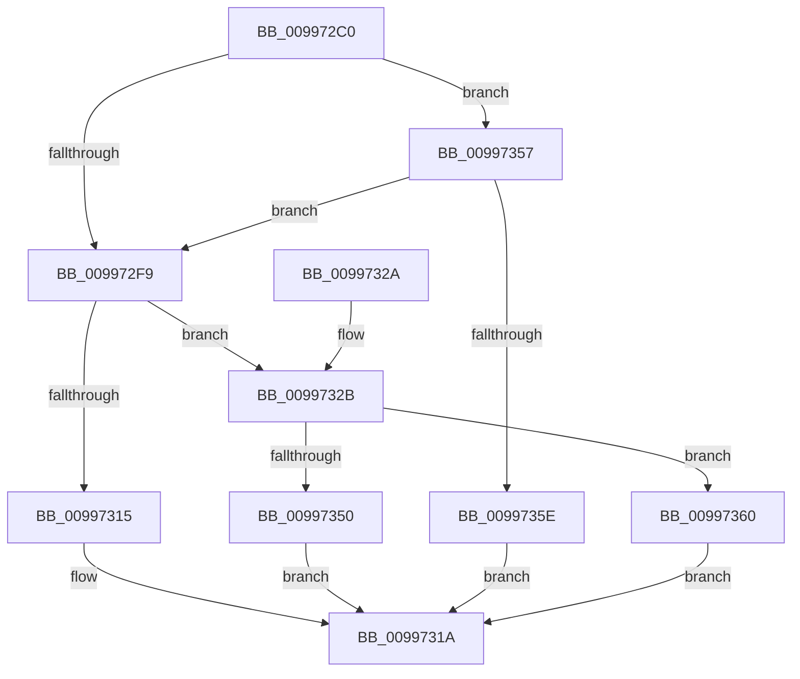

# IopGetRegistryKeyInformation

- RVA: `0x009972C0`–`0x0099736E` (길이 `174` bytes)
- VA: `0x00000001409972C0`
- 실행 섹션: `PAGE`
- PDB 이름 있음: `예`; PDB Function 태그: `아니요`
- unwind 정보 RVA: `0x00099344`
- 디코드: `51`개 명령, `174/174` bytes 표시
- 미해석 바이트: `0` (있으면 어셈블리에 `.byte`로 보존)

> 이 문서는 커널 이미지의 기계어와 PDB 기호를 분석해 생성했습니다. 4번과 5번은 함수 원형과 자료형을 바이너리 사용 방식에서 추정한 C 해석이며 원본 소스 복구 결과는 아닙니다.

## 1. Dependencies

- 직접 호출 지점: **4**; 고유 호출 대상: **3**
- 직접 호출자로 확인된 함수: **3**
- RIP 상대 이미지 참조: **0**

### Outgoing calls
- `0x009972ED` → [ZwQueryKey](../../text/6A/ZwQueryKey_function_006AD390.md) (function, `0x006AD390`)
- `0x00997308` → [ExAllocatePool2](../../poolcode/B8/ExAllocatePool2_function_00B820F0.md) (function, `0x00B820F0`)
- `0x00997345` → [ZwQueryKey](../../text/6A/ZwQueryKey_function_006AD390.md) (function, `0x006AD390`)
- `0x00997365` → [ExFreePoolWithTag](../../poolcode/B8/ExFreePoolWithTag_function_00B82870.md) (function, `0x00B82870`)

### Direct callers
- [pIoQueryDeviceDescription](../71/pIoQueryDeviceDescription_function_0071F10C.md) at `0x0071F21B`
- [pIoQueryDeviceDescription](../71/pIoQueryDeviceDescription_function_0071F10C.md) at `0x0071F3D4`
- [pIoQueryBusDescription](pIoQueryBusDescription_function_00996F58.md) at `0x00996FBB`
- [PiDevCfgCopyDeviceKey](PiDevCfgCopyDeviceKey_function_00997374.md) at `0x00997436`

### Static image references
- 디코드된 RIP-relative 메모리 참조가 없습니다.

## 2. Other-region calls and transfers

- 다른 실행 섹션으로 향하는 call: **4**
  - `0x009972ED` → [ZwQueryKey](../../text/6A/ZwQueryKey_function_006AD390.md) (`PAGE` → `.text`)
  - `0x00997308` → [ExAllocatePool2](../../poolcode/B8/ExAllocatePool2_function_00B820F0.md) (`PAGE` → `POOLCODE`)
  - `0x00997345` → [ZwQueryKey](../../text/6A/ZwQueryKey_function_006AD390.md) (`PAGE` → `.text`)
  - `0x00997365` → [ExFreePoolWithTag](../../poolcode/B8/ExFreePoolWithTag_function_00B82870.md) (`PAGE` → `POOLCODE`)
- 별도 외부 분기/꼬리 이동을 확인하지 못했습니다.

## 3. Assembly (complete function range)

```asm
009972C0  48 8B C4                        mov rax, rsp
009972C3  48 89 58 08                     mov qword ptr [rax + 8], rbx
009972C7  48 89 70 10                     mov qword ptr [rax + 0x10], rsi
009972CB  57                              push rdi
009972CC  48 83 EC 30                     sub rsp, 0x30
009972D0  83 60 18 00                     and dword ptr [rax + 0x18], 0
009972D4  48 8D 40 18                     lea rax, [rax + 0x18]
009972D8  45 33 C9                        xor r9d, r9d
009972DB  48 89 44 24 20                  mov qword ptr [rsp + 0x20], rax
009972E0  48 8B F2                        mov rsi, rdx
009972E3  45 33 C0                        xor r8d, r8d
009972E6  48 8B F9                        mov rdi, rcx
009972E9  41 8D 51 02                     lea edx, [r9 + 2]
009972ED  E8 9E 60 D1 FF                  call 0x1406ad390
009972F2  3D 23 00 00 C0                  cmp eax, 0xc0000023
009972F7  75 5E                           jne 0x140997357
009972F9  8B 54 24 50                     mov edx, dword ptr [rsp + 0x50]
009972FD  B9 40 00 00 00                  mov ecx, 0x40
00997302  41 B8 49 6F 4B 65               mov r8d, 0x654b6f49
00997308  E8 E3 AD 1E 00                  call 0x140b820f0
0099730D  48 8B D8                        mov rbx, rax
00997310  48 85 C0                        test rax, rax
00997313  75 16                           jne 0x14099732b
00997315  B8 9A 00 00 C0                  mov eax, 0xc000009a
0099731A  48 8B 5C 24 40                  mov rbx, qword ptr [rsp + 0x40]
0099731F  48 8B 74 24 48                  mov rsi, qword ptr [rsp + 0x48]
00997324  48 83 C4 30                     add rsp, 0x30
00997328  5F                              pop rdi
00997329  C3                              ret
0099732A  CC                              int3
0099732B  44 8B 4C 24 50                  mov r9d, dword ptr [rsp + 0x50]
00997330  48 8D 44 24 50                  lea rax, [rsp + 0x50]
00997335  4C 8B C3                        mov r8, rbx
00997338  48 89 44 24 20                  mov qword ptr [rsp + 0x20], rax
0099733D  BA 02 00 00 00                  mov edx, 2
00997342  48 8B CF                        mov rcx, rdi
00997345  E8 46 60 D1 FF                  call 0x1406ad390
0099734A  8B F8                           mov edi, eax
0099734C  85 C0                           test eax, eax
0099734E  78 10                           js 0x140997360
00997350  48 89 1E                        mov qword ptr [rsi], rbx
00997353  33 C0                           xor eax, eax
00997355  EB C3                           jmp 0x14099731a
00997357  3D 05 00 00 80                  cmp eax, 0x80000005
0099735C  74 9B                           je 0x1409972f9
0099735E  EB BA                           jmp 0x14099731a
00997360  33 D2                           xor edx, edx
00997362  48 8B CB                        mov rcx, rbx
00997365  E8 06 B5 1E 00                  call 0x140b82870
0099736A  8B C7                           mov eax, edi
0099736C  EB AC                           jmp 0x14099731a
```

## 4. C-style interpretation (structured pseudocode)

```c
__int64 __fastcall IopGetRegistryKeyInformation(__int64 a1, __int64 a2, int a3, int a4)
{
    __int64 result;
    __int64 v_rsp;
    unsigned __int64 v_stack_m18;
    unsigned __int64 v_stack_p10;
    unsigned int v_stack_p18;
    unsigned __int64 v_stack_p20;
    unsigned int v_stack_p50;
    unsigned __int64 v_stack_p8;

    *(unsigned __int64 *)(v_rsp + 8) = v_rbx;
    *(unsigned __int64 *)(v_rsp + 16) = v_rsi;
    v_rsp = (v_rsp) - (48);
    a4 = 0;
    v_stack_m18 = v_rsp + 24;
    a3 = 0;
    result = ZwQueryKey(a1, a4 + 2, a3, a4);
    if (((unsigned int)(result)) != 0xC0000023ULL) goto loc_00997357;
loc_009972F9:
    result = ExAllocatePool2(64, (unsigned int)(v_stack_p18), (unsigned int)(0x654B6F49ULL), a4);
    if (result != 0) goto loc_0099732B;
loc_0099731A:
    v_rsp = (v_rsp) + (48);
    return (unsigned int)(0xC000009AULL);
loc_0099732B:
    v_stack_p20 = v_stack_p50;
    result = ZwQueryKey(a1, 2, v_stack_p8, (unsigned int)(v_stack_p50));
    if (sign_flag) goto loc_00997360;
    *(unsigned __int64 *)(v_stack_p10) = v_stack_p8;
    result = 0;
    goto loc_0099731A;
loc_00997357:
    if (0 == 0x80000005ULL) goto loc_009972F9;
    goto loc_0099731A;
loc_00997360:
    a2 = 0;
    result = ExFreePoolWithTag(v_stack_p8, a2, v_stack_p8, (unsigned int)(v_stack_p50));
    goto loc_0099731A;
}
```

## 5. (Beta) C Style

```c
int64_t IopGetRegistryKeyInformation(int64_t Arg1, void *Arg2, int32_t Arg3, int32_t Arg4)
{
    uint8_t *arg2 = (uint8_t *)Arg2;

    int64_t result;
    int64_t local_rsp;
    uint64_t v_stack_m18;
    uint64_t v_stack_p10;
    uint32_t v_stack_p18;
    uint64_t v_stack_p20;
    uint32_t v_stack_p50;
    uint64_t v_stack_p8;

    *(uint64_t *)(local_rsp + 0x8) = local_rbx;
    *(uint64_t *)(local_rsp + 0x10) = local_rsi;
    local_rsp = (local_rsp) - (48);
    Arg4 = 0;
    v_stack_m18 = local_rsp + 24;
    Arg3 = 0;
    result = ZwQueryKey(Arg1, Arg4 + 2, Arg3, Arg4);
    if (((uint32_t)(result)) != 0xC0000023ULL) goto loc_00997357;
loc_009972F9:
    result = ExAllocatePool2(64, (uint32_t)(v_stack_p18), (uint32_t)(0x654B6F49ULL), Arg4);
    if (result != 0) goto loc_0099732B;
loc_0099731A:
    local_rsp = (local_rsp) + (48);
    return (uint32_t)(0xC000009AULL);
loc_0099732B:
    v_stack_p20 = v_stack_p50;
    result = ZwQueryKey(Arg1, 2, v_stack_p8, (uint32_t)(v_stack_p50));
    if (sign_flag) goto loc_00997360;
    *(uint64_t *)(v_stack_p10) = v_stack_p8;
    result = 0;
    goto loc_0099731A;
loc_00997357:
    if (0 == 0x80000005ULL) goto loc_009972F9;
    goto loc_0099731A;
loc_00997360:
    Arg2 = 0;
    result = ExFreePoolWithTag(v_stack_p8, Arg2, v_stack_p8, (uint32_t)(v_stack_p50));
    goto loc_0099731A;
}
```

### 관측된 메모리 오프셋

구조체 형식이 확인되지 않은 접근은 인자 기준의 오프셋으로만 기록했습니다.

| 기준 인자 | 오프셋 표현 | 폭 (bit) | 접근 |
|---|---:|---:|---|
| `Arg2` | `+ 0x0` | `64` | `W` |

## 6. Execution-region graph

[열기: 2D/3D 그래프와 함수 탐색 컨트롤 패널](../../../control-panel.html?section=page&rva=0x009972C0&view=graph)

- 2D 그래프는 위에서 아래로 흐르고, 3D 그래프는 빈 공간을 드래그해 회전합니다. Shift+드래그는 이동, 휠은 확대·축소, 함수 노드 선택은 대상 보고서 이동입니다.

### Static fallback


