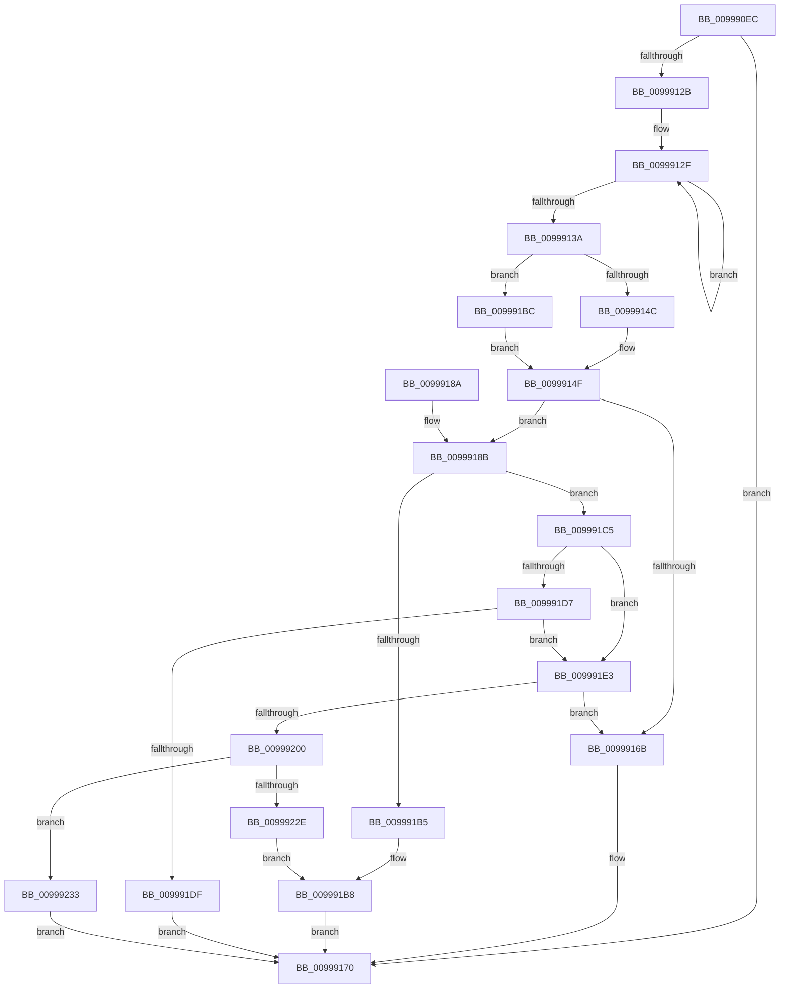

# IopGetRegistryValue

- RVA: `0x009990EC`–`0x00999244` (길이 `344` bytes)
- VA: `0x00000001409990EC`
- 실행 섹션: `PAGE`
- PDB 이름 있음: `예`; PDB Function 태그: `아니요`
- unwind 정보 RVA: `0x00099478`
- 디코드: `102`개 명령, `344/344` bytes 표시
- 미해석 바이트: `0` (있으면 어셈블리에 `.byte`로 보존)

> 이 문서는 커널 이미지의 기계어와 PDB 기호를 분석해 생성했습니다. 4번과 5번은 함수 원형과 자료형을 바이너리 사용 방식에서 추정한 C 해석이며 원본 소스 복구 결과는 아닙니다.

## 1. Dependencies

- 직접 호출 지점: **7**; 고유 호출 대상: **4**
- 직접 호출자로 확인된 함수: **74**
- RIP 상대 이미지 참조: **0**

### Outgoing calls
- `0x00999122` → [RtlInitUnicodeStringEx](../../text/46/RtlInitUnicodeStringEx_function_00463960.md) (function, `0x00463960`)
- `0x0099915E` → [ExAllocatePool2](../../poolcode/B8/ExAllocatePool2_function_00B820F0.md) (function, `0x00B820F0`)
- `0x009991AA` → [ZwQueryValueKey](../../text/6A/ZwQueryValueKey_function_006AD3B0.md) (function, `0x006AD3B0`)
- `0x009991CA` → [ExFreePoolWithTag](../../poolcode/B8/ExFreePoolWithTag_function_00B82870.md) (function, `0x00B82870`)
- `0x009991EF` → [ExAllocatePool2](../../poolcode/B8/ExAllocatePool2_function_00B820F0.md) (function, `0x00B820F0`)
- `0x00999223` → [ZwQueryValueKey](../../text/6A/ZwQueryValueKey_function_006AD3B0.md) (function, `0x006AD3B0`)
- `0x00999238` → [ExFreePoolWithTag](../../poolcode/B8/ExFreePoolWithTag_function_00B82870.md) (function, `0x00B82870`)

### Direct callers
- [PnpGetRegistryDword](../../text/4B/PnpGetRegistryDword_function_004BFDE8.md) at `0x004BFE07`
- [IopAllowRemoteDASD](../../text/4D/IopAllowRemoteDASD_function_004D5BAC.md) at `0x004D5C2F`
- [IopInitializeOfflineCrashDump](../../text/59/IopInitializeOfflineCrashDump_function_00595A24.md) at `0x00595B0C`
- [IopInitializeOfflineCrashDump](../../text/59/IopInitializeOfflineCrashDump_function_00595A24.md) at `0x00595BD3`
- [IopIsBitlockerOn](../../text/59/IopIsBitlockerOn_function_00595C3C.md) at `0x00595C9E`
- [IopReadDumpRegistry](../../text/59/IopReadDumpRegistry_function_00595CE0.md) at `0x00595D46`
- [IopReadDumpRegistry](../../text/59/IopReadDumpRegistry_function_00595CE0.md) at `0x00595D83`
- [IopReadDumpRegistry](../../text/59/IopReadDumpRegistry_function_00595CE0.md) at `0x00595DB7`
- [IopReadDumpRegistry](../../text/59/IopReadDumpRegistry_function_00595CE0.md) at `0x00595DEF`
- [IopReadDumpRegistry](../../text/59/IopReadDumpRegistry_function_00595CE0.md) at `0x00595E27`
- [IoInitializeLiveDump](../../text/59/IoInitializeLiveDump_function_00598B14.md) at `0x00598B9E`
- [IopGetRegistryULongValue](../../text/59/IopGetRegistryULongValue_function_00598EA4.md) at `0x00598EBA`
- [SecureDump_ReadRegistry](../../text/5A/SecureDump_ReadRegistry_function_005A3668.md) at `0x005A36D8`
- [PnpBootDeviceWait](../../text/5A/PnpBootDeviceWait_function_005A4D68.md) at `0x005A4DE7`
- [PiDevCfgQueryResolveValue](../../text/5A/PiDevCfgQueryResolveValue_function_005A801C.md) at `0x005A806A`
- [PnpReadDeviceConfiguration](../70/PnpReadDeviceConfiguration_function_00703350.md) at `0x007033B2`
- [IopInitializeDumpPolicySettings](../71/IopInitializeDumpPolicySettings_function_0071A444.md) at `0x0071A529`
- [IopInitializeDumpPolicySettings](../71/IopInitializeDumpPolicySettings_function_0071A444.md) at `0x0071A5EF`
- [IopCopyBootLogRegistryToFile](../71/IopCopyBootLogRegistryToFile_function_0071B19C.md) at `0x0071B388`
- [PipUpdateAsyncOptionsCallback](../72/PipUpdateAsyncOptionsCallback_function_00723740.md) at `0x0072375E`
- [PipUpdateSetupInProgress](../72/PipUpdateSetupInProgress_function_007237F8.md) at `0x00723828`
- [PipUpdateSetupInProgress](../72/PipUpdateSetupInProgress_function_007237F8.md) at `0x00723861`
- [PipUpdateSetupInProgress](../72/PipUpdateSetupInProgress_function_007237F8.md) at `0x007238A2`
- [PipGetDriverKsrGuidRegistryValue](../72/PipGetDriverKsrGuidRegistryValue_function_007251C0.md) at `0x007251EE`
- [IopIsReportedAlready](../72/IopIsReportedAlready_function_00726C6C.md) at `0x00726DB4`
- [IopIsReportedAlready](../72/IopIsReportedAlready_function_00726C6C.md) at `0x00726E5C`
- [PiGetDeviceRegistryProperty](../72/PiGetDeviceRegistryProperty_function_007280A8.md) at `0x007281A5`
- [PipApplyFunctionToServiceInstances](../72/PipApplyFunctionToServiceInstances_function_0072BF40.md) at `0x0072BFB4`
- [PipServiceInstanceToDeviceInstance](../72/PipServiceInstanceToDeviceInstance_function_0072C150.md) at `0x0072C204`
- [PnpCheckPossibleBootStartDriver](../72/PnpCheckPossibleBootStartDriver_function_0072D854.md) at `0x0072D870`
- [PipDmgInitReadGroupPolicy](../73/PipDmgInitReadGroupPolicy_function_007309B8.md) at `0x00730A12`
- [PiDevCfgFindDeviceMigrationNode](../73/PiDevCfgFindDeviceMigrationNode_function_00732920.md) at `0x00733269`
- [PiDevCfgMakeServiceBootStart](../73/PiDevCfgMakeServiceBootStart_function_00733BC8.md) at `0x00733C47`
- [PiDevCfgMakeServiceBootStart](../73/PiDevCfgMakeServiceBootStart_function_00733BC8.md) at `0x00733CA6`
- [PiDevCfgMigrateRootDevice](../73/PiDevCfgMigrateRootDevice_function_00733DF0.md) at `0x00733E48`
- [PiDevCfgQueryIncludedDriverNode](../73/PiDevCfgQueryIncludedDriverNode_function_00734D88.md) at `0x00735129`
- [PiDevCfgQueryMinWhcpVersion](../73/PiDevCfgQueryMinWhcpVersion_function_00735204.md) at `0x0073527F`
- [PiDevCfgQueryPolicyEnabled](../73/PiDevCfgQueryPolicyEnabled_function_007352E8.md) at `0x0073530C`
- [PiDevCfgQueryPolicyStringList](../73/PiDevCfgQueryPolicyStringList_function_00735358.md) at `0x007353BD`
- [PiDevCfgResolveVariableConstant](../73/PiDevCfgResolveVariableConstant_function_007359E0.md) at `0x00735A10`
- [PiDevCfgResolveVariableFormatString](../73/PiDevCfgResolveVariableFormatString_function_00735AB0.md) at `0x00735B07`
- [PiDevCfgResolveVariableFormatString](../73/PiDevCfgResolveVariableFormatString_function_00735AB0.md) at `0x00735B4C`
- [PiDevCfgResolveVariableKeyCopy](../73/PiDevCfgResolveVariableKeyCopy_function_007360D0.md) at `0x00736117`
- [PiDevCfgResolveVariableKeyValue](../73/PiDevCfgResolveVariableKeyValue_function_007361B0.md) at `0x00736208`
- [PiDevCfgResolveVariableKeyValue](../73/PiDevCfgResolveVariableKeyValue_function_007361B0.md) at `0x00736291`
- [PiDevCfgResolveVariableKeyValue](../73/PiDevCfgResolveVariableKeyValue_function_007361B0.md) at `0x007362B2`
- [PiDevCfgResolveVariableSwitchCase](../73/PiDevCfgResolveVariableSwitchCase_function_00736390.md) at `0x007363DA`
- [PiDevCfgResolveVariableSwitchCase](../73/PiDevCfgResolveVariableSwitchCase_function_00736390.md) at `0x00736468`
- [PiDevCfgResolveVariableSwitchCase](../73/PiDevCfgResolveVariableSwitchCase_function_00736390.md) at `0x007364AB`
- [PiDrvDbResolveFilePathKeyValues](../74/PiDrvDbResolveFilePathKeyValues_function_00742C00.md) at `0x00742FDB`
- [NtEnableLastKnownGood](../83/NtEnableLastKnownGood_function_0083C680.md) at `0x0083C77C`
- [PiDevCfgMigrateDevice](../96/PiDevCfgMigrateDevice_function_00963E60.md) at `0x00963FBA`
- [PiDevCfgVerifyService](../97/PiDevCfgVerifyService_function_00975EA0.md) at `0x00975F25`
- [PiDevCfgVerifyService](../97/PiDevCfgVerifyService_function_00975EA0.md) at `0x00975F80`
- [PiDevCfgVerifyService](../97/PiDevCfgVerifyService_function_00975EA0.md) at `0x00975FDC`
- [PiDevCfgBuildIndirectString](../97/PiDevCfgBuildIndirectString_function_0097A890.md) at `0x0097A9B8`
- [PnpPrepareDriverLoading](PnpPrepareDriverLoading_function_00996CC8.md) at `0x00996D6E`
- [PnpPrepareDriverLoading](PnpPrepareDriverLoading_function_00996CC8.md) at `0x00996E08`
- [IopGetRegistryValues](IopGetRegistryValues_function_00996E88.md) at `0x00996EBE`
- [IopGetRegistryValues](IopGetRegistryValues_function_00996E88.md) at `0x00996EF2`
- [IopGetRegistryValues](IopGetRegistryValues_function_00996E88.md) at `0x00996F21`
- [PiDevCfgCopyDeviceKey](PiDevCfgCopyDeviceKey_function_00997374.md) at `0x0099756C`
- [IopGetDriverNameFromKeyNode](IopGetDriverNameFromKeyNode_function_00998808.md) at `0x0099883C`
- [IopGetDriverNameFromKeyNode](IopGetDriverNameFromKeyNode_function_00998808.md) at `0x00998861`
- [PiGetServiceNameInfo](PiGetServiceNameInfo_function_00998AA8.md) at `0x00998B21`
- [IoOpenDriverRegistryKey](IoOpenDriverRegistryKey_function_00998BB0.md) at `0x00998C93`
- [PiFindDevInstMatch](PiFindDevInstMatch_function_009996A0.md) at `0x00999707`
- [IopBuildFullDriverPath](IopBuildFullDriverPath_function_009998E4.md) at `0x009999C2`
- [PiRearrangeDeviceInstances](PiRearrangeDeviceInstances_function_0099AF9C.md) at `0x0099B065`
- [PnpGetDeviceInstanceCsConfigFlags](../A7/PnpGetDeviceInstanceCsConfigFlags_function_00A75D5C.md) at `0x00A75EBE`
- [IopInitializeDeviceInstanceKey](../A7/IopInitializeDeviceInstanceKey_function_00A7A6DC.md) at `0x00A7A71A`
- [PiDevCfgResolveVariable](../A8/PiDevCfgResolveVariable_function_00A81AB8.md) at `0x00A81BEF`
- [PiDevCfgResolveVariableDeviceProperty](../AA/PiDevCfgResolveVariableDeviceProperty_function_00AA63A0.md) at `0x00AA6412`
- [PiDevCfgResolveVariableDeviceProperty](../AA/PiDevCfgResolveVariableDeviceProperty_function_00AA63A0.md) at `0x00AA64AE`
- [PiDevCfgResolveVariableExpression](../AA/PiDevCfgResolveVariableExpression_function_00AA8C00.md) at `0x00AA8C62`
- [PiDevCfgResolveVariableKeyHandle](../AB/PiDevCfgResolveVariableKeyHandle_function_00AB2A24.md) at `0x00AB2AA0`
- [PiDevCfgResolveVariableKeyHandle](../AB/PiDevCfgResolveVariableKeyHandle_function_00AB2A24.md) at `0x00AB2CEC`
- [PiDevCfgResolveMultiSzValue](../AB/PiDevCfgResolveMultiSzValue_function_00AB6894.md) at `0x00AB691B`
- [PnpDriverLoadingFailed](../AB/PnpDriverLoadingFailed_function_00AB8928.md) at `0x00AB8A46`
- [PnpDriverLoadingFailed](../AB/PnpDriverLoadingFailed_function_00AB8928.md) at `0x00AB8C41`
- [PiCreateDriverSwDeviceCallback](../AB/PiCreateDriverSwDeviceCallback_function_00ABB420.md) at `0x00ABBB08`
- [IopQuerySecureDeviceClassState](../AB/IopQuerySecureDeviceClassState_function_00ABC9A4.md) at `0x00ABC9EC`
- [IopQuerySecureDeviceClassState](../AB/IopQuerySecureDeviceClassState_function_00ABC9A4.md) at `0x00ABCAA6`
- [IopQuerySecureDeviceClassState](../AB/IopQuerySecureDeviceClassState_function_00ABC9A4.md) at `0x00ABCB08`
- [IopQuerySecureDeviceClassState](../AB/IopQuerySecureDeviceClassState_function_00ABC9A4.md) at `0x00ABCB66`
- [IopSafebootDriverLoad](../AD/IopSafebootDriverLoad_function_00AD2880.md) at `0x00AD29C4`
- [PnpGetDeviceInstanceRegistryValue](../AD/PnpGetDeviceInstanceRegistryValue_function_00AD5A90.md) at `0x00AD5B5E`
- [sub_00B26086](../B2/Unknown_function_00B26086.md) at `0x00B26098`
- [sub_00B2CB5C](../B2/Unknown_function_00B2CB5C.md) at `0x00B2CC52`
- [sub_00B40726](../B4/Unknown_function_00B40726.md) at `0x00B407AD`
- [sub_00B420B0](../B4/Unknown_function_00B420B0.md) at `0x00B4226C`
- [IopInitializeBootDrivers](../../init/C2/IopInitializeBootDrivers_function_00C2E6F4.md) at `0x00C2E801`
- [IopInitializeBootDrivers](../../init/C2/IopInitializeBootDrivers_function_00C2E6F4.md) at `0x00C2EBA6`
- [IopInitializeBootDrivers](../../init/C2/IopInitializeBootDrivers_function_00C2E6F4.md) at `0x00C2F0F3`
- [IopInitializePlugPlayServices](../../init/C2/IopInitializePlugPlayServices_function_00C2F298.md) at `0x00C2F3CC`
- [IopInitializePlugPlayServices](../../init/C2/IopInitializePlugPlayServices_function_00C2F298.md) at `0x00C2F3F2`
- [IopInitializePlugPlayServices](../../init/C2/IopInitializePlugPlayServices_function_00C2F298.md) at `0x00C2F69B`
- [IopInitializePlugPlayServices](../../init/C2/IopInitializePlugPlayServices_function_00C2F298.md) at `0x00C2F6DA`
- [IopInitializePlugPlayServices](../../init/C2/IopInitializePlugPlayServices_function_00C2F298.md) at `0x00C2F802`
- [IopInitializePlugPlayServices](../../init/C2/IopInitializePlugPlayServices_function_00C2F298.md) at `0x00C2F847`
- [PiInitCacheGroupInformation](../../init/C3/PiInitCacheGroupInformation_function_00C300E8.md) at `0x00C30148`
- [PipCheckSystemFirmwareUpdated](../../init/C3/PipCheckSystemFirmwareUpdated_function_00C3048C.md) at `0x00C304F2`
- [PipCheckSystemFirmwareUpdated](../../init/C3/PipCheckSystemFirmwareUpdated_function_00C3048C.md) at `0x00C30527`
- [PipGetDriverTagPriority](../../init/C3/PipGetDriverTagPriority_function_00C30A10.md) at `0x00C30A83`
- [PipGetDriverTagPriority](../../init/C3/PipGetDriverTagPriority_function_00C30A10.md) at `0x00C30AE9`
- [PipGetDriverTagPriority](../../init/C3/PipGetDriverTagPriority_function_00C30A10.md) at `0x00C30B3D`
- [PipHardwareConfigInit](../../init/C3/PipHardwareConfigInit_function_00C30D24.md) at `0x00C30ECF`
- [PipHardwareConfigInit](../../init/C3/PipHardwareConfigInit_function_00C30D24.md) at `0x00C30F32`
- [PipHardwareConfigInit](../../init/C3/PipHardwareConfigInit_function_00C30D24.md) at `0x00C31134`
- [PipHardwareConfigInit](../../init/C3/PipHardwareConfigInit_function_00C30D24.md) at `0x00C311B9`
- [PipHardwareConfigInit](../../init/C3/PipHardwareConfigInit_function_00C30D24.md) at `0x00C31202`
- [CompositefsBootIsEnabled](../../init/C6/CompositefsBootIsEnabled_function_00C6F254.md) at `0x00C6F2B9`
- [IopInitializeSystemDrivers](../../init/C7/IopInitializeSystemDrivers_function_00C73590.md) at `0x00C7368F`
- [IopInitializeSystemDrivers](../../init/C7/IopInitializeSystemDrivers_function_00C73590.md) at `0x00C736CD`
- [PpInitGetGroupOrderIndex](../../init/C7/PpInitGetGroupOrderIndex_function_00C77534.md) at `0x00C77587`
- [PipCheckDependencies](../../init/C7/PipCheckDependencies_function_00C77AE0.md) at `0x00C77B0D`

### Static image references
- 디코드된 RIP-relative 메모리 참조가 없습니다.

## 2. Other-region calls and transfers

- 다른 실행 섹션으로 향하는 call: **7**
  - `0x00999122` → [RtlInitUnicodeStringEx](../../text/46/RtlInitUnicodeStringEx_function_00463960.md) (`PAGE` → `.text`)
  - `0x0099915E` → [ExAllocatePool2](../../poolcode/B8/ExAllocatePool2_function_00B820F0.md) (`PAGE` → `POOLCODE`)
  - `0x009991AA` → [ZwQueryValueKey](../../text/6A/ZwQueryValueKey_function_006AD3B0.md) (`PAGE` → `.text`)
  - `0x009991CA` → [ExFreePoolWithTag](../../poolcode/B8/ExFreePoolWithTag_function_00B82870.md) (`PAGE` → `POOLCODE`)
  - `0x009991EF` → [ExAllocatePool2](../../poolcode/B8/ExAllocatePool2_function_00B820F0.md) (`PAGE` → `POOLCODE`)
  - `0x00999223` → [ZwQueryValueKey](../../text/6A/ZwQueryValueKey_function_006AD3B0.md) (`PAGE` → `.text`)
  - `0x00999238` → [ExFreePoolWithTag](../../poolcode/B8/ExFreePoolWithTag_function_00B82870.md) (`PAGE` → `POOLCODE`)
- 별도 외부 분기/꼬리 이동을 확인하지 못했습니다.

## 3. Assembly (complete function range)

```asm
009990EC  48 8B C4                        mov rax, rsp
009990EF  48 89 58 08                     mov qword ptr [rax + 8], rbx
009990F3  48 89 68 10                     mov qword ptr [rax + 0x10], rbp
009990F7  48 89 70 18                     mov qword ptr [rax + 0x18], rsi
009990FB  57                              push rdi
009990FC  41 56                           push r14
009990FE  41 57                           push r15
00999100  48 83 EC 50                     sub rsp, 0x50
00999104  4C 8B F1                        mov r14, rcx
00999107  0F 57 C0                        xorps xmm0, xmm0
0099910A  45 33 FF                        xor r15d, r15d
0099910D  48 8D 48 D0                     lea rcx, [rax - 0x30]
00999111  0F 11 40 D0                     movups xmmword ptr [rax - 0x30], xmm0
00999115  44 89 78 C8                     mov dword ptr [rax - 0x38], r15d
00999119  49 8B F1                        mov rsi, r9
0099911C  41 8B F8                        mov edi, r8d
0099911F  48 8B EA                        mov rbp, rdx
00999122  E8 39 A8 AC FF                  call 0x140463960
00999127  85 C0                           test eax, eax
00999129  78 45                           js 0x140999170
0099912B  48 83 CB FF                     or rbx, 0xffffffffffffffff
0099912F  48 FF C3                        inc rbx
00999132  66 44 39 7C 5D 00               cmp word ptr [rbp + rbx*2], r15w
00999138  75 F5                           jne 0x14099912f
0099913A  8D 1C 5D 1F 00 00 00            lea ebx, [rbx*2 + 0x1f]
00999141  B8 F8 FF FF FF                  mov eax, 0xfffffff8
00999146  23 D8                           and ebx, eax
00999148  85 FF                           test edi, edi
0099914A  75 70                           jne 0x1409991bc
0099914C  83 C3 04                        add ebx, 4
0099914F  BD 49 6F 4B 65                  mov ebp, 0x654b6f49
00999154  8B D3                           mov edx, ebx
00999156  44 8B C5                        mov r8d, ebp
00999159  B9 00 01 00 00                  mov ecx, 0x100
0099915E  E8 8D 8F 1E 00                  call 0x140b820f0
00999163  48 8B F8                        mov rdi, rax
00999166  48 85 C0                        test rax, rax
00999169  75 20                           jne 0x14099918b
0099916B  B8 9A 00 00 C0                  mov eax, 0xc000009a
00999170  4C 8D 5C 24 50                  lea r11, [rsp + 0x50]
00999175  49 8B 5B 20                     mov rbx, qword ptr [r11 + 0x20]
00999179  49 8B 6B 28                     mov rbp, qword ptr [r11 + 0x28]
0099917D  49 8B 73 30                     mov rsi, qword ptr [r11 + 0x30]
00999181  49 8B E3                        mov rsp, r11
00999184  41 5F                           pop r15
00999186  41 5E                           pop r14
00999188  5F                              pop rdi
00999189  C3                              ret
0099918A  CC                              int3
0099918B  48 8D 44 24 30                  lea rax, [rsp + 0x30]
00999190  4C 8B CF                        mov r9, rdi
00999193  48 89 44 24 28                  mov qword ptr [rsp + 0x28], rax
00999198  48 8D 54 24 38                  lea rdx, [rsp + 0x38]
0099919D  41 B8 01 00 00 00               mov r8d, 1
009991A3  89 5C 24 20                     mov dword ptr [rsp + 0x20], ebx
009991A7  49 8B CE                        mov rcx, r14
009991AA  E8 01 42 D1 FF                  call 0x1406ad3b0
009991AF  8B D8                           mov ebx, eax
009991B1  85 C0                           test eax, eax
009991B3  78 10                           js 0x1409991c5
009991B5  48 89 3E                        mov qword ptr [rsi], rdi
009991B8  33 C0                           xor eax, eax
009991BA  EB B4                           jmp 0x140999170
009991BC  83 C3 07                        add ebx, 7
009991BF  03 DF                           add ebx, edi
009991C1  23 D8                           and ebx, eax
009991C3  EB 8A                           jmp 0x14099914f
009991C5  33 D2                           xor edx, edx
009991C7  48 8B CF                        mov rcx, rdi
009991CA  E8 A1 96 1E 00                  call 0x140b82870
009991CF  81 FB 05 00 00 80               cmp ebx, 0x80000005
009991D5  74 0C                           je 0x1409991e3
009991D7  81 FB 23 00 00 C0               cmp ebx, 0xc0000023
009991DD  74 04                           je 0x1409991e3
009991DF  8B C3                           mov eax, ebx
009991E1  EB 8D                           jmp 0x140999170
009991E3  8B 54 24 30                     mov edx, dword ptr [rsp + 0x30]
009991E7  44 8B C5                        mov r8d, ebp
009991EA  B9 00 01 00 00                  mov ecx, 0x100
009991EF  E8 FC 8E 1E 00                  call 0x140b820f0
009991F4  48 8B D8                        mov rbx, rax
009991F7  48 85 C0                        test rax, rax
009991FA  0F 84 6B FF FF FF               je 0x14099916b
00999200  8B 4C 24 30                     mov ecx, dword ptr [rsp + 0x30]
00999204  48 8D 44 24 30                  lea rax, [rsp + 0x30]
00999209  48 89 44 24 28                  mov qword ptr [rsp + 0x28], rax
0099920E  48 8D 54 24 38                  lea rdx, [rsp + 0x38]
00999213  89 4C 24 20                     mov dword ptr [rsp + 0x20], ecx
00999217  4C 8B CB                        mov r9, rbx
0099921A  49 8B CE                        mov rcx, r14
0099921D  41 B8 01 00 00 00               mov r8d, 1
00999223  E8 88 41 D1 FF                  call 0x1406ad3b0
00999228  8B F8                           mov edi, eax
0099922A  85 C0                           test eax, eax
0099922C  78 05                           js 0x140999233
0099922E  48 89 1E                        mov qword ptr [rsi], rbx
00999231  EB 85                           jmp 0x1409991b8
00999233  33 D2                           xor edx, edx
00999235  48 8B CB                        mov rcx, rbx
00999238  E8 33 96 1E 00                  call 0x140b82870
0099923D  8B C7                           mov eax, edi
0099923F  E9 2C FF FF FF                  jmp 0x140999170
```

## 4. C-style interpretation (structured pseudocode)

```c
__int64 __fastcall IopGetRegistryValue(__int64 a1, __int64 a2, int a3, __int64 a4)
{
    __int64 result;
    __int64 v_r15;
    __int64 v_rbx;
    __int64 v_rsp;
    unsigned __int64 v_stack_m18;
    unsigned __int64 v_stack_m20;
    unsigned __int64 v_stack_m28;
    unsigned int v_stack_m30;

    *(unsigned __int64 *)(v_rsp + 8) = v_rbx;
    *(unsigned __int64 *)(v_rsp + 16) = v_rbp;
    *(unsigned __int64 *)(v_rsp + 24) = v_rsi;
    v_rsp = (v_rsp) - (80);
    v_r15 = 0;
    *(unsigned __int64 *)(v_rsp - 48) = v_xmm0;
    *(unsigned int *)(v_rsp - 56) = 0;
    result = RtlInitUnicodeStringEx(v_rsp - 48, a2, a3, a4);
    if (sign_flag) goto loc_00999170;
    v_rbx = (v_rbx) | (-1);
loc_0099912F:
    v_rbx = (v_rbx) + 1;
    if ((*(unsigned __int16 *)(a2 + v_rbx * 2)) != 0) goto loc_0099912F;
    v_rbx = (unsigned int)((v_rbx * 2 + 31) & ((unsigned int)((unsigned int)(0xFFFFFFF8ULL))));
    if ((unsigned int)((unsigned int)(a3)) != 0) goto loc_009991BC;
    v_rbx = (unsigned int)((v_rbx) + (4));
loc_0099914F:
    result = ExAllocatePool2(256, (unsigned int)((unsigned int)(v_rbx)), (unsigned int)((unsigned int)((unsigned int)(0x654B6F49ULL))), a4);
    if (result != 0) goto loc_0099918B;
loc_0099916B:
loc_00999170:
    return (unsigned int)(0xC000009AULL);
loc_0099918B:
    v_stack_m28 = v_stack_m20;
    v_stack_m30 = (unsigned int)(*(unsigned __int64 *)(v_stack_m18 + 32));
    result = ZwQueryValueKey(a1, v_stack_m18, 1, result);
    if (sign_flag) goto loc_009991C5;
    *(unsigned __int64 *)(*(unsigned __int64 *)(v_stack_m18 + 48)) = result;
loc_009991B8:
    result = 0;
    goto loc_00999170;
loc_009991BC:
    v_rbx = (unsigned int)(((unsigned int)((unsigned int)(result))) + (7));
    v_rbx = (unsigned int)((v_rbx) + (0));
    v_rbx = (unsigned int)((v_rbx) & (0));
    goto loc_0099914F;
loc_009991C5:
    a2 = 0;
    result = ExFreePoolWithTag(0, a2, 1, result);
    if (((unsigned int)(v_rbx)) == 0x80000005ULL) goto loc_009991E3;
    if (((unsigned int)(v_rbx)) == 0xC0000023ULL) goto loc_009991E3;
    goto loc_00999170;
loc_009991E3:
    result = ExAllocatePool2(256, (unsigned int)(v_stack_m20), (unsigned int)((unsigned int)(*(unsigned __int64 *)(v_stack_m18 + 40))), result);
    if (result == 0) goto loc_0099916B;
    v_stack_m28 = v_stack_m20;
    v_stack_m30 = (unsigned int)((unsigned int)(v_stack_m20));
    result = ZwQueryValueKey(a1, v_stack_m18, 1, result);
    if (sign_flag) goto loc_00999233;
    *(unsigned __int64 *)(*(unsigned __int64 *)(v_stack_m18 + 48)) = result;
    goto loc_009991B8;
loc_00999233:
    a2 = 0;
    result = ExFreePoolWithTag(result, a2, 1, result);
    goto loc_00999170;
}
```

## 5. (Beta) C Style

```c
int64_t IopGetRegistryValue(int64_t Arg1, void *Arg2, int32_t Arg3, void *Arg4)
{
    uint8_t *arg2 = (uint8_t *)Arg2;
    uint8_t *arg4 = (uint8_t *)Arg4;

    int64_t result;
    int64_t local_r15;
    int64_t local_rbx;
    int64_t local_rsp;
    uint64_t v_stack_m18;
    uint64_t v_stack_m20;
    uint64_t v_stack_m28;
    uint32_t v_stack_m30;

    *(uint64_t *)(local_rsp + 0x8) = local_rbx;
    *(uint64_t *)(local_rsp + 0x10) = local_rbp;
    *(uint64_t *)(local_rsp + 0x18) = local_rsi;
    local_rsp = (local_rsp) - (80);
    local_r15 = 0;
    *(uint64_t *)(local_rsp - 0x30) = v_xmm0;
    *(uint32_t *)(local_rsp - 0x38) = 0;
    result = RtlInitUnicodeStringEx(local_rsp - 48, Arg2, Arg3, Arg4);
    if (sign_flag) goto loc_00999170;
    local_rbx = (local_rbx) | (-1);
loc_0099912F:
    local_rbx = (local_rbx) + 1;
    if ((*(uint16_t *)(arg2 + local_rbx * 2)) != 0) goto loc_0099912F;
    local_rbx = (uint32_t)((local_rbx * 2 + 31) & ((uint32_t)((uint32_t)(0xFFFFFFF8ULL))));
    if ((uint32_t)((uint32_t)(Arg3)) != 0) goto loc_009991BC;
    local_rbx = (uint32_t)((local_rbx) + (4));
loc_0099914F:
    result = ExAllocatePool2(256, (uint32_t)((uint32_t)(local_rbx)), (uint32_t)((uint32_t)((uint32_t)(0x654B6F49ULL))), Arg4);
    if (result != 0) goto loc_0099918B;
loc_0099916B:
loc_00999170:
    return (uint32_t)(0xC000009AULL);
loc_0099918B:
    v_stack_m28 = v_stack_m20;
    v_stack_m30 = (uint32_t)(*(uint64_t *)(v_stack_m18 + 0x20));
    result = ZwQueryValueKey(Arg1, v_stack_m18, 1, result);
    if (sign_flag) goto loc_009991C5;
    *(uint64_t *)(*(uint64_t *)(v_stack_m18 + 0x30)) = result;
loc_009991B8:
    result = 0;
    goto loc_00999170;
loc_009991BC:
    local_rbx = (uint32_t)(((uint32_t)((uint32_t)(result))) + (7));
    local_rbx = (uint32_t)((local_rbx) + (0));
    local_rbx = (uint32_t)((local_rbx) & (0));
    goto loc_0099914F;
loc_009991C5:
    Arg2 = 0;
    result = ExFreePoolWithTag(0, Arg2, 1, result);
    if (((uint32_t)(local_rbx)) == 0x80000005ULL) goto loc_009991E3;
    if (((uint32_t)(local_rbx)) == 0xC0000023ULL) goto loc_009991E3;
    goto loc_00999170;
loc_009991E3:
    result = ExAllocatePool2(256, (uint32_t)(v_stack_m20), (uint32_t)((uint32_t)(*(uint64_t *)(v_stack_m18 + 0x28))), result);
    if (result == 0) goto loc_0099916B;
    v_stack_m28 = v_stack_m20;
    v_stack_m30 = (uint32_t)((uint32_t)(v_stack_m20));
    result = ZwQueryValueKey(Arg1, v_stack_m18, 1, result);
    if (sign_flag) goto loc_00999233;
    *(uint64_t *)(*(uint64_t *)(v_stack_m18 + 0x30)) = result;
    goto loc_009991B8;
loc_00999233:
    Arg2 = 0;
    result = ExFreePoolWithTag(result, Arg2, 1, result);
    goto loc_00999170;
}
```

### 관측된 메모리 오프셋

구조체 형식이 확인되지 않은 접근은 인자 기준의 오프셋으로만 기록했습니다.

| 기준 인자 | 오프셋 표현 | 폭 (bit) | 접근 |
|---|---:|---:|---|
| `Arg2` | `+ 0x0 + rbx*2` | `16` | `R` |
| `Arg4` | `+ 0x0` | `64` | `W` |

## 6. Execution-region graph

[열기: 2D/3D 그래프와 함수 탐색 컨트롤 패널](../../../control-panel.html?section=page&rva=0x009990EC&view=graph)

- 2D 그래프는 위에서 아래로 흐르고, 3D 그래프는 빈 공간을 드래그해 회전합니다. Shift+드래그는 이동, 휠은 확대·축소, 함수 노드 선택은 대상 보고서 이동입니다.

### Static fallback


