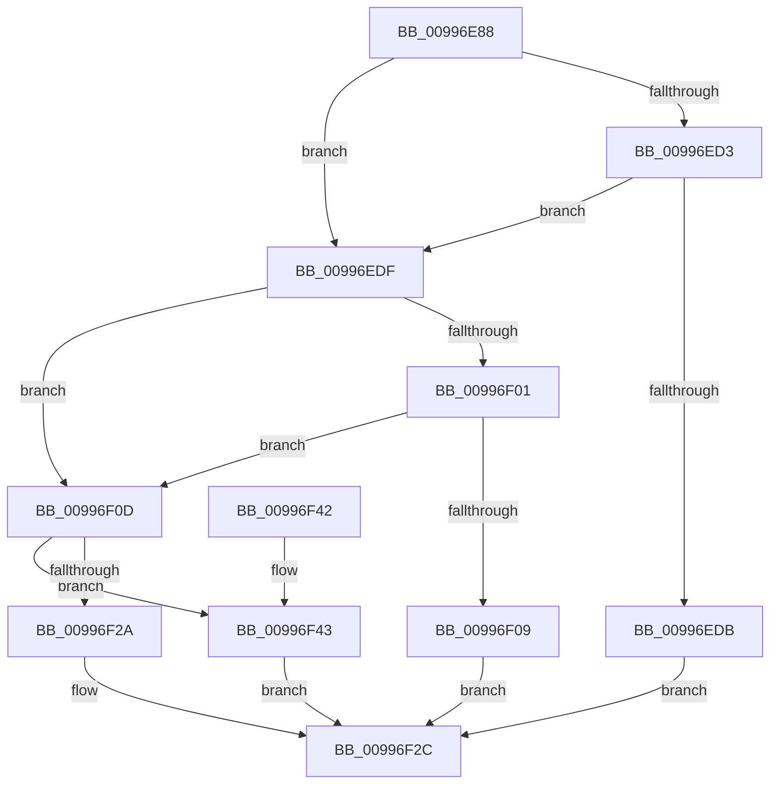

# IopGetRegistryValues

- RVA: `0x00996E88`–`0x00996F4F` (길이 `199` bytes)
- VA: `0x0000000140996E88`
- 실행 섹션: `PAGE`
- PDB 이름 있음: `예`; PDB Function 태그: `아니요`
- unwind 정보 RVA: `0x000992F8`
- 디코드: `56`개 명령, `199/199` bytes 표시
- 미해석 바이트: `0` (있으면 어셈블리에 `.byte`로 보존)

> 이 문서는 커널 이미지의 기계어와 PDB 기호를 분석해 생성했습니다. 4번과 5번은 함수 원형과 자료형을 바이너리 사용 방식에서 추정한 C 해석이며 원본 소스 복구 결과는 아닙니다.

## 1. Dependencies

- 직접 호출 지점: **3**; 고유 호출 대상: **1**
- 직접 호출자로 확인된 함수: **2**
- RIP 상대 이미지 참조: **3**

### Outgoing calls
- `0x00996EBE` → [IopGetRegistryValue](IopGetRegistryValue_function_009990EC.md) (function, `0x009990EC`)
- `0x00996EF2` → [IopGetRegistryValue](IopGetRegistryValue_function_009990EC.md) (function, `0x009990EC`)
- `0x00996F21` → [IopGetRegistryValue](IopGetRegistryValue_function_009990EC.md) (function, `0x009990EC`)

### Direct callers
- [pIoQueryDeviceDescription](../71/pIoQueryDeviceDescription_function_0071F10C.md) at `0x0071F2E4`
- [pIoQueryDeviceDescription](../71/pIoQueryDeviceDescription_function_0071F10C.md) at `0x0071F49A`
- [pIoQueryBusDescription](pIoQueryBusDescription_function_00996F58.md) at `0x009970F0`

### Static image references
- `0x00996EB0` → RVA `0x00AFC7E0` (` ?? ::NNGAKEGL::`string'`; read)
- `0x00996EE2` → RVA `0x00AFC7B0` (` ?? ::NNGAKEGL::`string'`; read)
- `0x00996F17` → RVA `0x00AFC780` (` ?? ::NNGAKEGL::`string'`; read)

## 2. Other-region calls and transfers

- 다른 실행 섹션으로 향하는 call: **0**
- 별도 외부 분기/꼬리 이동을 확인하지 못했습니다.

## 3. Assembly (complete function range)

```asm
00996E88  48 89 5C 24 08                  mov qword ptr [rsp + 8], rbx
00996E8D  48 89 74 24 10                  mov qword ptr [rsp + 0x10], rsi
00996E92  48 89 7C 24 18                  mov qword ptr [rsp + 0x18], rdi
00996E97  41 56                           push r14
00996E99  48 83 EC 20                     sub rsp, 0x20
00996E9D  33 DB                           xor ebx, ebx
00996E9F  48 8D 72 08                     lea rsi, [rdx + 8]
00996EA3  48 89 1A                        mov qword ptr [rdx], rbx
00996EA6  4C 8B CA                        mov r9, rdx
00996EA9  48 89 5A 10                     mov qword ptr [rdx + 0x10], rbx
00996EAD  48 8B F9                        mov rdi, rcx
00996EB0  48 8D 15 29 59 16 00            lea rdx, [rip + 0x165929]
00996EB7  48 89 1E                        mov qword ptr [rsi], rbx
00996EBA  44 8D 43 28                     lea r8d, [rbx + 0x28]
00996EBE  E8 29 22 00 00                  call 0x1409990ec
00996EC3  41 BE 00 00 00 80               mov r14d, 0x80000000
00996EC9  8B D0                           mov edx, eax
00996ECB  41 03 C6                        add eax, r14d
00996ECE  41 85 C6                        test r14d, eax
00996ED1  75 0C                           jne 0x140996edf
00996ED3  81 FA 34 00 00 C0               cmp edx, 0xc0000034
00996ED9  74 04                           je 0x140996edf
00996EDB  8B C2                           mov eax, edx
00996EDD  EB 4D                           jmp 0x140996f2c
00996EDF  4C 8B CE                        mov r9, rsi
00996EE2  48 8D 15 C7 58 16 00            lea rdx, [rip + 0x1658c7]
00996EE9  41 B8 24 00 00 00               mov r8d, 0x24
00996EEF  48 8B CF                        mov rcx, rdi
00996EF2  E8 F5 21 00 00                  call 0x1409990ec
00996EF7  8B C8                           mov ecx, eax
00996EF9  41 03 C6                        add eax, r14d
00996EFC  41 85 C6                        test r14d, eax
00996EFF  75 0C                           jne 0x140996f0d
00996F01  81 F9 34 00 00 C0               cmp ecx, 0xc0000034
00996F07  74 04                           je 0x140996f0d
00996F09  8B C1                           mov eax, ecx
00996F0B  EB 1F                           jmp 0x140996f2c
00996F0D  4C 8D 4E 08                     lea r9, [rsi + 8]
00996F11  41 B8 18 00 00 00               mov r8d, 0x18
00996F17  48 8D 15 62 58 16 00            lea rdx, [rip + 0x165862]
00996F1E  48 8B CF                        mov rcx, rdi
00996F21  E8 C6 21 00 00                  call 0x1409990ec
00996F26  85 C0                           test eax, eax
00996F28  78 19                           js 0x140996f43
00996F2A  33 C0                           xor eax, eax
00996F2C  48 8B 5C 24 30                  mov rbx, qword ptr [rsp + 0x30]
00996F31  48 8B 74 24 38                  mov rsi, qword ptr [rsp + 0x38]
00996F36  48 8B 7C 24 40                  mov rdi, qword ptr [rsp + 0x40]
00996F3B  48 83 C4 20                     add rsp, 0x20
00996F3F  41 5E                           pop r14
00996F41  C3                              ret
00996F42  CC                              int3
00996F43  3D 34 00 00 C0                  cmp eax, 0xc0000034
00996F48  0F 45 D8                        cmovne ebx, eax
00996F4B  8B C3                           mov eax, ebx
00996F4D  EB DD                           jmp 0x140996f2c
```

## 4. C-style interpretation (structured pseudocode)

```c
__int64 __fastcall IopGetRegistryValues(__int64 a1, __int64 a2)
{
    __int64 result;
    __int64 v_rbx;
    __int64 v_rsp;
    unsigned __int64 v_stack_p10;
    unsigned __int64 v_stack_p18;
    unsigned __int64 v_stack_p8;

    v_stack_p8 = v_rbx;
    v_stack_p10 = v_rsi;
    v_stack_p18 = v_rdi;
    v_rsp = (v_rsp) - (32);
    v_rbx = 0;
    *(unsigned __int64 *)(a2) = 0;
    *(unsigned __int64 *)(a2 + 16) = 0;
    *(unsigned __int64 *)(a2 + 8) = 0;
    result = IopGetRegistryValue(a1, v_rip + 1464617, v_rbx + 40, a2);
    result = (unsigned int)((result) + ((unsigned int)((unsigned int)(0x80000000ULL))));
    if ((((unsigned int)((unsigned int)(0x80000000ULL))) & ((unsigned int)(result))) != 0) goto loc_00996EDF;
    if (((unsigned int)((unsigned int)((unsigned int)(result)))) == 0xC0000034ULL) goto loc_00996EDF;
    goto loc_00996F2C;
loc_00996EDF:
    result = IopGetRegistryValue(a1, v_rip + 1464519, 36, a2 + 8);
    result = (unsigned int)((result) + ((unsigned int)((unsigned int)(0x80000000ULL))));
    if ((((unsigned int)((unsigned int)(0x80000000ULL))) & ((unsigned int)(result))) != 0) goto loc_00996F0D;
    if (((unsigned int)((unsigned int)((unsigned int)(result)))) == 0xC0000034ULL) goto loc_00996F0D;
    goto loc_00996F2C;
loc_00996F0D:
    result = IopGetRegistryValue(a1, v_rip + 1464418, 24, a2 + 8 + 8);
    if (sign_flag) goto loc_00996F43;
    result = 0;
loc_00996F2C:
    v_rsp = (v_rsp) + (32);
    return result;
loc_00996F43:
    v_rbx = v_stack_p8;
    if (0 != 0xC0000034ULL) { v_rbx = 0; }
    goto loc_00996F2C;
}
```

## 5. (Beta) C Style

```c
int64_t IopGetRegistryValues(int64_t Arg1, void *Arg2)
{
    uint8_t *arg2 = (uint8_t *)Arg2;

    int64_t result;
    int64_t local_rbx;
    int64_t local_rsp;
    uint64_t v_stack_p10;
    uint64_t v_stack_p18;
    uint64_t v_stack_p8;

    v_stack_p8 = local_rbx;
    v_stack_p10 = local_rsi;
    v_stack_p18 = local_rdi;
    local_rsp = (local_rsp) - (32);
    local_rbx = 0;
    *(uint64_t *)(arg2) = 0;
    *(uint64_t *)(arg2 + 0x10) = 0;
    *(uint64_t *)(arg2 + 0x8) = 0;
    result = IopGetRegistryValue(Arg1, v_rip + 1464617, local_rbx + 40, Arg2);
    result = (uint32_t)((result) + ((uint32_t)((uint32_t)(0x80000000ULL))));
    if ((((uint32_t)((uint32_t)(0x80000000ULL))) & ((uint32_t)(result))) != 0) goto loc_00996EDF;
    if (((uint32_t)((uint32_t)((uint32_t)(result)))) == 0xC0000034ULL) goto loc_00996EDF;
    goto loc_00996F2C;
loc_00996EDF:
    result = IopGetRegistryValue(Arg1, v_rip + 1464519, 36, Arg2 + 8);
    result = (uint32_t)((result) + ((uint32_t)((uint32_t)(0x80000000ULL))));
    if ((((uint32_t)((uint32_t)(0x80000000ULL))) & ((uint32_t)(result))) != 0) goto loc_00996F0D;
    if (((uint32_t)((uint32_t)((uint32_t)(result)))) == 0xC0000034ULL) goto loc_00996F0D;
    goto loc_00996F2C;
loc_00996F0D:
    result = IopGetRegistryValue(Arg1, v_rip + 1464418, 24, Arg2 + 8 + 8);
    if (sign_flag) goto loc_00996F43;
    result = 0;
loc_00996F2C:
    local_rsp = (local_rsp) + (32);
    return result;
loc_00996F43:
    local_rbx = v_stack_p8;
    if (0 != 0xC0000034ULL) { local_rbx = 0; }
    goto loc_00996F2C;
}
```

### 관측된 메모리 오프셋

구조체 형식이 확인되지 않은 접근은 인자 기준의 오프셋으로만 기록했습니다.

| 기준 인자 | 오프셋 표현 | 폭 (bit) | 접근 |
|---|---:|---:|---|
| `Arg2` | `+ 0x0` | `64` | `W` |
| `Arg2` | `+ 0x8` | `64` | `R` |
| `Arg2` | `+ 0x10` | `64` | `W` |

## 6. Execution-region graph

[열기: 2D/3D 그래프와 함수 탐색 컨트롤 패널](../../../control-panel.html?section=page&rva=0x00996E88&view=graph)

- 2D 그래프는 위에서 아래로 흐르고, 3D 그래프는 빈 공간을 드래그해 회전합니다. Shift+드래그는 이동, 휠은 확대·축소, 함수 노드 선택은 대상 보고서 이동입니다.

### Static fallback


