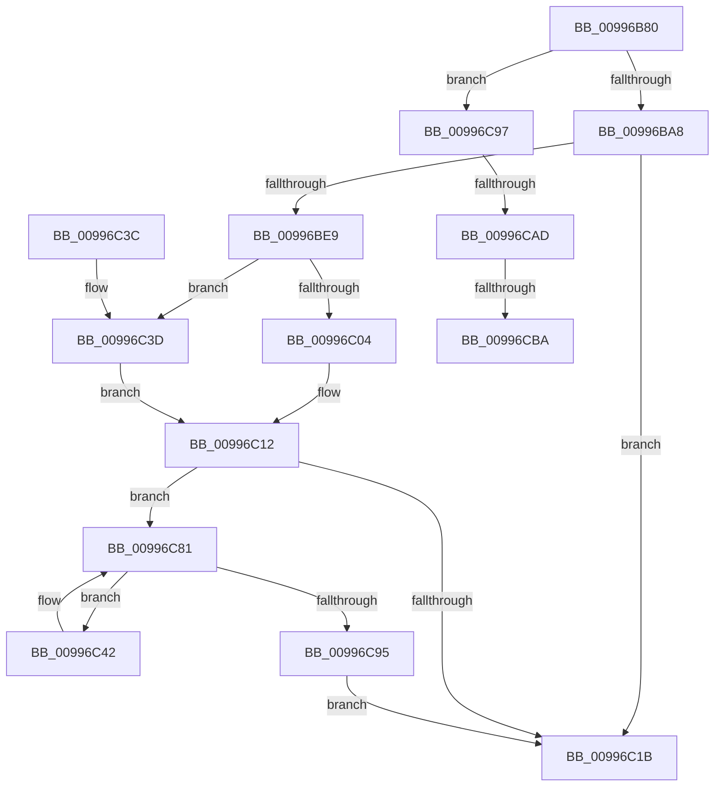

# IopLoadUnloadDriver

- RVA: `0x00996B80`–`0x00996CBF` (길이 `319` bytes)
- VA: `0x0000000140996B80`
- 실행 섹션: `PAGE`
- PDB 이름 있음: `예`; PDB Function 태그: `예`
- unwind 정보 RVA: `0x000992A0`
- 디코드: `86`개 명령, `319/319` bytes 표시
- 미해석 바이트: `0` (있으면 어셈블리에 `.byte`로 보존)

> 이 문서는 커널 이미지의 기계어와 PDB 기호를 분석해 생성했습니다. 4번과 5번은 함수 원형과 자료형을 바이너리 사용 방식에서 추정한 C 해석이며 원본 소스 복구 결과는 아닙니다.

## 1. Dependencies

- 직접 호출 지점: **10**; 고유 호출 대상: **9**
- 직접 호출자로 확인된 함수: **2**
- RIP 상대 이미지 참조: **2**

### Outgoing calls
- `0x00996BDE` → [ZwOpenKey](../../text/6A/ZwOpenKey_function_006AD310.md) (function, `0x006AD310`)
- `0x00996BF6` → [IopLoadDriver](IopLoadDriver_function_00997B54.md) (function, `0x00997B54`)
- `0x00996C27` → [KeSetEvent](../../text/33/KeSetEvent_function_0033F310.md) (function, `0x0033F310`)
- `0x00996C69` → [guard_dispatch_icall](../../text/6B/guard_dispatch_icall_function_006BAAD0.md) (function, `0x006BAAD0`)
- `0x00996C72` → [ObfDereferenceObject](../../text/2F/ObfDereferenceObject_function_002F9350.md) (function, `0x002F9350`)
- `0x00996C7C` → [ExFreePoolWithTag](../../poolcode/B8/ExFreePoolWithTag_function_00B82870.md) (function, `0x00B82870`)
- `0x00996C88` → [IopInterlockedRemoveHeadList](../../text/4B/IopInterlockedRemoveHeadList_function_004B4FB0.md) (function, `0x004B4FB0`)
- `0x00996C9B` → [guard_dispatch_icall](../../text/6B/guard_dispatch_icall_function_006BAAD0.md) (function, `0x006BAAD0`)
- `0x00996CA0` → [VfIsVerifierEnabled](../../text/4C/VfIsVerifierEnabled_function_004C72F0.md) (function, `0x004C72F0`)
- `0x00996CAD` → [DifIsPluginRunningWithoutReboot](../../text/61/DifIsPluginRunningWithoutReboot_function_0061A8EC.md) (function, `0x0061A8EC`)

### Direct callers
- [IopCompleteUnloadOrDelete](../../text/27/IopCompleteUnloadOrDelete_function_00270BC8.md) at `0x00270E4B`
- [IopLoadDriverImage](../../text/4F/IopLoadDriverImage_function_004FA0FC.md) at `0x004FA28A`

### Static image references
- `0x00996C12` → RVA `0x00E66101` (`.data`; read)
- `0x00996C81` → RVA `0x00F8D230` (`.data`; read)

## 2. Other-region calls and transfers

- 다른 실행 섹션으로 향하는 call: **9**
  - `0x00996BDE` → [ZwOpenKey](../../text/6A/ZwOpenKey_function_006AD310.md) (`PAGE` → `.text`)
  - `0x00996C27` → [KeSetEvent](../../text/33/KeSetEvent_function_0033F310.md) (`PAGE` → `.text`)
  - `0x00996C69` → [guard_dispatch_icall](../../text/6B/guard_dispatch_icall_function_006BAAD0.md) (`PAGE` → `.text`)
  - `0x00996C72` → [ObfDereferenceObject](../../text/2F/ObfDereferenceObject_function_002F9350.md) (`PAGE` → `.text`)
  - `0x00996C7C` → [ExFreePoolWithTag](../../poolcode/B8/ExFreePoolWithTag_function_00B82870.md) (`PAGE` → `POOLCODE`)
  - `0x00996C88` → [IopInterlockedRemoveHeadList](../../text/4B/IopInterlockedRemoveHeadList_function_004B4FB0.md) (`PAGE` → `.text`)
  - `0x00996C9B` → [guard_dispatch_icall](../../text/6B/guard_dispatch_icall_function_006BAAD0.md) (`PAGE` → `.text`)
  - `0x00996CA0` → [VfIsVerifierEnabled](../../text/4C/VfIsVerifierEnabled_function_004C72F0.md) (`PAGE` → `.text`)
  - `0x00996CAD` → [DifIsPluginRunningWithoutReboot](../../text/61/DifIsPluginRunningWithoutReboot_function_0061A8EC.md) (`PAGE` → `.text`)
- call이 아닌 외부 분기/꼬리 이동: **3**
  - `0x00996CA7` → [sub_00B2C55E](../B2/Unknown_function_00B2C55E.md) (`tail-transfer`)
  - `0x00996CB4` → [sub_00B2C55E](../B2/Unknown_function_00B2C55E.md) (`tail-transfer`)
  - `0x00996CBA` → [sub_00B2C55E + 0x9](../B2/Unknown_function_00B2C55E.md) (`tail-transfer`)

## 3. Assembly (complete function range)

```asm
00996B80  48 89 5C 24 18                  mov qword ptr [rsp + 0x18], rbx
00996B85  55                              push rbp
00996B86  56                              push rsi
00996B87  57                              push rdi
00996B88  48 8B EC                        mov rbp, rsp
00996B8B  48 83 EC 50                     sub rsp, 0x50
00996B8F  83 65 20 00                     and dword ptr [rbp + 0x20], 0
00996B93  48 8B F9                        mov rdi, rcx
00996B96  48 8B 49 38                     mov rcx, qword ptr [rcx + 0x38]
00996B9A  48 83 65 28 00                  and qword ptr [rbp + 0x28], 0
00996B9F  48 85 C9                        test rcx, rcx
00996BA2  0F 85 EF 00 00 00               jne 0x140996c97
00996BA8  21 4D EC                        and dword ptr [rbp - 0x14], ecx
00996BAB  4C 8D 45 D0                     lea r8, [rbp - 0x30]
00996BAF  48 21 4D D8                     and qword ptr [rbp - 0x28], rcx
00996BB3  0F 57 C0                        xorps xmm0, xmm0
00996BB6  48 8B 47 40                     mov rax, qword ptr [rdi + 0x40]
00996BBA  BA 19 00 02 00                  mov edx, 0x20019
00996BBF  48 C7 45 D0 30 00 00 00         mov qword ptr [rbp - 0x30], 0x30
00996BC7  21 4D D4                        and dword ptr [rbp - 0x2c], ecx
00996BCA  48 8D 4D 28                     lea rcx, [rbp + 0x28]
00996BCE  C7 45 E8 40 02 00 00            mov dword ptr [rbp - 0x18], 0x240
00996BD5  48 89 45 E0                     mov qword ptr [rbp - 0x20], rax
00996BD9  F3 0F 7F 45 F0                  movdqu xmmword ptr [rbp - 0x10], xmm0
00996BDE  E8 2D 67 D1 FF                  call 0x1406ad310
00996BE3  8B D8                           mov ebx, eax
00996BE5  85 C0                           test eax, eax
00996BE7  78 32                           js 0x140996c1b
00996BE9  48 8B 4D 28                     mov rcx, qword ptr [rbp + 0x28]
00996BED  4C 8D 4D 20                     lea r9, [rbp + 0x20]
00996BF1  45 33 C0                        xor r8d, r8d
00996BF4  B2 01                           mov dl, 1
00996BF6  E8 59 0F 00 00                  call 0x140997b54
00996BFB  8B D8                           mov ebx, eax
00996BFD  3D 65 03 00 C0                  cmp eax, 0xc0000365
00996C02  74 39                           je 0x140996c3d
00996C04  81 FB 8E 03 00 C0               cmp ebx, 0xc000038e
00996C0A  B8 34 00 00 C0                  mov eax, 0xc0000034
00996C0F  0F 44 D8                        cmove ebx, eax
00996C12  80 3D E8 F4 4C 00 00            cmp byte ptr [rip + 0x4cf4e8], 0
00996C19  75 66                           jne 0x140996c81
00996C1B  48 8D 4F 20                     lea rcx, [rdi + 0x20]
00996C1F  89 5F 48                        mov dword ptr [rdi + 0x48], ebx
00996C22  45 33 C0                        xor r8d, r8d
00996C25  33 D2                           xor edx, edx
00996C27  E8 E4 86 9A FF                  call 0x14033f310
00996C2C  48 8B 9C 24 80 00 00 00         mov rbx, qword ptr [rsp + 0x80]
00996C34  48 83 C4 50                     add rsp, 0x50
00996C38  5F                              pop rdi
00996C39  5E                              pop rsi
00996C3A  5D                              pop rbp
00996C3B  C3                              ret
00996C3C  CC                              int3
00996C3D  8B 5D 20                        mov ebx, dword ptr [rbp + 0x20]
00996C40  EB D0                           jmp 0x140996c12
00996C42  48 8B 4E 10                     mov rcx, qword ptr [rsi + 0x10]
00996C46  48 8B 51 30                     mov rdx, qword ptr [rcx + 0x30]
00996C4A  FF 42 10                        inc dword ptr [rdx + 0x10]
00996C4D  48 8B 4E 10                     mov rcx, qword ptr [rsi + 0x10]
00996C51  83 61 10 F7                     and dword ptr [rcx + 0x10], 0xfffffff7
00996C55  48 8B 4E 10                     mov rcx, qword ptr [rsi + 0x10]
00996C59  48 8B 46 18                     mov rax, qword ptr [rsi + 0x18]
00996C5D  48 8B 56 20                     mov rdx, qword ptr [rsi + 0x20]
00996C61  4C 8B 41 30                     mov r8, qword ptr [rcx + 0x30]
00996C65  45 8B 40 10                     mov r8d, dword ptr [r8 + 0x10]
00996C69  E8 62 3E D2 FF                  call 0x1406baad0
00996C6E  48 8B 4E 10                     mov rcx, qword ptr [rsi + 0x10]
00996C72  E8 D9 26 96 FF                  call 0x1402f9350
00996C77  33 D2                           xor edx, edx
00996C79  48 8B CE                        mov rcx, rsi
00996C7C  E8 EF BB 1E 00                  call 0x140b82870
00996C81  48 8D 0D A8 65 5F 00            lea rcx, [rip + 0x5f65a8]
00996C88  E8 23 E3 B1 FF                  call 0x1404b4fb0
00996C8D  48 8B F0                        mov rsi, rax
00996C90  48 85 C0                        test rax, rax
00996C93  75 AD                           jne 0x140996c42
00996C95  EB 84                           jmp 0x140996c1b
00996C97  48 8B 41 68                     mov rax, qword ptr [rcx + 0x68]
00996C9B  E8 30 3E D2 FF                  call 0x1406baad0
00996CA0  E8 4B 06 B3 FF                  call 0x1404c72f0
00996CA5  85 C0                           test eax, eax
00996CA7  0F 85 B1 58 19 00               jne 0x140b2c55e
00996CAD  E8 3A 3C C8 FF                  call 0x14061a8ec
00996CB2  84 C0                           test al, al
00996CB4  0F 85 A4 58 19 00               jne 0x140b2c55e
00996CBA  E9 A8 58 19 00                  jmp 0x140b2c567
```

## 4. C-style interpretation (structured pseudocode)

```c
__int64 __fastcall IopLoadUnloadDriver(__int64 a1)
{
    __int64 result;
    __int64 v_rbx;
    __int64 v_rsp;
    unsigned __int64 v_stack_m28;
    unsigned int v_stack_m2C;
    unsigned int v_stack_m30;
    unsigned __int64 v_stack_m38;
    unsigned __int64 v_stack_m40;
    unsigned int v_stack_m44;
    unsigned __int64 v_stack_m48;
    unsigned __int64 v_stack_p10;
    unsigned __int64 v_stack_p18;
    unsigned int v_stack_p8;

    v_stack_p18 = v_rbx;
    v_rsp = (v_rsp) - (80);
    if (*(unsigned __int64 *)(a1 + 56) != 0) goto loc_00996C97;
    v_stack_m48 = 48;
    v_stack_m30 = 576;
    v_stack_m38 = *(unsigned __int64 *)(a1 + 64);
    v_stack_m28 = v_xmm0;
    result = ZwOpenKey(v_stack_p10, (unsigned int)(0x20019ULL), v_stack_m48, a4);
    if (sign_flag) goto loc_00996C1B;
    a3 = 0;
    result = IopLoadDriver(v_stack_p10, 1, a3, v_stack_p8);
    if (((unsigned int)(result)) == 0xC0000365ULL) goto loc_00996C3D;
    v_rbx = (unsigned int)((unsigned int)(result));
    if (((unsigned int)((unsigned int)((unsigned int)(result)))) == 0xC000038EULL) { v_rbx = (unsigned int)((unsigned int)(0xC0000034ULL)); }
loc_00996C12:
    if ((*(unsigned __int8 *)(v_rip + 5043432)) != 0) goto loc_00996C81;
loc_00996C1B:
    *(unsigned int *)(a1 + 72) = (unsigned int)(v_rbx);
    a3 = 0;
    a2 = 0;
    result = KeSetEvent(a1 + 32, a2, a3, v_stack_p8);
    v_rsp = (v_rsp) + (80);
    return result;
loc_00996C3D:
    goto loc_00996C12;
loc_00996C42:
    result = guard_dispatch_icall(*(unsigned __int64 *)(v_rsi + 16), *(unsigned __int64 *)(v_rsi + 32), (unsigned int)(*(unsigned int *)(*(unsigned __int64 *)(*(unsigned __int64 *)(v_rsi + 16) + 48) + 16)), v_stack_p8);
    result = ObfDereferenceObject(*(unsigned __int64 *)(v_rsi + 16), *(unsigned __int64 *)(v_rsi + 32), (unsigned int)(*(unsigned int *)(*(unsigned __int64 *)(*(unsigned __int64 *)(v_rsi + 16) + 48) + 16)), v_stack_p8);
    a2 = 0;
    result = ExFreePoolWithTag(v_rsi, a2, (unsigned int)(*(unsigned int *)(*(unsigned __int64 *)(*(unsigned __int64 *)(v_rsi + 16) + 48) + 16)), v_stack_p8);
loc_00996C81:
    result = IopInterlockedRemoveHeadList(v_rip + 6251944, a2, (unsigned int)(*(unsigned int *)(*(unsigned __int64 *)(*(unsigned __int64 *)(v_rsi + 16) + 48) + 16)), v_stack_p8);
    if (result != 0) goto loc_00996C42;
    goto loc_00996C1B;
loc_00996C97:
    result = guard_dispatch_icall(v_rip + 6251944, a2, (unsigned int)(*(unsigned int *)(*(unsigned __int64 *)(*(unsigned __int64 *)(v_rsi + 16) + 48) + 16)), v_stack_p8);
    result = VfIsVerifierEnabled(v_rip + 6251944, a2, (unsigned int)(*(unsigned int *)(*(unsigned __int64 *)(*(unsigned __int64 *)(v_rsi + 16) + 48) + 16)), v_stack_p8);
    result = DifIsPluginRunningWithoutReboot(v_rip + 6251944, a2, (unsigned int)(*(unsigned int *)(*(unsigned __int64 *)(*(unsigned __int64 *)(v_rsi + 16) + 48) + 16)), v_stack_p8);
}
```

## 5. (Beta) C Style

```c
int64_t IopLoadUnloadDriver(void *Arg1)
{
    uint8_t *arg1 = (uint8_t *)Arg1;

    int64_t result;
    int64_t local_rbx;
    int64_t local_rsp;
    uint64_t v_stack_m28;
    uint32_t v_stack_m2C;
    uint32_t v_stack_m30;
    uint64_t v_stack_m38;
    uint64_t v_stack_m40;
    uint32_t v_stack_m44;
    uint64_t v_stack_m48;
    uint64_t v_stack_p10;
    uint64_t v_stack_p18;
    uint32_t v_stack_p8;

    v_stack_p18 = local_rbx;
    local_rsp = (local_rsp) - (80);
    if (*(uint64_t *)(arg1 + 0x38) != 0) goto loc_00996C97;
    v_stack_m48 = 48;
    v_stack_m30 = 576;
    v_stack_m38 = *(uint64_t *)(arg1 + 0x40);
    v_stack_m28 = v_xmm0;
    result = ZwOpenKey(v_stack_p10, (uint32_t)(0x20019ULL), v_stack_m48, a4);
    if (sign_flag) goto loc_00996C1B;
    a3 = 0;
    result = IopLoadDriver(v_stack_p10, 1, a3, v_stack_p8);
    if (((uint32_t)(result)) == 0xC0000365ULL) goto loc_00996C3D;
    local_rbx = (uint32_t)((uint32_t)(result));
    if (((uint32_t)((uint32_t)((uint32_t)(result)))) == 0xC000038EULL) { local_rbx = (uint32_t)((uint32_t)(0xC0000034ULL)); }
loc_00996C12:
    if ((*(uint8_t *)(v_rip + 0x4CF4E8)) != 0) goto loc_00996C81;
loc_00996C1B:
    *(uint32_t *)(arg1 + 0x48) = (uint32_t)(local_rbx);
    a3 = 0;
    a2 = 0;
    result = KeSetEvent(Arg1 + 32, a2, a3, v_stack_p8);
    local_rsp = (local_rsp) + (80);
    return result;
loc_00996C3D:
    goto loc_00996C12;
loc_00996C42:
    result = guard_dispatch_icall(*(uint64_t *)(local_rsi + 0x10), *(uint64_t *)(local_rsi + 0x20), (uint32_t)(*(uint32_t *)(*(uint64_t *)(*(uint64_t *)(local_rsi + 0x10) + 0x30) + 0x10)), v_stack_p8);
    result = ObfDereferenceObject(*(uint64_t *)(local_rsi + 0x10), *(uint64_t *)(local_rsi + 0x20), (uint32_t)(*(uint32_t *)(*(uint64_t *)(*(uint64_t *)(local_rsi + 0x10) + 0x30) + 0x10)), v_stack_p8);
    a2 = 0;
    result = ExFreePoolWithTag(local_rsi, a2, (uint32_t)(*(uint32_t *)(*(uint64_t *)(*(uint64_t *)(local_rsi + 0x10) + 0x30) + 0x10)), v_stack_p8);
loc_00996C81:
    result = IopInterlockedRemoveHeadList(v_rip + 6251944, a2, (uint32_t)(*(uint32_t *)(*(uint64_t *)(*(uint64_t *)(local_rsi + 0x10) + 0x30) + 0x10)), v_stack_p8);
    if (result != 0) goto loc_00996C42;
    goto loc_00996C1B;
loc_00996C97:
    result = guard_dispatch_icall(v_rip + 6251944, a2, (uint32_t)(*(uint32_t *)(*(uint64_t *)(*(uint64_t *)(local_rsi + 0x10) + 0x30) + 0x10)), v_stack_p8);
    result = VfIsVerifierEnabled(v_rip + 6251944, a2, (uint32_t)(*(uint32_t *)(*(uint64_t *)(*(uint64_t *)(local_rsi + 0x10) + 0x30) + 0x10)), v_stack_p8);
    result = DifIsPluginRunningWithoutReboot(v_rip + 6251944, a2, (uint32_t)(*(uint32_t *)(*(uint64_t *)(*(uint64_t *)(local_rsi + 0x10) + 0x30) + 0x10)), v_stack_p8);
}
```

### 관측된 메모리 오프셋

구조체 형식이 확인되지 않은 접근은 인자 기준의 오프셋으로만 기록했습니다.

| 기준 인자 | 오프셋 표현 | 폭 (bit) | 접근 |
|---|---:|---:|---|
| `Arg1` | `+ 0x20` | `64` | `R` |
| `Arg1` | `+ 0x38` | `64` | `R` |
| `Arg1` | `+ 0x40` | `64` | `R` |
| `Arg1` | `+ 0x48` | `32` | `W` |

## 6. Execution-region graph

[열기: 2D/3D 그래프와 함수 탐색 컨트롤 패널](../../../control-panel.html?section=page&rva=0x00996B80&view=graph)

- 2D 그래프는 위에서 아래로 흐르고, 3D 그래프는 빈 공간을 드래그해 회전합니다. Shift+드래그는 이동, 휠은 확대·축소, 함수 노드 선택은 대상 보고서 이동입니다.

### Static fallback


