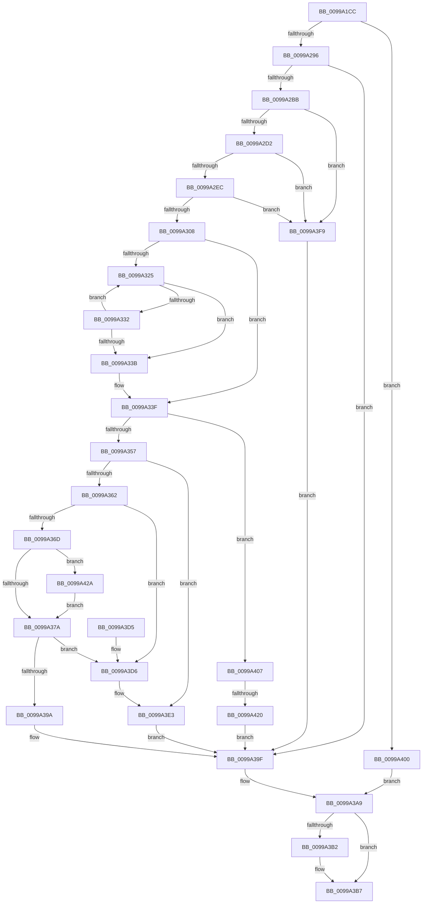

# IopQueryRegistryKeySystemPath

- RVA: `0x0099A1CC`–`0x0099A436` (길이 `618` bytes)
- VA: `0x000000014099A1CC`
- 실행 섹션: `PAGE`
- PDB 이름 있음: `예`; PDB Function 태그: `예`
- unwind 정보 RVA: `0x00099560`
- 디코드: `159`개 명령, `618/618` bytes 표시
- 미해석 바이트: `0` (있으면 어셈블리에 `.byte`로 보존)

> 이 문서는 커널 이미지의 기계어와 PDB 기호를 분석해 생성했습니다. 4번과 5번은 함수 원형과 자료형을 바이너리 사용 방식에서 추정한 C 해석이며 원본 소스 복구 결과는 아닙니다.

## 1. Dependencies

- 직접 호출 지점: **13**; 고유 호출 대상: **8**
- 직접 호출자로 확인된 함수: **2**
- RIP 상대 이미지 참조: **4**

### Outgoing calls
- `0x0099A258` → [RtlInitUnicodeString](../../text/42/RtlInitUnicodeString_function_0042A780.md) (function, `0x0042A780`)
- `0x0099A263` → [RtlInitUnicodeString](../../text/42/RtlInitUnicodeString_function_0042A780.md) (function, `0x0042A780`)
- `0x0099A26E` → [RtlInitUnicodeString](../../text/42/RtlInitUnicodeString_function_0042A780.md) (function, `0x0042A780`)
- `0x0099A285` → [ExAllocatePool2](../../poolcode/B8/ExAllocatePool2_function_00B820F0.md) (function, `0x00B820F0`)
- `0x0099A2AC` → [NtQueryObject](../8A/NtQueryObject_function_008A6DB0.md) (function, `0x008A6DB0`)
- `0x0099A2DF` → [RtlPrefixUnicodeString](../8F/RtlPrefixUnicodeString_function_008F4F70.md) (function, `0x008F4F70`)
- `0x0099A34A` → [RtlEqualUnicodeString](../93/RtlEqualUnicodeString_function_00932A20.md) (function, `0x00932A20`)
- `0x0099A38C` → [ExAllocatePool2](../../poolcode/B8/ExAllocatePool2_function_00B820F0.md) (function, `0x00B820F0`)
- `0x0099A3A4` → [ExFreePoolWithTag](../../poolcode/B8/ExFreePoolWithTag_function_00B82870.md) (function, `0x00B82870`)
- `0x0099A3B2` → [ExFreePool](../../poolcode/B8/ExFreePool_function_00B82850.md) (function, `0x00B82850`)
- `0x0099A3DE` → [RtlCopyUnicodeString](../../text/3F/RtlCopyUnicodeString_function_003FEF30.md) (function, `0x003FEF30`)
- `0x0099A3F2` → [RtlInitUnicodeString](../../text/42/RtlInitUnicodeString_function_0042A780.md) (function, `0x0042A780`)
- `0x0099A42C` → [ExFreePoolWithTag](../../poolcode/B8/ExFreePoolWithTag_function_00B82870.md) (function, `0x00B82870`)

### Direct callers
- [PiDrvDbResolveKeyFilePaths](../74/PiDrvDbResolveKeyFilePaths_function_0074326C.md) at `0x007432AB`
- [IopBuildFullDriverPath](IopBuildFullDriverPath_function_009998E4.md) at `0x0099999F`

### Static image references
- `0x0099A201` → RVA `0x00AFC8A0` (` ?? ::NNGAKEGL::`string'`; read)
- `0x0099A217` → RVA `0x00AFC880` (` ?? ::NNGAKEGL::`string'`; read)
- `0x0099A22D` → RVA `0x00AFC850` (` ?? ::NNGAKEGL::`string'`; read)
- `0x0099A2BB` → RVA `0x00FD9DD8` (`PAGEDATA`; read)

## 2. Other-region calls and transfers

- 다른 실행 섹션으로 향하는 call: **10**
  - `0x0099A258` → [RtlInitUnicodeString](../../text/42/RtlInitUnicodeString_function_0042A780.md) (`PAGE` → `.text`)
  - `0x0099A263` → [RtlInitUnicodeString](../../text/42/RtlInitUnicodeString_function_0042A780.md) (`PAGE` → `.text`)
  - `0x0099A26E` → [RtlInitUnicodeString](../../text/42/RtlInitUnicodeString_function_0042A780.md) (`PAGE` → `.text`)
  - `0x0099A285` → [ExAllocatePool2](../../poolcode/B8/ExAllocatePool2_function_00B820F0.md) (`PAGE` → `POOLCODE`)
  - `0x0099A38C` → [ExAllocatePool2](../../poolcode/B8/ExAllocatePool2_function_00B820F0.md) (`PAGE` → `POOLCODE`)
  - `0x0099A3A4` → [ExFreePoolWithTag](../../poolcode/B8/ExFreePoolWithTag_function_00B82870.md) (`PAGE` → `POOLCODE`)
  - `0x0099A3B2` → [ExFreePool](../../poolcode/B8/ExFreePool_function_00B82850.md) (`PAGE` → `POOLCODE`)
  - `0x0099A3DE` → [RtlCopyUnicodeString](../../text/3F/RtlCopyUnicodeString_function_003FEF30.md) (`PAGE` → `.text`)
  - `0x0099A3F2` → [RtlInitUnicodeString](../../text/42/RtlInitUnicodeString_function_0042A780.md) (`PAGE` → `.text`)
  - `0x0099A42C` → [ExFreePoolWithTag](../../poolcode/B8/ExFreePoolWithTag_function_00B82870.md) (`PAGE` → `POOLCODE`)
- call이 아닌 외부 분기/꼬리 이동: **1**
  - `0x0099A41A` → [sub_00B2CE30](../B2/Unknown_function_00B2CE30.md) (`tail-transfer`)

## 3. Assembly (complete function range)

```asm
0099A1CC  48 89 5C 24 08                  mov qword ptr [rsp + 8], rbx
0099A1D1  48 89 74 24 10                  mov qword ptr [rsp + 0x10], rsi
0099A1D6  55                              push rbp
0099A1D7  57                              push rdi
0099A1D8  41 55                           push r13
0099A1DA  41 56                           push r14
0099A1DC  41 57                           push r15
0099A1DE  48 8D 6C 24 C9                  lea rbp, [rsp - 0x37]
0099A1E3  48 81 EC B0 00 00 00            sub rsp, 0xb0
0099A1EA  33 C0                           xor eax, eax
0099A1EC  48 C7 45 D7 0C 00 0E 00         mov qword ptr [rbp - 0x29], 0xe000c
0099A1F4  48 89 45 27                     mov qword ptr [rbp + 0x27], rax
0099A1F8  0F 57 C0                        xorps xmm0, xmm0
0099A1FB  89 45 2F                        mov dword ptr [rbp + 0x2f], eax
0099A1FE  4C 8B F2                        mov r14, rdx
0099A201  48 8D 05 98 26 16 00            lea rax, [rip + 0x162698]
0099A208  48 C7 45 F7 18 00 1A 00         mov qword ptr [rbp - 9], 0x1a0018
0099A210  48 89 45 DF                     mov qword ptr [rbp - 0x21], rax
0099A214  48 8B D9                        mov rbx, rcx
0099A217  48 8D 05 62 26 16 00            lea rax, [rip + 0x162662]
0099A21E  48 C7 45 E7 26 00 28 00         mov qword ptr [rbp - 0x19], 0x280026
0099A226  48 89 45 FF                     mov qword ptr [rbp - 1], rax
0099A22A  0F 57 C9                        xorps xmm1, xmm1
0099A22D  48 8D 05 1C 26 16 00            lea rax, [rip + 0x16261c]
0099A234  45 33 FF                        xor r15d, r15d
0099A237  33 D2                           xor edx, edx
0099A239  48 89 45 EF                     mov qword ptr [rbp - 0x11], rax
0099A23D  49 8B CE                        mov rcx, r14
0099A240  4C 89 7D 7F                     mov qword ptr [rbp + 0x7f], r15
0099A244  0F 11 45 C7                     movups xmmword ptr [rbp - 0x39], xmm0
0099A248  44 89 7D 77                     mov dword ptr [rbp + 0x77], r15d
0099A24C  0F 11 4D B7                     movups xmmword ptr [rbp - 0x49], xmm1
0099A250  0F 11 45 07                     movups xmmword ptr [rbp + 7], xmm0
0099A254  0F 11 45 17                     movups xmmword ptr [rbp + 0x17], xmm0
0099A258  E8 23 05 A9 FF                  call 0x14042a780
0099A25D  33 D2                           xor edx, edx
0099A25F  48 8D 4D B7                     lea rcx, [rbp - 0x49]
0099A263  E8 18 05 A9 FF                  call 0x14042a780
0099A268  33 D2                           xor edx, edx
0099A26A  48 8D 4D C7                     lea rcx, [rbp - 0x39]
0099A26E  E8 0D 05 A9 FF                  call 0x14042a780
0099A273  BF 00 10 00 00                  mov edi, 0x1000
0099A278  41 B8 49 6F 20 20               mov r8d, 0x20206f49
0099A27E  8B D7                           mov edx, edi
0099A280  B9 00 01 00 00                  mov ecx, 0x100
0099A285  E8 66 7E 1E 00                  call 0x140b820f0
0099A28A  48 8B F0                        mov rsi, rax
0099A28D  48 85 C0                        test rax, rax
0099A290  0F 84 6A 01 00 00               je 0x14099a400
0099A296  48 8D 45 77                     lea rax, [rbp + 0x77]
0099A29A  44 8B CF                        mov r9d, edi
0099A29D  4C 8B C6                        mov r8, rsi
0099A2A0  48 89 44 24 20                  mov qword ptr [rsp + 0x20], rax
0099A2A5  41 8D 57 01                     lea edx, [r15 + 1]
0099A2A9  48 8B CB                        mov rcx, rbx
0099A2AC  E8 FF CA F0 FF                  call 0x1408a6db0
0099A2B1  8B D8                           mov ebx, eax
0099A2B3  85 C0                           test eax, eax
0099A2B5  0F 88 E4 00 00 00               js 0x14099a39f
0099A2BB  0F B7 3D 16 FB 63 00            movzx edi, word ptr [rip + 0x63fb16]
0099A2C2  45 8D 6F 02                     lea r13d, [r15 + 2]
0099A2C6  41 03 FD                        add edi, r13d
0099A2C9  66 39 3E                        cmp word ptr [rsi], di
0099A2CC  0F 82 27 01 00 00               jb 0x14099a3f9
0099A2D2  41 B0 01                        mov r8b, 1
0099A2D5  48 8D 0D FC FA 63 00            lea rcx, [rip + 0x63fafc]
0099A2DC  48 8B D6                        mov rdx, rsi
0099A2DF  E8 8C AC F5 FF                  call 0x1408f4f70
0099A2E4  84 C0                           test al, al
0099A2E6  0F 84 0D 01 00 00               je 0x14099a3f9
0099A2EC  48 8B 46 08                     mov rax, qword ptr [rsi + 8]
0099A2F0  45 8D 47 5C                     lea r8d, [r15 + 0x5c]
0099A2F4  8B CF                           mov ecx, edi
0099A2F6  48 D1 E9                        shr rcx, 1
0099A2F9  48 8D 14 48                     lea rdx, [rax + rcx*2]
0099A2FD  66 44 39 42 FE                  cmp word ptr [rdx - 2], r8w
0099A302  0F 85 F1 00 00 00               jne 0x14099a3f9
0099A308  0F B7 0E                        movzx ecx, word ptr [rsi]
0099A30B  66 2B CF                        sub cx, di
0099A30E  48 89 55 CF                     mov qword ptr [rbp - 0x31], rdx
0099A312  66 89 4D C9                     mov word ptr [rbp - 0x37], cx
0099A316  41 0F B7 FF                     movzx edi, r15w
0099A31A  66 44 89 7D C7                  mov word ptr [rbp - 0x39], r15w
0099A31F  66 44 3B F9                     cmp r15w, cx
0099A323  73 1A                           jae 0x14099a33f
0099A325  0F B7 C7                        movzx eax, di
0099A328  48 D1 E8                        shr rax, 1
0099A32B  66 44 39 04 42                  cmp word ptr [rdx + rax*2], r8w
0099A330  74 09                           je 0x14099a33b
0099A332  66 41 03 FD                     add di, r13w
0099A336  66 3B F9                        cmp di, cx
0099A339  72 EA                           jb 0x14099a325
0099A33B  66 89 7D C7                     mov word ptr [rbp - 0x39], di
0099A33F  41 B0 01                        mov r8b, 1
0099A342  48 8D 55 D7                     lea rdx, [rbp - 0x29]
0099A346  48 8D 4D C7                     lea rcx, [rbp - 0x39]
0099A34A  E8 D1 86 F9 FF                  call 0x140932a20
0099A34F  84 C0                           test al, al
0099A351  0F 84 B0 00 00 00               je 0x14099a407
0099A357  66 44 39 7D B7                  cmp word ptr [rbp - 0x49], r15w
0099A35C  0F 85 81 00 00 00               jne 0x14099a3e3
0099A362  BF 1A 00 00 00                  mov edi, 0x1a
0099A367  66 39 7D B9                     cmp word ptr [rbp - 0x47], di
0099A36B  73 69                           jae 0x14099a3d6
0099A36D  48 8B 4D BF                     mov rcx, qword ptr [rbp - 0x41]
0099A371  48 85 C9                        test rcx, rcx
0099A374  0F 85 B0 00 00 00               jne 0x14099a42a
0099A37A  0F B7 D7                        movzx edx, di
0099A37D  B9 00 01 00 00                  mov ecx, 0x100
0099A382  41 B8 49 6F 20 20               mov r8d, 0x20206f49
0099A388  66 89 7D B9                     mov word ptr [rbp - 0x47], di
0099A38C  E8 5F 7D 1E 00                  call 0x140b820f0
0099A391  48 89 45 BF                     mov qword ptr [rbp - 0x41], rax
0099A395  48 85 C0                        test rax, rax
0099A398  75 3C                           jne 0x14099a3d6
0099A39A  BB 9A 00 00 C0                  mov ebx, 0xc000009a
0099A39F  33 D2                           xor edx, edx
0099A3A1  48 8B CE                        mov rcx, rsi
0099A3A4  E8 C7 84 1E 00                  call 0x140b82870
0099A3A9  48 8B 4D BF                     mov rcx, qword ptr [rbp - 0x41]
0099A3AD  48 85 C9                        test rcx, rcx
0099A3B0  74 05                           je 0x14099a3b7
0099A3B2  E8 99 84 1E 00                  call 0x140b82850
0099A3B7  4C 8D 9C 24 B0 00 00 00         lea r11, [rsp + 0xb0]
0099A3BF  8B C3                           mov eax, ebx
0099A3C1  49 8B 5B 30                     mov rbx, qword ptr [r11 + 0x30]
0099A3C5  49 8B 73 38                     mov rsi, qword ptr [r11 + 0x38]
0099A3C9  49 8B E3                        mov rsp, r11
0099A3CC  41 5F                           pop r15
0099A3CE  41 5E                           pop r14
0099A3D0  41 5D                           pop r13
0099A3D2  5F                              pop rdi
0099A3D3  5D                              pop rbp
0099A3D4  C3                              ret
0099A3D5  CC                              int3
0099A3D6  48 8D 55 F7                     lea rdx, [rbp - 9]
0099A3DA  48 8D 4D B7                     lea rcx, [rbp - 0x49]
0099A3DE  E8 4D 4B A6 FF                  call 0x1403fef30
0099A3E3  0F 10 45 B7                     movups xmm0, xmmword ptr [rbp - 0x49]
0099A3E7  33 D2                           xor edx, edx
0099A3E9  48 8D 4D B7                     lea rcx, [rbp - 0x49]
0099A3ED  F3 41 0F 7F 06                  movdqu xmmword ptr [r14], xmm0
0099A3F2  E8 89 03 A9 FF                  call 0x14042a780
0099A3F7  EB A6                           jmp 0x14099a39f
0099A3F9  BB E5 00 00 C0                  mov ebx, 0xc00000e5
0099A3FE  EB 9F                           jmp 0x14099a39f
0099A400  BB 9A 00 00 C0                  mov ebx, 0xc000009a
0099A405  EB A2                           jmp 0x14099a3a9
0099A407  BA 26 00 00 00                  mov edx, 0x26
0099A40C  0F B7 CF                        movzx ecx, di
0099A40F  83 C2 04                        add edx, 4
0099A412  03 D1                           add edx, ecx
0099A414  81 FA FF FF 00 00               cmp edx, 0xffff
0099A41A  0F 86 10 2A 19 00               jbe 0x140b2ce30
0099A420  BB 05 00 00 80                  mov ebx, 0x80000005
0099A425  E9 75 FF FF FF                  jmp 0x14099a39f
0099A42A  33 D2                           xor edx, edx
0099A42C  E8 3F 84 1E 00                  call 0x140b82870
0099A431  E9 44 FF FF FF                  jmp 0x14099a37a
```

## 4. C-style interpretation (structured pseudocode)

```c
__int64 __fastcall IopQueryRegistryKeySystemPath(__int64 a1, __int64 a2)
{
    __int64 result;
    __int64 v_r15;
    __int64 v_rdi;
    __int64 v_rsp;
    unsigned __int64 v_stack_m28;
    unsigned int v_stack_m30;
    unsigned __int64 v_stack_m38;
    unsigned __int64 v_stack_m48;
    unsigned __int64 v_stack_m58;
    unsigned __int64 v_stack_m5F;
    unsigned __int64 v_stack_m60;
    unsigned __int64 v_stack_m68;
    unsigned __int64 v_stack_m70;
    unsigned __int64 v_stack_m78;
    unsigned __int64 v_stack_m80;
    unsigned __int64 v_stack_m88;
    unsigned __int64 v_stack_m90;
    unsigned __int16 v_stack_m96;
    unsigned __int64 v_stack_m98;
    unsigned __int64 v_stack_mA0;
    unsigned __int16 v_stack_mA6;
    unsigned __int64 v_stack_mA8;
    unsigned __int64 v_stack_mB8;
    unsigned __int64 v_stack_p10;
    unsigned int v_stack_p18;
    unsigned __int64 v_stack_p20;
    unsigned __int64 v_stack_p8;

    v_stack_p8 = v_rbx;
    v_stack_p10 = v_rsi;
    v_rsp = (v_rsp) - (176);
    result = 0;
    v_stack_m88 = 0xE000CULL;
    v_stack_m38 = 0;
    v_stack_m30 = 0;
    v_stack_m68 = 0x1A0018ULL;
    v_stack_m80 = v_rip + 1451672;
    v_stack_m78 = 0x280026ULL;
    v_stack_m60 = v_rip + 1451618;
    v_r15 = 0;
    a2 = 0;
    v_stack_m70 = v_rip + 1451548;
    v_stack_p20 = 0;
    v_stack_m98 = v_xmm0;
    v_stack_p18 = 0;
    v_stack_mA8 = v_xmm1;
    v_stack_m58 = v_xmm0;
    v_stack_m48 = v_xmm0;
    result = RtlInitUnicodeString(0, a2, a3, a4);
    a2 = 0;
    result = RtlInitUnicodeString(v_stack_mA8, a2, a3, a4);
    a2 = 0;
    result = RtlInitUnicodeString(v_stack_m98, a2, a3, a4);
    result = ExAllocatePool2(256, (unsigned int)((unsigned int)((unsigned int)(0x1000ULL))), (unsigned int)(0x20206F49ULL), a4);
    if (result == 0) goto loc_0099A400;
    v_stack_mB8 = v_stack_p18;
    result = NtQueryObject(a1, v_r15 + 1, result, (unsigned int)((unsigned int)((unsigned int)(0x1000ULL))));
    if (sign_flag) goto loc_0099A39F;
    v_rdi = (unsigned int)((*(unsigned __int16 *)(v_rip + 6552342)) + ((unsigned int)(v_r15 + 2)));
    if ((*(unsigned __int16 *)(result)) < ((unsigned __int16)(v_rdi))) goto loc_0099A3F9;
    result = RtlPrefixUnicodeString(v_rip + 6552316, result, 1, (unsigned int)((unsigned int)((unsigned int)(0x1000ULL))));
    if ((unsigned __int8)(result) == 0) goto loc_0099A3F9;
    a1 = ((unsigned int)((unsigned int)(v_rdi))) >> (1);
    if ((*(unsigned __int16 *)(*(unsigned __int64 *)(result + 8) + a1 * 2 - 2)) != ((unsigned __int16)(v_r15 + 92))) goto loc_0099A3F9;
    a1 = (unsigned __int16)((*(unsigned __int16 *)(result)) - ((unsigned __int16)(v_rdi)));
    v_stack_m90 = *(unsigned __int64 *)(result + 8) + a1 * 2;
    v_stack_m96 = (unsigned __int16)(a1);
    v_stack_m98 = 0;
    if (0 >= ((unsigned __int16)(a1))) goto loc_0099A33F;
loc_0099A325:
    result = (0) >> (1);
    if ((*(unsigned __int16 *)(*(unsigned __int64 *)(result + 8) + a1 * 2 + result * 2)) == ((unsigned __int16)(v_r15 + 92))) goto loc_0099A33B;
    v_rdi = (unsigned __int16)((0) + ((unsigned __int16)(v_r15 + 2)));
    if (((unsigned __int16)(v_rdi)) < ((unsigned __int16)(a1))) goto loc_0099A325;
loc_0099A33B:
    v_stack_m98 = (unsigned __int16)(v_rdi);
loc_0099A33F:
    result = RtlEqualUnicodeString(v_stack_m98, v_stack_m88, 1, (unsigned int)((unsigned int)((unsigned int)(0x1000ULL))));
    if ((unsigned __int8)(result) == 0) goto loc_0099A407;
    if (v_stack_mA8 != 0) goto loc_0099A3E3;
    if (v_stack_mA6 >= 26) goto loc_0099A3D6;
    if (v_stack_mA0 != 0) goto loc_0099A42A;
loc_0099A37A:
    v_stack_mA6 = 26;
    result = ExAllocatePool2(256, 26, (unsigned int)(0x20206F49ULL), (unsigned int)((unsigned int)((unsigned int)(0x1000ULL))));
    v_stack_mA0 = result;
    if (result != 0) goto loc_0099A3D6;
loc_0099A39F:
    a2 = 0;
    result = ExFreePoolWithTag(result, a2, (unsigned int)(0x20206F49ULL), (unsigned int)((unsigned int)((unsigned int)(0x1000ULL))));
loc_0099A3A9:
    if (v_stack_mA0 != 0) {
        result = ExFreePool(v_stack_mA0, a2, (unsigned int)(0x20206F49ULL), (unsigned int)((unsigned int)((unsigned int)(0x1000ULL))));
    }
    return (unsigned int)((unsigned int)((unsigned int)(0xC000009AULL)));
loc_0099A3D6:
    result = RtlCopyUnicodeString(v_stack_mA8, v_stack_m68, (unsigned int)(0x20206F49ULL), (unsigned int)((unsigned int)((unsigned int)(0x1000ULL))));
loc_0099A3E3:
    a2 = 0;
    *(unsigned __int64 *)(a2) = v_xmm0;
    result = RtlInitUnicodeString(v_stack_mA8, a2, (unsigned int)(0x20206F49ULL), (unsigned int)((unsigned int)((unsigned int)(0x1000ULL))));
    goto loc_0099A39F;
loc_0099A3F9:
    goto loc_0099A39F;
loc_0099A400:
    goto loc_0099A3A9;
loc_0099A407:
    a2 = (unsigned int)((38) + (4));
    a2 = (unsigned int)((a2) + (26));
    goto loc_0099A39F;
loc_0099A42A:
    a2 = 0;
    result = ExFreePoolWithTag(26, a2, (unsigned int)(0x20206F49ULL), (unsigned int)((unsigned int)((unsigned int)(0x1000ULL))));
    goto loc_0099A37A;
}
```

## 5. (Beta) C Style

```c
int64_t IopQueryRegistryKeySystemPath(int64_t Arg1, void *Arg2)
{
    uint8_t *arg2 = (uint8_t *)Arg2;

    int64_t result;
    int64_t local_r15;
    int64_t local_rdi;
    int64_t local_rsp;
    uint64_t v_stack_m28;
    uint32_t v_stack_m30;
    uint64_t v_stack_m38;
    uint64_t v_stack_m48;
    uint64_t v_stack_m58;
    uint64_t v_stack_m5F;
    uint64_t v_stack_m60;
    uint64_t v_stack_m68;
    uint64_t v_stack_m70;
    uint64_t v_stack_m78;
    uint64_t v_stack_m80;
    uint64_t v_stack_m88;
    uint64_t v_stack_m90;
    uint16_t v_stack_m96;
    uint64_t v_stack_m98;
    uint64_t v_stack_mA0;
    uint16_t v_stack_mA6;
    uint64_t v_stack_mA8;
    uint64_t v_stack_mB8;
    uint64_t v_stack_p10;
    uint32_t v_stack_p18;
    uint64_t v_stack_p20;
    uint64_t v_stack_p8;

    v_stack_p8 = local_rbx;
    v_stack_p10 = local_rsi;
    local_rsp = (local_rsp) - (176);
    result = 0;
    v_stack_m88 = 0xE000CULL;
    v_stack_m38 = 0;
    v_stack_m30 = 0;
    v_stack_m68 = 0x1A0018ULL;
    v_stack_m80 = v_rip + 1451672;
    v_stack_m78 = 0x280026ULL;
    v_stack_m60 = v_rip + 1451618;
    local_r15 = 0;
    Arg2 = 0;
    v_stack_m70 = v_rip + 1451548;
    v_stack_p20 = 0;
    v_stack_m98 = v_xmm0;
    v_stack_p18 = 0;
    v_stack_mA8 = v_xmm1;
    v_stack_m58 = v_xmm0;
    v_stack_m48 = v_xmm0;
    result = RtlInitUnicodeString(0, Arg2, a3, a4);
    Arg2 = 0;
    result = RtlInitUnicodeString(v_stack_mA8, Arg2, a3, a4);
    Arg2 = 0;
    result = RtlInitUnicodeString(v_stack_m98, Arg2, a3, a4);
    result = ExAllocatePool2(256, (uint32_t)((uint32_t)((uint32_t)(0x1000ULL))), (uint32_t)(0x20206F49ULL), a4);
    if (result == 0) goto loc_0099A400;
    v_stack_mB8 = v_stack_p18;
    result = NtQueryObject(Arg1, local_r15 + 1, result, (uint32_t)((uint32_t)((uint32_t)(0x1000ULL))));
    if (sign_flag) goto loc_0099A39F;
    local_rdi = (uint32_t)((*(uint16_t *)(v_rip + 0x63FB16)) + ((uint32_t)(local_r15 + 2)));
    if ((*(uint16_t *)(result)) < ((uint16_t)(local_rdi))) goto loc_0099A3F9;
    result = RtlPrefixUnicodeString(v_rip + 6552316, result, 1, (uint32_t)((uint32_t)((uint32_t)(0x1000ULL))));
    if ((uint8_t)(result) == 0) goto loc_0099A3F9;
    Arg1 = ((uint32_t)((uint32_t)(local_rdi))) >> (1);
    if ((*(uint16_t *)(*(uint64_t *)(result + 0x8) + Arg1 * 2 - 0x2)) != ((uint16_t)(local_r15 + 92))) goto loc_0099A3F9;
    Arg1 = (uint16_t)((*(uint16_t *)(result)) - ((uint16_t)(local_rdi)));
    v_stack_m90 = *(uint64_t *)(result + 0x8) + Arg1 * 2;
    v_stack_m96 = (uint16_t)(Arg1);
    v_stack_m98 = 0;
    if (0 >= ((uint16_t)(Arg1))) goto loc_0099A33F;
loc_0099A325:
    result = (0) >> (1);
    if ((*(uint16_t *)(*(uint64_t *)(result + 0x8) + Arg1 * 2 + result * 2)) == ((uint16_t)(local_r15 + 92))) goto loc_0099A33B;
    local_rdi = (uint16_t)((0) + ((uint16_t)(local_r15 + 2)));
    if (((uint16_t)(local_rdi)) < ((uint16_t)(Arg1))) goto loc_0099A325;
loc_0099A33B:
    v_stack_m98 = (uint16_t)(local_rdi);
loc_0099A33F:
    result = RtlEqualUnicodeString(v_stack_m98, v_stack_m88, 1, (uint32_t)((uint32_t)((uint32_t)(0x1000ULL))));
    if ((uint8_t)(result) == 0) goto loc_0099A407;
    if (v_stack_mA8 != 0) goto loc_0099A3E3;
    if (v_stack_mA6 >= 26) goto loc_0099A3D6;
    if (v_stack_mA0 != 0) goto loc_0099A42A;
loc_0099A37A:
    v_stack_mA6 = 26;
    result = ExAllocatePool2(256, 26, (uint32_t)(0x20206F49ULL), (uint32_t)((uint32_t)((uint32_t)(0x1000ULL))));
    v_stack_mA0 = result;
    if (result != 0) goto loc_0099A3D6;
loc_0099A39F:
    Arg2 = 0;
    result = ExFreePoolWithTag(result, Arg2, (uint32_t)(0x20206F49ULL), (uint32_t)((uint32_t)((uint32_t)(0x1000ULL))));
loc_0099A3A9:
    if (v_stack_mA0 != 0) {
        result = ExFreePool(v_stack_mA0, Arg2, (uint32_t)(0x20206F49ULL), (uint32_t)((uint32_t)((uint32_t)(0x1000ULL))));
    }
    return (uint32_t)((uint32_t)((uint32_t)(0xC000009AULL)));
loc_0099A3D6:
    result = RtlCopyUnicodeString(v_stack_mA8, v_stack_m68, (uint32_t)(0x20206F49ULL), (uint32_t)((uint32_t)((uint32_t)(0x1000ULL))));
loc_0099A3E3:
    Arg2 = 0;
    *(uint64_t *)(arg2) = v_xmm0;
    result = RtlInitUnicodeString(v_stack_mA8, Arg2, (uint32_t)(0x20206F49ULL), (uint32_t)((uint32_t)((uint32_t)(0x1000ULL))));
    goto loc_0099A39F;
loc_0099A3F9:
    goto loc_0099A39F;
loc_0099A400:
    goto loc_0099A3A9;
loc_0099A407:
    Arg2 = (uint32_t)((38) + (4));
    Arg2 = (uint32_t)((Arg2) + (26));
    goto loc_0099A39F;
loc_0099A42A:
    Arg2 = 0;
    result = ExFreePoolWithTag(26, Arg2, (uint32_t)(0x20206F49ULL), (uint32_t)((uint32_t)((uint32_t)(0x1000ULL))));
    goto loc_0099A37A;
}
```

### 관측된 메모리 오프셋

구조체 형식이 확인되지 않은 접근은 인자 기준의 오프셋으로만 기록했습니다.

| 기준 인자 | 오프셋 표현 | 폭 (bit) | 접근 |
|---|---:|---:|---|
| `Arg2` | `+ 0x0` | `128` | `W` |

## 6. Execution-region graph

[열기: 2D/3D 그래프와 함수 탐색 컨트롤 패널](../../../control-panel.html?section=page&rva=0x0099A1CC&view=graph)

- 2D 그래프는 위에서 아래로 흐르고, 3D 그래프는 빈 공간을 드래그해 회전합니다. Shift+드래그는 이동, 휠은 확대·축소, 함수 노드 선택은 대상 보고서 이동입니다.

### Static fallback


